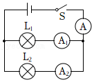
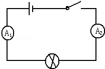
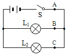
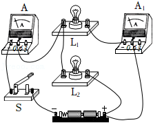
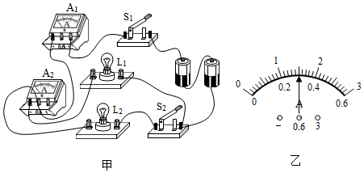

# 知识点·并联电路的电流规律．（同步练习）

> 教材：物理·九年级全一册·沪科技版2024新教材 ｜ 来源：国家中小学智慧教育平台·在线练习 ｜ 共 5 题

## 1. 单选题

如图所示，在探究“并联电路的电流规律”时，闭合开关\( S\)后，电流表\( A\)的示数是\( \text{0}\text{.}\text{6A}\)，电流表\( {A}_{1}\)的示数是\( \text{0}\text{.}\text{2A}\)，则电流表\( {A}_{2}\)的示数是（    ）．

- A. \( \text{0}\text{.}\text{2A}\)
- B. \( \text{0}\text{.}\text{3A}\)
- C. \( \text{0}\text{.}\text{4A}\)
- D. \( \text{0}\text{.}\text{6A}\)

【答案】C

【解析】​

## 2. 单选题

如图所示的电路，若电流表\( {A}_{1}\)、\( {A}_{2}\)都是好的，但当闭合开关以后，\( {A}_{1}\)的指针向右偏转的角度很大，\( {A}_{2}\)的指针向右偏转的角度很小，这可能是（    ）．

- A. 电流先通过\( {A}_{1}\)后再通过\( {A}_{2}\)，故\( {A}_{1}\)的示数大于\( {A}_{2}\)
- B. \( {A}_{2}\)的正、负接线柱接反了
- C. 通过\( {A}_{1}\)和\( {A}_{2}\)的电流不相等
- D. \( {A}_{2}\)所接的量程大于\( {A}_{1}\)所接的量程

【答案】D

【解析】​

## 3. 单选题（难度：适中）

如图所示，在探究并联电路中的电流关系时，小明同学用电流表测出\( A\)、\( B\)、\( C\)三处的电流分别为\( {I}_{A}=\text{0}\text{.}\text{5A}\)，\( {I}_{B}=\text{0}\text{.}\text{3A}\)，\( {I}_{C}=\text{0}\text{.}\text{2A}\)，在表格中记录数据后，下一步首先应该做的是（    ）．

- A. 整理器材，结束实验
- B. 换用不同规格的小灯泡，再测出几组电流值
- C. 分析数据，得出结论
- D. 换用电流表的另一量程，再测出一组电流值

【答案】B

【解析】​

## 4. 单选题（难度：简单）

如图所示的实验电路，闭合开关\( S\)后，电流表\( A\)的示数为\( \text{0}\text{.}\text{5A}\)，电流表\( {A}_{1}\)的示数为\( \text{0}\text{.}\text{3A}\)．则通过小灯泡\( {L}_{1}\)、\( {L}_{2}\)的电流分别是（    ）．

- A. \( \text{0}\text{.}\text{3A}\)，\( \text{0}\text{.}\text{2A}\)
- B. \( \text{0}\text{.}\text{2A}\)，\( \text{0}\text{.}\text{3A}\)
- C. \( \text{0}\text{.}\text{5A}\)，\( \text{0}\text{.}\text{3A}\)
- D. \( \text{0}\text{.}\text{5A}\)，\( \text{0}\text{.}\text{2A}\)

【答案】A

【解析】​

## 5. 多选题（难度：简单）

如图甲所示电路，闭合开关\( {S}_{1}\)、\( {S}_{2}\)时，灯泡\( {L}_{1}\)和\( {L}_{2}\)发光，电流表\( {A}_{1}\)、\( {A}_{2}\)的指针指在同一位置如图乙所示．下列说法中正确的是（    ）．

- A. 通过灯泡\( {L}_{2}\)的电流为\( \text{1}\text{.}\text{2A}\)
- B. 取下灯泡\( {L}_{2}\)，电流表\( {A}_{1}\)示数变为\( \text{0}\)
- C. 若某时刻只有灯泡\( {L}_{1}\)熄灭，原因可能是\( {L}_{1}\)被短路
- D. 若只断开开关\( {S}_{2}\)，电流表\( {A}_{2}\)仍然有示数

【答案】A/D

【解析】​
