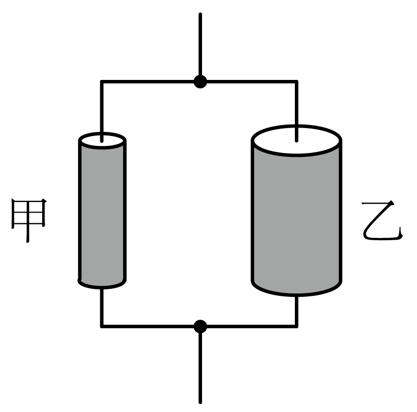
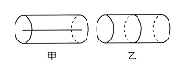
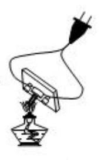
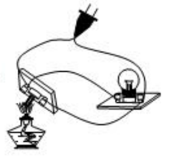
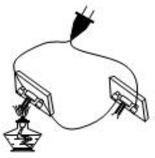
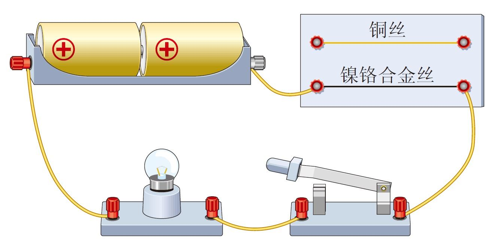
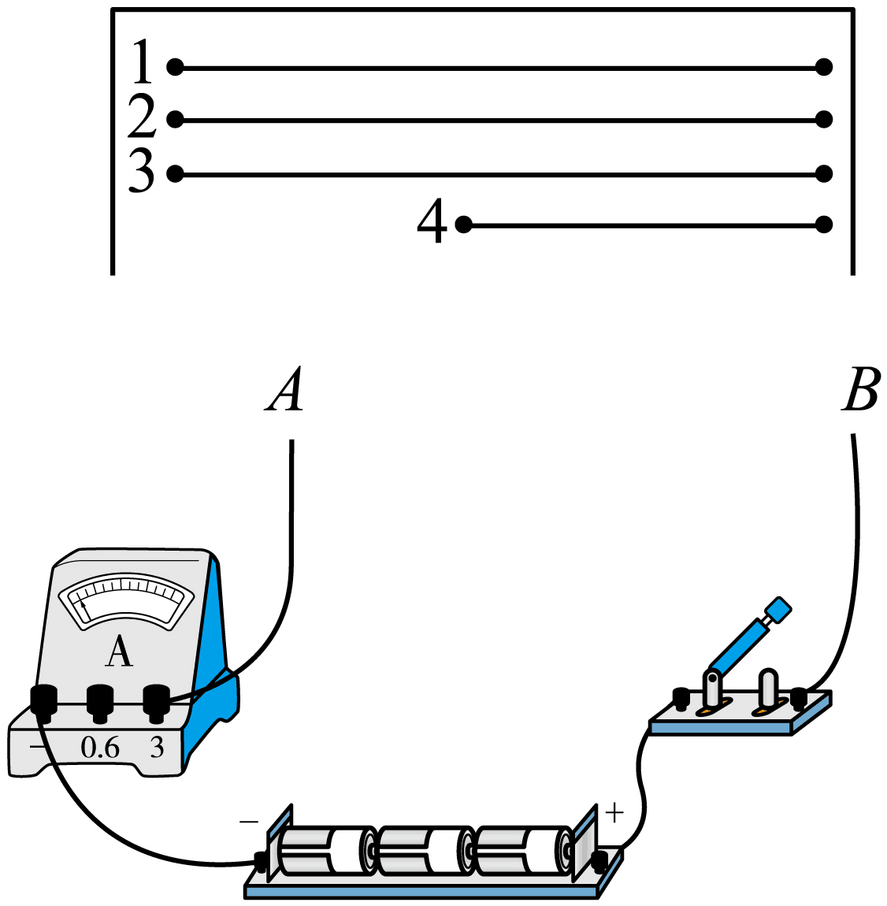
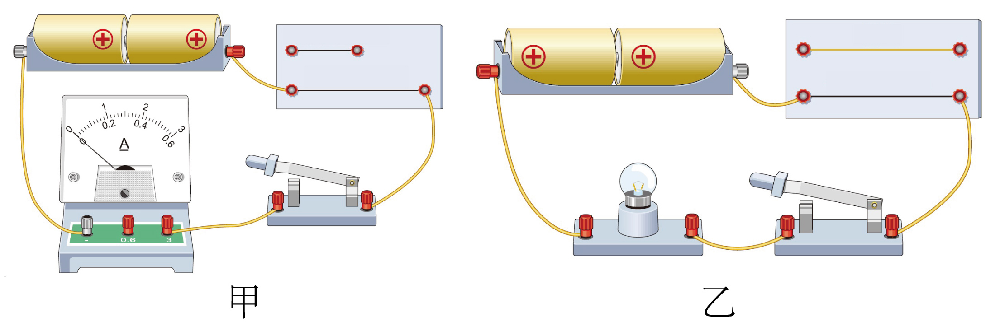
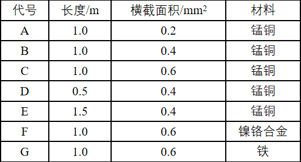

# 知识点·影响电阻大小的因素（同步练习）

> 教材：物理·九年级全一册·沪科技版2024新教材 ｜ 来源：国家中小学智慧教育平台·在线练习 ｜ 共 12 题

## 1. 单选题（难度：简单）

有一条电阻线，在其两端加10V电压时，测得电阻值为15Ω，如果在其两端加20V的电压，它的电阻为（　　）

- A. 0.5Ω
- B. 15Ω
- C. 0.05Ω
- D. 10Ω

【答案】B

【解析】​

## 2. 单选题（难度：适中）

有甲、乙、丙三根同种材料制成的导线，甲导线和乙导线长均为1m，乙导线粗些；乙导线和丙导线粗细相同，丙导线长为0.5m。则三根导线按电阻由大到小排列的应是（　　）

- A. 丙、乙、甲
- B. 甲、乙、丙
- C. 丙、甲、乙
- D. 甲、丙、乙

【答案】B

【解析】​

## 3. 单选题

一段粗细均匀的导线，长1m，电阻为R，先把它剪去一半，再将剩下的一半拉长到1m，此时它的电阻（　  ）

- A. 大于R
- B. 等于R
- C. 小于R
- D. 条件不足，无法判断

【答案】A

【解析】​

## 4. 单选题

如图所示，材料相同的甲、乙两金属棒长度相同，但乙的横截面积大，把它们并联在同一电路中，下列说法正确的是（　　）

- A. 甲的电阻大于乙的电阻
- B. 甲两端的电压大
- C. 甲的电阻小于乙的电阻
- D. 乙两端的电压大

【答案】A

【解析】​

## 5. 单选题（难度：简单）

中国青年科学家曹原在22岁时发现当两层平行石墨烯旋转成约1.1°的微妙角度时，再加入一定数量的电子，石墨烯的电阻突然变为零，此时的石墨烯是（　　）

- A. 绝缘体材料
- B. 超导体材料
- C. 半导体材料
- D. 纳米材料

【答案】B

【解析】​

## 6. 单选题（难度：简单）

如图所示，AB和BC是由同种材料制成的长度相同、横截面积不同的两段导体，将它们串联后连入电路中，这两段导体两端的电阻及通过它们的电流的大小关系正确的是（　　）
 

- A. RAB=RBC、IAB<IBC
- B. RAB=RBC、IAB=IBC
- C. RAB>RBC、IAB=IBC
- D. RAB>RBC、IAB<IBC

【答案】C

【解析】​

## 7. 单选题（难度：适中）

有一段导体，某同学为了使其接入电路的电阻增大，下列方法中正确的是（　　）

- A. 如甲图，沿轴线剖开，只取其中一半
- B. 如乙图，横切成两部分，只取其中一段
- C. 减小通过导体的电流
- D. 增大加在导体两端的电压

【答案】A

【解析】​

## 8. 单选题（难度：适中）

现代生产生活中需要各种各样的材料，下列说法正确的是（　　）

- A. 家庭电路中的导线是用半导体材料制成的
- B. 橡胶、铝、塑料都是很好的绝缘材料
- C. 用超导体材料可以制成性能优良的输电导线
- D. 有些半导体材料对光比较敏感，不能用来制造光敏电阻

【答案】C

【解析】​

## 9. 单选题

导体和绝缘体的划分不是绝对的，当条件改变时绝缘体也能变成导体，如在常温下是很好的绝缘体的玻璃在高温下就变成了导体．为了验证玻璃在加热烧红时也能导电，同学们利用白炽灯，灯丝已断的灯泡玻璃芯，酒精灯，插头，导线若干，设计了如图所示的四种方案，其中合理的是（　　）

- A. 
- B. 
- C. 
- D. 

【答案】C

【解析】​

## 10. 填空题（难度：简单）

如图所示，在探究影响电阻大小因素的实验中，小亮使用两根长度和横截面积都相同的铜丝和镍铬合金丝来做实验，实验电路中，（选填“可以”或“不可以”）用电流表替换小灯泡进行实验；这两种导线中适合做家庭电路电线的是。
 

【答案】不可以，铜丝

【解析】​

## 11. 填空题

做“决定电阻大小的因素”的实验，器材如图，其中1、3为锰铜丝，2、4为镍铬丝，它们中的第3根横截面积为2S，其它根横截面积为S。
（1）为了研究电阻与导体材料有关，应将导线先后接入电路A、B间；
（2）为了研究电阻与导体的长度有关，应将导线先后接入电路A、B两点间；
（3）为了研究电阻与导体的关系，应将导线1和导线3先后接入电路A、B两点间。实验的结论是：，导体的电阻越大。
 

【答案】1、2，2、4，横截面积，同种材料、长度相同的导体，横截面积越小

【解析】​

## 12. 填空题（难度：适中）

某小组同学在“探究影响导体电阻大小的因素”实验中，设计了如图甲、乙所示的电路，对导体电阻跟它的长度、横截面积、材料有关的猜想进行了实验检验。下表中给出了可供选择的几种导体，分别用A~G七个字母代表。  
 

 
 

 
（1）连接电路时开关S应处于（填“闭合”或“断开”）；
（2）为检验“导体电阻跟长度有关”的猜想，应选用三种导体；
（3）如图乙所示的电路是通过观察来判断电阻丝电阻的大小的；
（4）改进甲、乙两电路，使小灯泡与电流表串联，既可以，又可以。

【答案】断开，B、D、E，小灯泡的亮度 ，准确读出电流值，保护电路

【解析】​
