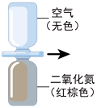
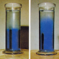
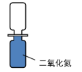
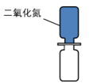
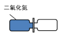
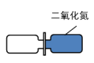
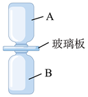
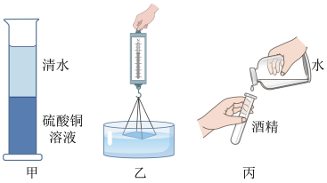
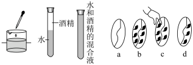

# 知识点·扩散（同步练习）

> 教材：物理·九年级全一册·沪科技版2024新教材 ｜ 来源：国家中小学智慧教育平台·在线练习 ｜ 共 6 题

## 1. 单选题（难度：简单）

如图所示，上、下两个广口瓶分别装有空气和二氧化氮气体，中间用玻璃板隔，抽去玻璃后（    ）．

- A. 二氧化氮向上方扩散，空气不会向下方扩散
- B. 空气向下方扩散，二氧化氮不会向上方扩散
- C. 当两种气体分布均匀后，分子就不会向上或向下运动了
- D. 当两种气体分布均匀后，分子仍会向上或向下不断运动

【答案】D

## 2. 单选题（难度：适中）

在量筒里装一半清水，用细管在水的下面注入密度比水大的硫酸铜水溶液．静放几天，界面就逐渐变得模糊不清了如图所示，如果静放足够长的时间后，下列说法正确的是（    ）．

- A. 水分子无法运动到量筒底部
- B. 液体会一直保持图乙所示状态
- C. 两种液体混合均匀后分子不再运动
- D. 液体温度升高可加快混合的速度

【答案】D

## 3. 单选题

将一个空瓶子和一个装有红棕色二氧化氮气体（\( {\rho }_{\mathrm{二}\mathrm{氧}\mathrm{化}\mathrm{氮}}>{\rho }_{\mathrm{空}\mathrm{气}}\)）的瓶子瓶口相对，中间用一块玻璃板隔开．抽开玻璃板后，通过观察瓶内颜色的变化推断气体分子是否做无规则运动．图中关于两个瓶子的放置方法，最合理的是（    ）．

- A. 
- B. 
- C. 
- D. 

【答案】A

## 4. 填空题（难度：简单）

用如图所示的装置演示气体扩散现象，其中1瓶装有密度比空气大的红棕色的二氧化氮气体，另一瓶装有空气．
​（1）装二氧化氮气体的应是（选填“\( A\)”或“\( B\)”）瓶．过一段时间后的现象是（用文字描述看到的现象）；
​（2）透过扩散现象的事实可以表明：；
​（3）若实验温度分别为①0℃，②4℃，③20℃，④30℃，则在（填序号）温度下气体扩散最快．

【答案】B     ，A瓶内出现红棕色气体，B瓶内的气体颜色会变淡     ，分子在永不停息地做无规则运动    ，$ \text{④}$ 

## 5. 填空题（难度：适中）

如图所示的实验，是我们在学习分子动理论时做过的一些实验：
图甲：浓硫酸铜溶液与清水开始界面十分清晰，几天之后，两种液体混合均匀了；
图乙：玻璃板的下表面接触水面，发现拉力示数大于玻璃板的重力；
图丙：水和酒精充分混合后的总体积小于混合前水和酒精的总体积．

      
​（1）图甲说明了：．
​（2）图乙说明了：．
​（3）图丙说明了：．

【答案】一切物质的分子都在不停的做无规则运动，分子间存在引力，分子间存在间隙

## 6. 填空题

如图所示，根据分子运动理论回答：

     
​（1）墨水滴在水中散开，说明；
​（2）在一端开口的玻璃管内装有一半的酒精，再沿管壁慢慢地注入带颜色的水，这时可以清楚地看见水和酒精的分界面，然后堵住管口，上下颠倒几次，使水和酒精充分混合，可以看见混合液体体积减小了，这说明．
​（3）如图所示，\( a\)是一个铁丝圈，中间较松弛的系着一根棉线，图中是浸过肥皂水的铁丝网，图\( c\)表示用手指轻碰一下棉线的左边，图\( d\)表示棉线左边的肥皂膜破了，棉线被拉向右边，这个实验说明了．

【答案】分子在不停地做无规则运动，分子间存在间隙，分子间存在引力
