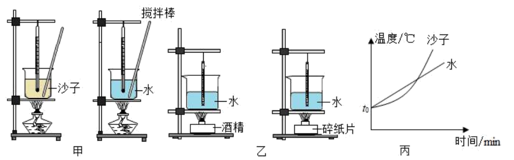
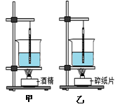
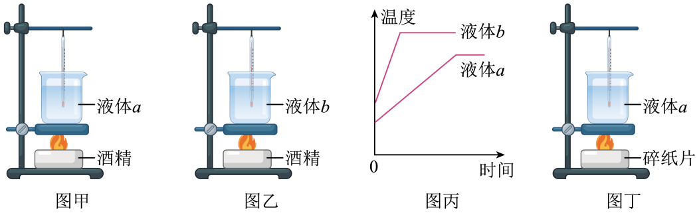

# 知识点·放热能力（同步练习）

> 教材：物理·九年级全一册·沪科技版2024新教材 ｜ 来源：国家中小学智慧教育平台·在线练习 ｜ 共 3 题

## 1. 填空题（难度：适中）

小明同学探究了“不同物质吸热升温的现象”，同时又探究了“不同燃料燃烧的放热能力”，他设计了两组实验装置如图所示．

    
​（1）探究“不同燃料燃烧的放热能力”应选用实验（甲/乙）；
​（2）用来反映物质吸热多少的方法，甲图实验是通过比较 ，乙图实验是通过比较；
​（3）除了图中已经呈现的器材，两个实验都还要用到的测量工具是 ；
​（4）图丙是根据甲图实验记录的数据所画出的温度随时间变化图像，由图像可知，该实验操作存在的问题是．

【答案】乙  ，加热时间，升高的温度，天平，沙子受热不均匀

## 2. 填空题（难度：简单）

如图在“比较质量相等的不同燃料燃烧时放出的热量”实验中，小华实验组选用碎纸片和酒精为燃料进行了实验：
​（1）实验除了温度计，还需要的测量工具是；
​（2）烧杯中液体的种类（选填“相同”或“不同”）质量（选填“相等”或“可以不等”）；
​（3）燃料完全燃烧后，图甲的温度计示数升高较多，则（选填“酒精”或“碎纸片”）放出的热量更多；
​（4）酒精完全燃烧后，将\( \text{500g}\)水的温度从\( \text{20°C}\)升高至\( \text{70°C}\)，则水吸收的热量为 \( \text{J}\)．[\( {c}_{\text{水}}=4200\text{J/(kg·}\text{℃}\text{)}\)]

【答案】托盘天平，相同，相等，酒精，105000

## 3. 填空题

在探究“观察液体的沸腾”实验中，将质量相同的\( a\)、\( b\)两种液体分别倒入相同容器中，用相同的热源加热，如图甲、乙所示．每隔相同时间，测量液体的温度，并绘制出温度随时间变化的图像，如图丙所示．

     
​（1）由丙图可知：液体沸腾时需要吸热，但保持不变．
​（2）由丙图可知：与液体\( b\)比较，液体\( a\)的 大， 低．（填物质的物理属性）
​（3）图丁装置和液体质量与甲、乙完全相同，为探究不同燃料燃烧时放出的热量与燃料种类的关系，应将图丁与图 所示实验相比较．
​（4）在题​（3）实验中，应取质量 （选填“相等”或“不相等”）的酒精和碎纸片．实验时，小明同时点燃两种燃料加热液体，当其中一种燃料先熄灭时，测出两种燃料加热的液体升高的温度，老师认为小明的实验操作是错误的，你认为错误的原因是：．

【答案】温度，比热容，沸点，甲  ，相等，两种燃料未全部完全燃烧
