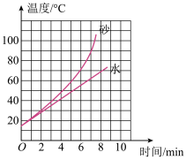
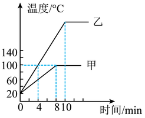
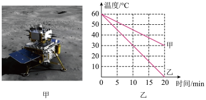
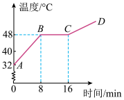
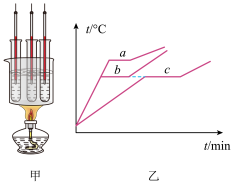
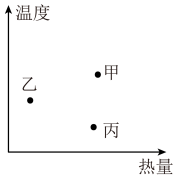

# 知识点·比热容图像（同步练习）

> 教材：物理·九年级全一册·沪科技版2024新教材 ｜ 来源：国家中小学智慧教育平台·在线练习 ｜ 共 6 题

## 1. 单选题（难度：适中）

某研究小组在做“比较不同物质吸热的情况”的实验中，利用相同规格的电加热器给相同质量的水和砂加热（不计热损失），用取得的实验数据做出如图所示的图像，对该图像下列说法正确的是（    ）．

- A. 吸收同样的热，砂升高温度少，表明砂的吸热本领比水强
- B. 吸收同样的热，水升高温度少，表明水的吸热本领比砂强
- C. 相同质量的水和砂同时加热，水温度先到达\( \text{60}\text{℃}\)
- D. 相同质量的水和砂同时加热，同时到达\( \text{60}\text{℃}\)

【答案】B

## 2. 单选题（难度：简单）

用相同的燃料分别对质量相等的甲、乙两种液体加热（不计热量损失）．如图所示是甲、乙的温度随加热时间变化的图像，下列说法中正确的是（    ）．

- A. 沸腾前，升高相同温度，甲吸收的热量较多
- B. \( \text{4~8min}\)，甲的内能在减小
- C. 乙内能增大时，温度一定升高
- D. 甲、乙的比热容之比为\( \text{2}\text{∶}\text{3}\)

【答案】A

## 3. 单选题

2020 年 12 月 17 日，嫦娥5 号凯旋归来，圆满实现中国探月工程“绕、落、回”的三步走发展目标．图甲所示，嫦 5 在月球上成功进行了月壤钻掘打包、地外天体起飞、深空无人对接的多个世界级科研实验．月壤快递到家后，假如用质量均为 1g的地岩甲和样品月岩乙进行对比实验，如图乙是这两种岩石温度随放热时间变化的图像，若它们在相同的时间内放出的热量相等，已知\({c}_{\text{甲}}=2.1\times {10}^{3}\text{ J/}\left ( {\text{kg}\cdot \text{℃}} \right )\)，下列说法正确的是（    ）．

- A. 机械臂在钻掘时，主要是以热传递的方式改变了月壤的内能
- B. 因月表没有空气阻力，嫦娥5号火箭发动机可以把内能全部转化为机械能
- C. \( \text{1g}\)地岩甲在 \( \text{20min}\) 内放出的热量为 \( 6.3\times {10}^{3}\text{J}\)
- D. 月岩乙的比热容为\(1.05\times {10}^{3}\text{J/}\left ( {\text{kg}\cdot \text{℃}} \right )\)

【答案】D

## 4. 单选题（难度：简单）

如图所示是某物质加热熔化过程中温度随时间变化的图像，关于该图像，下列判断正确的是（    ）．

- A. 该图像可能是沥青熔化时温度随时间变化的图像
- B. \( AB\)段说明：物质温度升高，该物质的熔点也随之升高
- C. \( BC\)段温度不变，内能也不变
- D. 该物质液态时的比热容大于固态时的比热容

【答案】D

## 5. 单选题

如图甲所示，在三个相同的试管中分别装入两种固态物质中的其中一种物质，再将它们放入装有水的烧杯中加热熔化．绘制出温度随时间变化的熔化图像，如图乙所示．关于试管中加热前的固态物质，下列判断正确的是（    ）． 

- A. 试管\( a\)和\( b\)中物质的质量相同
- B. 试管\( a\)和\( b\)中物质的比热容相同
- C. 试管\( b\)和\( c\)中物质的质量相同
- D. 试管\( b\)和\( c\)中物质的比热容相同

【答案】D

## 6. 单选题（难度：适中）

现有甲、乙、丙三种初温度相同的液体，其中甲、乙为质量相等的不同液体，乙、丙为质量不等的同种液体．若对这三种液体分别加热，则可根据它们吸收的热量和升高的温度，在温度﹣热量图象上分别画出对应的三点甲、乙、丙，如图所示，由此图得出下列结论中正确的是（    ）．

- A. 丙的质量比甲的质量大
- B. 丙的质量比甲的质量小
- C. 丙的比热容比甲的比热容大
- D. 无法判断

【答案】A
