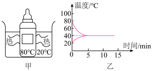
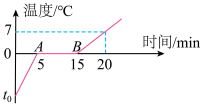
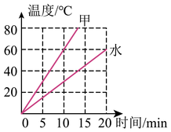

# 知识点·比热容简单计算（同步练习）

> 教材：物理·九年级全一册·沪科技版2024新教材 ｜ 来源：国家中小学智慧教育平台·在线练习 ｜ 共 3 题

## 1. 填空题（难度：简单）

如图甲所示，小明同学用水冷却牛奶，将盛着牛奶的密闭容器浸在质量为\( \text{2kg}\)的水中，牛奶的内能是通过（选填“做功”或“热传递”）的方式减小的．小明根据观察的数据绘制了牛奶、水的温度随时间变化的图像，如图乙所示，则水吸收的热量是 \( \text{J}\)．[\({c}_{\text{水}}=4.2\times {10}^{3}\text{J/}\left ( {\text{kg}\cdot \text{℃}} \right )\)]

【答案】热传递 ，$ 1.68\times {10}^{5}$

## 2. 填空题（难度：适中）

如图所示是冰的熔化图像，若在此过程中单位时间内吸收的热量恒定，水的比热容是冰的\( \text{2}\)倍．则由\( A\to B\)的过程中，冰水混合物需要热量，内能．冰的初温\( {t}_{0}=\)  \( \text{℃}\)．

【答案】吸收     ，增加     ，$ \text{-}\text{14}$ 

## 3. 填空题

用两个相同的加热器给物质甲和水加热，它们的温度随时间变化的关系如图所示，已知物质甲和水的质量之比为2∶3，据此判断物质甲的比热容为 \(\text{J/}\left ( {\text{kg}\cdot \text{℃}} \right )\)．[\({c}_{\text{水}}=4.2\times {10}^{3}\text{J/}\left ( {\text{kg}\cdot \text{℃}} \right )\)，不计热量损失]

【答案】$ 3.15\times {10}^{3}$    
