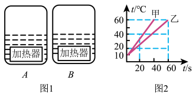
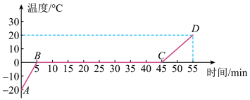

# 知识点·比热容计算（同步练习）

> 教材：物理·九年级全一册·沪科技版2024新教材 ｜ 来源：国家中小学智慧教育平台·在线练习 ｜ 共 6 题

## 1. （难度：简单）

质量为\( \text{500g}\)的金属块，温度从\( \text{100}\text{℃}\)降低到\( \text{20}\text{℃}\)共放出了\( \text{3.52}\text{×}{10}^{4}\text{J}\)的热量，求：金属块的比热容\( c\)．

【答案】

由题知，金属块降低的温度

$ \Delta t=t-{t}_{0}=\text{100}\text{℃}-\text{20}\text{℃}\text{=}\text{80}\text{℃}$   

根据$ {Q}_{\text{放}}=cm\Delta t$可得，该金属块的比热容为

$ c=\frac{{Q}_{\text{放}}}{m\Delta t}=\frac{\text{3}\text{.}\text{52}\text{×}\text{1}{\text{0}}^{\text{4}}\text{J}}{\text{0}\text{.}\text{5kg}\text{×}\text{80}\text{℃}}=0.88\times 1{0}^{3}\text{J/}\left(\text{kg}\cdot \mathrm{℃}\right)$   

答：金属块的比热容为$ 0.88\times 1{0}^{3}\text{J/}\left(\text{kg}\cdot \mathrm{℃}\right)$．

## 2. （难度：简单）

质量\( \text{500g}\)、温度\( \text{100}\text{℃}\)的某金属块，当温度降低到\( \text{20}\text{℃}\)时，放出\( \text{1.84}\text{×}\text{1}{\text{0}}^{\text{4}}\text{J}\)的热量，该金属块的比热容是多少？可能是哪种金属？

 
 
 
 物质

 
 
 比热容\( c\)/\(\text{J}\cdot \left ( {\text{kg}\cdot ℃} \right )^{\text{-1}}\)

 
 

 
 
 铝

 
 
 \( \text{0.88}\text{×}{\text{10}}^{\text{3}}\) 

 
 

 
 
 铁、钢

 
 
 \( \text{0.46}\text{×}{\text{10}}^{\text{3}}\) 

 
 

 
 
 铜

 
 
 \( \text{0.39}\text{×}{\text{10}}^{\text{3}}\) 

 
 

 
 
 铅

 
 
 \( \text{0.13}\text{×}{\text{10}}^{\text{3}}\) 

 
 

 

​

【答案】

解：由题可知该金属的比热容为

$c=\frac {{Q}_{\text{放}}} {m∆t}=\frac {\text{1}\text{.}\text{84}\text{×}{\text{10}}^{\text{4}}\text{J}} {\text{0}\text{.}\text{5}\text{kg}\text{×（}\text{100}\text{℃}-\text{20}\text{℃）}}=\text{0.46}\text{×}{\text{10}}^{\text{3}}\text{J/}\left ( {\text{kg}\cdot ℃} \right )$<em><em> </em></em>

由表格可知该金属可能是铁、钢．

答：该金属块的比热容是$\text{0.46}\text{×}{\text{10}}^{\text{3}}\text{J/}\left ( {\text{kg}\cdot ℃} \right )$，可能是铁、钢．

## 3. （难度：适中）

吃早饭的时候，妈妈用热水给小雪加热如下图所示的袋装牛奶，为了使这袋牛奶的温度由\( \text{12}\text{℃}\)升高到\( \text{42}\text{℃}\)，妈妈至少要用\( \text{60}\text{℃}\)的热水多少千克？[水的比热容为\(4.2\times {10}^{3}\text{J/}\left ( {\text{kg}\cdot \text{℃}} \right )\)），设该牛奶的比热容为\(2.5\times {10}^{3}\text{J/}\left ( {\text{kg}\cdot \text{℃}} \right )\)，不计热量损失]

【答案】

解：由题意和图可知，牛奶的质量

$ {m}_{\text{奶}}=\text{250g}=0.25\text{kg}$  

牛奶从$ \text{12}\text{℃}$升高到$ \text{42}\text{℃}$需要吸收的热量

$ {Q}_{\text{吸}}={c}_{\text{奶}}{m}_{\text{奶}}\Delta {t}_{\text{奶}}=2.5\times 1{0}^{3}\text{J/}(\text{kg}\cdot \mathrm{℃})\times 0.25\text{kg}\times (42\mathrm{℃}-12\mathrm{℃})=1.875\times 1{0}^{4}\text{J}$   

设水的质量为$ {m}_{\text{水}}$，则水从$ \text{60}\text{℃}$降到$ \text{42}\text{℃}$放出的热量

$ {Q}_{\text{放}}={c}_{\text{水}}{m}_{\text{水}}\Delta {t}_{\text{水}}=4.2\times 1{0}^{3}\text{J/}(\text{kg}\cdot \mathrm{℃})\times {m}_{\text{水}}\times (\text{60}\text{℃}-\text{42}\text{℃})$   

不计热量损失，由$ {Q}_{\text{吸}}={Q}_{\text{放}}$可得

$ 4.2\times 1{0}^{3}\text{J/}(\text{kg}\cdot \mathrm{℃})\times {m}_{\text{水}}\times (\text{60}\text{℃}-\text{42}\text{℃})=1.875\times 1{0}^{4}\text{J}$   

解得$ {m}_{\text{水}}\approx 0.248\text{kg}$

答：妈妈至少要用$ \text{60}\text{℃}$的热水约$ 0.248\text{kg}$．   

## 4. （难度：适中）

如图所示，\( A\)、\( B\)是两个底部装有完全相同的加热器的容器，加热器产生的热量\( \text{90\%}\)可以被容器中的液体吸收，已知加热器每秒钟放出热量为\( \text{1000J}\)．现将甲、乙（蓖麻油）两种液体分别倒入\( A\)、\( B\)杯中，其中甲液体的质量为\( \text{200g}\)，加热过程中甲、乙两种液体温度随加热时间的变化曲线如图所示．分析回答下列问题：

（1）加热\( \text{60s}\)时，乙吸收的热量；

（2）甲液体的比热容：

（3）蓖麻油的质量．[\({c}_{\text{蓖麻油}}=\text{1.8}\text{×}{\text{10}}^{\text{3}}\text{J/}\left ( {\text{kg}\cdot ℃} \right )\)]

【答案】

解：（1）加热$ \text{60s}$，乙吸收的热量为

${Q}_{\text{乙}}=1000\text{J}\times 60\text{s}\times 90\% =\text{5.4×}{\text{10}}^{\text{4}}\text{J}$    

（2）由图像可知，甲液体加热$ \text{20s}$温度从$ \text{10}\text{℃}$升高到$ \text{40}\text{℃}$，升高了$ \text{30}\text{℃}$，在这$ \text{20s}$内甲液体吸收的热量为:

${Q}_{\text{甲}}=1000\text{J}\times 20\text{s}\times 90\% =\text{1.8×}{\text{10}}^{\text{4}}\text{J}$  

甲液体的质量：$ {m}_{\text{甲}}=\text{200g=0}\text{.}\text{2kg}$

则甲液体的比热容为:

$ {c}_{\text{甲}}=\frac{{Q}_{\text{甲}}}{{m}_{\text{甲}}\Delta {t}_{\text{甲}}}=\frac{\text{1.8}\text{×}\text{1}{\text{0}}^{\text{4}}\text{J}}{\text{0.2kg}\text{×}\text{30}\text{℃}}=3\times 1{0}^{3}\text{J/}\left(\text{kg}\cdot \mathrm{℃}\right)$  

（3）由图可知，蓖麻油$ \text{60s}$内升高的温度为$ \text{50}\text{℃}$，蓖麻油的质量为

$ {m}_{\text{乙}}=\frac{{Q}_{\text{乙}}}{{c}_{\text{乙}}\Delta {t}_{\text{乙}}}=\frac{\text{5.4}\text{×}\text{1}{\text{0}}^{\text{4}}\text{J}}{\text{1.8}\text{×}\text{1}{\text{0}}^{\text{3}}\text{J/}\left(\text{kg}\text{⋅℃}\right)\text{×}\text{50}\text{℃}}=0.6\text{kg}$  

答：（1）加热$ \text{60s}$时，乙吸收的热量是$ \text{5.4×}{\text{10}}^{\text{4}}\text{J}$；（2）甲液体的比热容为$ 3\times 1{0}^{3}\text{J/}\left(\text{kg}\cdot \mathrm{℃}\right)$；

（3）蓖麻油的质量为$ 0.6\text{kg}$．

## 5. 

小红在实验室利用电加热器加热，完成了冰的熔化实验，并描绘出冰的温度随加热时间变化的关系图线（如图所示）．实验时，冰的质量为\( \text{0}\text{.}\text{5 kg}\)，相同时间内水和冰吸收的热量相同，水的比热容为\( 4.2\times 1{0}^{3}\text{J/}\left(\text{kg}\cdot \mathrm{℃}\right)\)．求：

（1）根据图线求\( CD\)段水吸收的热量；

（2）\( AB\)段冰吸收的热量；

（3）冰的比热容；

（4）冰在熔化过程中吸收的热量．

【答案】

解：（1）$ CD$段水吸收的热量

$ {Q}_{\text{吸}}={c}_{\text{水}}m({t}_{\text{水}}-{t}_{\text{0}\text{水}})=4.2\times 1{0}^{3}\text{J/}\left(\text{kg}\cdot \mathrm{℃}\right)\times \text{0.5kg}\times \left(\text{20}\text{℃}-\text{0}\text{℃}\right)=4.2\times {10}^{4}\text{J}$   

（2）$ AB$段冰吸热时间为$ CD$段水吸热时间的一半，故其吸收的热量为$ CD$段水吸收热量的一半，即

$ {Q}_{\text{吸冰}}=\frac{1}{2}{Q}_{\text{吸水}}=\frac{1}{2}\times 4.2\times {10}^{4}\mathrm{J}=2.1\times {10}^{4}\mathrm{J}$．   

（3）$ AB$段冰升高的温度

$ {\Delta t}_{\text{冰}}=0\text{℃}-(-20\text{℃})=2\text{0}\text{℃}$  

冰的比热容

$ {c}_{\text{冰}}=\frac{{Q}_{\text{吸冰}}}{m\Delta {t}_{\text{冰}}}=\frac{\text{2.1}\text{×}\text{1}{\text{0}}^{\text{4}}\text{J}}{\text{0.5kg}\text{×}\text{20}\text{℃}}=2.1\times 1{0}^{3}\text{J/}\left(\text{kg}\cdot \mathrm{℃}\right)$   

（4）冰熔化过程持续了$ \text{40min}$，是水吸收热量的$ \text{4}$倍，所以冰在熔化过程中吸收的热量

$ Q=4{Q}_{\text{吸水}}=4\times 4.2\times {10}^{4}\mathrm{J}=1.68\times {10}^{5}\mathrm{J}$  

答：（1）$ CD$段水吸收的热量为$ 4.2\times {10}^{4}\mathrm{J}$；（2）$ AB$段冰吸收的热量为$ 2.1\times {10}^{4}\mathrm{J}$；（3）冰的比热容为$ 2.1\times 1{0}^{3}\text{J/}\left(\text{kg}\cdot \mathrm{℃}\right)$；（4）冰在熔化过程吸收的热量为$ 1.68\times {10}^{5}\mathrm{J}$．

## 6. 

质量为\( \text{5kg}\)的酒精，温度由\( \text{60}\text{℃}\)降低到\( \text{40}\text{℃}\)，会放出多少焦耳的热量？若这些热量全部被初温为\( \text{50}\text{℃}\)，质量为\( \text{1kg}\)的水吸收，则水的温度会上升到多少摄氏度？[水的比热容\(4.2\times {10}^{3}\text{J/}\left ( {\text{kg}\cdot \text{℃}} \right )\)，酒精的比热容\(2.4\times {10}^{3}\text{J/}\left ( {\text{kg}\cdot \text{℃}} \right )\)，环境气压为一个标准大气压]

【答案】

解：酒精放出的热量

${Q}_{\text{放}}={c}_{\text{酒}}{m}_{\text{酒}}（{t}_{0\text{酒}}-{t}_{\text{酒}}）=2.4\times {10}^{3}\text{J/}\left ( {\text{kg}\cdot \text{℃}} \right )\times \text{5kg}\times \text{（}\text{60}\text{℃}-\text{40}\text{℃}\text{）}=\text{2.4}\text{×}\text{1}{\text{0}}^{\text{5}}\text{J}$  

（2）不计热量损失，水吸收的热量等于酒精放出的热量，即

$ {Q}_{\text{吸}}={Q}_{\text{放}}=2.4\times {10}^{5}\text{J}$ 

根据公式$ {Q}_{\text{吸}}=cm\left(t-{t}_{0}\right)$可得

${t}_{\text{水}}=\frac {{Q}_{\text{吸}}} {{c}_{\text{水}}{m}_{\text{水}}}+{{t}_{0}}_{\text{水}}=\frac {\text{2.4}\text{×}\text{1}{\text{0}}^{\text{5}}\text{J}} {\text{4.2}\text{×}{\text{10}}^{\text{3}}\text{J/}\left ( {\text{kg}\cdot \text{℃}} \right )\text{×}\text{1kg}}+50\text{℃}\approx \text{107}\text{℃}$ 

在一个标准大气压下，水的沸点是$ \text{100}\text{℃}$，所以水最高上升到$ \text{100}\text{℃}$．

答：质量为$ \text{5kg}$的酒精，温度由$ \text{60}\text{℃}$降低到$ \text{40}\text{℃}$，会放出$ \text{2.4}\text{×}\text{1}{\text{0}}^{\text{5}}\text{J}$的热量，水的温度会上升到$ \text{100}\text{℃}$．

