# 知识点·汽化和液化（同步练习）

> 教材：物理·九年级全一册·沪科技版2024新教材 ｜ 来源：国家中小学智慧教育平台·在线练习 ｜ 共 35 题

## 1. 单选题

目前全球海水淡化日产量约为\( 3500\)万立方米，其中\( 80\%\)用于饮用水，解决了\( 1\)亿多人的用水问题。现在所用海水淡化的方法有很多种，其中一种是蒸馏法，使海水中的水变成水蒸气而把盐留下，再将水蒸气冷凝为液态的淡水。以下说法正确的有（      ）

- A. 水变成水蒸气是汽化现象
- B. 水变成水蒸气的过程中放热
- C. 水蒸气变成小水滴是凝固现象
- D. 水蒸气变成小水滴的过程中吸热

【答案】A

【解析】​

## 2. 单选题（难度：简单）

在卫生间里洗过热水澡后，室内的玻璃镜面变得模糊不清，过了一段时间镜面又变得清晰起来，镜面上发生的这两种现象的物态变化情况是（      ）

- A. 先汽化，后液化
- B. 先液化，后汽化
- C. 只有液化
- D. 只有汽化

【答案】B

【解析】​

## 3. 单选题（难度：适中）

夏天，在教室地面上洒一些水，同学们会感到凉爽。对于这一现象所蕴含的物理知识，下列说法中正确的是（      ）

- A. 利用了水的蒸发，吸收热量
- B. 利用了水的蒸发，放出热量
- C. 利用了水的汽化，放出热量
- D. 利用了水的液化，吸收热量

【答案】A

【解析】​

## 4. 单选题（难度：适中）

夏天清晨，有时路边的草叶上结有露珠，露珠的形成属于（      ）

- A. 凝固
- B. 汽化
- C. 液化
- D. 凝华

【答案】C

【解析】​

## 5. 单选题（难度：简单）

室温是\( 18℃\)。温度计在酒精中的示数是\( \text{17}\text{℃}\)，将温度计从酒精中取出来后，它的示数（      ）

- A. 会马上升高到\( \text{18}\text{℃}\)
- B. 仍然保持\( \text{17}\text{℃}\)不变
- C. 先下降，然后上升到\( \text{18}\text{℃}\)
- D. 以上三种情况都有可能

【答案】C

【解析】​

## 6. 单选题（难度：适中）

炎热的夏天，当你走在晒得发烫的柏油路上时，刚好来了一辆洒水车，洒湿了路面，这时你会感到更加闷热，产生这种感觉的主要原因是（      ）

- A. 洒水车中的水经过暴晒，温度很高
- B. 洒水后空气的湿度增加，身上的汗液很难蒸发
- C. 地面上的水反射了阳光，使身体得到更多的热量
- D. 水蒸发时把地面的热带到了人的身上

【答案】B

【解析】​

## 7. 单选题（难度：适中）

下表列出部分金属的熔点和沸点，下列说法正确的是（      ）
物质
水银
金
铜
钢
纯铁
钨

熔点\( \text{/}\text{℃}\)
\( -38.8\) 
\( 1064\) 
\( 1083\) 
\( 1515\) 
\( 1535\) 
\( 3410\) 

沸点\( \text{/}\text{℃}\)
\( 357\) 
\( 2500\) 
\( 2360\) 
 
\( 2750\) 
\( 5900\)

- A. 金掉入钢水中不会熔化
- B. 电灯泡里的灯丝通常是钨丝制成的，因为钨的沸点高
- C. 在\( \text{-}\text{40}\text{℃}\)时，水银温度计已不能使用
- D. 表中所列金属的沸点都可以用水银温度计测量

【答案】C

【解析】​

## 8. 单选题（难度：简单）

关于蒸发和沸腾，下列说法错误的是（      ）

- A. 蒸发在任何温度下都能进行
- B. 蒸发在液体外部和内部同时进行
- C. 蒸发和沸腾都是汽化现象
- D. 蒸发和沸腾能同时进行

【答案】B

【解析】​

## 9. 单选题（难度：适中）

下列措施中，能加快液体蒸发的是（      ）

- A. 盖上酒精灯的灯帽
- B. 用地膜覆盖育有秧苗的农田
- C. 用电吹风机吹头发
- D. 把新鲜的苹果装入密封袋保存

【答案】C

【解析】​

## 10. 单选题（难度：适中）

关于液化，下列说法不正确的是（      ）

- A. 所有气体在温度降到足够低的时候都能液化
- B. 压缩气体体积可以使一部分气体液化
- C. 所有气体利用压缩体积的方式都可以液化
- D. 物质由气态变为液态的过程叫液化

【答案】C

【解析】​

## 11. 单选题（难度：简单）

医生检查病人口腔时，常用一个带把的小镜子在酒精灯火焰上烤一烤，再放入病人口腔进行检查，“烤一烤”的目的是（      ）

- A. 使镜子变暖和，让病人觉得舒服
- B. 使镜子膨胀变大，以便看得清楚
- C. 使镜子温度不低于口腔的温度，以免口腔内水蒸气液化使镜面变模糊
- D. 以上三种说法都对

【答案】C

【解析】​

## 12. 单选题（难度：简单）

下列措施中，目的是为了减慢蒸发的是（      ）

- A. 用吹风机吹干头发
- B. 冬天将湿衣服晾在暖气上方
- C. 将湿衣服展开晾晒
- D. 将新鲜的蔬菜装入保鲜袋

【答案】D

【解析】​

## 13. 单选题（难度：简单）

习总书记指出“绿水青山就是金山银山”，彰显出我国对生态环境保护的重视。江河、湖、海、湿地、森林和草原等在调节水平衡中发挥着重要作用。关于降雨和地球水循环，下列说法中正确的是（      ）

- A. 地表水和海水放出热量后，汽化成水蒸气
- B. 部分上升的水蒸气与冷空气接触，会液化成小水滴
- C. 小水滴遇到更冷的气流时吸收热量，凝华成小冰珠
- D. 小冰珠在降落过程中放出热量，熔化成雨水

【答案】B

【解析】​

## 14. 单选题（难度：适中）

如图所示是对冰加热时其温度随时间变化的图像，由图可知下列说法中错误的是（      ）

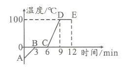

- A. \( BC\)段是固液共存态，是吸热过程
- B. 冰的熔点是\( 0\text{℃}\)，水的沸点是\( 100\text{℃}\)
- C. 冰熔化时要吸热，水沸腾时要放热
- D. \( CD\)段是液态，且吸热温度上升

【答案】C

【解析】​

## 15. 单选题

关于水的沸腾实验，下列说法正确的是（      ）

- A. 水沸腾时冒出的“白气”是水蒸气
- B. 水的沸点随气压的降低而升高
- C. 验中将酒精灯挪开，水并没有立即停止沸腾，说明水在沸腾时并不需要吸热
- D. 沸腾时，大量的气泡上升，变大，并在液面破裂开来，气泡中释放的是水蒸气

【答案】D

【解析】​

## 16. 单选题（难度：适中）

如图所示，是北京冬奥会所使用的“雪炮”式造雪机。它利用高压空气将水流打碎成细密的雾状，喷出后快速结成雪粒。下列说法正确的是（      ）

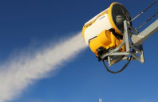

- A. 水雾结成雪粒是凝华现象
- B. 水雾结成雪粒要放出热量
- C. 外部气温越高，喷出的水雾越容易结成雪粒
- D. 外部气温较低时，喷出的水雾不可能蒸发

【答案】B

【解析】​

## 17. 单选题

学完了热现象内容后，在标准大气压下，小刚有以下的一些想法，其中正确的是（      ）

- A. 寒冷的冬天室外温度为\( -10\text{℃}\)时没有水蒸气
- B. 用热水壶烧水，水的温度达到\( 100\text{℃}\)才能汽化
- C. 水的温度达到\( \text{0}\text{℃}\)才能变为冰，水变为冰时放热温度降低
- D. 将\( \text{-}\text{10}\text{℃}\)的冰块放入冰水混合物中再立即放入\( \text{0}\text{℃}\)的房间，冰会变多

【答案】D

【解析】​

## 18. 单选题（难度：简单）

\( 2021\)年\( 10\)月，在宁夏银川市和吴忠市等地出现了新冠疫情，“白衣战士”们重新穿上厚重的防护服，戴着护目镜，肩负起抗击疫情的重大责任。护目镜在使用一段时间后，会出现起雾的现象，如图所示，对此说法正确的是（      ）

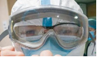

- A. “雾气”的形成过程是汽化现象
- B. “雾气”形成在护目镜的外侧
- C. “雾气”是护目镜和面部之间的水蒸气遇冷液化后形成的
- D. “雾气”形成的过程需要吸热

【答案】C

【解析】​

## 19. 多选题（难度：适中）

下列关于热现象的解释正确的是（      ）

- A. 冬天司机往水箱里加点酒精是为了提高液体的凝固点
- B. 皮肤上涂一些酒精会感到凉爽是因为酒精蒸发时吸热
- C. 冻豆腐里面的小孔是由于豆腐里的水先凝固后熔化形成的
- D. 从冰箱里取出的易拉罐外壁会出现小水滴是水蒸气凝华而成的

【答案】B/C

【解析】​

## 20. 多选题（难度：适中）

“探究水沸腾时温度的变化规律”时，装置如图所示，则实验中正确的是（      ）

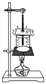

- A. 一般采用温度较高的水做实验，是为了更好地观察水沸腾的现象
- B. 烧杯口加盖子比不加盖子更容易缩短水达到沸腾时所需要的时间
- C. 需要观察烧杯内水中气泡大小的变化情况
- D. 石棉网的作用是使烧杯内水的温度始终趋于一致

【答案】B/C

【解析】​

## 21. 多选题（难度：简单）

关于汽化现象，下列说法中正确的是（      ）

- A. 各种液体沸腾时都有确定的温度
- B. 蒸发在液体的表面和内部同时发生
- C. 在质量、温度、表面积相同的条件下，水表面附近空气流动得越快，水蒸发得越快
- D. 在手背上擦酒精，过会儿酒精不见了，手背感觉发凉，这是由于酒精蒸发吸热所致

【答案】A/C/D

【解析】​

## 22. 多选题（难度：适中）

关于蒸发和沸腾，下面说法中错误的是（      ）

- A. 蒸发可以在任何温度下进行，沸腾只能在一定温度下进行
- B. 沸腾需要吸热，蒸发不需要吸热
- C. 蒸发是缓慢的汽化现象，沸腾是剧烈的汽化现象
- D. 蒸发是发生在液体表面的汽化现象，沸腾是在液体内部发生的汽化现象

【答案】B/D

【解析】​

## 23. 多选题（难度：适中）

如图所示，烧杯和试管中都是冰\( (\)环境温度低于\( \text{0}\text{℃})\)，在不断加热的过程中，下列现象或事实描述正确的是（      ）

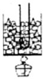

- A. 当烧杯中的冰全部熔化前，试管中的冰一点都没有熔化
- B. 水在沸腾前会不断以蒸发的形式汽化
- C. 冰块能够从水中吸收热量是由于水的温度高
- D. 试管中的水因达不到沸点而不能沸腾

【答案】A/B/C

【解析】​

## 24. 多选题（难度：适中）

在下列各种说法中错误的是（      ）

- A. 在煮鸡蛋时，水沸腾后，用小火和大火效果一样
- B. 晶体和非晶体的区别在于晶体有一定的熔点，而非晶体没有
- C. 温度计只能用液体的热胀冷缩来工作
- D. 秋天的早晨花草上出现小露珠，这是液化现象，要吸收热量

【答案】C/D

【解析】​

## 25. 多选题（难度：适中）

下列关于“白气”的说法中不正确的是（      ）

- A. 烧开水时，壶嘴周围的“白气”是壶内的水汽化形成的水蒸气
- B. 烧开水时，壶嘴周围的“白气”是壶内冒出的水蒸气遇冷液化形成的小水滴
- C. 打开冰箱门，门周围的“白气”是门外的空气液化形成的小水滴
- D. 打开冰箱门，门周围的“白气”是冰箱内的水蒸气液化形成的小水滴

【答案】A/C/D

【解析】​

## 26. 多选题（难度：简单）

容器里装有水，将烧杯底朝上压入水中，如图所示。在标准大气压下对容器底加热。下列结论正确的有（      ）

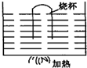

- A. 烧杯内的水不能沸腾，烧杯外的水能沸腾
- B. 烧杯内、外的水都能沸腾
- C. 烧杯内、外的水温度相等
- D. 烧杯内的水温高于烧杯外的水温

【答案】A/C

【解析】​

## 27. 填空题（难度：简单）

火箭刚点火时，高温火焰向下喷到发射塔架下的地面，很多物体遇到这样的高温将会,为了保护发射塔架，就在其下建了一个大水池（导流槽），让火焰喷到水中，利用水的来吸收巨大的热量．我们在电视上看到火箭升空的瞬间，伴有迅速扩展的庞大的白色气团是形成的。

【答案】熔化，汽化，水蒸气液化

【解析】​

## 28. 多选题（难度：适中）

无论是严冬还是酷暑，在使用冷暖空调的房间窗户玻璃表面，有时都会出现小水珠，关于这种现象的说法中正确的是（      ）

- A. 夏天，小水珠附着在玻璃的内表面
- B. 夏天，小水珠附着在玻璃的外表面
- C. 冬天，小水珠附着在玻璃 内表面
- D. 冬天，小水珠附着在玻璃的外表面

【答案】B/C

【解析】​

## 29. 多选题（难度：简单）

如下图所示是小明探究水沸腾时的装置以及实验中不同时刻气泡的情形。下列有关分析不正确的是（      ）

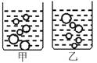

- A. 他可以选用量程为\( \text{-}\text{80}\text{℃}\)到\( \text{60}\text{℃}\)的酒精温度计
- B. 图甲是水沸腾前的现象
- C. 水沸腾时，烧杯中不停地冒出“白气”，这些“白气”是水蒸气
- D. 小明撤去酒精灯后发现水继续沸腾了一段时间，所以水的沸腾有的时候不需要吸收热量

【答案】A/C/D

【解析】​

## 30. 填空题（难度：适中）

小李同学观看“沸腾的油锅中取铁球”表演后，得知锅中的“油”是由油和醋组成的混合液体，油的沸点为\( \text{287}\text{℃}\)，醋的沸点为\( 60\text{℃}\)，当温度达到 \( \text{℃}\)时锅中的“油”就沸腾了；继续加热，“油”和放入其中的铁球的温度（填“会”或“不会”）升高，当后，继续加热，就不可能赤手从油锅中取铁球了。

【答案】$ 60$ ，不会，醋全部汽化

【解析】​

## 31. 填空题（难度：简单）

小明同学在\( 4\)块相同的玻璃板上各滴一滴质量相同的水，进行如图所示的实验，探究影响液体蒸发快慢的因素。

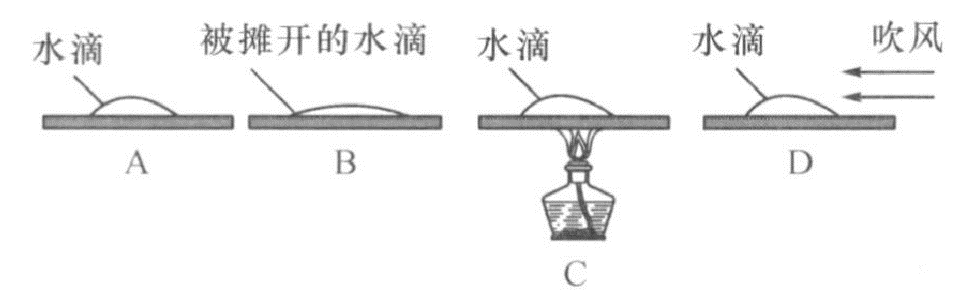

\( \left(1\right)\)通过\( A\)、\( B\)两图的对比，可以得出液体蒸发快慢与液体的有关。
\( \left(2\right)\)通过、两图的对比，可以得出液体蒸发快慢与液体的温度有关。
\( \left(3\right)\)完成上述探究后，小明又根据生活经验，猜想液体蒸发快慢还可能与液体表面附近空气流速有关\( .\)于是，他设计实验方案如图\( D\)所示，控制、相同，改变液面附近空气流速，观察液体蒸发快慢，得出结论。

【答案】表面积，$ A$  ，$ C$  ，液体的温度，液体表面积

【解析】​

## 32. 填空题（难度：适中）

物理兴趣小组进行“探究水沸腾时温度变化的特点”的实验。

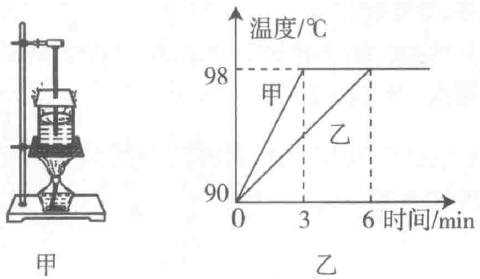
    
\( \left(1\right)\)需要安装的实验器材有：\( A.\)烧杯和水；\( B.\)酒精灯；\( C.\)纸板和温度计；\( D.\)铁圈和石棉网．装置如图甲所示，安装的顺序是（填写器材前的字母）。
\( \left(2\right)\)烧杯加纸板盖的目的是。
\( \left(3\right)\)甲、乙两同学用同样的实验装置，在相同的实验环境下，分别用质量为\( {m}_{\text{甲}}\)和\( {m}_{\text{乙}}\)的水进行实验，根据实验数据描绘的温度随时间变化的图像如图乙所示，分析图像可知，\( {m}_{\text{甲}}\)  \( {m}_{\text{乙}}\)（选填“大于”“等于”或“小于”）。
\( \left(4\right)\)实验时发现，水沸腾时出现大量的“白气”，这是现象（填一物态变化），需要（填“吸热”或“放热”）。

【答案】$ BDAC$   ，减少散热，小于，液化，放热

【解析】​

## 33. 填空题（难度：适中）

一支大的注射器的小孔用橡皮帽堵住，里面装有乙醚蒸气，如上图所示，推活塞，压缩乙醚蒸气的体积，当乙醚蒸气被压缩到一定程度时，会看见注射器中出现了液态乙醚，这表明用的办法可以使气体。

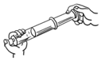

【答案】压缩体积，液化

【解析】​

## 34. 填空题（难度：适中）

如图所示，用酒精灯加热烧瓶中的水，水沸腾后，让水蒸气沿玻璃导管通入空试管中（试管竖立在冷水槽中）

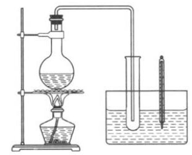
    
\( \left(1\right)\)水蒸气通入试管后，可以观察到试管底部有出现，这是现象。
\( \left(2\right)\)实验中还可以观察到温度计的示数逐渐，说明。

【答案】水  ，液化  ，升高，液化放热

【解析】​

## 35. 填空题（难度：适中）

小明同学做纸锅烧水实验。查阅资料知道纸的着火点大约是\( \text{183}\text{℃}\)，酒精灯火焰温度约为\( \text{450}\text{℃}\)，电吹风吹出热风的温度约为\( \text{60}\text{℃}\)。（标准大气压下水的沸点约为\( \text{100}\text{℃}）\)

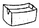
​
​\( \left(1\right)\)小明同学用电吹风吹出的热风给“纸锅”加热，水\( (\)选填“会”或“不会”\( )\)沸腾，这是因为电吹风吹出热风的温度水的沸点。
\( \left(2\right)\)用酒精灯给“纸锅”底加热，当水沸腾时，“纸锅”\( (\)选填“会”或“不会”\( )\)燃烧，这是因为水沸腾时温度，水的沸点\( \text{100}\text{℃}\)低于纸的着火点\( \text{183}\text{℃}\)。

【答案】不会，低于，不会，保持不变

【解析】​
