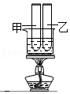
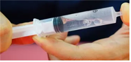
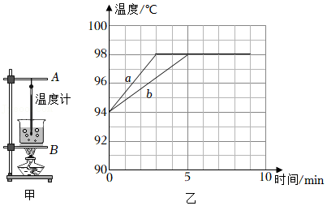

# 知识点·沸腾（同步练习）

> 教材：物理·九年级全一册·沪科技版2024新教材 ｜ 来源：国家中小学智慧教育平台·在线练习 ｜ 共 3 题

## 1. 单选题

如图所示，甲试管装酒精（酒精沸点为78℃），乙试管装水，同时放入盛水的大烧杯中，对大烧杯加热至使里面的水沸腾一段时间，则下列说法中正确的是（    ）．

- A. 甲试管内的酒精和乙试管内的水都不沸腾
- B. 甲试管内的酒精和乙试管内的水同时沸腾
- C. 甲试管内的酒精先沸腾，乙试管内的水后沸腾
- D. 甲试管内的酒精会沸腾，乙试管内的水不沸腾

【答案】D

【解析】​

## 2. 

如图，央视《是真的吗？》节目中，主持人和助理做了“针管烧水”的实验：往针管里面吸入大约三分之一的水和少量空气，用拇指按住针筒口防止漏气、并拉动针筒拉杆．观察到针筒里的水就会冒泡泡沸腾起来．你认为这种“针管就能使水沸腾“的方法是否可行？你的依据是什么．

【答案】

可行，液体的沸点与气压有关，气压越小，沸点越低．

【解析】​

## 3. 填空题

如图甲是探究“水沸腾时温度变化的特点”的实验装置．
【进行实验与收集证据】
（1）组装实验装置时，应当先调整图甲中（选填“\( A\)”或“\( B\)”）的高度．
（2）某小组用相同的装置先后做了两次实验，绘制出如图乙所示的\( a\)、\( b\)两条图线．

【分析与论证】
（3）由图可知：实验中水的沸点为 ℃；沸腾过程中水的温度保持；若两次实验所用水的质量分别为\( {m}_{a}\)、\( {m}_{b}\)，则\( {m}_{a}\) \( {m}_{b}\)（选填“＞”、“＝”或“＜”）．
（4）撤去酒精灯后，水很快停止沸腾，说明水在沸腾过程中需要持续．
【交流反思】
（5）各实验小组发现，水沸腾时的温度均低于100℃，那么，水的沸点可能与有关．
（6）为提高水的沸点，换用火力更大的酒精灯加热，这种做法​（选填“可行”或“不可行”）．

【答案】B，98，不变，＜，吸热，大气压，不可行

【解析】​
