# 知识点·温度 （同步练习）

> 教材：物理·九年级全一册·沪科技版2024新教材 ｜ 来源：国家中小学智慧教育平台·在线练习 ｜ 共 15 题

## 1. 单选题（难度：简单）

某同学对预防新冠肺炎措施中的相关物理量进行了估测，其中最接近实际的是（    ）

- A. “测体温”：发烧时病人的体温约为36.5℃
- B. “勤洗手”：一次正确洗手的时间约为5s
- C. “要锻炼”：在跑步机上跑步时的速度约为15m/s
- D. “戴口罩”：一只医用外科口罩的长度约为15cm

【答案】D

【解析】​

## 2. 单选题（难度：简单）

下列关于生活环境中的一些常见温度的说法中，你认为最符合实际的是（    ）

- A. 人感觉到温暖而又舒适的房间温度是23℃
- B. 洗澡时淋浴水温约为70℃
- C. 人的正常体温是47℃
- D. 我国历史上的最低气温是0℃

【答案】A

【解析】​

## 3. 单选题（难度：简单）

如图所示的温度计，关于它的说法不正确的是（    ）

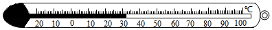

- A. 该温度计是根据液体热胀冷缩的原理制成的
- B. 该温度计的量程是﹣20～100℃
- C. 在使用该温度计测量液体温度时，可以离开被测液体读数
- D. 该温度计此时的示数为32℃

【答案】C

【解析】​

## 4. 单选题（难度：简单）

关于体温计和普通温度计的区别，下列说法错误的是（    ）

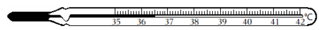

- A. 体温计内有一特别细的弯管，普通温度计没有
- B. 使用体温计前要用力甩动，把液柱甩到35℃以下，一般温度计不能甩动
- C. 使用体温计测量体温后，可离开身体观察示数，一般温度计不能离开被测物体读数
- D. 体温计与普通温度计分度值相同

【答案】D

【解析】​

## 5. 单选题（难度：适中）

用一支水银温度计测量放在25℃房间里的一盆热水的温度时，当温度计的水银上升经过“28℃”这一刻度时，温度计的读数表示的是（    ）

- A. 房间里的温度
- B. 热水的温度
- C. 温度计中水银的温度
- D. 无法判断

【答案】C

【解析】​

## 6. 单选题（难度：简单）

如图所示，用温度计测定一杯热水温度，在温度计的四种使用方法中正确的是（    ）

- A. 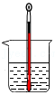
- B. 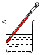
- C. 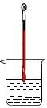
- D. 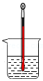

【答案】D

【解析】​

## 7. 单选题（难度：简单）

用实验室常用温度计测量烧杯中热水的温度时，下列说法正确的是（    ）

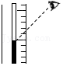

- A. 温度计的玻璃泡可以碰到容器壁
- B. 将玻璃泡浸入热水中马上读出温度
- C. 读数时温度计可以离开被测热水
- D. 读数时如图所示，测量数据偏大

【答案】D

【解析】​

## 8. 单选题（难度：适中）

一支体温计的示数是38.0℃，若直接用它去测量甲、乙两个病人的体温，体温计的示数先后分别是38.0℃和39.5℃，则下列判断正确的是（    ）

- A. 甲的体温是38.0℃，乙的体温是39.5℃
- B. 甲的体温低于38.0℃，乙的体温是39.5℃
- C. 甲的体温不高于38.0℃，乙的体温是39.5℃
- D. 甲、乙两人体温都无法确定

【答案】C

【解析】​

## 9. 填空题（难度：简单）

在“用温度计测水的温度”的实验中：
\( \text{（}\text{1}\text{）}\)有甲、乙、丙三支温度计，其测量范围是：甲\( \text{0}\text{～}\text{100}\text{℃}\)；乙\( \text{30}\text{～}\text{55}\text{℃}\)；丙\( \text{35}\text{～}\text{42}\text{℃}\). 应选用温度计. 
\( \text{（}\text{2}\text{）}\)按正确使用温度计的步骤，将下列选项进行排序：. 
\( A\).选用合适量程的温度计
\( B\).估计被测水的温度
\( C\).稍候，待温度计的示数稳定后再读数
\( D\).让温度计的玻璃泡与水充分接触
\( E\).取出温度计
\( F\).视线与温度计内液面齐平，读取示数

【答案】甲，BADCFE

【解析】​

## 10. 填空题（难度：简单）

对物理量的准确测量是物理研究的一个重要方面，如图所示，体温计的示数为 ℃

【答案】36.5

【解析】​

## 11. 填空题（难度：简单）

某市某天最高和最低气温如图所示，则当天的最高气温为 ℃，最低气温为 ℃. 

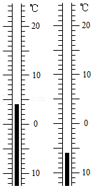

【答案】4，﹣6

【解析】​

## 12. 填空题（难度：适中）

在用温度计测量水的温度时，甲、乙、丙三位同学按如图所示方法读数，甲俯视读数会，丙仰视读数会（以上两空均填“偏大”或“偏小”），正确的读数是，水的温度是℃. 

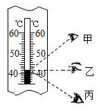

【答案】偏大，偏小，乙，42

【解析】​

## 13. 填空题

中国科兴疫苗需保存在低于8℃的环境中. 夏季，运输过程中为监测疫苗温度是否超标，应在冷藏箱内放置图所示的温度计. 在接收点，为正确读数，验收人员（选填“能”或“不能”）把温度计从冷藏箱中取出读数，温度计示数如图所示，表明疫苗（选填“安全”或“不安全”）. 

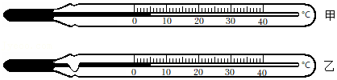

【答案】乙，不能，安全

【解析】​

## 14. 填空题（难度：简单）

在“用温度计测量水的温度”实验中：
\( \text{（}\text{1}\text{）}\)实验室常用的温度计是根据液体的规律制成的. 
\( \text{（}\text{2}\text{）}\)使用温度计之前，应观察它的量程和. 
\( \text{（}\text{3}\text{）}\)请指出如左图所示的操作错误之处（写出一条即可）：. 
\( \text{（}\text{4}\text{）}\)在测量温水的温度后，又用温度计测量了从冰箱中取出的冰的温度，温度计的示数如图，应记为 ℃.
 
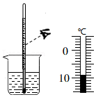

【答案】热胀冷缩，分度值，温度计的玻璃泡碰到了容器底（或视线未与液柱上表面相平），﹣9

【解析】​

## 15. 填空题

如图是小明设计的一个气体温度计的示意图. 瓶中装的是气体，装置密封完好，弯管中间有一段液柱. 
\( \text{（}\text{1}\text{）}\)这个温度计是根据性质来测量温度的；
\( \text{（}\text{2}\text{）}\)若将瓶放到冰水混合物中，液柱停在A处，B、C是与A点相差2摄氏度的两点，则B处应该标的温度值是，C处的温度值比B处（填“高”或“低”）；

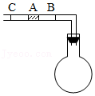

【答案】气体的热胀冷缩，﹣2℃  ，高

【解析】​
