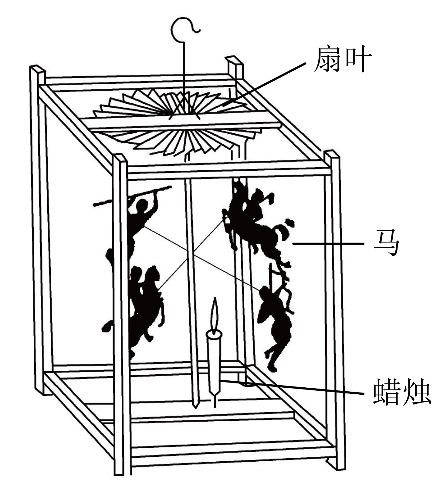
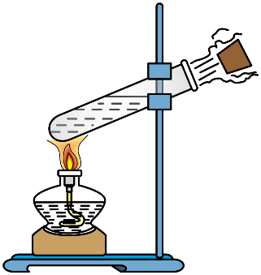
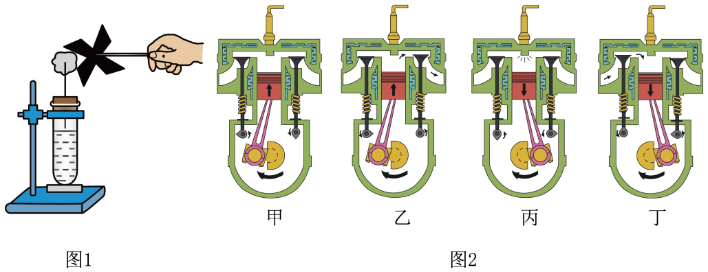
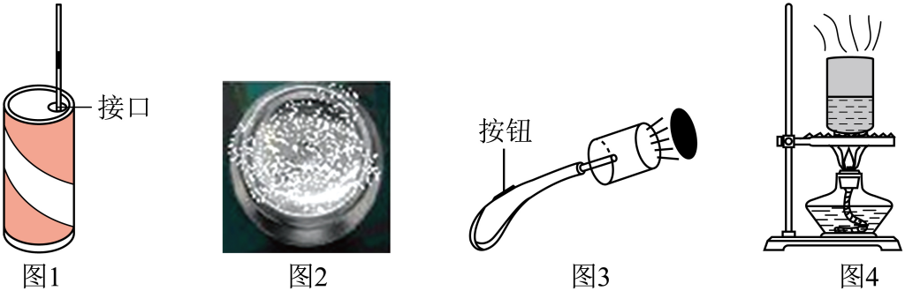
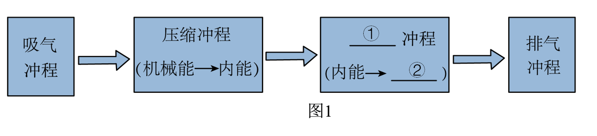
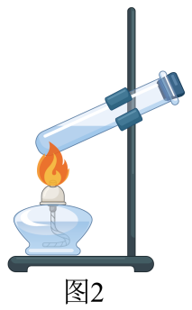

# 知识点·热机（同步练习）

> 教材：物理·九年级全一册·沪科技版2024新教材 ｜ 来源：国家中小学智慧教育平台·在线练习 ｜ 共 6 题

## 1. 单选题（难度：简单）

以下机械不属于热机的是（     ）．

- A. 火箭发动机
- B. 柴油机
- C. 洗衣机
- D. 蒸汽机

【答案】C

## 2. 多选题

赏花灯是庆祝元宵节的民间传统习俗，“走马灯”是花灯的一种．某“走马灯”的结构示意图如图所示，点燃底部蜡烛，热空气上升，驱动上端扇叶转动，带动转轴及“马”旋转起来．下列说法正确的是（     ）．

- A. 蜡烛燃烧是化学能转化为内能
- B. 点燃蜡烛后，周围空气受热密度变大而上升
- C. 热空气的内能有一部分转化为扇叶的机械能
- D. “走马灯”的工作原理与汽油机工作原理相同

【答案】A/C

【解析】走马灯中蜡烛燃烧，气体受热，空气密度减小而上升，遇冷后下降，形成循环气流，对流驱动扇叶。这个过程中，化学能转化为内能，内能传递给扇叶直接转化为机械能，实现内能向机械能的转化。‌‌因此，走马灯可以被视为一台小型的热机，通过热循环实现能量转换和机械运动，工作原理与汽油机工作原理有区别。

答案：走马灯‌是通过蜡烛加热空气，热空气上升驱动叶轮旋转，将内能直接转化为机械能。‌汽油机‌通过燃料燃烧产生高温高压燃气，推动活塞运动，再通过曲轴将内能转化为机械能。两者工作原理有差别，答案选择A、C

## 3. 单选题（难度：适中）

如图所示，在试管内装些水，用橡胶塞塞住管口，把水加热至沸腾一段时间后，塞子受到水蒸气的压力会冲出去．下列说法正确的是（     ）．

- A. 塞子冲出去前，试管内气体压强变小
- B. 塞子冲出去时，管口周围出现的白雾是空气液化成小水珠形成的
- C. 塞子冲出去后，水蒸气的内能增大
- D. 这个实验虽然简单，却基本展示了蒸汽机的工作原理

【答案】D

## 4. 填空题（难度：简单）

老师用图1所示实验装置，加热试管使水沸腾，发现试管斜上方的小风车开始不停地转动．由此引出以下问题，请利用所学的知识回答．

     
​（1）图1实验中能量转化方式与图​2中汽油机的哪个冲程相同？；
​（2）图2汽油机的工作冲程顺序是丁→  →乙．

【答案】丙，甲&rarr;丙

## 5. 填空题

利用易拉罐做以下几个小实验；

     
​（1）如图1，向空易拉罐中插入透明吸管，接口用蜡密封，在吸管内引入一小段油柱，把罐体放在热水中，可以看到油柱，这是利用气体的制作简易温度计；
​​（2）如图2，在易拉罐中放入盐和敲碎的冰，用筷子轻轻搅拌半分钟，可以看到罐底出现“白霜”，这是空气中的水蒸气发生了现象；
​（3）如图3，将易拉罐底部开一圆孔倒出饮料，放入滴有酒精的小块脱脂棉花，轻轻晃动易拉罐，把电火花发生器紧紧塞进孔中，按动按钮，观察到罐子飞出去了，这个过程与汽油机的冲程能量转化方式一致；
​（4）如图4，在易拉罐中注入少量水，用酒精灯对易拉罐加热，待罐口出现白雾时将罐口堵住．撤去酒精灯让易拉罐冷却，观察到，说明了．

【答案】上升，热胀冷缩，凝华，做功，易拉罐变瘪了，大气压强的存在

## 6. 填空题（难度：适中）

现代生活越来越离不开热机，因此全面了解和认清热机的结构和工作过程对我们的生活至关重要，请你完成下面围绕“热机”展开的一些问题：

​（1）如图所示是热机完成一个工作循环及相应主要能量转化情况的流程图1，请你补充完整；；

​   

​

​​（2）如图2所示，在试管中装些水，用橡皮塞塞住，加热使水沸腾后，水蒸气把橡皮塞冲出的过程中是能转化为能，图中情景可用来演示四冲程汽油机工作过程中的冲程；

      

​（3）单缸四冲程汽油机工作时，有些冲程是辅助冲程，要靠安装在曲轴上的飞轮的惯性来完成，只有一个冲程不用靠飞轮的惯性来完成，这个冲程是冲程；

​（4）我们发现热机工作时，一般要在气缸的外面安装一个水箱用来降低气缸的温度，是利用水的特性，这是采用的方式来减小气缸的内能．

【答案】做功，机械能，内，机械，做功，做功，比热容大，热传递
