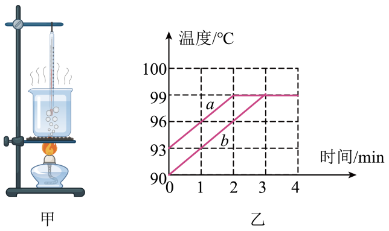
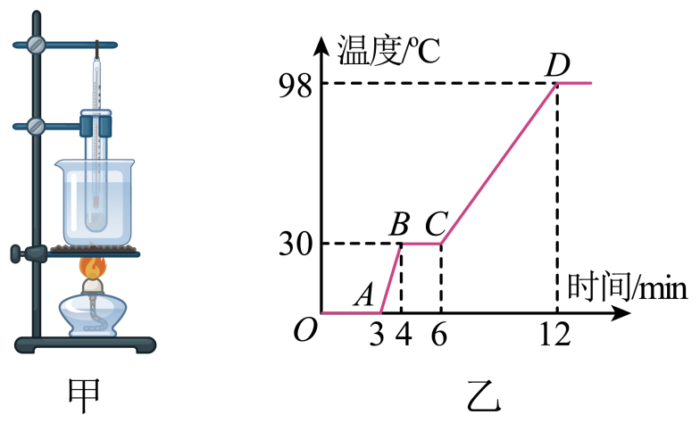
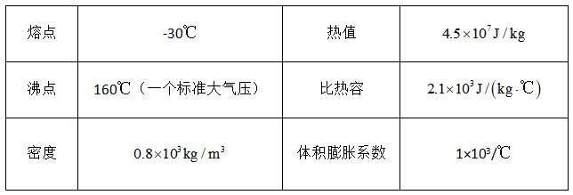
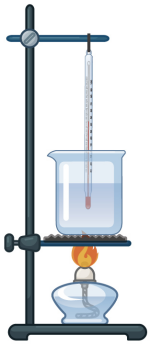
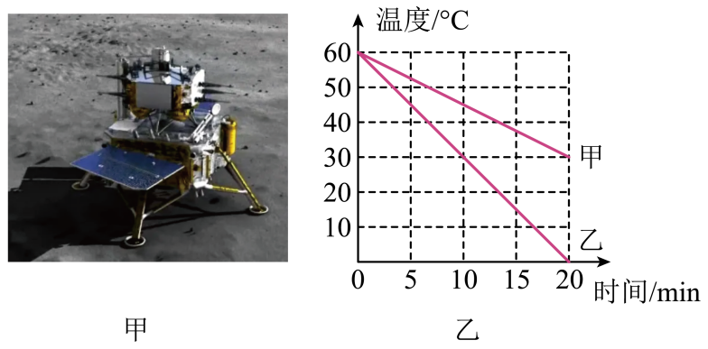
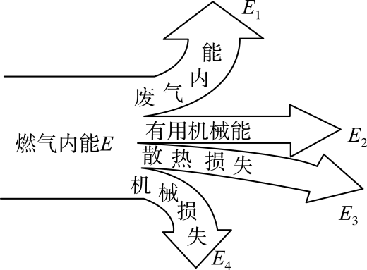
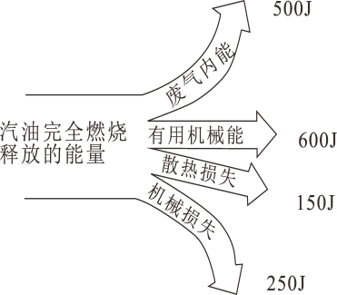
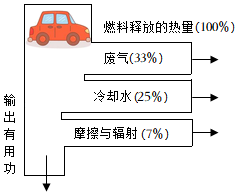

# 知识点·热机效率（同步练习）

> 教材：物理·九年级全一册·沪科技版2024新教材 ｜ 来源：国家中小学智慧教育平台·在线练习 ｜ 共 16 题

## 1. 单选题（难度：简单）

甲、乙两台热机，甲的效率比乙的低，其含义是（    ）．

- A. 甲热机消耗的燃料多
- B. 甲热机比乙热机做功少
- C. 做相同的有用功，甲损失的能量比乙损失的多
- D. 甲热机的功率比乙热机的小

【答案】C

## 2. 单选题

甲、乙两台内燃机，甲的效率为35%，乙的效率为25%，这两个数据表示（    ）．

- A. 内燃机甲做的功比内燃机乙做得多
- B. 内燃机甲的功率比内燃机乙的功率大
- C. 在相同时间内内燃机甲燃烧的燃油比内燃机乙多
- D. 在消耗相同的燃油时，内燃机甲做的有用功比内燃机乙做的有用功多

【答案】D

## 3. 单选题（难度：适中）

小叶看见面点师傅将面拉成长条，放入滚烫的油中就炸出了香脆可口的油条，于是很想了解油的吸热能力．在老师指导下，他用酒精灯分别加热质量为\( \text{50g}\)、初温为\( \text{20}\text{℃}\)的油和水，记录的相关数据如下表所示．若单位时间内油吸收的热量与水吸收的热量相等，酒精的热值为\( 3\times {10}^{7}\text{J/kg}\)，水的比热容为\( 4.2\times {10}^{3}\text{J/(kg·}\text{℃}\text{)}\)．下列说法正确的是（    ）．
物质种类
加热时间
（\( \text{min}\)）
消耗酒精
（\( \text{g}\)）
末温
（\( \text{℃}\)）

油
2
1
88

水
2
1
50

- A. \( \text{2min}\)内油吸收的热量为\( 3\times {10}^{4}\text{J}\)
- B. 他使用的酒精灯的加热效率为\( 21\%\)
- C. 油的末温比水的高，所以吸热能力更强
- D. 油的吸热能力与其吸收的热量多少有关

【答案】B

## 4. 单选题（难度：适中）

小明取少量燃料置于燃烧皿中，点燃后对\( \text{100g}\)的热水加热\( \text{4min}\)，然后立即将其熄灭，测得消耗燃料\( \text{4.2g}\)，并根据实验数据绘制了水温随时间变化的图像如图乙中\( a\)线所示．已知此过程中燃料均匀燃烧放热，该燃料的热值为\( \text{2×}{10}^{\text{6}}\text{J/kg}\)，水的比热容\( 4.2\times {10}^{3}\text{J/(kg·}\text{℃}\text{)}\)，整个过程中忽略水的质量变化，下列说法中正确的是（    ）．

- A. 通过图像计算得知\( \text{4min}\)水吸收到的热量为\( \text{2520J}\)
- B. 通过计算得出燃料燃烧放出热量有\( 40\%\)被水吸收
- C. 水吸收的热量和燃料燃烧放出的热量都与加热时间成正比
- D. 若实验装置和热损失比例均不变，利用该燃料加热另一杯水绘出了如图乙中\( b\)线所示图像，则这杯水的质量大于上一杯水的质量

【答案】C

## 5. 单选题（难度：简单）

有一种低熔点的金属，放在手中就可熔化．小新同学利用如图甲的实验装置来探究“该金属熔化时温度的变化规律”．烧杯中装有冰水混合物，试管中装有该固体金属，他完成实验并绘制了时间与温度图象如图乙．从第\( \text{3min}\)开始，单位时间内金属吸收的热量相等，金属的质量为\( \text{100g}\)，固态时的比热容为\( 0.37\times {10}^{3}\text{J/(kg·}\text{℃}\text{)}\)．下列分析正确的是（    ）．

- A. 该金属的沸点一定为\( \text{98}\text{℃}\)
- B. \( \text{3-4min}\)该金属吸收的热量为\( 1.11\times {10}^{3}\text{J}\)
- C. 该金属固态的比热容大于液态的比热容
- D. 如果酒精完全燃烧，本实验装置的加热效率可以达到\( 100\%\)

【答案】B

## 6. 多选题

某种煤油有关数据如下表： 

    
如图，有一只煤油加热灯，内装\( \text{50g}\)煤油，正在加热烧杯中质量为\( \text{200g}\)，初温为\( \text{20}\text{℃}\)的煤油，经过\( \text{10min}\)后，烧杯中的煤油温度升为\( \text{80}\text{℃}\)，加热灯中的煤油变为\( \text{48g}\)，若不计加热过程中煤油的蒸发，当地气压为一个标准大气压，若杯中煤油相同时间吸热相等，则（    ）．

- A. 在这\( \text{10min}\)内，装置的加热效率为\( 50\%\)
- B. 加热过程中，杯中煤油密度变小
- C. 杯中煤油的每秒平均吸热为\( \text{160J}\)
- D. 若继续再加热\( \text{20min}\)，杯中煤油温度会变为\( \text{160}\text{℃}\)

【答案】B/D

## 7. 单选题

2020年12月17日，嫦娥五号凯旋归来，圆满实现了中国探月工程“绕、落、回”的三步走发展目标．如图甲所示，嫦娥五号在月球上成功进行了月壤钻掘打包、地外天体起飞、深空无人对接的多个世界级科研实验．月壤快递到家后，假如用质量均为\( \text{1g}\)的地岩甲和样品月岩乙进行对比实验，如图乙是这两种岩石的温度随放热时间变化的图像，若它们在相同时间内放出的热量相等，已知\( {c}_{\text{甲}}=2.1\times {10}^{3}\text{J/(kg·}\text{℃}\text{)}\)，下列说法正确的是（    ）．

- A. 由图像可知，地岩甲的比热容小于月岩乙的比热容
- B. 因月球表面没有空气阻力，嫦娥五号火箭发动机可以把内能全部转化为机械能
- C. \( \text{1g}\)地岩甲在\( \text{20min}\)内放出的热量为\( 6.3\times {\text{10}}^{\text{4}}\text{J}\)
- D. 月岩乙的比热容为\( 1.05\times {10}^{3}\text{J/(kg·}\text{℃}\text{)}\)

【答案】D

## 8. 填空题（难度：简单）

“氢能助力”“绿色冬奥”相对于化石能源有着巨大的环保优势．假如完全燃烧\( \text{0}\text{.}\text{3kg}\)氢气放出热量的\( 50\%\)被水吸收，能使 \( \text{kg}\)的水温度从\( \text{20°C}\)上升到\( \text{70°C}\)．[\( {q}_{\text{氢}}=1.4\times {10}^{8}\mathrm{J}/\mathrm{k}\mathrm{g}\)，水的比热容\( {c}_{\text{水}}=4.2\times {10}^{3}\text{J/(kg·}\text{℃}\text{)}\)]

【答案】100

## 9. 填空题（难度：适中）

在一段平直的公路上汽车匀速行驶\( \text{1h}\)，行驶的平均功率为\( \text{21KW}\)，效率为\( 30\%\)，这段时间内汽车至少消耗 \( \text{L}\)汽油（汽油的热值为\( 3.5\times {10}^{7}\text{J/L}\)）．

【答案】7.2

## 10. 填空题

小明家天然气热水器的热效率是\( 84\%\)，某次洗澡用水\( \text{40kg}\)．水经过热水器温度升高\( \text{20}\text{℃}\)，此过程中水吸收的热量是 \( \text{J}\)，天然气完全燃烧放出的热量是 \( \text{J}\)，消耗天然气\( {\text{m}}^{\text{3}}\)．[\( {c}_{\text{水}}=4.2\times {10}^{3}\text{J/(kg·}\text{℃}\text{)}\)，\( {q}_{\text{天然气}}=3.2\times {10}^{7}\text{J/}{\text{m}}^{\text{3}}\)]

【答案】$ 3.36\times {10}^{6}$，$ 4\times {10}^{6}$，0.125

## 11. 填空题（难度：简单）

如图所示为内燃机的能流图，则内燃机的效率可表示为．两个铁块的质量之比为4∶1，升高的温度之比是1∶2，吸收的热量之比为．

【答案】$ \eta =\frac{{E}_{2}}{E}\times 100\%$   ， 2∶1  

## 12. 填空题（难度：简单）

氢能源具有热值高、无污染等优点．氢气的热值为\( 1.4\times {10}^{8}\text{J/kg}\)，完全燃烧\( \text{0}\text{.}\text{2kg}\)的氢气可放出 \( \text{J}\)的热量；若一罐氢气用去了一半，则剩余氢气的热值是\( \text{J/kg}\)．

【答案】$ 2.8\times {10}^{7}$ ，$ 1.4\times {10}^{8}$

## 13. 填空题

已知某种汽油的热值是\( 4.6\times {10}^{7}\text{J/kg}\)，现有汽油\( \text{0}\text{.}\text{02kg}\)，完全燃烧其中的一半，汽油放出的热量是 \( \text{J}\)；若上述放出的热量使\( \text{2kg}\)的水温度升高\( \text{25}\text{℃}\)（未沸腾），则水吸收的热量为\( \text{J}\)；剩余\( \text{0}\text{.}\text{01kg}\)的汽油热值是 \( \text{J/kg}\)．（已知\( {c}_{\text{水}}=4.2\times {10}^{3}\text{J/(kg·}\text{℃}\text{)}\)．如图为某汽油机工作时能量转化图，该汽油机的效率是．

【答案】$ 4.6\times {10}^{5}$，$2.1\times {10}^{5}$，$ 4.6\times {10}^{7}$，$ 40\%$

## 14. 填空题（难度：适中）

某品牌汽车汽油机的能量流程图如图所示，若汽车行驶过程中消耗汽油\( \text{0}\text{.}\text{2kg}\)，已知汽油的热值为\( 4.2\times {10}^{7}\text{J/kg}\)，假如这些汽油完全燃烧，则牵引力做的功是 \( \text{J}\)；行驶中的汽车在紧急刹车时，刹车片会发烫，这是通过的方式增加物体内能的．\( [\)已知\( {c}_{\text{水}}=4.2\times {10}^{3}\text{J/(kg·}\text{℃}\text{)}\)]

【答案】$ 2.94\times {10}^{6}$ ，做功

## 15. 填空题

某汽车的汽油机每秒做功\( \text{40}\)次，则其曲轴在\( \text{1min}\)内转动了圈．当汽油在发动机内燃烧不充分时会冒“黑烟”，此时汽油的热值，汽油机的工作效率会（选填“增大”、“不变”或“减小”）．

【答案】4800  ，不变，减小

## 16. 填空题（难度：适中）

烧烤的常用燃料是木炭，\( \text{100g}\)的木炭完全燃烧可以放出\( 3.4\times {10}^{6}\text{J}\)的热量，则木炭的热值为 \( \text{J/kg}\)；木炭用掉一半时，剩余木炭的热值将（选填“变大”、“变小”或“不变”）．

【答案】$ 3.4\times {10}^{7}$ ，不变
