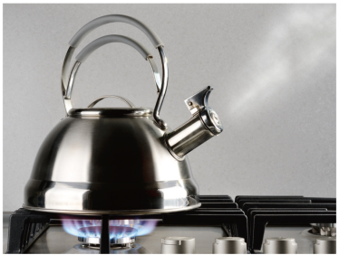
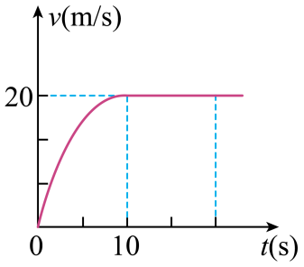
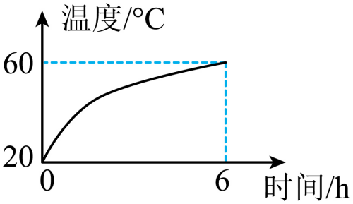
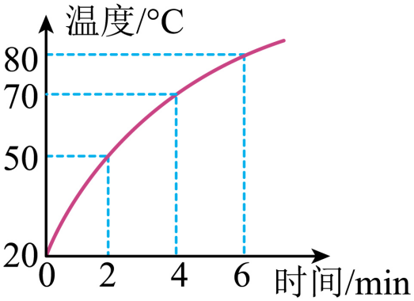

# 知识点·热机效率计算（同步练习）

> 教材：物理·九年级全一册·沪科技版2024新教材 ｜ 来源：国家中小学智慧教育平台·在线练习 ｜ 共 9 题

## 1. （难度：简单）

在一标准大气压下，用一台热损失\( 40\%\)的燃气灶将\( \text{3kg}\)初温为\( \text{30}\text{℃}\)的水加热至沸腾，求需要消耗多少天然气？[\( c=4.2\times {10}^{3}\text{J/(kg·}\text{℃}\text{)}\)，\( {q}_{\text{天然气}}=3.5\times {10}^{7}\text{J/}{\text{m}}^{\text{3}}\)]

【答案】

解：根据比热容公式，$ \text{3 kg}$初温为$ \text{30}\text{℃}$的水加热至沸腾所吸收的热量为

$ {Q}_{\text{吸}}=cm\left({t}_{\text{末}}-{t}_{\text{初}}\right)=4.2\times {10}^{3}\text{J/(kg·}\text{℃}\text{)}\times 3\text{kg}\times \left(100\text{℃}-30\text{℃}\right)=8.82\times 1{0}^{5}\text{J}$   

由题意可知，热损失率为$ 40\%$的天然气灶的热效率为$ 60\%$，根据热效率公式，可得天然气释放的总热量为

$ {Q}_{\text{总}}=\frac{{Q}_{\text{吸}}}{\eta }=\frac{8.82\times 1{0}^{5}\text{J}}{60\%}=\text{1.47}\text{×}\text{1}{\text{0}}^{\text{6}}\text{J}$  

根据热值公式，天然气的量为

$ V=\frac{{Q}_{\text{总}}}{{q}_{\text{天然气}}}=\frac{\text{1.47}\text{×}\text{1}{\text{0}}^{\text{6}}\text{J}}{\text{3.5}\text{×}\text{1}{\text{0}}^{\text{7}}\text{J/}{\text{m}}^{\text{3}}}=\text{0.042}{\text{m}}^{\text{3}}$  

## 2. （难度：适中）

天然气灶使用方便、经济环保．如图所示，在一个标准大气压下，天然气灶将\( \text{1}\text{.}\text{5L}\)，温度为\( \text{20}\text{℃}\)的水加热至沸腾，大约需要\( \text{5min}\)，已知水的比热容为\( 4.2\times {10}^{3}\text{J/(kg·}\text{℃}\text{)}\)，天然气的热值为\( \text{3.5}\text{×}\text{1}{\text{0}}^{\text{7}}\text{J/}{\text{m}}^{\text{3}}\)，求：

（1）水吸收的热量；

（2）若天然气完全燃烧放出的热量\( 50\%\)被水吸收，烧开这壶水需要多少天然气．

【答案】

解：（1）水的体积为

$ V=1.5\text{L}=1.5\times 1{0}^{-3}{\text{m}}^{\text{3}}$   

水的质量为

$ m={\rho }_{\text{水}}V=1\times 1{0}^{3}\text{kg}/{\text{m}}^{\text{3}}\times 1.5\times 1{0}^{-3}{\text{m}}^{\text{3}}=1.5\text{kg}$  

水吸收的热量为

$ {Q}_{\text{吸}}=cm\left({t}_{\text{末}}-{t}_{\text{初}}\right)=4.2\times 1{0}^{3}\text{J/}\left(\text{kg}\text{⋅℃}\right)\times 1.5\text{kg}\times \left(100\text{℃}-20\text{℃}\right)=5.04\times 1{0}^{5}\text{J}$  

（2）天然气放热为

$ {Q}_{\text{放}}=\frac{{Q}_{\text{吸}}}{\eta }=\frac{5.04\times 1{0}^{5}\text{J}}{50\%}=1.008\times 1{0}^{6}\text{J}$  

所需天然气为

$ {V}_{\text{气}}=\frac{{Q}_{\text{放}}}{q}=\frac{\text{1.008}\text{×}\text{1}{\text{0}}^{\text{6}}\text{J}}{\text{3.5}\text{×}\text{1}{\text{0}}^{\text{7}}\text{J/}{\text{m}}^{\text{3}}}=2.88\times 1{0}^{-2}{\text{m}}^{3}$  

## 3. （难度：简单）

氢能源车的发动机工作时将液态氢转化为氢气在气缸中燃烧，使用氢作为燃料的主要优点是热值大、无污染．某次测试中，一辆氢能源车以\( \text{70kW}\)的功率匀速行驶\( \text{0}\text{.}\text{5h}\)，消耗了\( \text{2kg}\)燃料．求：（\( {q}_{\text{氢气}}=1.4\times {10}^{8}\text{J/kg}\)）

（1）\( \text{2kg}\)氢气完全燃烧放出的热量；

（2）该发动机的效率．

【答案】

解：（1）$ \text{2kg}$氢气完全燃烧放出的热量为

$ {Q}_{\text{放}}=m{q}_{\text{氢气}}=2\text{kg}\times 1.4\times 1{0}^{8}\text{J/kg}=2.8\times 1{0}^{8}\text{J}$  

（2）匀速行驶$ \text{0}\text{.}\text{5h}$发动机所做的有用功为

$ W=Pt=70\times 1{\text{0}}^{\text{3}}\text{W}\times 0.5\times 3600\text{s}=1.26\times 1{0}^{8}\text{J}$  

该发动机的效率为

$ \eta =\frac{W}{{Q}_{\text{放}}}\times 100\%=\frac{1.26\times 1{0}^{8}\text{J}}{2.8\times 1{0}^{8}\text{J}}\times 100\%=45\%$ 

## 4. 

新能源汽车因环保、节能、高效等优势，成为人们日常使用的重要交通工具．如图是国内某型号电动汽车，其装备的蓄电池的电容量为\( 120\text{kW·h}\)．当电动机的输出功率为\( \text{150kW}\)时，电动汽车以\( \text{108km/h}\)的速度做匀速直线运动，在行驶过程中电动车所受的阻力大小保持不变．（已知汽油的热值\( {q}_{\mathrm{汽}\mathrm{油}}=4．6\times {10}^{7}\text{J/kg}\)）求：

​（1）行驶过程中电动车所受的阻力大小；

​（2）己知电动机将电能转化成机械能的效率为\( 80\%\)，充满电的电动汽车最多可以运动多远？

​（3）若将电动车换成燃油车，燃油发动机的工作效率约为\( 30\%\)，则匀速行驶第\( \text{（}\text{2}\text{）}\)问中同样的距离，燃油车需要消耗多少千克汽油？（结果保留两位小数）

【答案】

解：（1）汽车的行驶速度为

$ v=108\text{km/}\text{h}=30\text{m/s}$  

汽车行驶过程中牵引力为

$ F=\frac{P}{v}=\frac{\text{150000W}}{\text{30m/s}}=5000\text{N}$  

汽车匀速行驶，故汽车水平方向上受到的阻力和牵引力是一对平衡力，故行驶过程中电动车所受的阻力为

$ f=F=5000\text{N}$ 

（2）电池的电能转化为汽车的机械能为

$ {W}_{\text{机械能}}=\eta {W}_{\text{电能}}=80\%\times 120\text{kW}\cdot \text{h=96kW}\cdot \text{h=96}000\text{W}\times 3600\text{s}=3.456\times 1{0}^{8}\text{J}$  

故汽车最多可行驶的距离为

$ s=\frac{{W}_{\text{机械能}}}{F}=\frac{\text{3.456}\text{×}\text{1}{\text{0}}^{\text{8}}\text{J}}{\text{5000N}}=6.912\times 1{0}^{4}\text{m}$  

（3）燃油车行驶相同的距离需要克服阻力做功为

$ W={W}_{\text{机械能}}=3.456\times 1{0}^{8}\text{J}$  

燃烧的燃油质量为

$ m=\frac{{Q}_{\text{放}}}{{q}_{\text{汽油}}}=\frac{W}{{\eta }^{\text{'}}\times {q}_{\text{汽油}}}=\frac{3.456\times 1{0}^{8}\text{J}}{30\%\times 4.6\times 1{0}^{7}\text{J/kg}}\approx 25.04\text{kg}$   

## 5. （难度：适中）

一辆汽车以恒定的功率在平直的公路上做直线运动，其\( v-t\)图像如图，在第\( \text{10s}\)时速度达到\( \text{20m/s}\)，通过的路程为\( \text{120m}\)，设汽车在行驶过程中所受阻力不变，大小为\( f=4\times {10}^{3}\text{N}\)，求：
（1）在\( \text{0}\text{—}\text{10s}\)内汽车的平均速度；
（2）在\( \text{0}\text{—}\text{10s}\)内汽车发动机产生的牵引力所做的功；
（3）若发动机的效率为\( 30\%\)，则在\( \text{0}\text{—}\text{10s}\)内，需要燃烧多少克的汽油．（已知汽油的热值为\( \text{5}\text{×}{10}^{7}\text{J/kg}\)，结果保留两位小数）

【答案】

解：（1）在$ \text{0}\text{∼}\text{10s}$内汽车的平均速度

$ v=\frac{s}{t}=\frac{\text{120m}}{\text{10s}}=12\text{m/s}$  

（2）由图象可知，汽车在$ \text{10s}$后做匀速直线运动，受平衡力，汽车的牵引力

$ F=f=4\times 1{0}^{3}\text{N}$ 

汽车的功率

$ P=Fv=4\times 1{\text{0}}^{\text{3}}\text{N}\times \text{20m/s=8}\times 1{0}^{4}\text{W}$  

在$ \text{0}\text{∼}\text{10s}$内汽车发动机产生的牵引力所做的功

$ W=Pt\text{=8}\times 1{0}^{4}\text{W}\times \text{10s=8}\times 1{0}^{5}\text{J}$  

（3）根据$ \eta =\frac{W}{{Q}_{\text{放}}}$可知，燃料燃烧释放的热量

$ {Q}_{\text{放}}=\frac{W}{\eta }=\frac{8\times 1{0}^{5}\text{J}}{30\%}$  

由$ {Q}_{\text{放}}=qm$可知，在$ \text{0}\text{∼}\text{10s}$内，需要燃烧的汽油

$ m=\frac{{Q}_{\text{放}}}{q}=\frac{\frac{8\times 1{\text{0}}^{\text{5}}\text{J}}{30\%}}{5\times 1{0}^{7}\text{J/kg}}\approx 0.05333\text{kg}=53.33\text{g}$   

## 6. （难度：简单）

有一款太阳能热水器，铭牌上的部分参数如表所示．将它安装在阳光充足的水平楼顶上，并送满水．
（1）若该太阳能热水器每天接收的太阳能为\( 3.36\times {10}^{7}\text{J}\)，其中有\( 60\%\)被热水器中的水吸收，则可使水温升高多少？
（2）每天接受的太阳能相当于完全燃烧多少千克的煤气所放出的热量？（水的比热容\( 4.2\times 1{0}^{3}\text{J/}\left(\text{kg}\text{⋅℃}\right)\)，煤气的热值为\( 4.2\times {10}^{7}\text{J/kg}\)）
型号
\( \text{JL-88}\) 

水容量\( \text{/kg}\)
80

自身质量\( \text{/kg}\)
40

【答案】

解：（1）水吸收的热量

$ {Q}_{\text{吸}}={Q}_{\text{放}}\times \eta =3.36\times 1{0}^{7}\text{J}\times 60\%=2.016\times 1{0}^{7}\text{J}$  

可使水温升高的温度

$ \Delta t=\frac{{Q}_{\text{吸}}}{cm}=\frac{2.016\times 1{0}^{7}\text{J}}{4.2\times 1{0}^{3}\text{J/}\left(\text{kg}\cdot \mathrm{℃}\right)\times 80\text{kg}}=60\text{℃}$   

（2）由题知，煤气完全燃烧放出的热量

$ {Q}_{\text{放}}={Q}_{\text{吸}}=3.36\times 1{0}^{7}\text{J}$   

完全燃烧煤气的质量

$ {m}^{\text{'}}=\frac{{Q}_{\text{放}}}{q}=\frac{3.36\times 1{0}^{7}\text{J}}{4.2\times 1{0}^{7}\text{J/kg}}=0.8\text{kg}$ 

## 7. 

某品牌家用太阳能热水器的晒水箱容积为\( \text{50L}\)，装满水经2.5小时曝晒后水温能升高\( \text{27}\text{℃}\)．已知这种晒水箱的热效率是\( 50\%\)，太阳光垂直照射地表面时，地表吸收的热量为\( {Q}_{0}=1.26\times {10}^{3}\text{J/}\left(\text{s·}{\text{m}}^{\text{2}}\right)\)；\( {\rho }_{\text{水}}=1.0\times {10}^{3}\text{kg/}{\text{m}}^{\text{3}}\)、\( {c}_{\text{水}}=4.2\times {10}^{3}\text{J/(kg·}\text{℃}\text{)}\)；煤的热值\( {q}_{\text{煤}}=3\times {10}^{7}\text{J/kg}\)．

​（1）求\( \text{50L}\)水温度升高\( \text{27}\text{℃}\)所吸收的热量；

​（2）求上述热量相当于完全燃烧多少千克的煤释放的热量；

​（3）求该晒水箱需要安装受阳光垂直照射的面积．

【答案】

解：（1）水的质量为

$ m=\rho V=1.0\times 1{0}^{3}\text{kg/}{\text{m}}^{3}\times 50\times 1{\text{0}}^{\text{-3}}{\text{m}}^{\text{3}}=50\text{kg}$  

水温度升高$ \text{27}\text{℃}$所吸收的热量为

$ {Q}_{\text{吸}}={c}_{\text{水}}m\Delta t=4.2\times {10}^{3}\text{J/(kg·}\text{℃}\text{)}\times 50\text{kg}\times 27\mathrm{℃}=5.67\times 1{0}^{6}\text{J}$  

（2）上述热量相当于完全燃烧煤的质量为

$ m=\frac{{Q}_{\text{放}}}{q}=\frac{{Q}_{\text{吸}}}{q}=\frac{\text{5.67}\text{×}\text{1}{\text{0}}^{\text{6}}\text{J}}{\text{3}\text{×}\text{1}{\text{0}}^{\text{7}}\text{J/kg}}=0.189\text{kg}$ 

（3）由题干的条件可知，晒水箱的热效率为

$ \eta =\frac{{Q}_{吸}}{{Q}_{0}tS}$ 

$ S=\frac{{Q}_{吸}}{{\eta Q}_{0}t}=\frac{5.67\times 1{\text{0}}^{\text{6}}\text{J}}{50\%\times 1.26\times 1{0}^{3}\text{J/}\left(\text{s}\text{⋅}{\text{m}}^{\text{2}}\right)\times 2.5\times 3600\text{s}}=\text{1}{\text{m}}^{\text{2}}$  

则需要安装的受阳光垂直照射面积$ S$为$ \text{1}{\text{m}}^{\text{2}}$．

## 8. （难度：适中）

太阳能具有环保、可再生等优点；太阳能热水器深受广大用户的青睐，某品牌太阳能热水器，水容量为\( \text{100L}\)，该热水器在冬季有效日照时段里，平均每平方米的面积上每小时接收的太阳能约为\( \text{2}\text{.}\text{8×}{10}^{6}\text{J}\)．若该热水器接收太阳能的有效面积为\( \text{2}{\text{m}}^{\text{2}}\)，每天日照时间\( \text{6h}\)，这些太阳能使水温随日照时间变化的图像如图所示．[\( {\rho }_{\text{水}}=1.0\times {10}^{3}\text{kg/}{\text{m}}^{\text{3}}\)；\( {c}_{\text{水}}=4.2\times {10}^{3}\text{J/(kg·}\text{℃}\text{)}\)]求：

​（1）装满水时，热水器中水的质量；

​（2）一天内热水器中的水能吸收的热量；

​（3）热水器的效率约为多少．

【答案】

解：（1）热水器中水的质量

$ m=\rho V=1\times 1{0}^{3}\text{kg/}{\text{m}}^{3}\times 100\times 1{0}^{-3}{\text{m}}^{\text{3}}=100\text{kg}$   

（2）一天内热水器中的水吸收热量，温度从$ \text{20}\text{℃}$上升到$ \text{60}\text{℃}$，则水吸收的热量

$ {Q}_{\text{吸}}=cm\Delta t=4.2\times 1{0}^{3}\text{J/}(\text{kg}\cdot \mathrm{℃})\times 100\text{kg}\times 40\mathrm{℃}=1.68\times 1{0}^{7}\text{J}$   

（3）根据平均每平方米的面积上每小时接收的太阳能约为$ 2.8\times {10}^{6}\text{J}$可知，热水器接收的太阳能

$ E=2{\text{m}}^{\text{2}}\times 6\text{h}\times 2.8\times 1{0}^{6}\text{J/}\left({\text{m}}^{\text{2}}\text{⋅}\text{h}\right)=3.36\times 1{0}^{7}\text{J}$   

则热水器的效率

$ \eta =\frac{{Q}_{\text{吸}}}{E}\times 100\%=\frac{\text{1.68}\text{×}\text{1}{\text{0}}^{\text{7}}\text{J}}{\text{3.36}\text{×}\text{1}{\text{0}}^{\text{7}}\text{J}}\times 100\%=50\%$  

## 9. 

近年来，市区的天然气管道铺进乡村，小明同学家也用上了天然气灶．小明同学用天然气给\( \text{10kg}\)的水加热，并绘制出加热过程中水温随时间变化的图线，如图所示．若天然气灶的热效率是\( 50\%\)，天然气的热值约为\( 3.0\times {10}^{7}\text{J/m³}\)，水的比热容为\( 4.2\times 1{0}^{3}\text{J/}\left(\text{kg}\text{⋅℃}\right)\)．当加热\( \text{4min}\)时，求：

（1）水所吸收的热量；

（2）天然气完全燃烧放出的热量；

（3）完全燃烧的天然气体积．

【答案】

解：（1）分析图像可知，加热$ \text{4min}$时，水的温度由$ \text{20}\text{℃}$上升到$ \text{70}\text{℃}$，水温度上升了$ \text{50}\text{℃}$，水吸收的热量

$ {Q}_{\text{放}}={c}_{\text{水}}{m}_{\text{水}}∆t=4.2\times 1{0}^{3}\text{J/}\left(\text{kg}\text{⋅℃}\right)\times 10\text{kg}\times 50℃=2.1\times {10}^{6}\text{J}$  

（2）天然气完全燃烧放出的热量

$ {Q}_{\text{放}}=\frac{{Q}_{\text{吸}}}{\eta }=\frac{2.1\times 1{0}^{6}\text{J}}{50\%}=4.2\times 1{0}^{6}\text{J}$  

（3）完全燃烧的天然气体积

$ V=\frac{{Q}_{\text{放}}}{q}=\frac{4.2\times 1{0}^{6}\text{J}}{3.0\times 1{\text{0}}^{\text{7}}\text{J/}{\text{m}}^{\text{3}}}=0.14{\text{m}}^{\text{3}}$  

