# 知识点·焦耳定律多档位问题（同步练习）

> 教材：物理·九年级全一册·沪科技版2024新教材 ｜ 来源：国家中小学智慧教育平台·在线练习 ｜ 共 23 题

## 1. 填空题

某电热水器的工作原理如图所示（已知两电阻丝的阻值相等，电源电压保持不变）。它有加热和保温两个工作状态。当开关S₁接b，S₂断开时，它是处于状态，此时电路功率为P₁；当开关S₁接a。S₂闭合时，它是处于状态，此时电路功率为P₂，则P₁：P₂=。

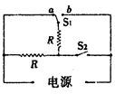

【答案】保温，加热，1：4

【解析】​

## 2. 填空题（难度：简单）

某款迷你电饭煲有加热和保温两档。其电路如图所示，已知R1=88Ω，R2=2112Ω,开关S置于（选填“1”或“2”）时是保温挡，保温10min产生的热量是J。

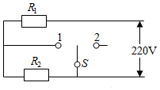

【答案】2  ，13200

【解析】​

## 3. 填空题（难度：适中）

某型号的电烤箱有“高温”和“低温”两档。电路如图所示，开关S接时，是“高温”档；当开关S分别接“1”和“2”时，电流表的示数为5A和1A；则电阻R₀=Ω、R=Ω，电烤箱处于“高温”档工作10min产生的热量为J。

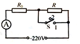

【答案】1，44，176，6.6&times;105

【解析】​

## 4. （难度：适中）

图甲是内胆为铝质材料的电饭锅，内部电路如图乙所示，R1是加热电阻，阻值为48.4Ω；R2是限流电阻，阻值为484Ω煮饭时，接通电源（220V），闭合手动开关S1，电饭锅处在加热状态．当锅内食物温度达到103℃时，开关S1会自动断开，断开后若无外力作用则不会自动闭合，S2是一个自动温控开关，当锅内食物温度达到80℃时会自动断开，温度低于70℃时会自动闭合【已知水的比热容为C水=4.2×10³J/（kg•℃）】。

​
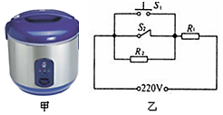

请解答下列问题：

（1）在保温和加热两种情况下，电饭锅消耗的电功率之比是多少？

（2）若在一个标准大气压下将温度为20℃，质量为2.5kg的水烧开需要16min40s，求电饭锅正常工作时电能转化为内能的效率是多少？​

【答案】

（1）在保温和加热两种情况下，电饭锅消耗的电功率之比是1：11；

（2）电能转化为内能的效率为84%。

【解析】​

## 5. 

如图为一款利用高温水蒸气熨烫衣服的便携式挂烫机，它的正常工作电压为220V，水箱最多装水0.2kg。它有大小两个加热挡位，其内部电路如图所示，电热丝R1=56Ω，R2=44Ω，求：

​
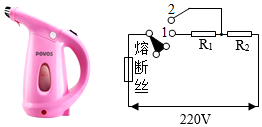

（1）大功率挡的额定功率。

（2）若用大功率挡将水箱中0.2kg的水从20℃加热到100℃，需要吸收多少热量？

（3）若用大功率挡加热这些水，所需时间为1分10秒，求熨烫机的加热效率。（结果保留一位小数）​

【答案】

（1）大功率挡的额定功率为1100W； 

（2）若用大功率挡将水箱中0.2kg的水从20℃加热到100℃，需要吸收6.72×104J；

（3）熨烫机的加热效率为87.3%。

【解析】​

## 6. 

如图所示是某电热器装置的简化电路图，开关S可切换加热和保温两种状态，它的额定电压为220V，额定加热功率是P热=1100W，R1、R2是发热电阻，R2=440Ω。已知电路电压正常，已知水的比热容为C水=4.2×10³J/（kg•℃），试完成下列问题：

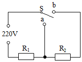
  
（1）图中电阻R1的阻值是多大？
（2）该电热器的保温功率P温是多大？
（3）若该电热器将2kg的水从20℃，加热到75℃，需要8min时间，则它加热时将电能转化为水的内能的效率为多少？

【答案】

（1）图中电阻<em><em>R</em></em><em><em>1</em></em>的阻值是44Ω；

（2）该电热器的保温功率<em><em>P</em></em>温是100W；

（3）该加热器加热时将电能转化为水的内能的效率为87.5%。

【解析】​

## 7. 

如图是某家用电热水器的简化电路图，温控开关S可根据水温自动切换到加热和保温两种状态，R₁、R₂是发热电阻，热水器主要参数如下表。热水器正常加热35min，可使满箱水的温度从25℃升高到55℃，求：

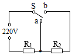
 
额定电压
220V
容积
30L

加热功率
2000W
保温功率
800W

（1）热水器处于保温状态时，电路中的电流；（结果保留一位小数）
（2）R₁的阻值；
（3）在上述加热任务中，水吸收的热量；
（4）在上述加热任务中，热水器的加热效率。

【答案】

（1）热水器处于保温状态时，电路中的电流为3.6A；

（2）<em>R<em>1</em></em>的阻值24.2Ω；

（3）在上述加热任务中，水吸收的热量为3.78×106J；

（4）在上述加热任务中，热水器的加热效率为90%。

【解析】​

## 8. 

如图甲是某学校使用的电开水器，乙图是简化电路（R1、R2都是加热电阻）当加入冷水后，开关接1位置，电开水器处于加热状态，将水烧开后，开关自动跳转到2位置，电开水器处于保温状态，电开水器额定电压为220V，容量为50L，加热功率为5.5kW，C水=4.2×10³J/（kg•℃），求：

​
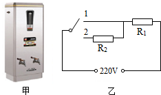

（1）R1的电阻；

（2）将水箱装满20℃的水加热到沸腾（标准大气压下），水吸收的热量；

（3）加满水烧开后，电开水器处于保温状态时，若无人接水，水每分钟放出的热量为6×10⁴J，为保持水温不变，计算电阻R₂的阻值。​

【答案】

（1）<em>R<em>1</em></em>的电阻为8.8Ω；

（2）将水箱装满20℃的水加热到沸腾（标准大气压下），水吸收的热量为1.68×107J；

（3）为保持水温不变，电阻<em><em>R</em></em><em><em>2</em></em>的阻值为39.6Ω。

【解析】​

## 9. 

如图甲是一款便携式电火锅，图乙是其简化电路图。R₁、R₂均为电热丝，电火锅有加热和保温两个挡，加热功率为440W，保温功率为110W。

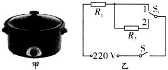
 
（1）加热挡工作时，电路中的电流是多少？
（2）电热丝R₂的阻值是多少？
（3）若不计热量损失，该电火锅正常工作，把质量为0.55kg初温为20℃的水加热到100℃，需要多少秒？[C水=4.2×10³J/（kg•℃ ]

【答案】

（1）加热挡工作时，电路中的电流是2A；

（2）电热丝R2的阻值是330Ω；

（3）不计热量损失，该电火锅正常工作，把质量为0.55kg初温为20℃的水加热到100℃，需要420s。

【解析】​

## 10. 

如图甲是一台常用的电热饮水机，下表是它的铭牌数据。如图乙是它的电路原理图，其中S是温控开关，R₁是电阻，R₂是加热电阻。当S闭合时，饮水机处于加热状态；当S断开时，饮水机处于保温状态。

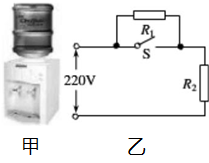
  

 
 
 
 水桶容量

 
 
 20L

 
 

 
 
 热水箱容量

 
 
 1L

 
 

 
 
 额定电压

 
 
 220V

 
 

 
 
 加热功率

 
 
 440W

 
 

 
 
 保温功率

 
 
 40W

 
 

 

（1）在加热状态下，饮水机正常工作时电路中的电流是多大？

（2）求电阻R₁的阻值（保温功率是指整个电路消耗的功率）。

（3）饮水机正常工作时，将热水箱中的水从20℃加热到90℃，需用时14min[水的比热容为C水=4.2×10³J/（kg•℃） ]，求此加热过程中，饮水机的加热效率。

【答案】

（1）在加热状态下，饮水机正常工作时电路中的电流是2A；

（2）电阻<em><em>R</em></em>1的阻值为1100Ω；

（3）加热过程中，饮水机的加热效率为79.5%。

【解析】​

## 11. 

小明家新添了一个多功能双层煮蛋器．其简化电路图如图甲所示，R1和R2均为加热电阻丝（设电阻丝的阻值不变）。该煮蛋器有两个档位．低温档功率为40W，高温档功率为1210W。求：
 
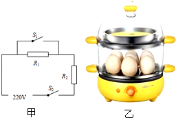
 
（1）R1、R2电阻丝的阻值。
（2）小明在一次煮蛋时加入了1kg20℃的水，从加热到刚好沸腾用时共6min，求该煮蛋器加热时的效率。[水的比热容为C水=4.2×10³J/（kg•℃ )，大气压为1标准大气压]。

【答案】

（1）<em>R<em>1</em></em>的阻值为1170Ω，<em><em>R</em></em><em><em>2</em></em>的阻值为40Ω；

（2）该煮蛋器加热时的效率约为77.1%。

【解析】​

## 12. 

如图所示，是小明家新买的某品牌全自动电热足浴盆的简化电路示意图，内部由加热系统和按摩系统两部分组成。S0是自动温控开关，加热功率为800W，保温功率为100W求：

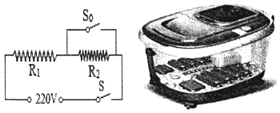
 
（1）R₁和R₂的电阻值各是多大？
（2）某次正常加热时，加热效率为70%，若将6kg初温为20℃的水加热至40℃，需要加热几分钟？[C水=4.2×10³J/（kg•℃]
（3）足浴盆按摩系统中的电动机工作电压是12V（按摩系统将交流电转换为12V），工作电流为4A，其电阻为0.5Ω，电动机工作中因发热损失的功率是多少？电动机的效率是多少？

【答案】

（1）<em>R</em>1的电阻值为60.5Ω，<em><em>R</em></em>2的电阻值为423.5Ω；

（2）将6kg初温为20℃的水加热至40℃，需要加热15min；

（3）电动机工作中因发热损失的功率是8W，电动机的效率是83.3%。

【解析】​

## 13. （难度：简单）

小明家新买了一台电热水器如图甲所示，如图乙是它的电路原理图（开关S只能单独接1或同时接1和2，不能单独接2），R1、R2为电热丝，下表是电热水器的有关参数。[C水=4.2×10³J/（kg•℃ )，不考虑温度对电阻丝的影响]。

‎ 
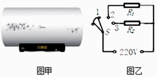
 

 
 
 
 电源

 
 
 220V 50Hz

 
 

 
 
 水箱容量

 
 
 50L

 
 

 
 
 

 ‎功率

 
 
 加热

 
 
 2000W

 
 

 
 
 保温

 
 
 400W

 
 

 

（1）电热丝R1、R2的电阻值是多少？

‎（2）水箱装满水，电热水器正常加热工作210min，水箱中的水温度升高60℃，则电热水器的加热效率是多少？

【答案】

（1）电热丝<em><em>R</em></em><em><em>1</em></em>的电阻值是121Ω；<em><em>R</em></em><em><em>2</em></em>的电阻值是30.25Ω；

（2）电热水器的加热效率是50%。

【解析】​

## 14. （难度：简单）

有一种挂式电热水器内部简化电路如图所示，该热水器设有高、中、低三档，已知电热丝R₁=55Ω，高档加热功率为1100W，电热转化效率为80%，水的比热容为C水=4.2×10³J/（kg•℃ )，求：

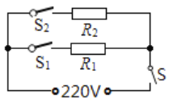
 
（1）将2kg水从20℃加热到75℃需要吸收多少热量；
（2）热水器高、中、低三档工作时，开关S₁、S₂对应的关闭状态；
（3）用低档将2kg水从20℃加热到75℃需要多少时间。

【答案】

（1）将2kg水从20℃加热到75℃需要吸收4.62×105J的热量；

（2）热水器高温档工作时，开关<em><em>S</em></em>1、<em><em>S</em></em>2都处于闭合状态；

热水器中温档工作时，开关<em><em>S</em></em>1处于闭合状态，<em><em>S</em></em>2处于断开状态；

热水器低温档工作时，开关<em><em>S</em></em>2处于闭合状态，<em><em>S</em></em>1处于断开状态；

（3）用低档将2kg水从20℃加热到75℃要2625s。

【解析】​

## 15. （难度：适中）

小红家的电热饮水机，有加热和保温两种工作状态，R₁和R₂为两段电热丝，当饮水机热水箱内水温达到92℃时，开关S₀就会自动断开，处于保温状态；当水温降到一定温度t时，S₀又闭合重新加热。饮水机的铭牌数据与电路原理图如下；求：

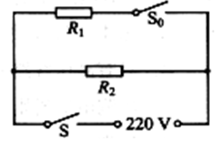
 

 
 
 
 热水箱水量

 
 
 额定电压

 
 
 加热时功率

 
 
 保温时的功率

 
 

 
 
 1kg

 
 
 220V

 
 
 440W

 
 
 40W

 
 

 

（1）电热饮水机处于加热状态时，通过饮水机的电流？

（2）计算电热丝R₁的阻值？

（3）在无人取水状态下，饮水机重新加热一次的时间为150s。加热一次消耗的电能是多少？若饮水机的加热效率为90%，请计算每次重新加热前的水的温度是多少？[计算结果保留整数，水的比热容为C水=4.2×10³J/（kg•℃ )]

【答案】

（1）电热饮水机处于加热状态时，通过饮水机的电流为2A；

（2）电热丝<em><em>R</em></em>1的阻值为121Ω；

（3）每次重新加热前的水的温度是78℃。

【解析】​

## 16. （难度：适中）

如图是电饭锅工作原理的简化电路图，电饭锅有两档，分别是高温烧煮和低温焖饭，S1为档位自动控制开关，R0和R均为电热丝，R0的阻值为1210Ω，该电饭锅铭牌技术参数如下表所示（低温焖饭档额定功率模糊不清）。求：

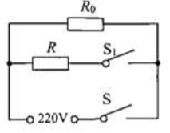
 
某型号电饭锅

额定电压
220V

额定功率
高温烧煮
1040W

低温焖饭
 

电源频率
50Hz

（1）电饭锅高温烧煮0.5h消耗的电能是多少kW•h？
（2）电饭锅低温焖饭时的额定功率是多少W？
（3）某一天，R0烧断了，在只有R连入电路工作的情况下，把一标准大气压下的0.81kg水由20℃加热至沸用了7min，这个过程电饭锅的效率为80%，则这时的实际电压为多少伏？[水的比热容为C水=4.2×10³J/（kg•℃ )]

【答案】

（1）电饭锅高温烧煮0.5h消耗的电能为1.512×106J；

（2）电饭锅低温焖饭时的额定功率为40W；

（3）实际电压为198V。

【解析】​

## 17. 

如图甲所示是一款加热杯，可以通过控制开关实现高、中、低三档加热，其简化电路图如图乙所示。R₁和R₂、R₃均为电热丝，已知R₁=176Ω加热杯的部分参数如表。[水的比热容为C水=4.2×10³J/（kg•℃ )]

求：

‎
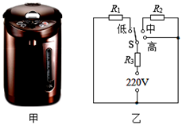
  

 
 
 
 额定电压

 
 
 220V

 
 

 
 
 高温档功率

 
 
 1100W

 
 

 
 
 中温档功率

 
 
 440W

 
 

 
 
 低温档功率

 
 
  

 
 

 
 
 容量

 
 
 1L

 
 

 

（1）R₂的阻值是多少？

（2）加热杯的低温档功率是多少？

（3）若不计热量损失，加热杯使用高温档加热，使1L水从12℃升高到100℃，需要多长时间？

【答案】

（1）<em>R<em>2</em></em>的阻值是66Ω；

（2）加热杯的低温档功率是220W；

（3）若不计热量损失，加热杯使用高温档加热，使1L水从12℃升高到100℃，需要336s。

【解析】​

## 18. （难度：适中）

某品牌台式电烤箱的简化电路如图所示，R₁和R₂分别为电烤箱上、下两组电热管。只闭合S、S₁，电烤箱处于上面烘烤状态；同时闭合S、S₁、S₂，电烤箱处于双面烘烤状态。已知电烤箱的工作电压为220V，双面烘烤功率为1980W，R₂电阻为55Ω。试求：

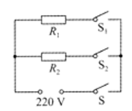
 
（1）双面烘烤时，电路中的电流是多少？
（2）R₁的电阻是多少？
（3）该电烤箱处于上面烘烤状态工作10min，所产生的总热量是多少？

【答案】

（1）双面烘烤时，电路中的电流是9A；

（2）<em>R</em>1的电阻是44Ω；

（3）该电烤箱处于上面烘烤状态工作10min，所产生的总热量是6.6×105J。

【解析】​

## 19. （难度：适中）

如图甲是某品牌的足浴盆，图乙是足浴盆的简化电路图和相关参数，请根据这些信息完成下列问题：

‎ 
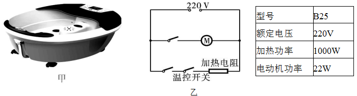
  

​（1）加热电阻正常工作时的阻值为多少？

（2）在足浴盆中加入5kg水，在加热状态下加热了500s，水温从20℃升高到40℃，则足浴盆的加热效率为多少？[水的比热容为C水=4.2×10³J/（kg•℃ )]

（3）启动按摩功能时，通过电动机线圈的电流是多少？

【答案】

（1）加热电阻正常工作时的阻值为48.4Ω；

（2）足浴盆的加热效率为84%；

（3）启动按摩功能时，通过电动机线圈的电流是0.1A。

【解析】​

## 20. 

母亲为了给小林增加营养，买了一台全自动米糊机，如图（甲）所示。米糊机的主要结构：中间部分是一个带可动刀头的电动机，用来将原料粉碎打浆；外部是一个金属圆环形状的电热管，用来对液体加热。如图（乙）所示是米糊机正常工作时，做一次米糊的过程中，电热管和电动机交替工作的“P-t”图象。表格内是主要技术参数。

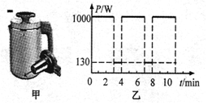
 

 
 
 
  额定容积

 
 
  1.5L

 
 
  加热功率

 
 
  1000W

 
 

 
 
  额定电压

 
 
  220V

 
 
  电机功率

 
 
  130W

 
 

 
 
  额定频率

 
 
  50Hz

 
 
  机器净重

 
 
  1.9kg

 
 

 
 
  整机尺寸

 
 
  232cm×174cm×298cm

 
 

 

请问：

（1）米糊机正常工作时的电热管中的电流是多大？（计算结果保留两位小数）

（2）米糊机正常工作时做一次米糊，消耗的电能是多少？

（3）米糊机在正常工作状态下做一次米糊，若各类原料和清水总质量为1.5kg，初温为20℃，米糊沸腾时温度是100℃，电热管的加热效率是多少？（已知原料和清水的混合物的比热容及米糊的比热容均为4×10³J/（kg•℃ )，计算结果保留百分数整数）。

【答案】

（1）4.55A；

（2）5.556×105J；

（3）89%。

【解析】​

## 21. 

如图甲是小明家的养生壶。它有高温，中温、低温三个档位，如图乙是它工作电路图，图表是其部分参数，其中R₁和R₂为发热电阻R₂=88Ω，求：

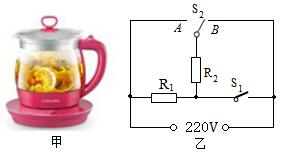
 

 
 
 
 额定电压

 
 
 220V

 
 

 
 
 低温的功率

 
 
 275W

 
 

 
 
 容量

 
 
 3L

 
 

 
 
 防烧干功能

 
 
 有

 
 

 

（1）发热电阻R₁的阻值是多少？

（2）该养生壶中温档时的电功率是多少？

（3）小明某次煲汤时，在额定电压下用高温档加热3kg水，使其温度从20℃上升到100℃，求烧开一壶水需要多长时间？[不计热量损失，水的比热容为C水=4.2×10³J/（kg•℃ )]

【答案】

（1）发热电阻<em><em>R</em></em>1的阻值是88Ω；

（2）该养生壶中温档时的电功率是550W；

（3）烧开一壶水需要916s。

【解析】​

## 22. 

如图所示是一款多功能洗衣机的简化电路图．此款洗衣机额定电压220V，它有两个档位，当开关置于位置1时（电路接入R₁和R₂）为加热状态，消耗功率为2400W；当开关置于位置2时（电路接入R₂和电动机

）为保温洗涤状态。[已知电阻R₁的阻值为22Ω，水的比热容为C水=4.2×10³J/（kg•℃ )]。

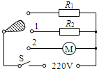
 
（1）在洗衣机内加入质量为20kg、初温为20℃的冷水，求加热到70℃时水吸收的热量；
（2）求R₂的阻值；
（3）已知洗衣机在保温洗涤状态下工作时，电动机的功率为240W，则此时通过电路的总电流为多少？

【答案】

（1）在洗衣机内加入质量为20kg、初温为20℃的冷水，加热到70℃时水吸收的热量为4.2×106J；

（2）<em>R</em>2的阻值为242Ω；

（3）洗衣机在保温洗涤状态下工作时，电动机的功率为240W，则此时通过电路的总电流为1.09A。

【解析】​

## 23. （难度：适中）

如图所示是某型号的爆米花机的电路图，闭合开关S时，R加热，电动机搅拌，开始制作爆米花；爆米花机的铭牌如表所示。[C玉米=1.2×10³J/（kg•℃ )]

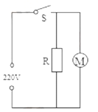
 
额定电压
220V

加热功率
200W

电动机功率
44W

（1）将100g、20℃的玉米加热到320℃成为爆米花时，求玉米粒需要吸收的热量；
（2）电阻R发热，把100g、20℃的玉米粒加热成为爆米花，需要用时5min，求R的加热效率。

【答案】

（1）玉米粒需要吸收的热量为3.6×104J；

（2）R的加热效率为60%。

【解析】​
