# 知识点·焦耳定律实验（同步练习）

> 教材：物理·九年级全一册·沪科技版2024新教材 ｜ 来源：国家中小学智慧教育平台·在线练习 ｜ 共 12 题

## 1. 填空题（难度：简单）

在“探究影响电流热效应的因素”的实验中，小明用如图所示装置进行实验，甲、乙是两个完全相同的烧瓶，瓶内装有质量相等的煤油，瓶内连接的电阻丝的阻值分别为5Ω和10Ω，A、B是相同的温度计，还有满足实验要求的电源、滑动变阻器、电流表、开关和导线。
​
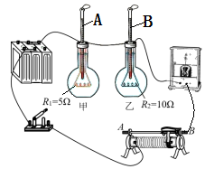

（1）小明选用煤油而不用水，主要是考虑到煤油的比水的小，实验现象更明显；
（2）闭合开关，移动变阻器的滑片在某位置，通电后观察到B温度计的示数比A温度计的示数升高得快。由此可得出的结论是；
（3）为了探究电流产生的热量与电流的关系，小明准备将甲、乙两烧瓶中的电阻丝并联，通电相同时间后比较两支温度计升高的温度得出结论。小明的设想（选填“可行”或“不可行”）。
（4）完成以上探究后，小明将乙烧瓶内的煤油换成等质量的水，闭合开关，通电一段时间后，发现温度计A升高的示数大于温度计B升高的示数。根据这一现象，结合（2）中得到的结论，（选填“能”或“不能”）确定水的比热容比煤油的比热容大，理由是。​

【答案】比热容，电流和通电时间相同，电阻越大，电流产生的热量越多，不可行，能，水吸收的热量多，而升高的温度小

【解析】​

## 2. （难度：适中）

小明做“探究电流通过导体产生热量的多少跟什么因素有关”的实验。如图所示，有3个空烧瓶瓶口向下，固定在竖直的木板上，瓶口用橡皮塞塞紧，3根两端开口的L形的玻璃短管穿过橡皮塞与瓶内相通，每根玻璃管中各有一段相同长度的红色水柱，实验前使3条红色水柱在同一高度，每个瓶中各有一根电阻丝（阻值分别为6Ω、3Ω、3Ω），电源电压调到3V，瓶子不漏气，请回答下列问题：

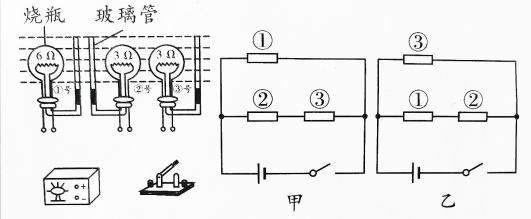

此实验是通过观察来判断电阻丝产生热量的多少，利用此实验装置时，实验所用时间比加热液体所用时间缩短很多，其原因是。

小明要完成该实验，应采用___​__电路图，并在图中用笔画线将电路连接完整。

小明连好实物电路后，闭合开关，2min后号烧瓶中玻璃管红色水柱更高。

在上面（3）小问中，①号烧瓶内的电阻丝产生热量为。

闭合开关一段时间后，①②③三只烧瓶产生的热量之比为。

【答案】红色水柱高度/气体受热膨胀比液体明显，

乙 ； 

 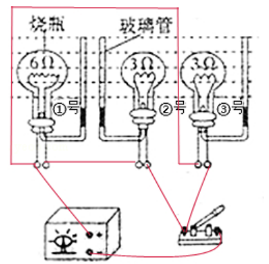

，③，80J，2:1:9

【解析】提示：解析视频请查看最后一题。

提示：解析视频请查看最后一题。

提示：解析视频请查看最后一题。

提示：解析视频请查看最后一题。

​

## 3. 填空题

某同学用如图所示的实验装置探究电流通过导体产生的热量与哪些因素有关，两个透明容器中封闭着等量的空气。
 
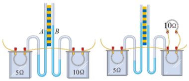
 
（1）通电后透明容器中电阻丝的内能增大是通过（选填“做功”或“热传递”）方式改变的。
（2）观察图甲中的A、B管，在通电时间相等时，发现B管液面上升得更高，表明电流通过导体产生的热量多少与有关。
（3）采用图乙中的实验装置探究“电流产生的热量跟电流是否有关”时，右边透明容器中应该选用阻值为Ω的电阻丝。
（4）能用图乙中的实验结论解释的现象是（填序号）。
①电炉丝通过导线连接到电路里，电炉丝热得发红而导线几乎不发热。
②电风扇通过导线连接到电路里，导线几乎不发热。电热水壶通过同样的导线连接到电路里，导线明显发热。
③冬天在房间里使用电取暖器时，通电越久，房间里温度会越高。

【答案】做功，电阻，5，②

【解析】​

## 4. 填空题（难度：适中）

生活中我们发现：电炉丝通过导线接到电路里，电炉丝热得发红，而导线却几乎不发热。为了探究“电流通过导体时产生热量的多少跟什么因素有关，老师设计了如图甲、乙两组实验装置：将a、b、c、d四段电阻丝分别密封在完全相同的盒内，盒内封闭一定量的空气，并与装有相同液体的U形管相连通。将电阻丝e与图乙中电阻丝d并联置于盒外，五段电阻丝中b为10Ω其余均为5Ω。
 
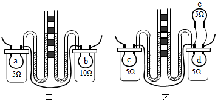

（1）实验中通过观察U形管中变化来比较电流通过电阻丝产生的热量的多少。这种实验方法叫。
（2）（选填“甲”“乙”）装置可探究电流产生的热量与的关系。
（3）其中装置能够解释“电炉丝热得发红，而导线却几乎不发热”。
（4）乙装置通电一段时（选填“左瓶”或“右瓶”）内的电阻丝产生的热量多。
（5）让乙装置冷却到初始状态，把右瓶并联的两根电阻丝都放入瓶内，接通电源比较两瓶内电阻丝发热多少。此时该装置是探究电流产生的热量跟的关系，一段时间后电阻丝产生的热量（选填“左瓶”、“右瓶”、“两瓶一样”）多。

【答案】液面高度，转换法，甲（乙），电阻（电流），甲，左瓶，电阻，左瓶

【解析】​

## 5. （难度：简单）

如图所示是“探究电流产生的热量与哪些因素有关”的实验装置，两个烧瓶及其中煤油的质量、初温均相同，两根电阻丝的阻值分别为R甲、R乙（R甲＞R乙）。 

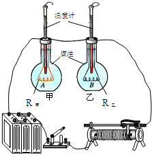

电流通过导体产生的热量无法直接测量，本实验是通过比较来间接比较热量多少的；实验的电路采用这种连接方式，目的是控制相等，从而探究电流通过导体产生的热量与之间的关系。

实验中小红问小明：“打开水龙头就可以得到水，干嘛不用水代替煤油？”，对于这个问题，小明与他的同学给出了下列四种答案，你认为最合理的是___。

实验中，小红和小明发现乙烧瓶中温度计的示数升高的（选填“快”或“慢”），由此得出结论：。

- A. 因为煤油有颜色便于观察
- B. 因为煤油的热值较大
- C. 因为煤油的密度较小
- D. 因为煤油的比热容较小

【答案】温度计示数/通过两段电阻丝的电流和通电时间/电阻大小，D，慢/在电流和通电时间相同的情况下，导体的电阻越大，产生的热量越多

【解析】提示：解析视频请查看最后一题。

提示：解析视频请查看最后一题。

​

## 6. 填空题（难度：适中）

用如图所示的装置探究“电流通过导体产生的热量与电流的关系”，相同烧瓶内装满了煤油。

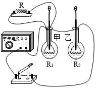
 
（1）烧瓶中装入的煤油是（选填“导体”或“绝缘体”）。
（2）为达到实验目的，选用的两电阻丝R₁与R₂的阻值应（选填“相等”或“不相等”），通过R₁的电流通过R₂的电流（选填“大于”或“小于”）。

【答案】绝缘体，相等，小于

【解析】​

## 7. 

小红和小明分别用如图所示装置，探究电流一定时，电流产生的热量与电阻的关系。他们分别将两段阻值不同的电阻丝（R₁<R₂​​）密封在完全相同的烧瓶中，并通过短玻璃管与气球相连。（设他们所用各种同类器材性能相同）

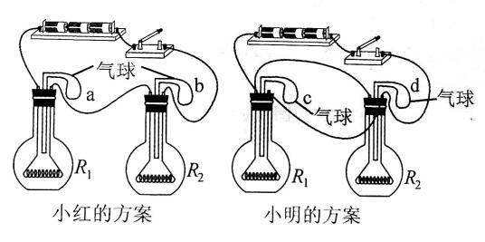

在这个实验中电流产生热量的多少是通过体现出来的。

他们同时开始进行实验，在a、b、c、d四个气球中，鼓起来最快的是。

小红和小明的方案中有一个是错误的，请针对错误方案进行简要评估。

【答案】气球的形变大小 ，c ，

小明的实验方案错误，采用了并联电路导致电流不相等。

【解析】提示：解析视频请查看最后一题。

提示：解析视频请查看最后一题。

​

## 8. 填空题（难度：适中）

在探究“导体产生的热量与导体两端的电压、导体的电阻和通电时间关系”的实验中，实验装置如图所示，两烧瓶A、B中煤油质量相等，两只温度计的示数相同，电阻丝的阻值R1＞R2。

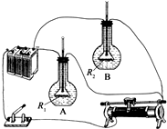
 
（1）开关接在干路，是为了控制相同。
（2）闭合开关后，发现B中温度计的示数上升较快。则B中电阻丝放出的热量比A中放出的热量（选填“多”或“少”）由此得出结论：当导体两端的电压和通电时间相同时，导体电阻越大，导体产生的热量越（选填“多”或“少”）。
（3）电烘箱高温和低温两档的调节是通过改变接入电路的电阻丝的长度来实现的。由上述实验可知：低温档接入电路的电阻丝比高温档要（选填“长”或“短”）一些。

【答案】通电时间，多，少，长

【解析】​

## 9. 

在“探究电流产生的热量与哪些因素有关”的实验中，实验电路如图1所示，其中R1＞R2。

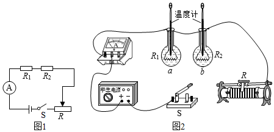
 ​​

实验一：探究电流产生的热量与电阻大小的关系：

请按照图1中的电路图将图2实物图连接完整；

实验电路按照图1中的电路图连接是为了控制通电时间相同和控制；电阻丝放出热量的多少，通过来进行判断。

为了便于比较两根电阻丝通过电流后产生热量的多少，a、b两瓶中要装入相等、初温相同的同种液体。为了在较短时间内达到明显的实验效果，实验时选用煤油而不选水，是因为煤油的比热容水的比热容（选填“大于”、“等于”或“小于”）。​

实验二：探究电流产生的热量与电流大小的关系：
闭合开关，移动滑动变阻器的滑片，使电路中的电流变成实验一中电流的2倍，且通电时间相同。实验发现：用电阻丝R1加热的煤油，在实验一中温度升高Δt1，在实验二中温度升高Δt1’，则Δt1’2Δt1（选填“大于”、“等于”或“小于”），该实验说明电流产生的热量与电流大小正比例关系（选填“成”或“不成”）。实验中，用电阻丝R2加热煤油重复以上实验步骤，也可以得出相同的结论。

如果在两烧瓶中分别装入质量相等的不同液体，并接入两根阻值的电阻丝（选填“相同”或“不同”），就可用这个装置来探究两种不同液体的吸热性质。假设d烧瓶中液体的质量为m，瓶中电阻丝的阻值为R，测出通过它的电流为I，通电一段时间t后，温度计的示数变化量为Δt，若不计热量损失，则a液体的比热容为（用所给出的物理量写出比热容的表达式）。

【答案】

如下图所示：

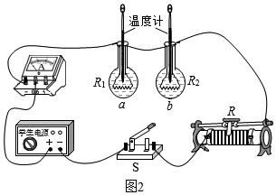 

，电流相同/温度计的示数变化，质量/小于，大于/不成，相同/<latex class="math-tex">\(c\frac {{I}^{2}Rt} {mΔt}\)</latex> 

【解析】提示：解析视频请查看最后一题。

提示：解析视频请查看最后一题。

提示：解析视频请查看最后一题。

提示：解析视频请查看最后一题。

​

## 10. 填空题

如图是探究“电流通过导体时产生的热量与哪些因素有关”的实验装置，两个透明容器中密封着等量的空气。
 
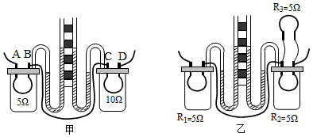
 
（1）甲装置可探究电流产生的热量与的关系，通电一段时间后，（填“左”或“右”）侧容器中U形管中液面的高度差大。
（2）乙装置中电阻R₃的主要作用是。
（3）如果乙装置中​R₃​发生了断路，保证通电时间相同，与断路前相比较，则左侧​U​形管中液面的高度差将（​填“变大”、“变小”或“不变”）​。

【答案】电阻，右，使流过容器中电阻<em><em>R</em></em><em><em>1</em></em><em><em>、R</em></em><em><em>2</em></em>的电流不同，变小

【解析】​

## 11. 

小华在家里学习烧饭做菜的过程中，经常要加热油和水，因此，她对一些物理现象有了一定的感性认识，她猜想油的比热容比水小。

能够支持她这一猜想的事实有___。

她设计了探究实验，如图所示电路，三个规格相同的锥形瓶内，分别装有质量相同，初温同为16℃的煤油或水。

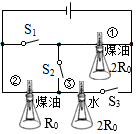
 
①为比较水与煤油的比热容大小，应闭合开关，观察两支温度计（填温度计序号）示数的变化。在同样条件下加热相同时间后，水的温度达到25℃，油的温度达到30℃，由此可得油的比热容为J/（kg•℃）水的比热容为4.2×10³J/（kg•℃）。
②为探究“电流通过导体产生热量的多少与电阻大小的关系”，应只闭合开关，观察两支温度计示数变化情况（填温度计序号）。

- A. 相同条件下，油比水凉的快
- B. 油能把食物炸的焦黄，而水不能
- C. 油能漂在水面上
- D. 油比水难蒸发
- E. 相同条件下，加热时油比水热的快

【答案】A/E，S1、S2、S3/①③/2.7×103/S2/①②

【解析】提示：解析视频请查看最后一题。

​

## 12. 填空题（难度：简单）

​小刚在“探究通电时间相同时，电流通过导体产生的热量跟电流、电阻的关系”的实验中，设计了如图所示电路。在三个相同的烧瓶中，装有自量相等的煤油，用电阻丝（R甲= R丙 ≠R乙）给烧瓶中的煤油加热，然后观察并记录烧瓶中温度计示数的变化情况，就可以对电阻丝放热的多少进行比较。请你仔细观察电路图，并回答下列问题。

​
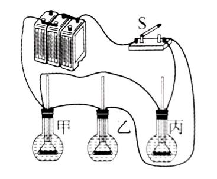
 

（1）研究导体产生的热量与电阻关系时，应该比较烧瓶中温度计示数变化情况。

（2）研究导体产生的热量与电流关系时，应该比较烧瓶中温度计示数变化情况。

【答案】甲、乙，甲、丙

【解析】​
