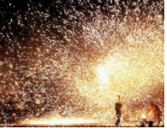
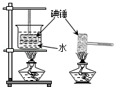
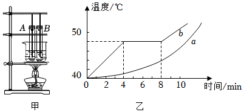

# 知识点·熔化（同步练习）

> 教材：物理·九年级全一册·沪科技版2024新教材 ｜ 来源：国家中小学智慧教育平台·在线练习 ｜ 共 3 题

## 1. 填空题（难度：简单）

“打铁花”是一种民族文化表演技艺，如图所示，表演者先将铁块放入炉子中变成铁水，然后击打铁水形成“铁花”，“铁花”又点燃烟花鞭炮，场景蔚为壮观．其中，铁块变成铁水的过程对应的物态变化为，此过程需要（选填“吸收”或“放出”）热量，温度．

【答案】熔化，吸收，保持不变

【解析】​

## 2. 填空题（难度：适中）

小明在观察“碘锤”中的物态变化之前，查阅资料得知：酒精灯外焰的温度约为\( \text{800}\text{℃}\)，碘的熔点为\( \text{113}\text{.}\text{7}\text{℃}\)．采用图中的两种方式加热，左图的碘颗粒吸热会（填物态变化名称，下同），右图中的碘颗粒吸热除了发生左图中的物态变化外，还可能会．

【答案】升华，熔化 

【解析】​

## 3. 填空题

某小组利用如图甲所示的装置探究固体熔化时温度的变化规律．
\( \text{（}\text{1}\text{）}\)本实验采用水浴法加热的优点是．
\( \text{（}\text{2}\text{）}\)图乙是根据实验数据作出的海波和石蜡的温度随时间变化的图像．图线（选填“\( a\)”或“\( b\)”）是海波的熔化图像，判断理由是．
\( \text{（}\text{3}\text{）}\)在海波和石蜡熔化的过程中，如果将试管从烧杯中取出，海波和石蜡停止熔化；再将试管放回烧杯后，海波和石蜡又继续熔化，该现象说明固体熔化时需要．

【答案】均匀受热，b  ，有固定的熔点  ，不断吸热

【解析】​
