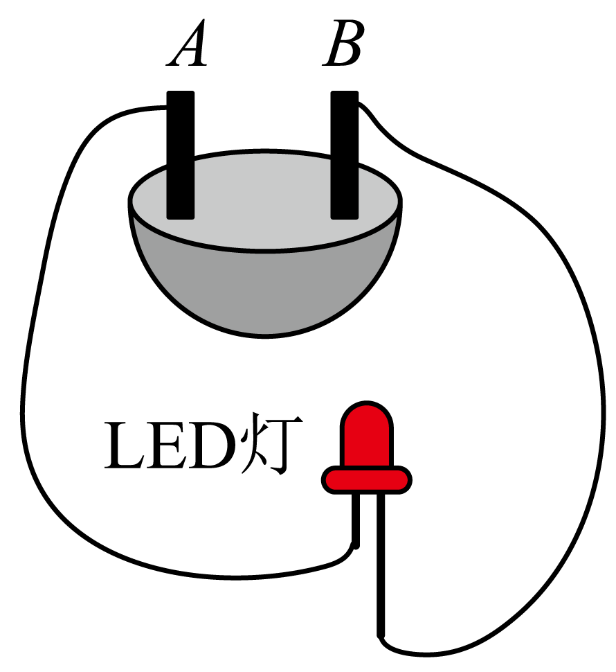

# 知识点·物体导电性能的辨析（同步练习）

> 教材：物理·九年级全一册·沪科技版2024新教材 ｜ 来源：国家中小学智慧教育平台·在线练习 ｜ 共 3 题

## 1. 填空题（难度：简单）

如图所示：用水果电池点亮了发光二极管。发光二极管的主要材料为（选填“导体”、“绝缘体”或“半导体”）。在这个水果电池中A、B这两个金属片中相当于电池正极的是金属片，发光二极管具有性。
 

【答案】半导体，B，单向导电

【解析】​

## 2. 填空题

如图电热膜是在绝缘的聚酯薄膜表面，经过特殊工艺加工形成的一条条薄的导电墨线，导电墨线两端与金属导线相连，形成网状结构。如当某根导电墨线的局部导电材料脱落，其电阻阻值（选填“变大”、“变小”或“不变”）
 

【答案】变大

【解析】​

## 3. 填空题（难度：适中）

如图所示，在2022年央视春晚现场，首次运用LED（发光二极管）屏幕打造720°穹顶空间，LED的核心部分是由（选填“导体”、“半导体”或“超导体”）材料制成，这些LED大屏幕相互之间应是（选填“串联”或“并联”）的。为了呈现绚丽多彩的效果，组成大屏幕的LED，应有红、、蓝三种颜色。
 

【答案】半导体，并联，绿

【解析】​
