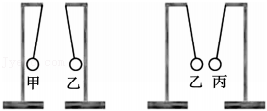
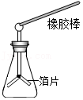
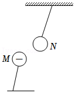
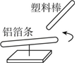
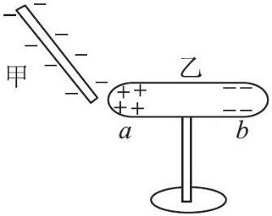

# 知识点·物体带电情况的判断（同步练习）

> 教材：物理·九年级全一册·沪科技版2024新教材 ｜ 来源：国家中小学智慧教育平台·在线练习 ｜ 共 10 题

## 1. 单选题

用塑料梳子梳头发时，头发容易被梳子“粘”着．下列现象中“粘”的原因与其相同的是（    ）．

- A. 两个铅柱底面削平挤压后能“粘”在一起
- B. 黑板刷可以“粘”在磁性黑板上
- C. 在干燥的天气里，化纤布料的衣服容易“粘”在身上
- D. 用硬纸片盖住装满水的玻璃杯倒置后，纸片“粘”在杯口上

【答案】C

【解析】​

## 2. 单选题（难度：简单）

两个带电小球相互接触后分开，然后又靠近，这时两小球（    ）．

- A. 一定互相吸引
- B. 一定互相排斥
- C. 一定无互相作用
- D. 可能相互排斥，也可能无相互作用

【答案】D

【解析】​

## 3. 单选题（难度：适中）

甲、乙、丙三个轻质小球用绝缘细线悬挂，相互作用情况如图所示．如果丙带正电，则甲（    ）．

- A. 一定带正电
- B. 一定带负电
- C. 一定不带电
- D. 可能带正电

【答案】B

【解析】​

## 4. 单选题

将b、c两球用绝缘细线悬挂而静止．现用带正电荷的a球分别靠近b、c两球，发现a、b间排斥，a、c间相互吸引．则下列说法正确的是（    ）．

- A. b球原来一定带正电荷，c球原来一定带负电荷
- B. b球原来可能带负电荷，c球原来可能不带电
- C. b球原来一定带正电荷，c球原来可能不带电荷
- D. b、c两球原来可能带同种电荷

【答案】C

【解析】​

## 5. 单选题（难度：适中）

当验电器带有一定量的电荷后，金属箔张开了一个角度．现用一个带异种电荷的带电体去接触这个验电器的金属小球，其最终结果是（    ）．

- A. 金属箔张角变小
- B. 金属箔张角变大
- C. 金属箔张角变为零
- D. 以上情形都可能发生

【答案】D

【解析】​

## 6. 单选题

用毛皮摩擦过的橡胶棒接触验电器上端的小球，发现验电器的两个金属箔片张开，如图所示，以下说法正确的是（    ）．

- A. 毛皮的原子核束缚电子的能力比橡胶棒强
- B. 毛皮和橡胶棒摩擦的过程中毛皮失去电子
- C. 验电器的金箔片张开是因为带了异种电荷
- D. 验电器上端的小球是用塑料制成的，目的是使金属箔片更容易张开

【答案】B

【解析】​

## 7. 多选题

将带负电的小球M靠近轻质小球N时，出现如图所示情形．若改用带正电的玻璃棒靠近这个轻质小球N，下列推断正确的是（    ）．

- A. 若相互吸引，N一定带负电
- B. 若相互吸引，N一定不带电
- C. 若相互排斥，N一定带正电
- D. 若相互排斥，N一定不带电

【答案】B/C

【解析】​​

​​

​​

## 8. 填空题

如图所示，用毛皮摩擦过的塑料棒靠近架在针尖上的铝箱条一端时，发现铝箔条会跟随塑料棒旋转起来，则铝箔条带电（选填“一定”“不一定”或“一定不”）．

【答案】不一定

【解析】​

## 9. 单选题（难度：简单）

如图所示，当一个带负电的物体甲靠近置于绝缘支架上不带电的金属导体乙时，乙的\( a\)端带正电，\( b\)端带负电．发生上述现象的原因：金属导体中存在大量可移动的自由电子，电子带负电，自由电子受到物体甲所带电荷的排斥作用，移动到导体乙的另一端．若将图中的物体甲换成用丝绸摩擦过的玻璃棒，下列分析正确的是（    ）．

- A. 导体乙的\( a\)、\( b\)两端都不带电
- B. 导体乙的\( a\)、\( b\)两端都带正电
- C. 导体乙的\( a\)端带正电、\( b\)端带负电
- D. 导体乙的\( a\)端带负电、\( b\)端带正电

【答案】D

【解析】​

## 10. 单选题（难度：简单）

运输汽油的汽车都有一条铁链拖地，其作用是（    ）．

- A. 发出声响，让过往车辆和行人注意
- B. 通过它向空气和大地散热
- C. 作为运油车的统一标志
- D. 汽油因振动摩擦起电，通过与大地相连的铁链使油罐带的电荷导入大地，从而避免造成危害

【答案】D

【解析】​
