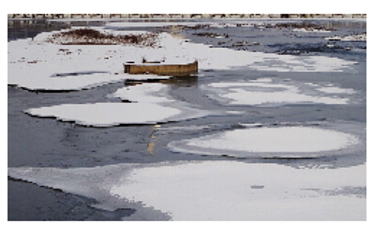
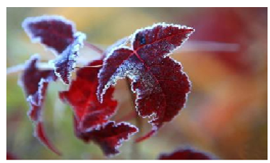
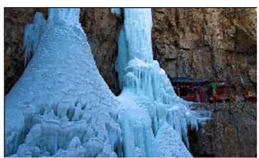
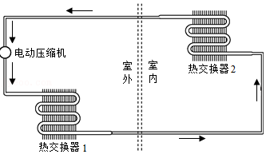
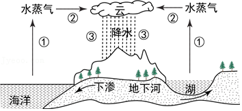

# 知识点·物态变化（同步练习）

> 教材：物理·九年级全一册·沪科技版2024新教材 ｜ 来源：国家中小学智慧教育平台·在线练习 ｜ 共 4 题

## 1. 单选题

中华文化渊远流长，诗词中蕴含丰富的知识．以下有关物态变化的分析，正确的是（    ）．

- A. “已是悬崖百丈冰”一冰的形成是凝固，需要放热
- B. “露似珍珠月似弓”—露的形成是液化，需要吸热
- C. “霜叶红于二月花”—霜的形成是凝华，需要吸热
- D. “斜月沉沉藏海雾”一雾的形成是汽化，需要放热

【答案】A

【解析】​

## 2. 单选题

祖国河山，山青水秀，四季如画，下面四幅图片的物态变化中，是吸热过程的是（    ）．

- A. 春天冰雪消融

​

- B. 夏天荷叶上的露珠

​

- C. 秋天枫叶上的白霜

​

- D. 冬天滴水形成的冰瀑

​

【答案】A

【解析】​

## 3. 填空题（难度：简单）

如图的空调制冷原理图中，环戊烷在管道里按照箭头所示方向循环流动．
\( \text{（}\text{1}\text{）}\)气态的环戊烷被压缩机压入室外的热交换器1，在这里发生的物态变化名称是，此过程（选填“吸热”、“放热”或“不吸放热”）．
\( \text{（}\text{2}\text{）}\)环戊烷“挤”过非常细的管道后流入室内交换器2，在这里发生的物态变化名称是，此过程（选填“吸热”、“放热”或“不吸放热”）．

【答案】液化  ，放热，汽化  ，吸热

【解析】​

## 4. 填空题

下图是水循环示意图，图中过程①发生的物态变化是；过程②中水蒸气有形成的小冰晶，有的形成小水滴，形成千姿百态的云，同时伴随着热；过程③中温度较高时冰晶会变成水滴，与空中下落的水滴一起形成雨．

【答案】汽化  ，凝华  ，液化，放，熔化

【解析】​
