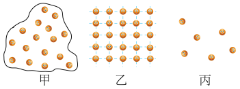

# 知识点·物质构成（同步练习）

> 教材：物理·九年级全一册·沪科技版2024新教材 ｜ 来源：国家中小学智慧教育平台·在线练习 ｜ 共 3 题

## 1. 单选题

下列哪一项属于气态物质分子的排列特点（    ）．

- A. 分子排列十分紧密，分子间有强大的作用力
- B. 分子极度散乱，间距很大，分子间作用力极小，容易被压缩
- C. 分子没有固定的位置，运动比较自由，分子间作用力较小
- D. 分子排列规则，就像坐在教室座位上的学生

【答案】B

## 2. 单选题（难度：适中）

如图所示的示意图形象地反映了物质的气、液、固三态分子排列的特点．下面说法正确的是（    ）．

- A. 甲是气态
- B. 乙是气态
- C. 丙是气态
- D. 甲是固态

【答案】C

## 3. 单选题（难度：简单）

下列物质具有一定体积但没有一定形状的是（    ）．

- A. 玻璃
- B. 氯气
- C. 水
- D. 铁板

【答案】C
