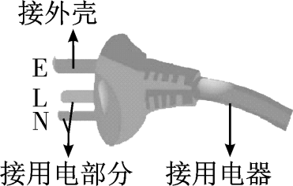
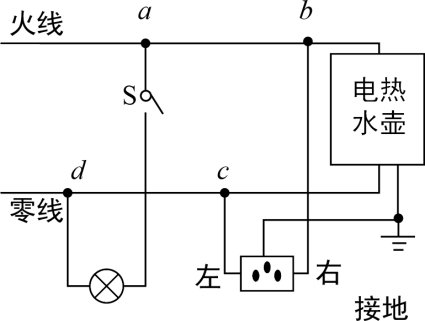
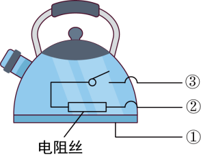
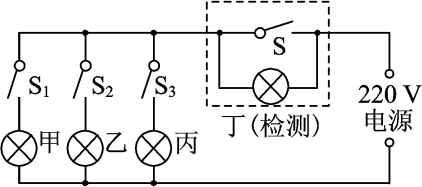

# 知识点·生活用电（同步练习）

> 教材：物理·九年级全一册·沪科技版2024新教材 ｜ 来源：国家中小学智慧教育平台·在线练习 ｜ 共 4 题

## 1. 单选题（难度：简单）

电冰箱、洗衣机等大功率家用电器的电源插头是三脚插头，如图所示．细心的小敏同学发现标“E”的插脚要稍长些，其作用是（    ）

- A. 插插头时外壳先接地线，拔插头时外壳先离地线
- B. 插插头时外壳先接地线，拔插头时外壳后离地线
- C. 插插头时外壳后接地线，拔插头时外壳先离地线
- D. 插插头时外壳后接地线，拔插头时外壳后离地线

【答案】B

## 2. 填空题（难度：适中）

如图是小聪家的部分电路和电热水壶的内部原理图，若小聪将电热水壶的插头插入插座，然后闭合开关时，空气开关跳闸，则原因可能是（选填序号即可：①三孔插座中接火线和零线的导线相碰：②电热水壶插头内两个线头相碰③电热水壶开关内两个线头相碰；④电路中增加了大功率用电器）．

    ​

【答案】④    

## 3. 填空题（难度：适中）

如图所示，家庭电路中新装有甲、乙、丙三盏规格相同的白炽灯，丁为检验灯（四灯额定电压均为\( \text{220 V}\)），在检测过程中：

    
（1）只闭合开关\({\text{S}}_{1}\)，电路中有两盏灯发光，这两盏灯分别是；
（2）此时，这两盏灯是以 联的方式连接在一起的，它们（选填“能”或“不能”）正常发光，判断的依据是；
（3）若只闭合开关\({\text{S}}_{2}\)，丁灯正常发光，则电路存在的故障是；
（4）若电路正常，闭合四个开关，能正常发光的白炽灯是；

【答案】甲、丁，串，不能，两灯的额定电压均为220 V，根据串联分压，它们各自两端的电压均低于额定电压，乙灯短路，甲、乙、丙

## 4. （难度：适中）

如图所示，两根电阻丝规格相同且电阻不变，旋钮开关\(\text{S}\)转动至断开位置，电路不工作；开关\(\text{S}\)转动至低挡位置，电路处于低功率工作状态，仅有一根电阻丝发热；开关\(\text{S}\)转动至高挡位置，电路处于高功率工作状态，两根电阻丝都发热．请以笔画线代替导线完成电路连接．

【答案】

    

