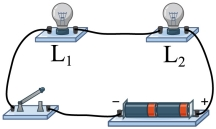
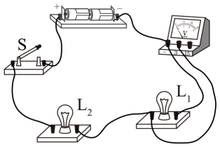
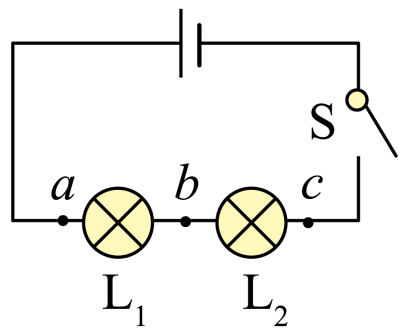
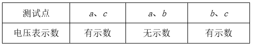
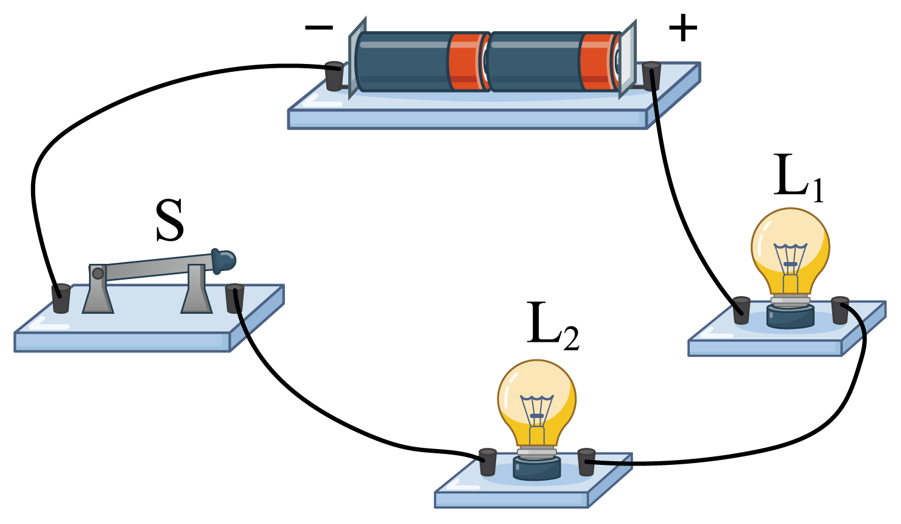
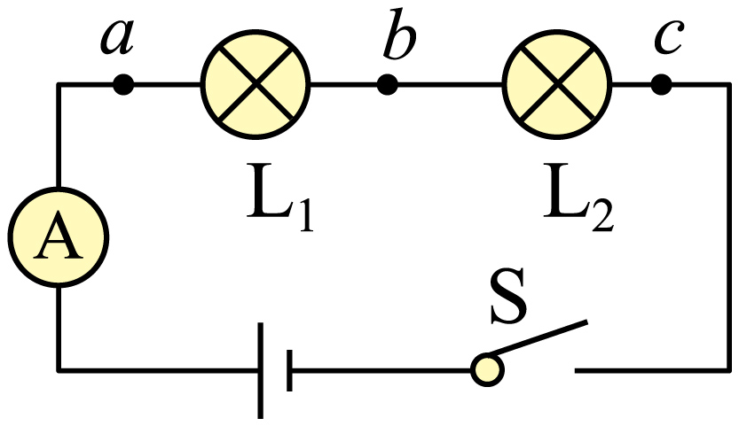
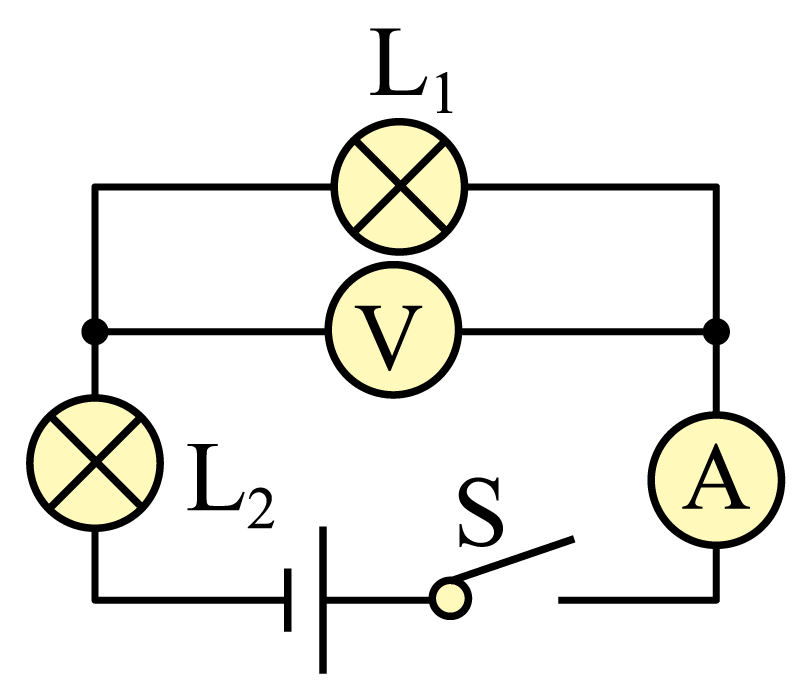

# 知识点·用电压表检测电路故障（同步练习）

> 教材：物理·九年级全一册·沪科技版2024新教材 ｜ 来源：国家中小学智慧教育平台·在线练习 ｜ 共 6 题

## 1. 单选题（难度：简单）

如图所示，闭合开关，两灯均不亮。已知电路连接正确，是其中一个小灯泡出现了故障。将电压表并联在灯泡L₁两端时，电压表无示数。则电路故障是（    ）。

- A. 灯L₁短路
- B. 灯L₂短路
- C. 灯L₁断路
- D. 灯L₂断路

【答案】D

【解析】​

## 2. 单选题

如图所示，闭合开关，下列现象和分析判断正确的是（   ）。

- A. 若灯泡L₁、L₂不亮，一定是L₂灯丝断了
- B. 若只有灯泡L₁断路，则电压表示数为零
- C. 若只有灯泡L₂断路，则电压表有示数
- D. 若电压表示数为零，只有灯泡L₂发光，则L₁短路

【答案】D

【解析】​

## 3. 单选题（难度：适中）

如图所示电路中，闭合电键后，发现灯泡L₁、L₂都不亮，用电压表进行电路故障检测，测试结果如右表所示，则可以判断电路中的故障是（   ）。

​​      

​

- A. L₁短路
- B. L₂短路
- C. L₁断路
- D. L₂断路

【答案】D

【解析】​

## 4. 填空题（难度：简单）

如图电路中，灯泡L₁、L₂均不亮。将电压表接在电源两端或L₁两端时，示数均为3V，改接在L₂两端时示数为0，该电路的故障是；如用电压表接在开关两端，示数应为。

【答案】L1断路  ，0

【解析】​

## 5. 填空题（难度：适中）

如图所示，闭合开关S，发现电灯L₁、L₂均不亮，电流表示数为零，说明电路存在故障，用电压表进行检测，发现b、c间电压为零，a、b和a、c间电压均为3V，则电路的故障是。

【答案】断路，电灯L1处断路

【解析】​

## 6. 填空题

如图所示的电路，闭合开关，两只灯泡都不发光，且电流表和电压表均没有示数。现仅将L₁和L₂两灯泡的位置对调，其它不变，再次闭合开关时，发现两只灯泡仍不发光，电流表指针仍然不动，但电压表的指针却有了明显的偏转。根据上述信息可以判断出该电路的故障是（选填“灯泡L₁”或“灯泡L₂”）灯丝断路。

【答案】灯泡L2  

【解析】​
