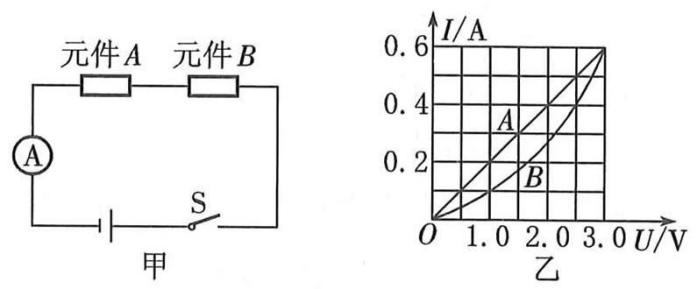
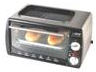
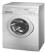

# 知识点·电功（同步练习）

> 教材：物理·九年级全一册·沪科技版2024新教材 ｜ 来源：国家中小学智慧教育平台·在线练习 ｜ 共 9 题

## 1. 单选题（难度：简单）

电能表测量的是（    ）。

- A. 电流
- B. 电功率
- C. 电功
- D. 电压

【答案】C

【解析】​

## 2. 单选题（难度：简单）

电路中有一用电器，其两端电压是6V，通过它的电流是200mA，则5min内电流做的功是（    ）。

- A. 6J
- B. 360J
- C. 6000J
- D. 3.6×10⁵J

【答案】B

【解析】​

## 3. 单选题（难度：简单）

关于电功说法正确的是(    )。

- A. 电流通过电灯做功时，电能只转化为光能
- B. 通过导体的电流越大，电流做的功一定越多
- C. 电流做功的多少可能大于电能转化为其他形式能量的多少
- D. 电流做了多少功，就有多少形式的电能转化为其他形式的能

【答案】D

【解析】​

## 4. 单选题（难度：适中）

R1=5Ω、R2=10Ω，将R1、R2串联后接在3V的电源上，通过R1的电流为I1，R13min消耗的电能为W1；通过R2的电流为I2，R23min消耗的电能为W2，则I1：I2及W1：W2分别为（    ）

- A. 1∶2  1∶2
- B. 2∶1  2∶1
- C. 1∶1  2∶1
- D. 1∶1  1∶2

【答案】D

【解析】​

## 5. 单选题（难度：适中）

两盏电灯串联接在某一电源上，甲灯的电阻为500Ω，乙灯的电阻为1200Ω，在相同的时间内（    ）。

- A. 甲灯消耗的电能多
- B. 乙灯消耗的电能多
- C. 甲、乙两灯消耗的电能一样多
- D. 无法判断

【答案】B

【解析】​

## 6. 单选题

​有两个电路元件A、B，把它们串联在电路中，如图甲所示，通过元件的电流与其两端的电压关系如图乙所示。闭合开关S，这时电流表的示数为0.4A，则在相同时间内A、B两元件的电功之比为 (    ) 。​​  

​

- A. 4：5
- B. 5：4
- C. 2∶3
- D. 1：3

【答案】A

【解析】​

## 7. 单选题（难度：简单）

如图所示的用电器中，工作时主要将电能转化为机械能的是（    ）。

- A. 手提电脑

- B. 电烤箱

- C. 洗衣机

- D. 电视机

【答案】C

【解析】​

## 8. 单选题

电炉的电热丝烧断后截去一段，再重新接好连入原来的电路中，电流在相同时间内所做的功（    ）。

- A. 变少
- B. 不变
- C. 变多
- D. 无法确定

【答案】C

【解析】​

## 9. 单选题（难度：适中）

甲、乙两个用电器并联后接在某一电源上，在相等的时间内，电流通过甲所做的功比乙的多，则（    ）。

- A. 通过甲的电流比乙的大
- B. 甲两端的电压比乙的高
- C. 甲的电阻比乙的大
- D. 乙消耗的电能比甲的多

【答案】A

【解析】​
