# 知识点·电功率（同步练习）

> 教材：物理·九年级全一册·沪科技版2024新教材 ｜ 来源：国家中小学智慧教育平台·在线练习 ｜ 共 40 题

## 1. 单选题（难度：简单）

如图所示为家里的电熨斗，与它有关的下列数据最符合实际的是（    ）。

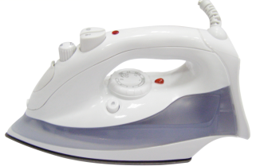

- A. 正常工作时的电流是1A
- B. 正常工作时的电压为36V
- C. 正常工作时的功率为70W
- D. 正常工作1小时消耗的电能约为0.5kW·h

【答案】D

【解析】​

## 2. 单选题

节能灯工作时几乎不发热，而一盏60W白炽灯工作时，热到烫手。一盏10W节能灯的发光亮度与一盏60W白炽灯的发光亮度相当，则60W白炽灯的发光效率大约是（　　）。

- A. 90%
- B. 83%
- C. 42%
- D. 17%

【答案】D

【解析】​

## 3. 多选题（难度：适中）

小强在实验室中利用仪器测量发现某LED灯和白炽灯在正常工作时，两灯的亮度相同。表为该LED灯和白炽灯的部分参数。下列说法中正确的是（　　）。

 
 
 
 二种灯

 
 
 LED灯

 
 
 白炽灯

 
 

 
 
 发光原理

 
 
 二极管发光

 
 
 钨丝高温发光

 
 

 
 
 额定电压

 
 
 24V

 
 
 220V

 
 

 
 
 响应时间

 
 
 10～9s

 
 
 10～3s

 
 

 
 
 额定功率

 
 
 12W

 
 
 100W

- A. 该LED灯的额定电压为24V
- B. 该LED灯正常工作时电流为2A
- C. 正常工作时，白炽灯的实际功率比LED灯大
- D. 该LED灯与白炽灯对比，正常工作10h，LED灯比白炽灯节约电能0.88度

【答案】A/C/D

【解析】​

## 4. 单选题（难度：简单）

下列家用电器中，正常工作时电功率最小的是（　　）。

- A. 空调
- B. 洗衣机
- C. 电视机
- D. 节能台灯

【答案】D

【解析】​

## 5. 单选题（难度：适中）

下列关于电功、电功率的说法中正确的是（　　）。

- A. 电流做功越多，电功率越大
- B. 电流做功越快，电功越大
- C. 用电器消耗电能越多，电功越大
- D. 用电器消耗电能越多，电功率越大

【答案】C

【解析】​

## 6. 单选题（难度：适中）

将一只电炉的电阻丝剪成长度相等的两段，并联后接到原来的电源上（设电源电压保持不变），功率将变为（　　）。

- A. 原来2倍
- B. 原来4倍
- C. 原来的一半
- D. 原来的1/4

【答案】B

【解析】​

## 7. 单选题

如图所示是甲、乙两种电暖器及其铭牌，则下列说法正确的是（　　）。

​​

​

- A. 正常工作时，甲消耗的电能比乙多
- B. 正常工作时，甲消耗的电能比乙慢
- C. 电流通过甲做的功一定比乙的多
- D. 电流通过甲做的功一定比乙的快

【答案】D

【解析】​

## 8. 单选题（难度：简单）

如图所示电路，闭合开关后两灯均正常发光，下列判断正确的是（　　）。

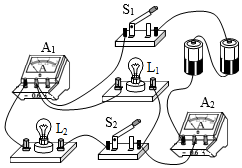

- A. 电流表A₁测通过灯L₁的电流
- B. 两电流表的示数一定不相同
- C. 两灯的额定功率一定不相同
- D. 仅断开S₂，电流表A₂的示数不变

【答案】B

【解析】​

## 9. 单选题

若将通过某一电阻丝的电流增大到原来的3倍，则（　　）。

- A. 电阻消耗的电功率增大到原来的3倍
- B. 电阻消耗的电功率增大到原来的6倍
- C. 电阻消耗的电功率增大到原来的9倍
- D. 无法确定

【答案】C

【解析】​

## 10. 多选题

​如图所示电路，电源电压不变，滑动变阻器的滑片移至最大阻值处，闭合开关，电流表示数为0.1A，小灯泡的功率为0.3W。移动滑片，使滑动变阻器最大阻值的1/3接入电路，电流表示数为0.2A，小灯泡恰好正常发光，且小灯泡消耗的功率为1W。下列计算结果正确的是(　　)。​

​
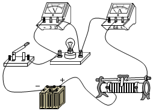

- A. 电源电压为9V
- B. 小灯泡正常发光时电阻为25Ω
- C. 滑动变阻器的最大阻值为25Ω
- D. 小灯泡正常发光时，滑动变阻器消耗的功率为4W

【答案】A/B

【解析】​

## 11. 单选题（难度：简单）

节能扶梯在无人乘坐时，会自动低速运行以达到节能的目的，该功能的实现是通过（　　）。

- A. 增大电流
- B. 增大电源总电压
- C. 减小总功率
- D. 增大总功率

【答案】C

【解析】​

## 12. 单选题（难度：适中）

电源电压3 V保持不变，把标有“3 V　3 W”的灯L₁和标有“3 V　1.5 W”的灯L₂按如图的方式连接．当开关S闭合后，则下列说法中正确的是(　　)。

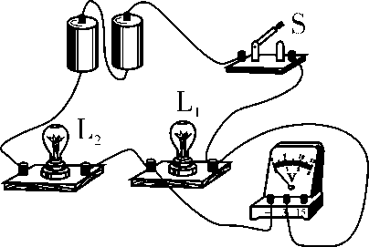

- A. 灯L₁消耗的实际功率是3 W
- B. 灯L₂消耗的实际功率是1.5 W
- C. 两灯消耗的总功率是1 W
- D. 电压表的示数与电源电压之比是1∶2

【答案】C

【解析】​

## 13. 单选题（难度：简单）

如图所示，电源电压保持不变，小灯泡L1、L2分别标有“6V  3W”和“6V  6W”的字样，滑动变阻器R的阻值变化范围为0～12Ω，当S1、S2和S3都闭合，滑动变阻器的滑片滑到a端时，两灯都正常发光。不考虑温度对灯泡电阻的影响，则（　　）。

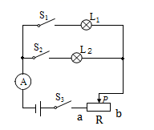

- A. 电源电压为12V
- B. 两灯都正常发光时电流表的示数为3A
- C. 整个电路的最小功率2.25W
- D. 整个电路的最大功率9W

【答案】D

【解析】​

## 14. 多选题

如图所示，电源电压恒为6V，小灯泡L标有“4V  1.6W”字样（阻值保持不变），R1=20Ω。滑动变阻器R2标有“ 30Ω  1A ”。电流表的量程为0～0.6A，电压表的量程为0～3V。下列说法正确的是（　　）。

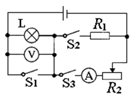

- A. 闭合S2，断开S1、S3时，通过电阻R1电流为0.2A
- B. 断开S2，闭合S1、S3时，滑动变阻器R2连入阻值范围5Ω～10Ω
- C. 闭合开关S3，断开S1、S2时，电灯L消耗的功率范围为0.225W～0.9W
- D. 闭合所有开关，滑动变阻器R2消耗的最大功率和最小功率之比为3：1

【答案】A/C/D

【解析】​

## 15. 单选题（难度：适中）

如图所示电路，电源电压不变，小灯泡标有“ 6V  3W ”字样，闭合开关后，当滑片P移至某一位置时，小灯泡恰好正常发光，此时滑动变阻器消耗的功率为P1；当滑片P移至某一端点时，电流表示数为0.3A，电压表示数变化了3V，此时滑动变阻器消耗的功率为P2，且P1: P2 =5:6。下列判断正确的是（　　）。

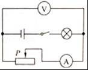

- A. 滑动变阻器的最大阻值为10Ω
- B. 电路允许消耗的最大功率为4.5W
- C. 小灯泡正常发光时，滑片P位于滑动变阻器中点位置
- D. 滑动变阻器消耗的功率由P1变为 P2的过程中，小灯泡消耗的功率变化了0.6W

【答案】B

【解析】​

## 16. 单选题（难度：简单）

如图电路，电源电压保持不变，滑动变阻器R标有“30Ω  1A ”，定值电阻R0的阻值为10Ω，小灯泡L标有“ 6V  3.6W ”（电阻不随温度而变化），电流表的量程为0～3A。当S闭合，S₁、S₂断开，滑片P移到R的中点时，小灯泡恰好正常发光。在保证电路安全的前提下，电路消耗总功率的最小值与最大值之比是（     ）。

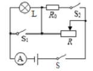

- A. 1：4
- B. 1：8
- C. 2：7
- D. 3：20

【答案】D

【解析】​

## 17. 多选题

定值电阻R₁、R₂和滑动变阻器R₃接入如图电路中，电源电压不变。当开关S1闭合，S2断开，滑片P位于a点时，电压表V₁和V₂的示数之比U1：U2=2：1，电流表的示数I₁=1A；滑片P位于最右端时，电压表V₁和V₂的示数之比U1’:U2’=2:5。当开关S1断开，S2闭合，两个电压表V1和V2的示数之比U1”:U2”=3:1，通过开关的闭合与断开及调节滑动变阻器的滑片，使电路消耗的功率最小为9W。下列说法正确的是（　　）。

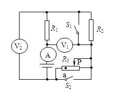

- A. 电源的电压为24V
- B. 滑动变阻器的最大阻值是24Ω
- C. 当开关S1断开，S2闭合，电路消耗的功率为32W
- D. 当开关S1闭合，S2断开，调节滑片P位置，R₃消耗的最大功率为9W

【答案】A/D

【解析】​

## 18. 单选题（难度：适中）

将标有“2V　1W”字样的小灯泡（假设灯丝电阻保持不变）和标有“20Ω  1A”字样的滑动变阻器连接在如图所示电路图中，其中电源两端的电压恒为4.5V，电流表量程为0～0.6A，电压表量程为0～3V。闭合开关，为保证电路安全，在移动滑动变阻器的滑片过程中，下列说法正确的是（　　）。

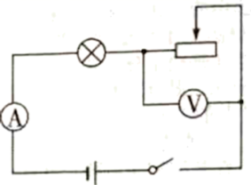

- A. 电流表示数的变化范围是0.19A～0.5A
- B. 电压表示数的变化范围是2V～3V
- C. 滑动变阻器阻值的变化范围是5Ω～20Ω
- D. 电路最大电功率是2.25W

【答案】D

【解析】​

## 19. 多选题（难度：适中）

如图甲是热敏电阻Rt（电阻随温度升高而减小）、灯泡L和定值电阻R0的电流随电压变化的图像。现将它们接入图乙所示的电路中，其中电流表A的量程为0～0.6A，滑动变阻器上标有“？Ω·0.5A”字样。滑动变阻器移至a端，只闭合S1，电流表A的示数为0.6A，此时灯L正常发光；滑片移至b端，只闭合S2，电流表A的示数为0.4A。下列说法正确的是（　　）。

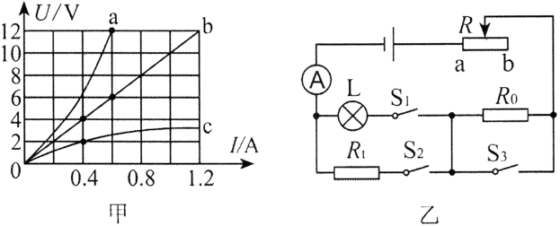

- A. 电源电压是18V
- B. 灯泡L的额定功率是7.2W
- C. 滑动变阻器的最大阻值是20Ω
- D. 闭合S1、S3，断开S2，电路的最大功率是9W

【答案】A/D/B

【解析】​

## 20. 单选题

如图甲所示，电源电压不变，第一次实验闭合开关S1、S2，断开S3，将R2的滑片P2置于最下端，R1的滑片P1从最左端滑至最右端时，电路消耗的功率为P。第二次实验闭合开关S3，断开S1、S2，将R2的滑片P2从最下端向上滑至中点时，电压表V₂的示数为3V，若继续向上滑动滑片P2，电路消耗的最大功率为P′。如图乙所示是两次实验中电流表A与电压表V1、V2示数关系的图象。下列说法正确的是（　　）。

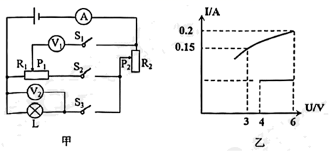

- A. R2的最大阻值为20Ω
- B. 该电路工作时，能消耗的最大总功率为3.6W
- C. 两次实验中P:P′=1:2
- D. 第一次实验向右移动滑片P1的过程中，电路消耗的功率将变大

【答案】C

【解析】​

## 21. 单选题（难度：简单）

如图所示，电源电压保持不变，闭合开关时，滑动变阻器的滑片P从一端滑到另一端时，电压表示数U与电流表示数I的变化关系如图所示、下列说法错误的是（　　）。

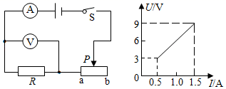

- A. 电源电压是9V
- B. 定值电阻的阻值是6Ω
- C. 电路消耗的最小功率为4.5W
- D. 滑动变阻器的最大阻值为18Ω

【答案】D

【解析】​

## 22. 单选题（难度：简单）

在如图甲电路中，电源电压不变，R₀为定值电阻，R为滑动变阻器。在滑片P从最右端向最左端滑动过程中，电压表与电流表的示数变化关系如图乙。则下列说法正确的是（  ）。

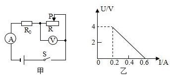

- A. 电源电压为5V
- B. R₀消耗的最小功率为0.4W
- C. 定值电阻R₀为8Ω
- D. 滑片P在中点时，电流为0.4A

【答案】B

【解析】​

## 23. 多选题

如图甲所示的电路中，R1为定值电阻，在移动滑动变阻器R2滑片的过程中，描绘出了如图乙所示的滑动变阻器消耗电功率与电流关系图像，以下计算结果正确的是（　　）。

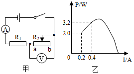

- A. R1的阻值为20Ω
- B. 滑动变阻器最大的阻值为50Ω
- C. 电源电压为8V
- D. 滑动变阻器R2最大的电功率为3.6W

【答案】B/D

【解析】​

## 24. 单选题（难度：简单）

图甲是某同学设计的调光灯电路，图中小灯泡的额定电压为3V，电源电压保持不变，闭合开关S后，将滑动变阻器的滑片从最左端滑到最右端的过程中，测得小灯泡的I﹣U关系图象如图乙所示，下列说法中错误的是（　　）。

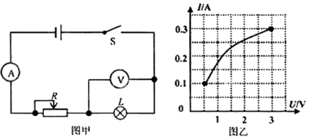

- A. 电源电压为3V
- B. 小灯泡正常发光时的电阻为10Ω
- C. 小灯泡实际功率越大，灯丝电阻越大
- D. 小灯泡的最小功率为0.1W

【答案】D

【解析】​

## 25. 单选题（难度：适中）

如图甲所示电路，电源电压保持不变，电流表A的量程为0-0.6A，电压表V1、V2的量程均为0-3V，滑动变阻器R的规格为“ 50Ω  2A ”；滑动变阻器的滑片P在某点时，电压表V1、V2的示数之和为4V，在保证电路各元件安全的最大范围内调节滑片P，其中一只电压表与电流表示数的变化图象如图乙所示。下列说法正确的是（    ）。

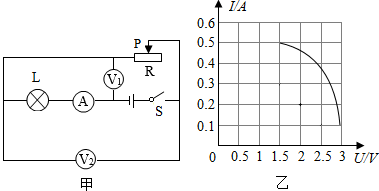
  
①电源电压为6V
②小灯泡的额定功率为0.75W
③滑动变阻器取值范围是3Ω～30Ω
④整个电路消耗的最大功率为2W

- A. 只有③和④
- B. 只有②和③
- C. 只有①和④
- D. 只有①和②

【答案】A

【解析】​

## 26. 多选题（难度：适中）

如图甲所示的电路中，电源电压恒定不变，电流表的量程为0～0.6A ，R1=50Ω， 电灯的额定电压为6V，图乙是电灯的电流与电压关系的图像。当开关S闭合，S1、S2断开，滑动变阻器的滑片在最右端时，电流表的示数为0.25A：当滑动变阻器阻值的\(\frac {1} {3}\)​接入电路时，电灯正常发光。当开关S、S1和S2均闭合时，下列说法正确的是（    ）。

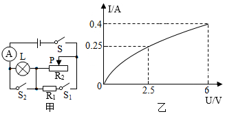

- A. 电源电压为10V
- B. 滑动变阻器的最大阻值为30Ω
- C. 为了保护电路，滑动变阻器接入电路的最小阻值为25Ω
- D. 整个电路消耗的最小电功率为6W

【答案】A/B/C

【解析】​

## 27. 填空题（难度：简单）

一些火灾因线路故障而引起，当线路连接处接触不良时，该处的阻值将（选填“变大”“变小”，下同），该处消耗的电功率将，会产生局部过热，引发火灾。白炽灯的灯丝断了，重新搭上接在原来的电路中，此时白炽灯灯丝的电阻会，灯泡的亮度会（选填“变亮”或“变暗”）。

【答案】变大，变大，变小，变亮

【解析】​

## 28. 多选题

如图所示，电源电压恒为8V，R1＝10Ω，滑动变阻器的规格是“ 20Ω  0.5A ”，电流表的量程为“0～3A”，电压表的量程为“0～15V”，小灯泡的额定电压为6V，小灯泡的I﹣U关系图象如图乙所示。在保证电路安全的情况下，下列说法正确的是（　　）。

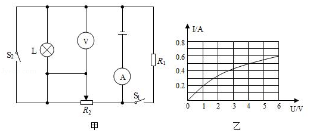

- A. 由乙图可知，小灯泡的额定功率为3.6 W
- B. 当S1、S2都断开，滑动变阻器接入电路的阻值范围是8Ω～20Ω
- C. 当S1、S2都闭合，10 s内R1消耗的电能为64 J
- D. 当S1、S2都闭合，电路消耗的最大电功率是24 W

【答案】A/B/C

【解析】​

## 29. 填空题（难度：适中）

某同学家中有一台电热饮水机，铭牌上部分信息如图所示，饮水机加热电阻不受温度影响。关闭家中其它用电器，只让该饮水机单独工作，电能表转盘转了50转用时60s，电能表参数如图所示，则该饮水机在这段时间内消耗的电能为J，此时家中的实际电压为V。

XX牌电热饮水机

额定电压
220V

额定功率
1210W​

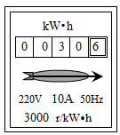

【答案】6&times;104，200

【解析】​

## 30. 填空题（难度：简单）

如图所示，英子家电能表的示数为kW•h，他家最多接入总功率为W的用电器，英子只让某电水壶工作，发现在10分钟内该电能表转盘转过了500转，消耗电能kW•h，该电水壶的实际功率为W。

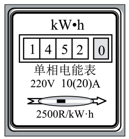

【答案】1452.0，4400，0.2，1200

【解析】​

## 31. 填空题（难度：适中）

明明家电能表上标有“220V 10（40）A”的字样，表示这个电能表的为10A，为40A。家里新购置了一台1kW的空调，这台空调正常工作时，通过它的电流为A（保留一位小数）；已知他家原有用电器的总功率为5600W，从电能表使用的角度考虑，明明家的电路是（填“允许”或“不允许”）安装这样一台空调的。

【答案】标定电流，额定最大电流，4.5，允许

【解析】​

## 32. 填空题

近日福州闽江两岸灯光夜景改造工程完工，使江滨夜景更加美丽，又节能环保。其中尤溪洲大桥换上了约3000盏新型LED灯，灯的功率由原来的28W变为现在的13W，若这些夜景灯每天工作3h，则一个月（按30天计算）kW•h，节省下的电能可使额定功率为1000W的电热水壶正常工作h。

【答案】4050，4050

【解析】​

## 33. 单选题（难度：简单）

额定功率相同的两个用电器，把它们并联在同一电源上，以下说法正确的是（   ）。

- A. 实际功率一定相同
- B. 实际功率一定不同
- C. 额定电压大的实际功率大
- D. 额定电压小的实际功率大

【答案】D

【解析】​

## 34. 单选题（难度：适中）

如图所示，电源电压保持不变，R₁，R₂，和R₃三个电阻阻值都相等，当所有开关都闭合时电路总功率与只闭合S₁时电路总功率之比为（     ）。

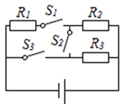

- A. 1:1
- B. 2:1
- C. 4:1
- D. 5:4

【答案】C

【解析】​

## 35. 单选题（难度：适中）

如图所示，某同学设计了一种烟雾报警装置，R₀为定值电阻，R为光敏电阻，其阻值随激光的光照强度减弱而增大．当R接收到的激光光照强度因烟雾而发生改变，使电路中电流小于或等于0.1A时，烟雾报警器报警．若S闭合后，当电流从0.1A变化至0.3A时，光敏电阻R的电功率从1W变为1.8W，在此过程中，下列说法正确的是（     ）。 

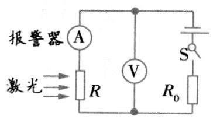

- A. 烟雾浓度逐渐减小时，电压表示数变大
- B. 电源电压为10V，R₀的阻值为20Ω
- C. 当电压表示数为6V时，烟雾报警器报警
- D. R₀消耗的电功率变化了1.6W

【答案】D

【解析】​

## 36. 单选题

如图所示是某同学在做“用滑动变阻器调节灯泡亮度”的实验电路图，电源电压恒为4.5V，电压表量程“0-3V”，电流表的量程“0-0.6A”，滑动变阻器规格“20Ω 1A”，灯泡L标有“2.5V 1.25W”字样（忽略灯丝电阻变化），在不损坏电路各个元件的情况下，下列判断正确的是（     ）。

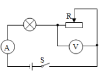
 
①灯泡的最小功率是0.162W
②该电路的最大功率是2.25W
③电压表的示数变化范围是2V-3V
④电流表的示数变化的范围是0.18A-0.5A
⑤滑动变阻器阻值变化的范围是2.5Ω-10Ω

- A. ①②④正确
- B. ②③正确
- C. ②③④正确
- D. ①③⑤正确

【答案】B

【解析】​

## 37. 单选题（难度：适中）

图示电路中，电源电压不变，灯泡L₁上标有“6V 3W”。闭合开关后，灯泡L₁恰好正常发光。若用一个标有“6V 4W”的灯泡L₂替换灯泡L₁（忽略温度对灯丝电阻的影响），闭合开关后，灯泡L₂的实际功率可能是（     ）。

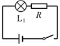

- A. 4.5W
- B. 3.5W
- C. 2W
- D. 1.5W

【答案】B

【解析】​

## 38. 填空题（难度：适中）

如图，甲、乙两只小灯泡规格分别为“6V 6W”和“6V 3W”，电源电压为6V，闭合开关，两灯泡并联：如果只闭合S₃，两灯均发光，则此时灯会较亮（选填“甲”或“乙”），此时乙灯的实际功率是W。（结果保留一位小数，不考虑温度对灯丝电阻的影响）

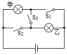

【答案】<em>S</em>1、<em>S</em>2，乙，1.3

【解析】​

## 39. 多选题

如图所示，电源电压恒为12V，L₁上标有“3V 3W”字样，当闭合S₁，将S₂拨至a处，滑动变阻器的滑片移至中点处，L₁正常发光，电路的总功率为P₁；将滑片移至最右端，S₂拨至b时，L₂恰好正常发光，此时电流表的示数为0.5A，电路的总功率为P₂，忽略温度对灯丝电阻的影响，下列说法正确的是（     ）。

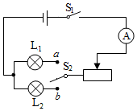

- A. 滑动变阻器的最大电阻为18Ω
- B. P₁:P₂\(=\)​1:2
- C. L₂的额定功率为1.5W
- D. L₂正常发光时电阻为3Ω

【答案】A/C

【解析】​

## 40. 填空题

如图所示电路，电源电压为8V，电阻为10Ω，电流表量程为0-0.6A，电压表量程为0-3V，滑动变阻器标有“20Ω 1A”字样。闭合开关S后，当变阻器滑片从右向左移动时，电流表的示数（填“增大”、“不变”或“减小”），电压表的示数（填“增大”、“不变”或“减小”），若要求两电表的示数均不超过各自的量程，则滑动变阻器消耗的功率变化范围是W。

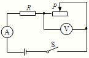

【答案】增大，减小，1.2～1.5

【解析】​
