# 知识点·电功率综合计算（同步练习）

> 教材：物理·九年级全一册·沪科技版2024新教材 ｜ 来源：国家中小学智慧教育平台·在线练习 ｜ 共 25 题

## 1. 

小明同学在物理实验室发现一个电学元件，是由一个标有“2V 2W”的小灯泡和一个定值电阻R₀连接而成。小明同学将该元件接入如图所示的电路中，电源电压恒为6V，闭合开关，无论怎样移动滑动变阻器的滑片P，电流表的示数总在0.2A-1A的范围内变化(小灯泡的电阻不随温度变化，且电路元件始终完好)。求：

​
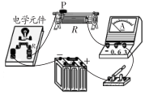

（1）小灯泡正常工作时的电流和电阻；

（2）定值电阻R₀与小灯泡的连接方式；

（3）定值电阻R₀的阻值；

（4）滑动变阻器R的最大阻值。​

【答案】

解：（1）灯泡标有“2V 2W”，灯泡正常工作时的电流：$ I=\frac{{P}_{L}}{{U}_{L}}=\frac{2\mathrm{W}}{2\mathrm{V}}=1\mathrm{A}$，灯泡的电阻：$  {R}_{L}=\frac{{U}_{L}}{{I}_{L}}=\frac{2\mathrm{V}}{2\mathrm{A}}=2\mathrm{\Omega }$；

（2）由题意知通过电路的最大电流是1A，而灯泡允许通过的最大电流也是1A，串联电路各处电流相等，所以灯泡和定值电阻串联接入电路；

（3）当滑动变阻器接入电路的电阻为0Ω时，电路总电阻最小，通过电路的电流最大，由欧姆定律可得电路总电阻：$ R=\frac{U}{I}=\frac{6\mathrm{V}}{1\mathrm{A}}=6\mathrm{\Omega }$，

串联电路总电阻等于各分电阻之和，所以定值电阻<em><em>R</em></em>0的阻值：$ {R}_{0}=R{-R}_{L}=6\mathrm{\Omega }-2\mathrm{\Omega }=4\mathrm{\Omega }$；

（4）当通过电路的电流最小时，滑动变阻器接入电路的电阻最大，由欧姆定律可得电路总电阻：$ {R}^{\text{'}}=\frac{U}{{I}^{\text{'}}}=\frac{6\mathrm{V}}{0.2\mathrm{A}}=30\mathrm{\Omega }$，

则滑动变阻器的最大阻值：$ {R}_{H}={R}^{\text{'}}{-R}_{0}-{R}_{L}=30\mathrm{\Omega }-4\mathrm{\Omega }-2\mathrm{\Omega }=24\mathrm{\Omega }$。

答：（1）小灯泡正常工作时的电流为1A，电阻为2Ω；

（2）定值电阻<em><em>R</em></em>0与小灯泡串联接入电路；

（3）定值电阻<em><em>R</em></em>0的阻值为4Ω；

（4）滑动变阻器R的最大阻值为24Ω。

【解析】​

## 2. （难度：简单）

如图所示的电路，电源电压为6V保持不变，R₁=4Ω。开关闭合，滑动变阻器R₂的滑片置于a端时，电压表V₁的示数为2V，求：

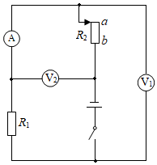
 
（1）电压表V₂的示数；
（2）电流表的示数；
（3）整个电路的功率；
（4）当滑片滑到b端时，通电1min电流做的功。

【答案】

解：（1）开关闭合，<em><em>R</em></em>1、<em><em>R</em></em>2、串联，电压表<em><em>V</em></em>1测量<em><em>R</em></em>1两端的电压，电压表<em><em>V</em></em>2测量<em><em>R</em></em>2两端的电压，电流表测量电路电流。

滑动变阻器<em><em>R</em></em>2的滑片置于a端时，电压表<em><em>V</em></em>1的示数为2V，则<em><em>R</em></em>1两端的电压为2V，电压表<em><em>V</em></em>2的示数<em><em>U</em></em>2=6V-2V=4V；

（2）电流表的示数$ I=\frac{{U}_{1}}{{R}_{1}}=\frac{2\mathrm{V}}{4\mathrm{\Omega }}=0.5\mathrm{A}$；

（3）整个电路的功率<em><em>P</em></em>=<em><em>UI</em></em>=6V×0.5A=3W；

（4）当滑片滑到b端时，滑动变阻器接入电路中的电阻为0，电路为<em><em>R</em></em>1的简单电路，通电1min电流做的功$W=\frac {{U}^{2}} {{R}_{1}}t=\frac {（6\mathrm{V}{）}^{2}} {4\mathrm{\Omega }}\times 1\times 60\mathrm{s}=540\mathrm{J}$。

【解析】​

（1）开关闭合，R₁、R₂串联，电压表V₁测量R₁两端的电压，电压表V₂测量R₂两端的电压，电流表测量电路电流。
滑动变阻器R₂的滑片置于a端时，电压表V₁的示数为2V，则R₁两端的电压为2V，根据串联电路的电压特点可知电压表V₂的示数；
（2）根据欧姆定律得出电流表的示数；
（3）根据P=UI得出整个电路的功率；
（4）当滑片滑到b端时，滑动变阻器接入电路中的电阻为0，电路为R₁的简单电路，根据\( W=\frac{{U}^{2}}{R}\)得出通电1min电流做的功。
本题考查串联电路的特点、欧姆定律的应用和电功率的计算，综合性强，难度适中。

## 3. 填空题

​如图，甲、乙为两只相同电表，当闭合S₁，S₂时，甲、乙两表示数之比为4：3，则两表均为表。两电阻大小之比R₁：R₂为，电路总功率为P₁，同时更换两电表种类，调整开关状态，使两表均有正常示数，此时电路总功率为P₂，则P₁：P₂为。​

​
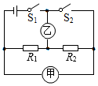

【答案】电压，1：3，3：16

【解析】​

## 4. （难度：简单）

如图所示，已知R₁=10Ω，R₂=15Ω，电源电压U=10V。求：

​
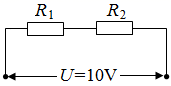

（1）通过R₁的电流；

（2）R₂消耗的电功率。​​

【答案】

解：（1）由图可知，两电阻串联，则通过<em><em>R</em></em>1的电流为

$ {I}_{1}=I=\frac{U}{{R}_{1}+{R}_{2}}=\frac{10\mathrm{V}}{10\mathrm{\Omega }+15\mathrm{\Omega }}=0.4\mathrm{A}$ 

（2）<em><em>R</em></em>2消耗的电功率为

<em><em>P</em></em>=<em><em>I</em></em>22<em><em>R</em></em>2=<em><em>I</em></em>2<em><em>R</em></em>2=(0.4A)2×15Ω=2.4W

答：（1）通过<em><em>R</em></em>1的电流为0.4A；

      （2）<em><em>R</em></em>2消耗的电功率为2.4W。

【解析】​

## 5. （难度：适中）

如图所示为模拟调光灯电路，电源电压恒为6V，灯泡标有“2.5V 0.5A”字样(灯丝阻值不变)，滑动变阻器标有“20Ω 1A”字样。求：

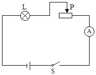
  
（1）灯泡正常发光时的电功率；
（2）灯泡正常发光时滑动变阻器接入电路的阻值。

【答案】

解：（1）灯泡正常发光时的电压为2.5V，电流为0.5A，则此时小灯泡消耗的电功率<em><em>P</em></em>L=<em><em>U</em></em>L<em><em>I</em></em>L=2.5V×0.5A=1.25W；

（2）根据串联电路的电压关系可知，滑动变阻器两端的电压为：

$ {U}^{\text{'}}=U-{U}_{\mathrm{L}}=6\mathrm{V}-2.5\mathrm{V}=3.5\mathrm{V}$；

滑动变阻器接入电路的电阻为：$ {R}^{\text{'}}=\frac{{U}^{\text{'}}}{{I}_{\mathrm{L}}}=\frac{3.5\mathrm{V}}{0.5\mathrm{A}}=7\mathrm{\Omega }$；

（3）电源电压6V大于灯泡的额定电压，由甲电路图可知，当滑动变阻器接入电路中的电阻过小时，会造成灯泡两端的电压过大损坏小灯泡；

为让滑片能自由移动，且小灯泡安全工作，当滑动变阻器接入电路中的电阻为零时，灯泡应正常发光，电路中应串联接入一个7Ω的电阻<em><em>R</em></em>0。

答：（1）灯泡正常发光时的电功率为1.25W；

（2）灯泡正常发光时滑动变阻器接入电路的阻值为7Ω；

（3）该电路设计有缺陷，当滑动变阻器接入电路中的电阻过小时，会造成灯泡两端的电压过大损坏小灯泡；解决办法：电路中串联接入一个7Ω的电阻<em><em>R</em></em>0。

【解析】​

（1）额定电压下灯泡正常发光，根据P=UI求出小灯泡正常发光时消耗的电功率；

（2）根据灯泡的额定电压和电源电压求出滑动变阻器两端的电压，根据欧姆定律求出滑动变阻器接入电路的电阻；

（3）电源的电压大于灯泡的额定电压，由甲电路图可知，当滑动变阻器接入电路中的电阻过小时会造成灯泡两端的电压过大损坏小灯泡；为让滑片能自由移动，且小灯泡安全工作，在电路中应串联一个电阻R₀。

本题考查了串联电路的特点和欧姆定律、电功率公式的应用以及电路设计的评估，要注意灯泡正常发光时的电压和额定电压相等。

## 6. （难度：简单）

如图所示，R₁的电阻为5Ω，闭合开关后，通过电阻R₁和R₂的电流分别为0.6A和0.3A，求：

​
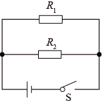

（1）电源电压；

（2）整个电路消耗的总功率。​

【答案】

解：（1）因为并联，所以电源电压等于<em><em>R</em></em>1电压为

​​​​​<latex class="math-tex">\(U={I}_{1}{R}_{1}=0.6\text{A}\times 5Ω=3\text{V}\)</latex>​​​

（2）整个电路消耗的总功率

​​​​​<latex class="math-tex">\(P=U({I}_{1}+{I}_{2})=3\text{V}\times (0.6\text{A}+0.3\text{A})=2.7\text{W}\)</latex>​​​

答：（1）电源电压3V；

（2）整个电路消耗的总功率2.7W。

【解析】​

## 7. 

如图所示，小灯泡L规格为“5V 1W”，R₀=50Ω，电源电压不变，电流表的量程为“0-0.6A”、“0-3A”，闭合开关，小灯泡L正常发光。

​
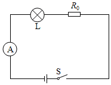

（1）求R₀的功率和电源电压；

（2）拆除小灯泡L，从规格分别为“10Ω 1A”、“100Ω 0.5A”的滑动变阻器中选择其中之一，以及若干导线连入电路。选择哪种规格的变阻器电路消耗的功率最大；最大功率是多少。​

【答案】

解：由电路图可知，闭合开关，灯泡<em><em>L</em></em>与定值电阻<em><em>R</em></em>0串联，电流表测电路中的电流。

（1）灯泡正常发光时其两端的电压<em><em>U</em></em>L=5V，功率<em><em>P</em></em>L=1W，

因串联电路中各处的电流相等，

所以，由<em><em>P</em></em>=<em><em>UI</em></em>可得，电路中的电流$ {I}_{1}=\frac{{P}_{\mathrm{L}}}{{U}_{\mathrm{L}}}=\frac{1\mathrm{W}}{5\mathrm{V}}=0.2\mathrm{A}$；

由$ I=\frac{U}{R}$可得，<em><em>R</em></em>0两端的电压$ {U}_{0}={I}_{1}{R}_{0}=0.2\mathrm{A}+50\mathrm{\Omega }=10\mathrm{V}$，

<em><em>R</em></em>0的功率$ {P}_{0}={U}_{0}{I}_{1}=10\mathrm{V}\times 0.2\mathrm{A}=2\mathrm{W}$，

因串联电路中总电压等于各分电压之和，

所以，电源电压$ \mathrm{U}={U}_{0}+{U}_{\mathrm{L}}=10\mathrm{V}+5\mathrm{V}=15\mathrm{V}$；

（2）若定值电阻<em><em>R</em></em>0与滑动变阻器<em><em>R</em></em>串联时，

当滑动变阻器接入电路中的电阻为零时，电路中的电流最大，最大电流$ {I}_{\mathrm{大}}=\frac{U}{{R}_{0}}=\frac{15\mathrm{V}}{50\mathrm{\Omega }}=0.3\mathrm{A}$；

若定值电阻<em><em>R</em></em>0与滑动变阻器<em><em>R</em></em>并联时，

因并联电路中各支路两端的电压相等，

所以，通过滑动变阻器的最小电流分别为$ {I}_{R}=\frac{U}{R}=\frac{15\mathrm{V}}{10\mathrm{\Omega }}=1.5\mathrm{A}$， $ {I}_{\mathrm{R}}{ }^{\text{'}}=\frac{U}{{R}^{\text{'}}}=\frac{15\mathrm{V}}{100\mathrm{\Omega }}=0.15\mathrm{A}$ ， 

因“10Ω 1A”的滑动变阻器允许通过的最大电流为1<em><em>A</em></em>，且小于1.5A，

所以，该规格的滑动变阻器不能与定值电阻<em><em>R</em></em>0并联，

因“100Ω 0.5A”的滑动变阻器允许通过的最大电流为0.5A，且大于0.15A，

所以，该规格的滑动变阻器能与定值电阻<em><em>R</em></em>0并联，

因并联电路中干路电流等于各支路电流之和，

所以，此时电路的最大总电流$ {I}_{\mathrm{大}}{ }^{\text{'}}={I}_{\mathrm{大}}+{I}_{\mathrm{R}\mathrm{大}}=0.3\mathrm{A}+0.5\mathrm{A}=0.8\mathrm{A}$，

综上可知，当“100Ω 0.5A”的滑动变阻器与定值电阻<em><em>R</em></em>0并联，且电流表（选0～​0.6A量程时位于两支路之一或选0～​3A的量程位于干路）时，电路的总功率最大，

则电路消耗的最大功率$ {P}_{\mathrm{滑}\mathrm{大}}=U{I}_{\mathrm{大}}{ }^{\text{'}}=15\mathrm{V}\times 0.8\mathrm{A}=12\mathrm{W}$。

【解析】​

## 8. （难度：适中）

一个小灯泡正常发光时两端的电压是2.5V，通过的电流是0.2A。现用一个电压为7.5V的电源对其供电，电源两端电压保持不变，为了使小灯泡正常发光，设计了如图所示的电路。求：

​
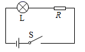

（1）串联的定值电阻R的阻值；

（2）小灯泡的额定功率。​​

【答案】

解：（1）小灯泡正常发光需要2.5V电压，则串联的定值电阻分得电压为

<em><em>U</em></em>R=<em><em>U</em></em>=<em><em>U</em></em>L=7.5V-2.5V=5V

    电路中的电流等于小灯泡正常发光时的电流，则定值电阻的阻值为

$ R=\frac{{U}_{R}}{I}=\frac{5\mathrm{V}}{0.2\mathrm{A}}=25\mathrm{\Omega }$ 

（2）小灯泡的额定功率为

<em><em>P</em></em>=<em><em>U</em></em>L<em><em>I</em></em>=2.5V×0.2A=0.5W

答：（1）串联的定值电阻<em><em>R</em></em>的阻值为25Ω；

       （2）小灯泡的额定功率为0.5W。

【解析】​

## 9. （难度：适中）

在图（a）所示的电路中，电源电压保持不变，电阻R₁为10Ω，滑动变阻器R₂上标有“100Ω 3A”字样。当电键S闭合时，电流表A₁的示数为0.8A，电流表A₂的示数为0.2A。求：

​
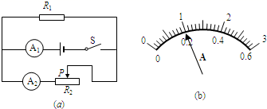

（1）电源电压U。

（2）电阻R₁消耗的功率P₁。

（3）现设想用定值电阻R₀来替换电阻R₁，要求：在移动滑动变阻器滑片P的过程中，能使两电表的指针偏离零刻度线的角度相同，且电路能正常工作。图（b）是电流表表盘示意图

①现有阻值为20Ω的定值电阻，若用它替换电阻R₁，请判断：能不能满足题目要求?若能满足题目要求，通过计算求出替换后滑动变阻器的阻值若不能满足题目要求，通过计算说明理由。

②满足题目要求的定值电阻R₀的可能取值范围是多少?​​

【答案】
解：（1）因为电阻<em><em>R</em></em>1与滑动变阻器<em><em>R</em></em>2是并联连接，A1测干路电流，A2测<em><em>R</em></em>2支路的电流，所以通过<em><em>R</em></em>1支路的电流

<em><em>I</em></em>1＝<em><em>I</em></em>总－<em><em>I</em></em>2＝0.8A－0.2A＝0.6A

故电源电压

<em><em>U</em></em>＝<em><em>U</em></em>1＝<em><em>I</em></em>1<em><em>R</em></em>1＝0.6A×10Ω＝6V

（2）电阻<em><em>R</em></em>1消耗的电功率

<em><em>P</em></em>1＝<em><em>U</em></em>1<em><em>I</em></em>1＝6V×0.6A＝3.6W

（3）①当两电流表指针偏转角度相同时A1的示数是A2的5倍，则

<em><em>I</em></em>总′＝5<em><em>I</em></em>2′

<em><em>I</em></em>总′＝<em><em>I</em></em>1′＋<em><em>I</em></em>2′

<em><em>I</em></em>1′＝4<em><em>I</em></em>2′

<em><em><latex class="math-tex">\({{I}_{1}}^{'}=\frac {U} {{R}_{0}}=\frac {6\text{V}} {20Ω}=0.3\text{A}\)</latex>​</em></em>

<em><em>I</em></em>2′＝0.075A

<em><em><latex class="math-tex">\({{R}_{1}}^{'}=\frac {U} {{{I}_{2}}^{'}}=\frac {6\text{V}} {0.075\text{A}}=80Ω\)<iframe allowtransparency="true" frameborder="0" scrolling="no" src="javascript:void(0)" style="border: 0px; width: 222px; height: 42px; display: inline; vertical-align: middle;"></iframe></latex></em></em>

②当滑动变阻器接入电路的电阻最大<em><em>R</em></em>2＝100Ω时，电阻<em><em>R</em></em>0的阻值最大，由并联电路的分流规律可知，此时电阻<em><em>R</em></em>0的阻值为25Ω，当两电表的示数最大时，即

<em><em>I</em></em>A1＝3A，<em><em>I</em></em>A2＝0.6A

电阻<em><em>R</em></em>0的阻值最小

<em><em><latex class="math-tex">\({{R}_{0}}^{'}=\frac {U} {{I}_{\text{A1}}-{I}_{\text{A2}}}=\frac {6\text{V}} {3\text{A}-0.6\text{A}}=2.5Ω\)<iframe allowtransparency="true" frameborder="0" scrolling="no" src="javascript:void(0)" style="border: 0px; width: 276px; height: 37px; display: inline; vertical-align: middle;"></iframe></latex></em></em>

故满足题目要求的定值电阻<em><em>R</em></em>0的可能取值范围为2.5Ω～25Ω。

答：（1）电源电压是6V；

（2）电阻<em><em>R</em></em>1消耗的功率是3.6W；

（3）①能满足题目要求；

②定值电阻<em><em>R</em></em>0的可能取值范围为2.5Ω～25Ω。

【解析】​

## 10. （难度：简单）

某物理兴趣小组的同学们设计了如甲图所示的电路，其中电源电压不变，灯泡L标有“ 12V  6W ”，滑动变阻器R的规格为“ 20Ω 1A ”，如图乙是定值电阻R₀和灯泡L电压与电流的关系图像。当断开开关S₁，闭合开关S和S₂，并将滑动变阻器的滑片P位于R最右端时，灯泡L的实际功率为1.6W。求：

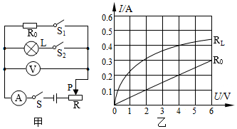

（1）​R₀的阻值；

（2）灯泡正常发光10min，电流通过灯泡所做的功；

（3）电源电压；

（4）甲电路在什么情况下消耗的电功率最大，求电路消耗的最大电功率。

【答案】

（1）20Ω； 

（2）3600J； 

（3）12V； 

（4）当开关$ S$、${S}_{1}$、$ {S}_{2}$都闭合且滑片位于左端时，甲电路消耗的电功率最大，其最大电功率为13.2W。

【解析】​

## 11. 

​如图所示电路，电源电压恒为12V，定值电阻R为12Ω，灯泡L标有“12V 0.5A”字样，假设灯丝电阻不随温度的变化而变化，求：

​
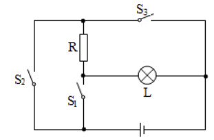

（1）灯泡L的额定功率是多少？

（2）当断开开关S₂、闭合S₁和S₃时，电路中的总电流是多少？

（3）开关S₁、S₂、S₃分别处于什么状态时，整个电路消耗的总功率最小？此时的总功率为多少？​​​​

【答案】
（1）由灯泡<em><em>L</em></em>标有“12V 0.5A”可知，灯泡的额定功率<em><em>P</em></em>=<em><em>UI</em></em>=12V×0.5A=6W，

（2）当断开开关<em><em>S</em></em>2、闭合<em><em>S</em></em>1和<em><em>S</em></em>3时，电阻<em>R</em>与灯<em>L</em>并联，因为​电源电压恒为12V，故灯泡正常发光，通过的电流为0.5A，根据<latex class="math-tex">\(I=\frac {U} {R}\)</latex>​​可知

通过<em><em>R</em></em>的电流<latex class="math-tex">\({I}_{\text{R}}=\frac {U} {R}=\frac {12\text{V}} {12Ω}=1\text{A}\)</latex>​​

根据并联电路电流的规律，电路中的总电流<em><em>I</em></em>=<em><em>I</em></em>L<em><em>+I</em></em>R=0.5A+1A=1.5A

（3）灯的电阻<latex class="math-tex">\({R}_{\text{L}}=\frac {U} {I}=\frac {12\text{V}} {0.5\text{A}}=24Ω\)</latex>​​

​​<latex class="math-tex">\(P=UI=\frac {{U}^{2}} {R}\)</latex>，当电路的总电阻最大时，电路的总功率最小，根据并联的电阻小于其中任一电阻，

故当灯与<em><em>R</em></em>串联时，即<em><em>S</em></em>1、<em><em>S</em></em>3断开，<em><em>S</em></em>2闭合，灯与<em><em>R</em></em>串联时，串联的总电阻最大，根据电阻的串联，此时电阻的总电阻<em><em>R</em></em>串 = <em><em>R</em></em>L + <em><em>R </em></em>= 12Ω+12Ω= 36Ω

​​电路的最小电功率  <latex class="math-tex">\({P}_{最小}=\frac {{U}^{2}} {{R}_{串}}=\frac {(12\text{v}{)}^{2}} {36Ω}=4\text{w}\)</latex>

【解析】​

## 12. （难度：适中）

实验小组的同学设计了如图所示的电路，已知电源电压不变，闭合开关S，调节滑动变阻器滑片P的位置，根据电路中电压表和电流表的数据描绘了如图所示的两条U-I图线。其中利用电压表和电流表的数据描绘出甲图线，利用电压表和电流表的数据描绘出乙图线。求：

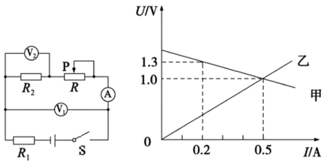
  
（1）定值电阻\( {R}_{2}\)的阻值；
（2）电源电压的大小及定值电阻\( {R}_{1}\)的阻值；
（3）\( {R}_{2}\)消耗的最大功率。

【答案】

（1）2Ω   ；

（2）1.5V  1Ω   ；

（3）0.5W。

【解析】​

## 13. 

如图所示，R₁阻值是20 Ω。当滑片P移到α端，开关都闭合时，电流表示数是0.9 A，灯L正常发光。再断开开关S₁，电流表示数变化了0.4 A。接着调节滑片P到b端，灯L的功率与额定功率之比是1∶4。（电源电压与灯丝电阻均保持不变）。求∶​

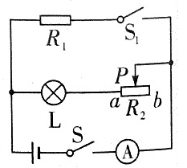
​

​​​（1）电源电压。

（2）灯L的额定功率。

（3）滑动变阻器的最大阻值。

【答案】
​解：（1）当滑片P位于a端，开关都闭合时，灯泡与电阻<em><em>R</em></em>并联，灯泡与电阻<em><em>R</em></em>并联，电流表测干路电流，再断开开关<em><em>S</em></em>1，只有灯泡连入电路，电流表测量灯泡的电流；

由于电流表示数变化量0.4A，则通过<em><em>R</em></em>1的电流为<em><em>I</em></em>1＝0.4A，

由<latex class="math-tex">\(I=\frac {U} {R}\)</latex>​​得电源电压：  <em><em>U</em></em>＝<em><em>I</em></em>1<em><em>R</em></em>1＝0.4A×20Ω＝8V；

（2）由于此时灯泡正常发光，则根据并联电路各支路两端的电压相等可知：

灯泡的额定电压为6V；

根据并联电路的特点可知：<em><em>I</em></em>额＝<em><em>I - I</em></em>1＝0.9A<em><em> - </em></em>0.4A＝0.5A，

灯泡的额定功率：<em><em>P</em></em>额＝<em><em>U</em></em>额<em><em>I</em></em>L＝8V×0.5A＝4W；

（3）灯泡电阻<latex class="math-tex">\({R}_{\text{L}}=\frac {{U}_{额}} {{I}_{额}}=\frac {8\text{V}} {0.5\text{A}}=16Ω\)</latex>​​​

S断开时，滑片P在b端时，灯泡与滑动变阻器<em><em>R</em></em>2串联，

已知：<em><em>P</em></em>实：<em><em>P</em></em>额＝1：4，则<em><em>P</em></em>实＝1/4 <em><em>P</em></em>额＝1/4 ×4W＝1W，

根据<em><em>P</em></em>＝<em><em>I</em></em>2<em><em>R</em></em>可得此时电流：<latex class="math-tex">\(I=\sqrt {\frac {{P}_{实}} {{R}_{\text{L}}}}=\sqrt {\frac {1\text{W}} {16Ω}}=0.25\text{A}\)</latex>​    ​​

总电阻   <latex class="math-tex">\(R=\frac {U} {I}=\frac {8\text{V}} {0.25\text{A}}=32Ω\)</latex>​    ​

根据电阻的串联特点得：   <em><em>R</em></em>2＝<em><em>R</em></em>﹣<em><em>R</em></em>L＝32Ω<em><em>- </em></em>16Ω＝16Ω。

【解析】​

## 14. 

如图甲所示的电路，电源电压保持不变。小灯泡\( L\)标有“2.5V   0.25A”字样，滑动变阻器R₁的最大值为30Ω，定值电阻\( {R}_{2}=30\Omega \)，电流表的量程为0～0.6A，电压表的量程为0～3V。求：

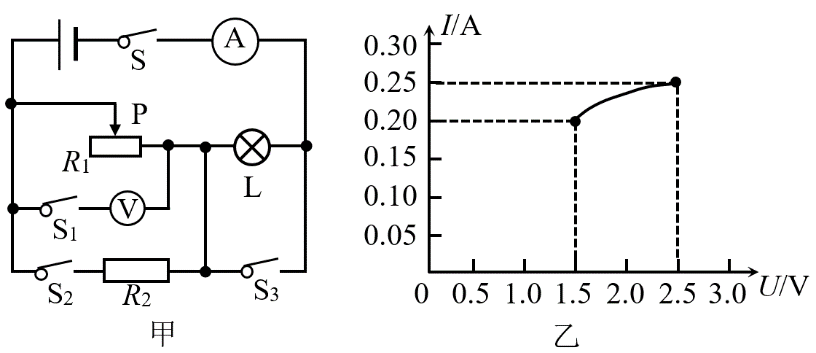

（1）小灯泡的额定功率是多少？

（2）只闭合\( S\)、\( {S}_{2}\)和\( {S}_{3}\)，将变阻器\( {R}_{1}\)的滑片P调到中点时，电流表示数为0.45A，则电源电压是多少？

（3）只闭合开关\( S\)、\( {S}_{1}\)，移动变阻器的滑片P，小灯泡\( L\)的I﹣U图像如图乙所示。在保护各元件安全的情况下，滑动变阻器\( {R}_{1}\)允许的取值范围是多少？

【答案】

（1）0.625W  ；

（2）4.5V  ；

（3）滑动变阻器<em><em>R</em></em><em><em>1</em></em>允许的取值范围是8～15Ω。

【解析】​

## 15. （难度：简单）

​如图所示，R₁=20Ω，R₂=40Ω，电源电压保持不变。当S₁、S₂都闭合时，电流表 A₁的示数是0.6 A，电流表A的示数是1 A，小灯泡L恰好正常发光，求∶

​​
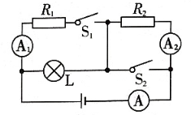
​

（1）电源电压和小灯泡的额定电压。

（2）当S₁、S₂都断开时，电流表A₂的示数是0.2A，则小灯泡的实际功率是多少。​​​​​​

【答案】
（1）当开关<em>S</em>1、<em>S</em>2都闭合时，电阻<em>R</em>1与灯<em>L</em>并联，电流表<em>A</em>1测量的是通过<em>R</em>1的电流I1=0.6A，

从而可知，电源电压<em>U</em>=<em>UL</em>=<em>U</em>1，

∵<em>R</em>1=20Ω，

∴电源电压为：<em>U</em>=<em>U</em>L=<em>U</em>1=<em>I</em>1<em>R</em>1=0.6A×20Ω=12V，

∵小灯泡正常发光，说明灯泡两端的电压为额定电压，

∴灯泡的额定电压为：<em>U</em>L额=<em>U</em>=12V。

（2）当开关S1、<em>S</em>2都断开时，电阻<em>R</em>2与灯<em>L</em>串联，电流表<em>A</em>2测量的是整个电路中的电流， 
从而可知，<em>I</em>2=<em>I</em>L=<em>I</em>=0.2A，

∵<em>U</em>=12V，

∴电路中的总电阻为：​<latex class="math-tex">\(R=\frac {U} {I}=\frac {12\text{V}} {0.2\text{A}}=60Ω\)</latex>

又∵<em>R</em>2=40Ω，

∴灯泡的电阻为：<em>R</em>L = <em>R</em> -<em>R</em>2 = 60Ω-40Ω= 20Ω，

则灯泡的实际功率为：<em>P</em>L=<em>I</em>L2RL=(0.2A)2×20Ω=0.8W。

【解析】​

## 16. （难度：适中）

如图甲所示的电路中，电源电压保持不变，小灯泡L标有“12V 6W”的字样，其电阻不随温度变化，R为定值电阻。当开关S闭合时，小灯泡L正常发光，电流表的示数如图乙所示。求：

​
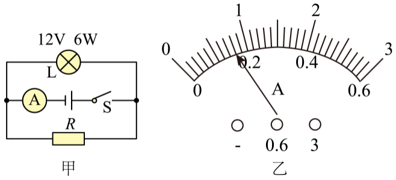

（1）小灯泡L的电阻；    

（2）电阻R的阻值。​​

【答案】

解：（1）小灯泡L正常发光时，根据欧姆定律可知其电阻为

​​​​​<latex class="math-tex">\({R}_{\text{L}}=\frac {{U}_{\text{L}}{\, }^{2}} {{P}_{\text{L}}}=\frac {(12\text{V}{)}^{2}} {6\text{W}}=24Ω\)</latex>​​​

（2）由电路图可知，小灯泡和电阻并联，电流表测量干路电流；由功率公式可知小灯炮正常发光时的电流为

​<latex class="math-tex">\({I}_{\text{L}}=\frac {{P}_{\text{L}}} {{U}_{\text{L}}}=\frac {6\text{W}} {12\text{V}}=0.5\text{A}\)</latex>​​

干路电流应大于0.5A，则图乙所示电流表的量程应为0~3A，对应分度值为0.1A，故读数为0.8A，则通过<em><em>R</em></em>的电流为

​​​​​<latex class="math-tex">\({I}_{\text{R}}=I-{I}_{\text{L}}=0.8\text{A}-0.5\text{A}=0.3\text{A}\)</latex>​​​

据并联电路的特点知，<em><em>R</em></em>的电阻为

​<latex class="math-tex">\(R=\frac {{U}_{\text{R}}} {{I}_{\text{R}}}=\frac {{U}_{\text{L}}} {{I}_{\text{R}}}=\frac {12\text{V}} {0.3\text{A}}=40Ω\)</latex>​​

答：（1）小灯泡L的电阻为24Ω；

（2）电阻<em><em>R</em></em>的阻值为40Ω。

【解析】​

## 17. （难度：简单）

​如图所示的电路，灯泡L标有“6V ”的字样，滑动变阻器R的最大阻值为20Ω，当闭合S₁，断开S₂，灯泡L恰好正常发光，电流表示数为0.2A；当断开S₁，闭合S₂，且滑动变阻器的滑片移到最右端时，电压表读数为4V（假设灯丝电阻不变）。求：​

​
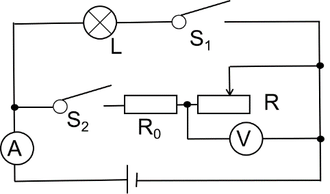
  

（1）电源电压。

（2）R₀的阻值。

（3）当S₁、S₂同时闭合，且滑动变阻器的滑片移到最左端．通电5min整个电路消耗的电能。

【答案】
（1）当闭合S1，断开S2时，仅灯泡<em><em>L</em></em>接入电路。因为此时灯泡<em><em>L</em></em>恰好正常发光，所以

<em><em>U</em></em> = <em><em>U</em></em>L = 6V

（2）当断开<em><em>S</em></em>1，闭合<em><em>S</em></em>2时，<em><em>R</em></em>0与<em><em>R</em></em>串联，当滑动变阻器的滑片移到最右端时，<em><em>R</em></em>接入的阻值最大，即R=20Ω

​​​​​​​<latex class="math-tex">\(I={I}_{0}={I}_{\text{R}}=\frac {{U}_{\text{R}}} {R}=\frac {4\text{V}} {20Ω}=0.2\text{A}\)</latex>​​​

​​​<em><em>U</em></em>0 = <em><em>U</em></em> -<em><em>U</em></em>R = 6V - 4V = 2V

​​​​​<latex class="math-tex">\({R}_{0}=\frac {{U}_{0}} {{I}_{0}}=\frac {2\text{V}} {0.2\text{A}}=10Ω\)</latex>​​​

（3）当<em><em>S</em></em>1、<em><em>S</em></em>2同时闭合，且滑动变阻器的滑片移到最左端时，灯泡<em><em>L</em></em>与<em><em>R</em></em>0并联

此时灯泡正常发光<em><em>P</em></em>L =1.2W    <em><em>U</em></em>0’= <em><em>U =6V</em></em>

<em><em>​</em></em><latex class="math-tex">\({P}_{0}=UI=\frac {{{U}^{'}_{0}}^{2}} {{R}_{0}}=\frac {(6\text{V}{)}^{2}} {10Ω}=3.6\text{W}\)<iframe allowtransparency="true" frameborder="0" scrolling="no" src="javascript:void(0)" style="border: 0px; width: 275px; height: 48px; display: inline; vertical-align: middle;"></iframe></latex>​​<em><em>           </em></em>

 

P = <em><em>P</em></em>L +<em><em>P</em></em>0 = 1.2W + 3.6W =4.8W

因为<latex class="math-tex">\(P=\frac {W} {t}\)</latex>​​

所以 <em><em>W </em></em>=<em><em>Pt </em></em>= 4.8W × 300s =1440J

【解析】​

## 18. （难度：简单）

​PTC是一种新型的半导体陶瓷材料，它的发热效率较高，PTC有一个人为设定的温度。当它的温度低于设定温度时，其电阻值会随它的温度升高而变小；当它的温度高于设定温度时，其电阻值随它的温度升高而变大。如图1所示的陶瓷电热水壶就使用了这种材料。它的工作电路如图2所示，R₀是定值电阻，其阻值不受温度的影响。RT是PTC的电阻，它的电阻值与温度的关系如图3所示。该电热水壶在RT设定温度状态工作时，电路消耗的总功率1100W。​
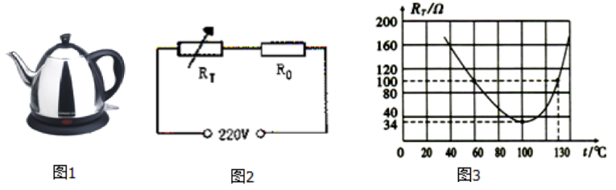
 

（1）R₀的阻值为多少? 

（2）当RT的温度为130℃时，电路中RT的实际功率为多少?​​

【答案】
（1）当在设定温度状态工作时，连入电路的电阻<em>R</em>T=34Ω，<em>R</em>0、RT串联

由电路总电阻​<latex class="math-tex">\({R}_{总}=\frac {{U}^{2}} {P}=\frac {(220\text{V}{)}^{2}} {1100\text{W}}=44Ω\)</latex> ，

<em>R</em>0的阻值：<em>R</em>0=<em>R</em>总-<em>R</em>T=44Ω-34Ω=10Ω。

（2）当<em>R</em>T的温度为130℃时，由图象可知，此时RT的阻值为100Ω，

电路中的总电阻：<em>R</em>'总=<em>R</em>0+<em>R</em>'T=10Ω+100Ω=110Ω，

电路中的电流：​<latex class="math-tex">\({I}^{'}=\frac {U} {{R}^{'}}=\frac {220\text{V}} {110Ω​​​​}=2\text{A}\)</latex> ，

RT两端的电压：<em>U</em>'=<em>I</em>'×<em>R</em>'T=2A×100Ω=200V，

RT的实际功率：<em>P</em>'=<em>U</em>'<em>I</em>'=200V×2A=400W。

【解析】​

## 19. （难度：适中）

如图所示，电源电压恒为12V，小灯泡L标有“6V 3W”字样，定值电阻\( {R}_{2}\)的阻值为6Ω。当开关\( S\)闭合、\( {S}_{1}\)、\( {S}_{2}\)都断开且滑片P移到滑动变阻器的中点时，灯泡\( L\)正常发光。（假设小灯泡的电阻保持不变）求：

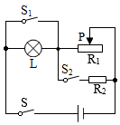

（1）滑动变阻器的最大阻值；

（2）当开关\( S\)、\( {S}_{1}\)、\( {S}_{2}\)都闭合时，调节滑片P的过程中，电路消耗的最小功率是多少。

【答案】

（1）最大电阻为24Ω；

（2）最小功率为30W。

【解析】​

## 20. （难度：适中）

如图，电源电压不变，小灯泡L上标有“6V  6W”字样（灯丝电阻不变）。定值电阻R₁的阻值为10Ω，R₂为滑动变阻器。

​
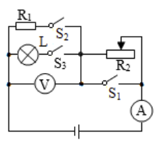

（1）当开关S₁、S₂、S₃都闭合时，小灯泡L正常发光，求此时电流表的示数。

（2）断开开关S₁和S₃，闭合开关S₂，当滑动变阻器的滑片调至阻值最大时，电压表示数为1.5V，求R₂的最大阻值。

（3）当电路中有电阻或小灯泡工作时，求整个电路的最小电功率。​​​​

【答案】
（1）当开关<em>S</em>1、<em>S</em>2、<em>S</em>3都闭合时，电阻<em>R</em>1与灯<em>L</em>并联，电流表测量干路电流，因并联电路中各支路两端的电压相等，且灯泡<em>L</em>正常发光，则电源电压<em>U</em>=<em>UL</em>=6V

通过<em>R</em>1的电流 ​<latex class="math-tex">\({I}_{1}=\frac {U} {{R}_{1}}=\frac {6\text{V}} {10Ω}=0.6\text{A}\)</latex>

电流表的示数<em>I</em> = <em>I</em>L + <em>I</em>1 = 1A + 0.2A =1.6A

（2）当开关<em>S</em>1、<em>S</em>3都断开，开关<em>S</em>2闭合时，电阻<em>R</em>1与滑动变阻器<em>R</em>2串联，电压表测量<em>R</em>1两端的电压，此时电路中的电流<latex class="math-tex">\(I=\frac {{U}_{1}} {{R}_{1}}=\frac {1.5\text{V}} {10Ω}=0.15\text{A}\)</latex>

根据串联分压原则和 ​<latex class="math-tex">\(I=\frac {U} {R}\)</latex>可得，<em>R</em>2的最大阻值<latex class="math-tex">\({R}_{2}=\frac {U-{U}_{1}} {I}=\frac {6\text{V}-1.5\text{V}} {0.15\text{A}}=30Ω\)<iframe allowtransparency="true" frameborder="0" scrolling="no" src="javascript:void(0)" style="border: 0px; width: 251px; height: 37px; display: inline; vertical-align: middle;"></iframe></latex>

（3）根据 <latex class="math-tex">\(P=\frac {{U}^{2}} {R}\)<iframe allowtransparency="true" frameborder="0" scrolling="no" src="javascript:void(0)" style="border: 0px; width: 67px; height: 37px; display: inline; vertical-align: middle;"></iframe></latex>可得，灯泡的电阻 <latex class="math-tex">\({R}_{\text{L}}=\frac {{{U}_{\text{L}}}^{2}} {{P}_{\text{L}}}=\frac {(6\text{V}{)}^{2}} {6\text{W}}=6Ω\)<iframe allowtransparency="true" frameborder="0" scrolling="no" src="javascript:void(0)" style="border: 0px; width: 205px; height: 43px; display: inline; vertical-align: middle;"></iframe></latex>

由<em>R</em>L &lt; <em>R</em>1可知，当<em>S</em>2闭合，<em>S</em>1、<em>S</em>3都断开，<em>R</em>1与<em>R</em>2串联，电路的总电阻最大，电路的总功率最小，则电路的最小总功率<latex class="math-tex">\(P=\frac {{U}^{2}} {{R}_{1}+{R}_{2}}=\frac {(6\text{V}{)}^{2}} {10Ω+30Ω}=0.9\text{W}\)<iframe allowtransparency="true" frameborder="0" scrolling="no" src="javascript:void(0)" style="border: 0px; width: 263px; height: 43px; display: inline; vertical-align: middle;"></iframe></latex>

【解析】​

## 21. 

​如图所示的电路，电源电压保持不变，R₁=20Ω，当闭合开关S₁、S₃，断开S₂时，电流表的示数为0.3A，当闭合开关能S₂、S₃，断开S₁时，电流表的示数为1.2A。

​
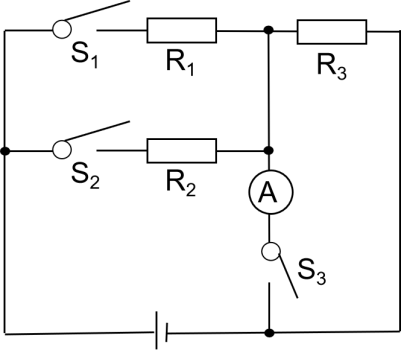

​（1）求电源电压。

（2）求电阻R₂的阻值。

（3）当闭合S₁，断开S₂、S₃时，电路消耗的电功率为P₁；当闭合S₂，断开S₁、S₂时，电路消耗的电功率为P₂，且P₁：P₂=1：2，求电阻R₃的阻值。

（4）求整个电路消耗的最小电功率。​​​​

【答案】
​（1）当闭合开关<em><em>S</em></em>1、<em><em>S</em></em>3，断开<em><em>S</em></em>2时，仅<em><em>R</em></em>1接入

根据<latex class="math-tex">\(I=\frac {U} {R}\)</latex>​​可知   <em><em>U </em></em>= <em><em>IR</em></em>1= 0.3A×20Ω=6V

​（2）当闭合开关能<em><em>S</em></em>2、<em><em>S</em></em>3，断开<em><em>S</em></em>1时，仅<em><em>R</em></em>2接入​​​

​​​<latex class="math-tex">\({R}_{2}=\frac {U} {{I}^{'}}=\frac {6\text{V}} {1.2\text{A}}=5Ω\)</latex>​​​​​​​​​​​​​​

（3）当闭合<em><em>S</em></em>1，断开<em><em>S</em></em>2、<em><em>S</em></em>3时，<em><em>R</em></em>1与<em><em>R</em></em>3串联  <latex class="math-tex">\({P}_{1}=\frac {{U}^{2}} {{R}_{1}+{R}_{3}}=\frac {{U}^{2}} {20Ω+{R}_{3}}\)</latex>

当闭合<em><em>S</em></em>2，断开<em><em>S</em></em>1、<em><em>S</em></em>2时，<em><em>R</em></em>2与<em><em>R</em></em>3串联<latex class="math-tex">\({P}_{2}=\frac {{U}^{2}} {{R}_{2}+{R}_{3}}=\frac {{U}^{2}} {5Ω+{R}_{3}}\)</latex>

因为<em><em> P</em></em>1：<em><em>P</em></em>2=1：2 ， 所以 <em><em>R</em></em>3= 10Ω

​（4）当闭合<em><em>S</em></em>1，断开<em><em>S</em></em>2、<em><em>S</em></em>3时，<em><em>R</em></em>1与<em><em>R</em></em>3串联时，电路的总电阻最大，总功率最小

​<em><em>R</em></em>串 = <em><em>R</em></em>1 + <em><em>R</em></em>3= 20Ω+10Ω= 30Ω

​${P}_{最小}=\frac {{U}^{2}} {{R}_{串}}=\frac {\left ( {6V} \right )^{2}} {30\Omega }=1.2\text{W}$

【解析】​

## 22. （难度：适中）

​小柳买了一台全自动豆浆机，下表是这个豆浆机的主要技术参数。图甲是豆浆机的主要结构：中间部位是一个带动刀头的电动机，用来将原料进行粉碎打浆；外部是一个金属圆环形状的电热管，用来对液体加热煮沸。图乙是豆浆机正常工作做一次豆浆的过程中电热管和电动机交替工作时的P—t图象。​

​
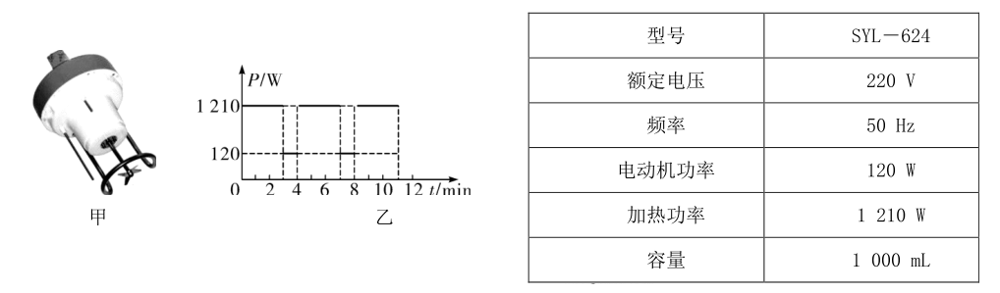
 

（1）豆浆机正常加热时的电流是多少？

（2）豆浆机正常加热时电热管的电阻是多少？

（3）豆浆机正常工作做一次豆浆，总共消耗的电能是多少？

【答案】
（1）根据<em><em>P</em></em>=<em><em>UI</em></em>可得，豆浆机正常加热时的电流：​

​​​​<latex class="math-tex">\({I}_{1}=\frac {{P}_{1}} {U}=\frac {1210\text{W}} {220\text{V}}=5.5\text{A}\)</latex>​​​​​

（2）由​<latex class="math-tex">\(I=\frac {U} {R}\)<iframe allowtransparency="true" frameborder="0" scrolling="no" src="javascript:void(0)" style="border: 0px; width: 55px; height: 35px; display: inline; vertical-align: middle;"></iframe></latex>可得，豆浆机正常加热时电热管的电阻：​

​<latex class="math-tex">\({R}_{1}=\frac {U} {{I}_{1}}=\frac {220\text{V}} {5.5\text{A}}=40Ω\)<iframe allowtransparency="true" frameborder="0" scrolling="no" src="javascript:void(0)" style="border: 0px; width: 199px; height: 36px; display: inline; vertical-align: middle;"></iframe></latex>​​​​

（3）由乙图可知：加热时间<em><em>t</em></em>1=9min=540s，电动机工作时间<em><em>t</em></em>2=2min=120s，

加热消耗的电能：

​<em><em>W</em></em>1=<em><em>P</em></em>1<em><em>t</em></em>1=1210W×540s=6.534×105J

电动机工作消耗的电能：

​<em><em>W</em></em>2=<em><em>P</em></em>2<em><em>t</em></em>2=120W×120s=1.44×104J

豆浆机正常工作做一次豆浆总共消耗的电能：

​<em><em>W</em></em>=<em><em>W</em></em>1+<em><em>W</em></em>2=6.534×105J+1.44×104J=6.678×105J

【解析】​

## 23. （难度：简单）

如图所示，电源电压恒定不变，灯泡L上标有“12V  9W”的字样（不考虑温度对灯丝电阻的影响）。求：

​
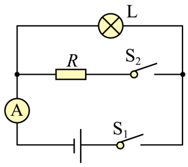

（1）灯泡正常发光时的电流是多少；灯泡L的电阻是多少；

（2）当闭合开关S₁时，电流表的示数为0.5A，则灯泡L的实际功率是多少；

（3）再闭合开关S₂时，电流表的示数为0.9A，则电阻R的阻值是多少；电阻R在5min内消耗的电能是多少。​​

【答案】

解：（1）由<em><em>P</em></em>＝<em><em>U</em></em>I可得，灯泡正常发光时的电流  <latex class="math-tex">\({I}_{\text{L}}=\frac {{P}_{\text{L}}} {{U}_{\text{L}}}=\frac {9\text{W}} {12\text{V}}=0.75\text{A}\)</latex>​   ​ 

由​<latex class="math-tex">\(I=\frac {U} {R}\)</latex>​可得，灯泡的电阻  <latex class="math-tex">\({R}_{\text{L}}=\frac {{U}_{\text{L}}} {{I}_{\text{L}}}=\frac {12\text{V}} {0.75\text{A}}=16Ω\)<iframe allowtransparency="true" frameborder="0" scrolling="no" src="javascript:void(0)" style="border: 0px; width: 210px; height: 38px; display: inline; vertical-align: middle;"></iframe></latex>   ​ 

（2）当闭合开关<em>S</em>1​时，电路为灯泡的简单电路，电流表测通过L的电流，电源的电压

​​​<latex class="math-tex">\(U={{I}_{\text{L}}}^{'}{R}_{L}=0.4\text{A}\times 16Ω=8\text{V}\)</latex>​​​ 

灯泡L的实际功率   <latex class="math-tex">\({{P}_{\text{L}}}^{'}={{UI}_{\text{L}}}^{'}=8\text{V}\times 0.5\text{A}=4\text{W}\)<iframe allowtransparency="true" frameborder="0" scrolling="no" src="javascript:void(0)" style="border: 0px; width: 274px; height: 30px; display: inline; vertical-align: middle;"></iframe></latex>  ​ 

（3）再闭合开关<em>S</em>2​时，灯泡L与电阻R并联，电流表测干路电流，因并联电路中各支路独立工作、互不影响，所以，闭合开关<em>S</em>2​前后通过灯泡L的电流不变，因并联电路中干路电流等于各支路电流之和，所以，通过电阻R的电流

<latex class="math-tex">\({I}_{\text{R}}=I-{{I}_{\text{L}}}^{'}=0.9\text{A}-0.5\text{A}=0.4\text{A}\)</latex>​   ​ 

电阻R的阻值    <latex class="math-tex">\(R=\frac {U} {{I}_{\text{R}}}=\frac {8\text{V}} {0.4\text{A}}=20Ω\)<iframe allowtransparency="true" frameborder="0" scrolling="no" src="javascript:void(0)" style="border: 0px; width: 189px; height: 37px; display: inline; vertical-align: middle;"></iframe></latex> ​ 

因并联电路中各支路两端的电压相等，所以，电阻R在5min内消耗的电能

​​​<latex class="math-tex">\({W}_{\text{R}}=U{I}_{\text{R}}t=8\text{V}\times 0.4\text{A}\times 5\times 60\text{s}=960\text{J}\)</latex>​​​ 

【解析】​

## 24. 

教室里有一款饮水机，其工作电路可简化为如图甲所示的电路。​S是温度控制开关，根据饮水机内水杯中水温的变化自动切换加热和保温两种工作状态，R₁​、R₂​是加热管的电阻（不考虑阻值受温度变化影响），它的部分技术参数如表所示、试回答下列问题：

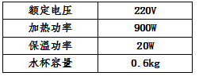

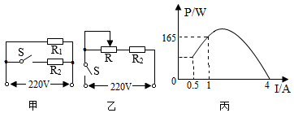

（1）​S闭合时，饮水机处于什么工作状态。R₂​的阻值是多少？

（2）水杯中装满20℃水时，饮水机正常工作，加热多长时间可将水烧开？[水的比热容为4.2×103J/（kg•℃），当时气压设定为1标准大气压，不考虑热损失]

（3）最近一次使用时，加热管R₁​损坏了，物理兴趣小组的同学们利用电位器（相当于滑动变阻器，以下称为变阻器）设计了如图乙所示的电路来控制加热管R₂​的发热功率，在老师的指导下进行模拟实验，将滑片从变阻器的一端滑到另一端的过程中，同学们通过实验测量，得出变阻器消耗的电功率P随电流I关系的图象如图丙所示，则：

①求R₂​的发热功率范围。

②变阻器的最大功率多大？

③简述：这种设计方案有什么不妥之处（指出一种合理的不妥情况即可）。

【答案】

（1）加热；55Ω； 

（2）加热224s可将水烧开； 

（3）①<em>R</em>2​的发热功率范围为13.75W～880W； 

②变阻器的最大功率为220W； 

③因变阻器与<em>R</em>2​串联，若其中任一电阻损坏，将导致整个电路不能工作（或变阻器产生的热量没有被利用）。

【解析】​

## 25. 

如图所示的电路中，电源电压保持不变，灯L标有“12V 6W”的字样，其电阻不随温度变化，R为定值电阻。当开关S闭合时，灯L正常发光，电流表的示数为0.8A。

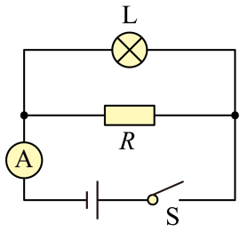
​

求：（1）灯L的电阻；

（2）电阻R的阻值；

（3）电阻R消耗的电功率。

【答案】
（1）灯L的电阻

<latex class="math-tex">\({R}_{\text{L}}=\frac {{U}^{2}} {P}=\frac {({12\text{V})}^{2}} {6\text{W}}=24Ω\)</latex>​

（2）由电路图可知，当开关S闭合时，灯L与定值电阻<em>R</em>并联，电流表测电路中的电流，灯L正常发光，通过灯L的电流

<latex class="math-tex">\({I}_{\text{L}}=\frac {U} {{R}_{\text{L}}}=\frac {12\text{V}} {24Ω}=0.5\text{A}\)</latex>

由并联电路中电流的特点，通过定值电阻<em>R</em>的电流

<latex class="math-tex">\({I}_{\text{R}}=I-{I}_{\text{L}}=0.8\text{A}-0.5\text{A}=0.3\text{A}\)</latex>​

由并联电路中电流的特点，定值电阻<em>R</em>两端的电压

<latex class="math-tex">\({U}_{\text{R}}={U}_{\text{L}}=12\text{V}\)</latex>​

电阻<em>R</em>的阻值

<latex class="math-tex">\(R=\frac {{U}_{\text{R}}} {{I}_{\text{R}}}=\frac {12\text{V}} {0.3\text{A}}=40Ω\)</latex>

（3）电阻<em>R</em>消耗的电功率

<latex class="math-tex">\(P={U}_{\text{R}}{I}_{\text{R}}=12\text{V}\times 0.3\text{A}=3.6\text{W}\)</latex>​

答：（1）灯L的电阻是24Ω；

（2）电阻<em>R</em>的阻值是40Ω；

（3）电阻<em>R</em>消耗的电功率是3.6W。

【解析】​
