# 知识点·电动机（同步练习）

> 教材：物理·九年级全一册·沪科技版2024新教材 ｜ 来源：国家中小学智慧教育平台·在线练习 ｜ 共 9 题

## 1. 单选题

下图为直流电动机的两个不同时刻的工作原理图，下列分析不正确的是（    ）．

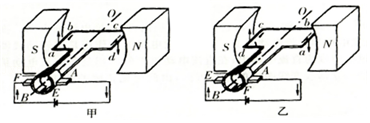

- A. 导线\( ab\)中的电流在这两个时刻方向不同，受到的磁场力方向也不同
- B. 甲乙两图中的线圈再转动90度角，都能到达平衡位置
- C. 由上往下看，线圈中电流均为顺时针方向
- D. 如果电动机持续转动，则电动机内外流的都是直流电

【答案】D

## 2. 单选题（难度：简单）

一台组装齐全的直流电动机模型，接通电源后电机不转，用手拨动一下转子后，线圈转子就正常转动起来，则该电动机模型开始时不转的原因可能是（    ）．

- A. 线圈内部断路
- B. 电刷与换向器接触不良
- C. 磁铁的磁性不强，或线圈中电流不够大
- D. 线圈正好处于平衡位置

【答案】D

## 3. 单选题（难度：适中）

小华在综合实践中自制的简易电动机示意图如图所示．矩形线圈由漆包线绕制而成，漆包线的两端分别从线圈的一组对边的中间位置引出，并作为线圈的转轴．将线圈架在两个金属支架之间，线圈平面位于竖直面内，永磁铁置于线圈正下方．为了使电池与两金属支架连接后线圈能连续转动起来，则小华应将（    ）．

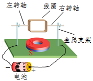

- A. 电池的正、负极对调一下
- B. 在线圈正上方增加磁体\( S\)极
- C. 左、右转轴下侧绝缘漆刮掉一半
- D. 左、右转轴绝缘漆全部刮掉

【答案】C

## 4. 单选题（难度：适中）

关于扬声器的分析，下列说法错误的是（    ）．

- A. 扬声器是把电信号转换为声信号的一种装置
- B. 扬声器的工作原理是通电线圈在磁场中受力的作用
- C. 扬声器工作时，把电能转化成机械能
- D. 扬声器的工作原理和发电机的原理一样

【答案】D

## 5. 多选题

如图所示是一种动圈式耳机的内部结构示意图．当音圈中有大小和方向反复变化的电流通过时，下列说法正确的是（    ）

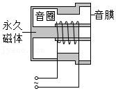

- A. 音圈带动音膜左右往复运动
- B. 音圈之所以运动，是由于磁场对导体有力的作用
- C. 这个过程中机械能转化为电能
- D. 音圈带动音膜振动发声

【答案】A/D

## 6. 填空题（难度：简单）

如图为直流电动机的基本构造示意图．请回答下列问题：
（1）直流电动机的工作原理是．
（2）电动机工作过程中，能量的转化是．

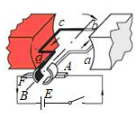

【答案】通电线圈在磁场中受力转动，电能转化为机械能

## 7. 填空题

如图装置是电动机的工作模型，在工作过程中，起了关键的作用，它能使线圈刚刚转过位置时，就自动改变线圈中的，从而实现通电线圈在磁场中的连续转动．

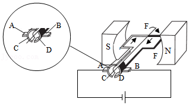

【答案】换向器，平衡位置，电流方向

## 8. 填空题（难度：适中）

某同学练习安装直流电动机模型，其示意图如图所示．开关闭合的瞬间，看到线圈向顺时针方向转动，但并没看到电动机线圈在连续转动．
（1）该同学看到线圈的运动情况是．
（2）安装电动机时该同学漏装的元件是．
（3）要想让电动机转动方向相反（补装元件后），可采取的措施是．

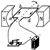

【答案】线圈在竖直位置附近左右摆动，换向器，将电源两极的导线对调（或将磁体的两极对调）

## 9. 单选题（难度：简单）

动圈式喇叭接在音频放大器上，当音频放大器给喇叭通电时，喇叭就会发出声音．下图和动圈式喇叭原理相同是（    ）．

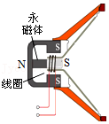

- A. 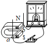
- B. 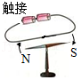
- C. 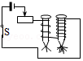
- D. 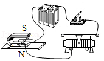

【答案】D
