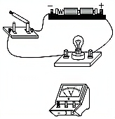
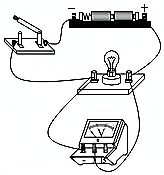
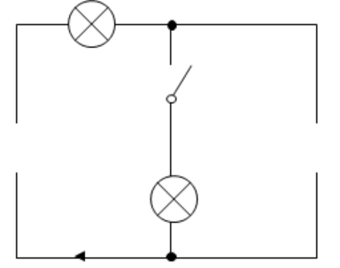
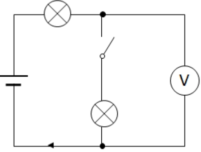
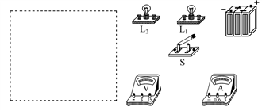
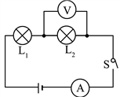
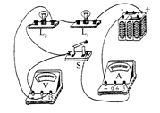

# 知识点·电压表的使用（同步练习）

> 教材：物理·九年级全一册·沪科技版2024新教材 ｜ 来源：国家中小学智慧教育平台·在线练习 ｜ 共 3 题

## 1. （难度：简单）

请用笔画线表示导线，将电压表连入实物图中，使电压表能够测量小灯泡两端的电压大小，要求电压表选用0~3V的量程。

【答案】

【解析】​

## 2. （难度：适中）

如图是一个不完整的电路图，其中箭头所指的方向表示电路接通时的电流方向，请在图中的两个空缺的位置分别补画电池和电压表的符号，使之成为一个完整的串联电路。

【答案】

【解析】​

## 3. 

利用下图中提供的实验器材，应怎样连接才能使L₁和L₂两灯串联在电路中，并用电流表测通过L₁的电流，用电压表测L₂两端的电压．

在虚线框内画出它的电路图；

在图中用笔画线代替导线，连接好实物电路

【答案】

   

，

【解析】​
