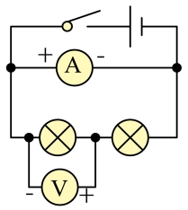
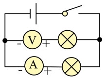
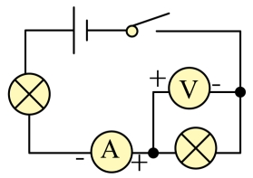
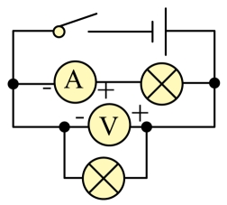
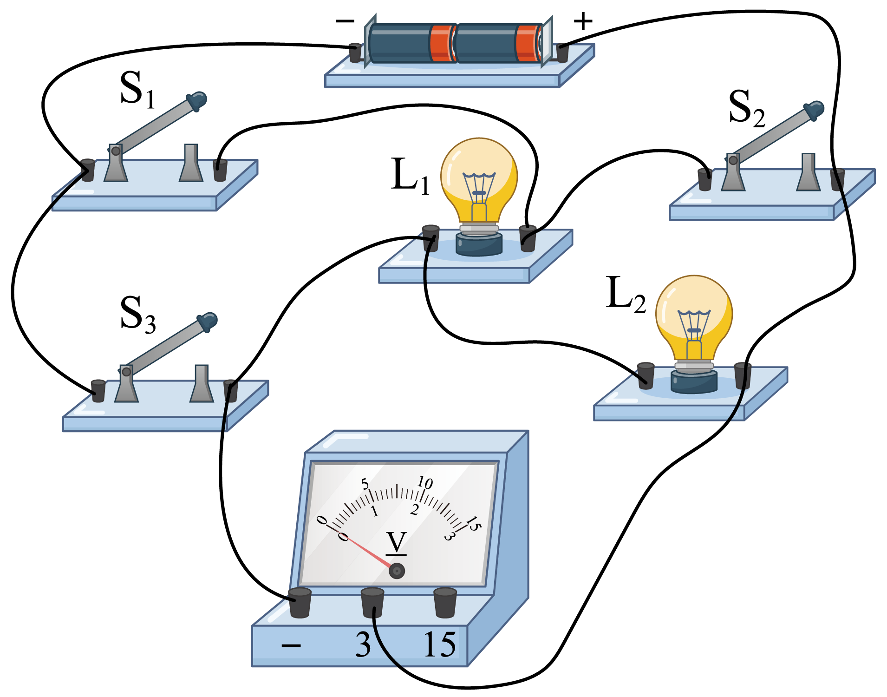
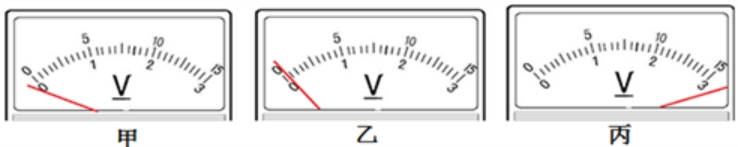
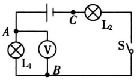
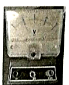

# 知识点·电压表的结构与使用方法（同步练习）

> 教材：物理·九年级全一册·沪科技版2024新教材 ｜ 来源：国家中小学智慧教育平台·在线练习 ｜ 共 6 题

## 1. 单选题（难度：适中）

如图所示各电路图中，电流表和电压表使用均正确的是图（　　）。

- A. ​

​​
- B. 
- C. 
​​​
- D. 

【答案】D

【解析】​

## 2. 单选题（难度：简单）

关于电压表的使用方法，不正确的是（   ）。

- A. 电压表必须并联在待测电路两端
- B. 电压表可以直接接在电源上
- C. 所测电压不能超过电压表量程
- D. 电流从电压表负接线柱流入

【答案】D

【解析】​

## 3. 多选题

（多选题）如图所示电路，电源两端电压不变，下列分析正确的是（    ）。

- A. 只闭合S₁时，两盏灯串联
- B. 只闭合S₁时，电压表测灯L₁两端电压
- C. 只闭合S₂、S₃时，两盏灯并联
- D. 只闭合S₁、S₃时，只有灯L₂发光

【答案】A/C/D

【解析】​

## 4. 填空题（难度：简单）

 
甲的问题： 乙的问题:丙的问题：。

【答案】正负接线柱接反了，选择电压表的量程过大，所测电压超过了电压表的量程

【解析】​

## 5. 填空题（难度：适中）

灯L₁与灯L₂串联，先用电压表测灯Ll两端的电压，如图所示．再测L₂两端电压时，只将电压表接A的一端改接C，这种接法（填“正确”或“不正确”）．理由是。

【答案】不正确，电流从电压表的&ldquo;﹣&rdquo;接线柱流进，从&ldquo;+&rdquo;接线柱流出

【解析】​

## 6. 填空题

如图所示是实验室常用的电压表．小鹏同学根据电压表测量电源电压过程中指针发生偏转的现象得出结论：①电压表使用过程中有电流通过。②指针偏转角度越大，流过的电流越大。③指针偏转的方向与电流方向无关。④使用不同的量程测量同一电源电压时指针偏转的角度相同。

 
（1）你认为小鹏同学得出的结论正确的是（写出序号）。
（2）关于小鹏同学的结论，请写出你认为错误的某一条（写出序号）并说出你的依据。
        答：，依据：。

【答案】①②，③或④，正负接线柱接反，指针会反向偏转或电源电压不变，改变量程，最小分度值不同，偏转角度不同

【解析】​
