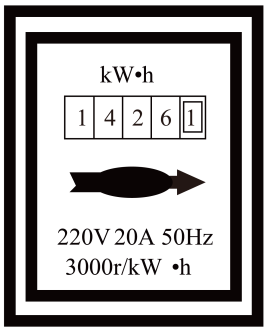

# 知识点·电流热效应（同步练习）

> 教材：物理·九年级全一册·沪科技版2024新教材 ｜ 来源：国家中小学智慧教育平台·在线练习 ｜ 共 3 题

## 1. 单选题（难度：简单）

下列家用电器，主要利用电能转化为内能工作的是（    ）。

- A. 收音机
- B. 电视机
- C. 电风扇
- D. 电饭锅

【答案】D

【解析】​

## 2. 填空题（难度：适中）

一只电热水壶装满水后接在220V的电源上，通过它的电流是1.2A。若通电10min将水烧开，则电流做功J，消耗电能J。若将该电热水壶接在110V的电源上，则烧开这壶水需要min。

【答案】1.584&times;105，1.584&times;105，40

【解析】​

## 3. 填空题（难度：适中）

​生活中室内各房间里电灯、电视机等用电器是联的，该室内的电能表表盘如图所示，其读数为kw·h，若电能表上的铝盘转了150转，室内的用电器消耗了J的电能。​

​

【答案】并    ，1426.1    ，1.8&times;105

【解析】​
