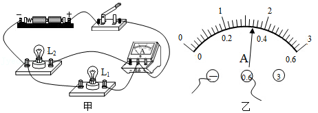
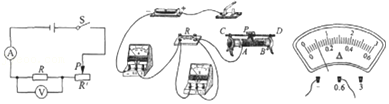
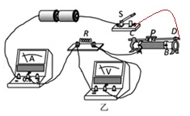
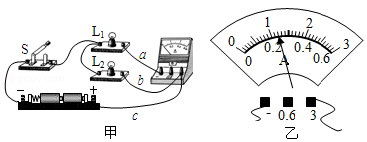
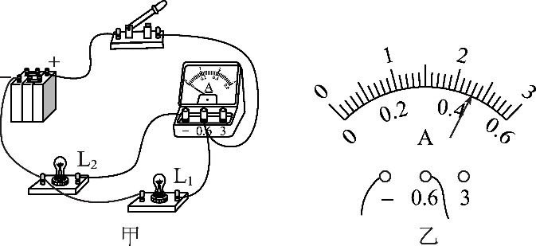
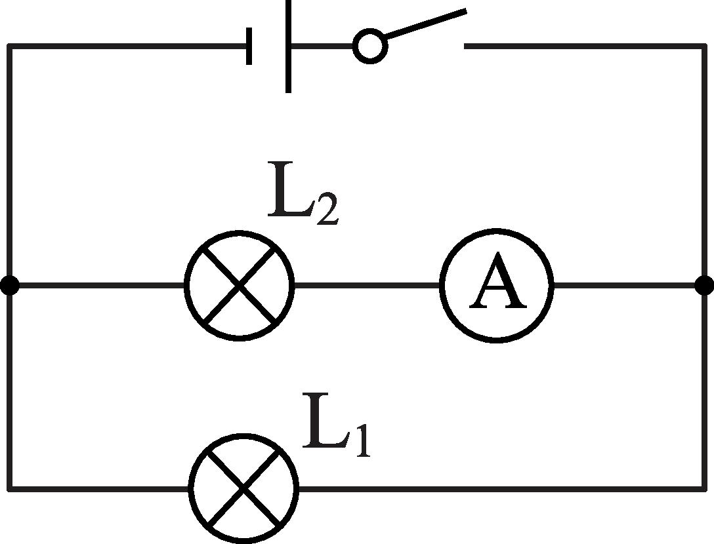

# 知识点·电流的测量．（同步练习）

> 教材：物理·九年级全一册·沪科技版2024新教材 ｜ 来源：国家中小学智慧教育平台·在线练习 ｜ 共 4 题

## 1. （难度：适中）

在用电流表测电流的实验中：

若某同学连接的电路如图甲所示，则电流表测的是灯的电流．合上开关后如果电流表的示数如图乙所示，则通过该灯的电流是A；

若合上开关后，两灯均亮，电流表指针不发生偏转，那么可能的原因是（     ）．

- A. 电流表内部短路
- B. 开关处接触不良
- C. 开关短路
- D. 电源供电不足

【答案】$ {\text{L}}_{2}$/0.34，A

【解析】​

## 2. （难度：适中）

小明在探究“电流大小与哪些因素有关”的实验中：

连接电路时，开关应．

请用笔画线代替导线，根据电路图将所示的实物电路连接完整．

闭合开关前，图中滑动变阻器的滑片\( \text{P}\)应位于（选填“\( A\)”或“\( B\)”）端，可以起到作用．

【答案】断开，

 

    

，B    /保护电路（或保护电源或其他元件、防止电流过大等）

【解析】​

## 3. 填空题

如图所示是小明同学用电流表测量电流的实物连接图，请按要求回答：

     
（1）在连接电路时，开关应处于状态．
（2）图甲中电流表测量的是通过灯泡的电流；
（3）小明同学连接好电路后，闭合开关，发现指针快速向右大幅度偏转，他赶快断开开关，发生这种现象的原因可能是．
（4）小明同学纠正错误后，电流表的示数如图乙所示，则电流表测出的电流是​\( \text{A}\)．
（5）如果要用电流表测通过\( {\text{L}}_{1}\)和\( {\text{L}}_{2}\)的总电流，且只允许移动一根导线，应将导线（选填“a”“b”“c”）的右端接在电流表的（选填“3”“0.6”“﹣”）接线柱上．
（6）闭合开关后，小明发现两灯都亮，由于连线较乱，一时无法确定电路是串联还是并联，请你帮他想出一种简单可行的判断方法．

【答案】断开 ，$ {\text{L}}_{1}$，$ {\text{L}}_{1}$短路，1.2， b，-，从灯座上取下一盏灯泡，若另一盏灯泡仍发光则是并联，反之是串联

【解析】​

## 4. 

如图所示，在用电流表测电流的实验中：

连接电路时，电流表应先用量程试触．‎​​

若某同学连接的电路如图甲所示，则电流表测的是灯​的电流，闭合开关后，若电流表的示数如图乙所示，则通过该灯的电流是 \( \text{mA}\)．

请你在虚线框中画出与图甲实物图对应的电路图．

​​

​

如果闭合开关后，灯泡均发光，电流表指针不发生偏转，那么原因可能是．

- A. 电流表内部断路
- B. 开关处接触不良
- C. ‎电流表短路
- D. 电源供电不足

【答案】大（或0∼3A），<latex class="math-tex">\(\text{L}_{2}\)</latex>/460$ \text{mA}$，
​

，C

【解析】​
