# 知识点·电流的磁效应（同步练习）

> 教材：物理·九年级全一册·沪科技版2024新教材 ｜ 来源：国家中小学智慧教育平台·在线练习 ｜ 共 12 题

## 1. 单选题（难度：适中）

小明在一块有机玻璃板上安装了一个用导线绕成的螺线管，在板面上均匀撒满铁屑，通电后轻敲玻璃板，铁屑的排列如图所示．下列说法正确的是（    ）. 

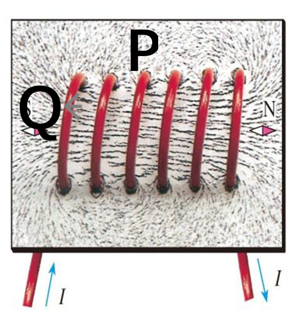

- A. 图中\( P\)、\( Q\)两点相比，\( P\)点处的磁场较强
- B. 若只改变螺线管中的电流方向，\( P\)、\( Q\)两点处的磁场会减弱
- C. 若只改变螺线管中的电流方向，\( P\)、\( Q\)两点处的磁场方向会改变
- D. 若只增大螺线管中的电流，\( P\)、\( Q\)两点处的磁场方向会改变

【答案】C

## 2. 单选题（难度：简单）

如图所示的通电螺线管，其中正确的是 （      ）.

- A. 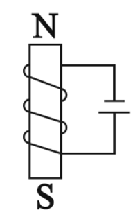
- B. 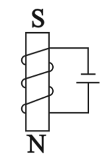
- C. 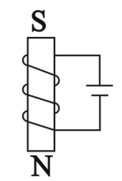
- D. 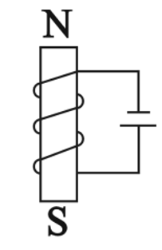

【答案】D

## 3. 单选题（难度：适中）

在如图所示的四种情况中，磁体\(N\)​极与通电螺线管左端相吸引的是（   ）.

- A. 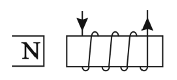
- B. 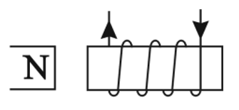
- C. 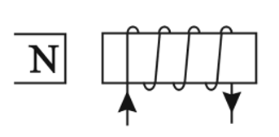
- D. 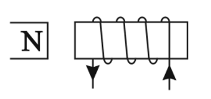

【答案】B

## 4. 单选题（难度：简单）

通电螺线管中的电流方向和其周围磁感线的分布如图所示，其中正确的是（    ）.

- A. 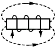
- B. 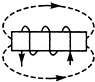
- C. 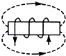
- D. 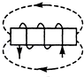

【答案】B

## 5. 单选题

矩形线圈放在蹄形磁铁的两极之间，刚通电时在磁场作用下扭转方向如图甲所示．现将该线圈放在图乙所示的蹄形螺线管间，\( a\)、\( b\)为螺线管与电源的接口．某同学进行了如下四次操作：
①\( a\)接正极\( b\)接负极，线圈中通与图甲电流方向相同的电流
②\( b\)接正极\( a\)接负极，线圈中通与图甲电流方向相同的电流
③\( a\)接正极\( b\)接负极，线圈中通与图甲电流方向相反的电流
④\( b\)接正极\( a\)接负极，线圈中通与图甲电流方向相反的电流
线圈刚通电时扭转方向与图甲所示的扭转方向相同的是（    ）. 

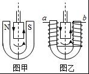

- A. ①和③
- B. ②和④
- C. ①和④
- D. ②和③

【答案】D

## 6. 单选题

1820年，安培在科学院的例会上做了一个小实验，引起与会科学家的极大兴趣．如图所示，把螺线管沿东西方向水平悬挂起来，然后给导线通电，看到的现象是，通电螺线管（   ）. 

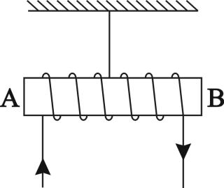

- A. 转动后停在任意位置
- B. 转动后停在南北方向上
- C. 不停地转动下去
- D. 仍保持在原来位置上

【答案】B

## 7. 填空题

如图所示，闭合开关\( S\)，通电螺旋管右侧的小磁针静止时，小磁针的\( N\)极指向左，则电源的右端为极. 若要使通电螺线管的磁性增强，滑动变阻器的滑片\( P\)应向（选填“\( a\)”或“\( b\)”）端移动. 
 
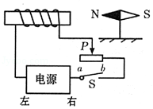

【答案】正，$ b$ 

## 8. 填空题（难度：适中）

在验证电流产生磁场的实验中，小东连接了如图所示的实验电路. 他把小磁针（图中没有画出）放在直导线 \( AB\) 的正下方，闭合开关后，发现小磁针指向不发生变化.  经检查，各元件完好，电路连接无故障. 
​（1）请你猜想小磁针指向不发生变化的原因是.
​​（2）写出检验你的猜想是否正确的方法：. 

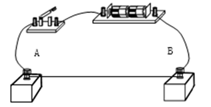

【答案】小磁针与直导线距离远（其他情况符合题意即可），使小磁针尽量靠近直导线，静止时，给直导线通电，观察小磁针指向是否变化，若小磁针指向变化，说明猜想正确；若小磁针指向不变化，说明猜想错误．

## 9. 填空题（难度：简单）

如图所示实验，用极的指向判断通电螺线管周围各点的磁场方向，为了探究通电螺线管磁极的极性与电流方向是否有关，应该采取的操作是. 
 
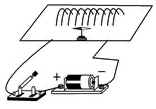

【答案】$ N$    ，对调电源的正负极

## 10. 填空题（难度：简单）

如图所示，根据通电螺线管的磁感线方向，可判断通电螺线管左端为极，电源的\( a\)端为 极，小磁针静止时的\( b\)端为极. 
  
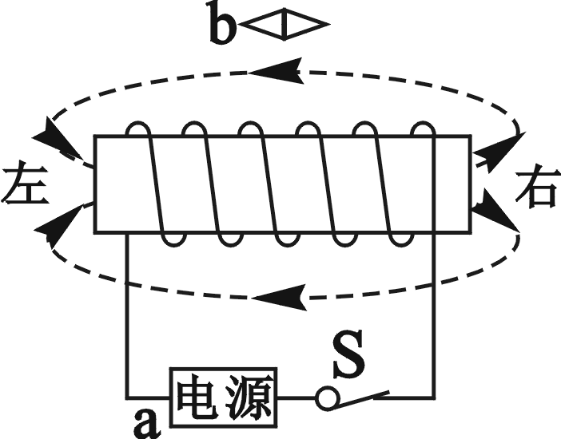

【答案】南（或$ S$）   ，正  ，北（或$ N$）

## 11. 填空题（难度：适中）

如图所示，当开关\( S\)闭合时，通电螺线管旁的小磁针按如图所示方向转动，则通电螺线管的\( a\)端为极，电源的\( d\)端为极．当图中滑片向左滑动时，小磁针受到的磁场力 （填“变大”“变小”或“不变）. 
 
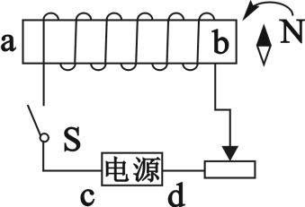

【答案】$ N$    ，负，变大

## 12. 填空题

某同学在“探究通电螺线管的外部磁场”的活动中，用漆包线绕制一只螺线管，接入如图所示的电路中，闭合开关\( S\)后，螺线管的下端为极，当滑动变阻器的滑片\( P\)向右移动时，下端吸引大头针的个数将. 

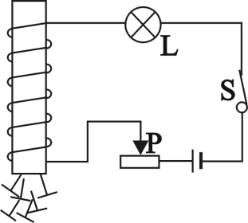

【答案】$ S$（南），增加
