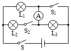
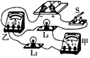
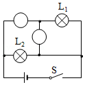
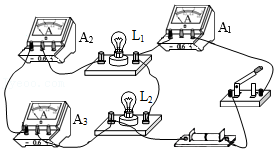

# 知识点·电流表的使用（同步练习）

> 教材：物理·九年级全一册·沪科技版2024新教材 ｜ 来源：国家中小学智慧教育平台·在线练习 ｜ 共 4 题

## 1. 填空题（难度：简单）

如图所示电路中，当开关\( \text{S}\)、\( {\text{S}}_{\text{1}}\)、\( {\text{S}}_{\text{2}}\)均闭合时，此时电流表测的是_中的电流．

【答案】$ {\text{L}}_{\text{2}}$ 

【解析】​

## 2. 填空题（难度：简单）

如图所示的电路中，开关闭合时电流表甲测量的是通过（选填“\( {\text{L}}_{\text{1}}\mathrm{”}\)“\( {\text{L}}_{\text{2}}\mathrm{”}\)或“\( {\text{L}}_{\text{1}}\)和\( {\text{L}}_{\text{2}}\)”）的电流，电流表乙测量的是通过（选填“\( {\text{L}}_{\text{1}}\mathrm{”}\mathrm{“}{\text{L}}_{\text{2}}\mathrm{”}\)或“\( {\text{L}}_{\text{1}}\)和\( {\text{L}}_{\text{2}}\)”）的电流．

【答案】$ {\text{L}}_{\text{2}}$，$ {\text{L}}_{\text{1}}$

【解析】​

## 3. （难度：简单）

在图中的〇里填上适当的电表符号，使小灯正常工作．

【答案】

   

【解析】​

## 4. 多选题（难度：适中）

小明用三个电流表和两个小灯泡做实验，检验并联电路中干路电流是否等于各支路电流之和，其连接的电路如图所示．这个电路中有一根导线接错了，小明找出这根导线，将其连接正确后再闭合开关．关于该正确的电路连接，下列判断正确的是（    ）．

- A. 电流表\( {\text{A}}_{\text{1}}\)测量干路电流
- B. 电流表\( {\text{A}}_{\text{2}}\)测量灯\( {\text{L}}_{\text{1}}\)的电流
- C. 电流表\( {\text{A}}_{\text{3}}\)测量灯\( {\text{L}}_{\text{1}}\)的电流
- D. 电流表\( {\text{A}}_{\text{3}}\)测量灯\( {\text{L}}_{\text{2}}\)的电流

【答案】A/B/D

【解析】​
