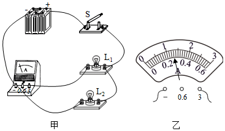
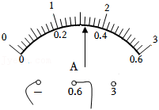
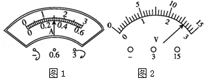

# 知识点·电流表的读数方法（同步练习）

> 教材：物理·九年级全一册·沪科技版2024新教材 ｜ 来源：国家中小学智慧教育平台·在线练习 ｜ 共 3 题

## 1. 填空题（难度：适中）

如图所示的电路，当开关\( \text{S}\)闭合后，电流表测量的是通过（选填“电源”“\( {\text{L}}_{\text{1}}\mathrm{”}\)或“\( {\text{L}}_{\text{2}}\)”）的电流，电流表的指针偏转如图乙所示，电流表的示数为\( \text{A}\)．

【答案】$ {\text{L}}_{\text{1}}$，1.3

【解析】​

## 2. 填空题（难度：简单）

如图所示，电流表的示数为A．

【答案】0.32

【解析】​

## 3. 填空题

（1）如图1所示，是实验室中常见电流表的示意图，请你写出从图中得到的两条信息：\( \text{①}\)电流表选择的量程是；\( \text{②}\)电流表的示数为．
（2）如图2，若选\( \text{0}\text{～}\text{3V}\text{的}\)量程，读数为 \( \text{V}\)；若选\( \text{0}\text{～}\text{15V}\)的量程，读数为 \( \text{V}\)．

【答案】0～3A   ，1.5A   ，2.6  ，13

【解析】​
