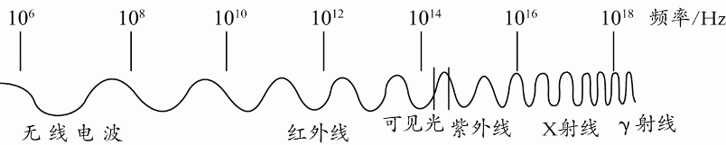
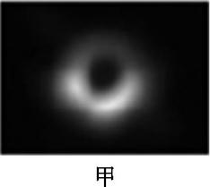
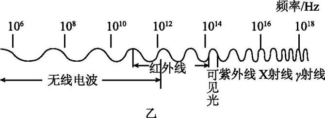

# 知识点·电磁波是怎样传播的（同步练习）

> 教材：物理·九年级全一册·沪科技版2024新教材 ｜ 来源：国家中小学智慧教育平台·在线练习 ｜ 共 9 题

## 1. 单选题（难度：简单）

关于电磁波和信息的传递，下列说法正确的是（    ）.

- A. 光纤通信利用光的折射传递信息
- B. 不同频率的电磁波在真空中传播速度不相同
- C. “嫦娥四号”探测器能从月球向地球传送影像，说明电磁波能在真空中传播
- D. 在地球的周围均匀配置至少5颗同步通信卫星，就可覆盖几乎全部的地球表面

【答案】C

【解析】​

## 2. 单选题

下列说法中，正确的是（    ）.

- A. 电磁波的频率越高，传播的速度就越大
- B. 电磁波可以在真空中传播
- C. 手机间通话靠超声波传递
- D. 微波不具有能量

【答案】B

【解析】​

## 3. 多选题（难度：适中）

抗击新冠病毒期间，全国的中小学生在家学习，很多同学利用钉钉系统，通过手机、电脑进行网上学习，下列与之相关的叙述正确的是（    ）.

- A. 利用手机通过家里的WiFi上网，信息是通过电磁波来传递的
- B. 极其精密的手机芯片，是采用纳米技术用半导体材料制作的
- C. 老师讲课是通过话筒将声音变成电信号，与电动机原理相同
- D. 静坐椅子上学习时，地面对椅子的支持力和椅子的重力平衡

【答案】A/B

【解析】​

## 4. 单选题

第五代移动通信技术（5th eneration Mobile Communication Technology，简称5G）是具有高速率、低时延和大连接特点的新一代宽带移动通信技术，是实现人机物互联的网络基础设施. 关于信息传递技术，下列说法正确的是（    ）.

- A. 5G通讯技术是利用超声波传递信息
- B. 在真空中，5G信号比4G信号的传播速度快
- C. 网线使用的光导纤维，利用的是光在光纤中的折射
- D. 5G是电磁波在信息方面的应用

【答案】D

【解析】​

## 5. 单选题（难度：简单）

电磁波在人们生产、生活中有许多应用. 下列实例中，不属于电磁波的应用的是（    ）.

- A. 电视机遥控器利用红外线进行遥控
- B. 收音机利用无线电波传递信号
- C. 用B超来检查人体疾病
- D. 医生用X光片判断患者是否骨折

【答案】C

【解析】​

## 6. 多选题（难度：适中）

电磁波是一个大家族，如图是它们的家族谱. 对电磁波的认识下列说法错误的是（    ）. 

- A. 可见光也是一种电磁波
- B. 红外线比紫外线频率高
- C. 真空中不同电磁波传播的速度不同
- D. 电磁波的频率越高波长越短

【答案】B/C

【解析】​

## 7. 单选题

2020年4月天文学家召开全球新闻发布会，宣布首次利用射电望远镜拍到黑洞的照片，如图甲所示，已知射电望远镜通过收集太空中\( 3.75\times {10}^{10}\text{Hz}\)的亚毫米波段电磁波进行记录，最后生成这幅黑洞照片. 图乙是电磁波家族，请根据图中信息判断，下列说法不正确的是（    ）. 

    

- A. 亚毫米电磁波属于无线电波
- B. 亚毫米电磁波的频率高于可见光，所以人类无法看见
- C. 真空中亚毫米波段电磁波的传播速度和可见光相同
- D. 亚毫米波段电磁波的传播不需要介质

【答案】B

【解析】​

## 8. 单选题（难度：适中）

模拟信号在话筒中将声音转换成信号电流时，下列说法正确的是（    ）.

- A. 信号电流的频率、振幅变化跟声音的频率、振幅变化完全相同
- B. 信号电流只有频率变化跟声音的频率变化完全相同
- C. 信号电流只有振幅变化跟声音的振幅变化完全相同
- D. 信号电流的频率、振幅变化跟声音的频率、振幅变化不完全相同

【答案】A

【解析】​

## 9. 填空题

如图所示的是正在自动飞行的“亿航184”，它在飞行过程中的信息是通过传递给地面指挥中心的，其传递信息速度与光速（填“相等”或“不相等”）. 

【答案】电磁波，相等

【解析】​
