# 知识点·电磁铁 电磁继电器（同步练习）

> 教材：物理·九年级全一册·沪科技版2024新教材 ｜ 来源：国家中小学智慧教育平台·在线练习 ｜ 共 30 题

## 1. 单选题（难度：简单）

要使电磁铁的磁性增强，可以（    ）．

- A. 改变电流的方向
- B. 增大电流的大小
- C. 拔出电磁铁中的铁芯
- D. 减少电磁铁的线圈匝数

【答案】B

## 2. 单选题（难度：适中）

如图所示，在电磁铁正上方用弹簧挂着一条形磁铁，开关闭合后，当滑片\(\text{P}\)​从\(a\)​端向\(b\)​端滑动过程中，会出现的现象是（    ）．

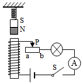

- A. 电流表示数变小，弹簧长度变短，小灯泡亮度增强
- B. 电流表示数变小，弹簧长度变长，小灯泡亮度减弱
- C. 电流表示数变大，弹簧长度变长，小灯泡亮度减弱
- D. 电流表示数变大，弹簧长度变短，小灯泡亮度增强

【答案】D

## 3. 单选题（难度：简单）

如图所示是“探究电磁铁磁性强弱与哪些因素有关”的实验，想让电磁铁吸引更多的大头针，可行的做法是（    ）．

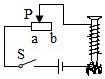

- A. 将滑片\(\text{P}\)向\( a\)端移动
- B. 将滑片\(\text{P}\)向\( b\)端移动
- C. 用铜芯替代铁芯
- D. 减少线圈匝数

【答案】A

## 4. 单选题

如图所示，\( \text{GMR}\)是一个巨磁电阻，其阻值随磁场的增强而急剧减小，当闭合开关\({\text{S}}_{1}\)、\({\text{S}}_{2}\)时，下列说法正确的是（    ）．

\( \text{①}\)电磁铁的右端为\(\text{N}\)极

\( \text{②}\)小磁针将顺时针旋转

\( \text{③}\)当\(\text{P}\)向左滑动时，电磁铁的磁性增强，指示灯变亮

\( \text{④}\)当\(\text{P}\)向右滑动时，电磁铁的磁性减小，电压表的示数减小

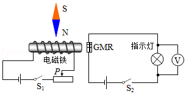

- A. 只有\( \text{④}\)正确
- B. 只有\( \text{③④}\)正确
- C. 只有\( \text{②③}\)正确
- D. \( \text{①②③④}\)都正确

【答案】B

## 5. 单选题（难度：适中）

如图所示的电路，将电磁铁（线圈电阻不计）与滑动变阻器串联接入电路，下列说法正确的是（    ）．

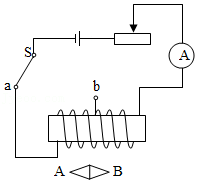

- A. 当开关\(\text{S}\)拨到\( a\)时，电磁铁的左端为\(\text{​​S}\)极
- B. 当开关\(\text{S}\)拨到\( a\)时，小磁针静止时\( B\)端为\(\text{N}\)极
- C. 当开关\(\text{S}\)拨到\( a\)时，将滑动变阻器的滑片向右滑动，电磁铁的磁性增强
- D. 保持滑动变阻器滑片位置不变，开关\(\text{S}\)由\( a\)拨到\( b\)，电磁铁的磁性增强

【答案】B

## 6. 单选题

利用如图实验装置探究“电磁铁磁性强弱的特点”，弹簧下挂着铁块\( AB\)，下列说法中错误的是（    ）．

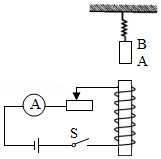

- A. 闭合开关，弹簧将会变长，断开开关弹簧将恢复原状
- B. 闭合开关，电磁铁的上端为\(\text{N}\)极
- C. 闭合开关，向右移滑片，电流表示数会减小，弹簧会变长
- D. 保持滑动变阻器滑片位置不变，取出铁芯再闭合开关，弹簧的长度会比有铁芯时短

【答案】C

## 7. 单选题（难度：适中）

小李同学观察学校楼道里的消防应急灯，平时灯是熄灭的，一旦停电，灯泡就会发光．如图所示是消防应急灯的电路图，图中少连了一根导线，工作原理是：外部电路为\( \text{220V}\)的交流电，当其正常时，两盏电压为\( \text{6V}\)的应急灯均不发光；外部电路停电时，两端电压为\( \text{6V}\)的灯泡发光对于这一装置及其工作特点，下列说法中正确的是（    ）．

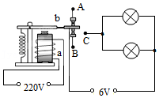

- A. 当外部电路停电时，电磁铁有磁性，装置开始工作
- B. 如果要增强电磁铁的磁性，只能增大电磁铁中的电流
- C. 外部电路正常时，电磁铁的上端始终为\(\text{S}\)极
- D. 电路中\( C\)点应该和\( A\)点相连

【答案】D

## 8. 单选题（难度：简单）

如图是一种水位报警器的原理图．当水位到达金属块\(\text{A}\)时（一般的水能导电），电路中（    ）．

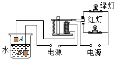

- A. 绿灯亮
- B. 红灯亮
- C. 两灯同时亮
- D. 两灯都不亮

【答案】B

## 9. 单选题

小李设计了一种“闯红灯违规模拟记录器”，拍摄机动车闯红灯时的情景，如图甲．工作原理：当光控开关接收到某种颜色光时，开关自动闭合，且当压敏电阻受到车的压力，它的阻值变化规律如图乙所示，当电流变化到一定值时，继电器的衔铁就被吸下；光控开关未受到该种光照射时自动断开，衔铁没有被吸引，工作电路中的指示灯发光．已知控制电路电压为\( \text{6V}\)，继电器线圈电阻\( \text{10}\text{Ω}\)，当控制电路中电流大于\( \text{0.06A}\)时，衔铁被吸引．下列说法中不正确的是（    ）．

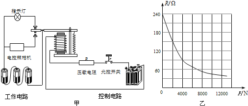

- A. 要记录违规闯红灯的情景，光控开关应在接收到红光时，自动闭合
- B. 光控开关接收到绿光时，指示灯亮，电控照相机不工作
- C. 质量小于\( \text{400kg}\)的车辆违规时不会被拍照记录
- D. 要使质量较小的车闯红灯也能被拍下，可以在控制电路中串联一个电阻

【答案】D

## 10. 填空题（难度：简单）

电磁铁和永久磁铁相比，电磁铁的优点是：它的磁性有无可以由来控制，它的磁性强弱可以由来控制，它的\(\text{N}\)、\(\text{S}\)极可以由来控制．

【答案】电流（路）的通断，电流大小，电流方向

## 11. 填空题（难度：适中）

如图所示的电路中，当滑动变阻器的滑片向右移动时，电磁铁吸引大头针的个数将（选填“增加”或“减少”），铁钉的下端是电磁铁的极．

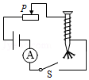

【答案】减少，$ N$ 

## 12. 填空题（难度：适中）

如图，\(\text{A}\)、\(\text{B}\)弹簧下方分别吊着软铁棒和条形磁铁，闭合开关，将滑动变阻器的滑片逐渐向左移动时，\(\text{A}\)弹簧的长度将，\(\text{B}\)弹簧的长度将（选填“伸长”、“缩短”或“不变”）．

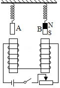

【答案】缩短，伸长

## 13. 填空题（难度：简单）

某市科技馆有机器人和参观者下象棋的展台．机器人取放棋子时用一根“手指”接触棋子表面就可以实现（如图），其奥秘是“手指”内部有电磁铁．
（1）机器人取放棋子时利用了电磁铁的（选填“磁性有无”或“磁极方向”）可以控制的特点．
（2）制作象棋棋子的材料应该是下列常见金属材料中的．
​A. 铁
B. 铜
​​C. 铝．

【答案】磁性有无，A

## 14. 填空题

如图所示是一个限流装置的示意图，当电流过大时，电磁铁磁性会（选填“增强”或“减弱”），电磁铁吸引衔铁\( Q\)，实现自动切断电路的作用，此装置工作时，电磁铁左端是极．

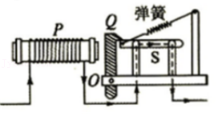

【答案】增强，$ N$ 

## 15. 填空题（难度：适中）

现在很多大型商场都安装了如图1所示的“聪明的电梯”，无人乘梯和有人乘梯时电梯运行的速度会发生变化．这种电梯的简易控制电路如图2所示，\( R\)是一个压敏电阻，其阻值随压力的增大而减小．当人走上电梯后，电磁继电器控制电路中的电流（选填“增大”或“减小”），和衔铁相连的动触点与静触点（选填“1”或“2”）接触，电动机的转速变快，使电梯的运行速度加快．

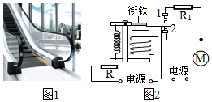

【答案】增大，2

## 16. 填空题

如图所示，\( R\)是一个光敏电阻，光敏电阻的阻值随光照强度的增大而减小，\( {R}_{0}\)是电阻箱（已调至合适阻值），它们和继电器组成自动控制电路来控制路灯．白天灯熄，夜晚灯亮．则给路灯供电的电源应接在（填写“\( a\)、\( b\)”或者“\( b\)、\( c\)”）两端；为了使路灯推迟发光，你对这个电路采取调节措施是．

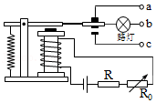

【答案】$ a$ 、$ b$， 减小$ {R}_{0}$的阻值

## 17. 填空题

有一种磁性非金属材料叫铁氧体，某同学研究铁氧体的磁性与温度的关系．他在恒温箱顶部固定一个铁氧体，然后在铁氧体下方放一磁铁，实验现象如图（\( a\)）所示，然后改变恒温箱的温度，观察到的现象如图（\( b\)）、（\( c\)）所示．
​​

​    ​
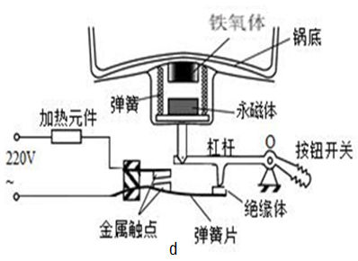
    
\( \text{①}\)根据图（\( a\)）、（\( b\)）和（\( c\)）及相关条件可以归纳得出结论：在一定温度范围内，温度越高，铁氧体的磁性（选填“越强”‘越弱”或“不变”）．
\( \text{②}\)自动电饭锅就应用到了以上结论，图（\( d\)）为电饭锅的工作原理图，安装在发热盘（锅底）中央的温控器内部装有铁氧体、永磁体、弹簧等元件．煮米饭时，两个金属触点（选填“接触”或“断开”），加热元件工作；当锅底的温度升高到某温度时，永磁体与铁氧体（选填“分开”或“吸引”），加热元件停止工作．

【答案】越弱，接触，分开

## 18. 填空题（难度：简单）

小李同学利用电磁继电器设计了一个自动恒温加热鱼缸，如图所示，左侧的温度计是电接点水银温度计，右侧​A为一段软导线，​B为一个小型电热器，当温度达到或超过℃时，电磁铁磁性（选填“具有”或“没有”），加热器​B  （选填“开始工作”或“停止工作”），用水银温度计是因为水银是．

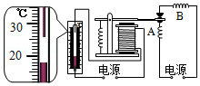

【答案】26，具有，停止工作，导体

## 19. 填空题（难度：简单）

在探究“影响电磁铁磁性强弱的因素”实验中，小明制成简易电磁铁甲、乙，并设计了如图所示电路．

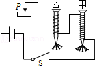
    
（1）实验中是通过观察来比较电磁铁磁性强弱．这种研究方法称为．
（2）把甲、乙两个电磁铁串联，目的是相同，以探究电磁铁磁性强弱与的关系．
（3）由现象可得结论：电流一定时，，电磁铁磁性越强．
（4）电磁铁吸引的大头针下端分散的原因是．
（5）电磁铁在生产、生活中应用广泛，请写出其中的一个应用：．

【答案】电磁铁吸引大头针的数量，转换法，控制电流，线圈匝数，线圈匝数越多，大头针被磁化，同名磁极相互排斥，电磁起重机；电动机；扬声器；磁悬浮列车等等

## 20. 填空题（难度：适中）

小明在做“探究电磁铁的磁性强弱与哪些因素有关”的实验时，连接了如图所示的电路．请你结合该实验中的具体情况，完成下面的填空：

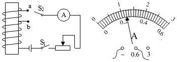
    
（1）\({\text{S}}_{1}\)闭合，\({\text{S}}_{2}\)接\( a\)处时，将滑动变阻器的滑片向右移动，可以探究对电磁铁磁性强弱的影响．此时电磁铁磁性会（选填“增强”、“不变”或“减弱”）．
（2）探究线圈匝数对电磁铁磁性强弱影响时，\({\text{S}}_{1}\)闭合，\({\text{S}}_{2}\)接\( a\)处时，电流表示数如题16﹣2图所示，记为 \( \text{A}\)，保持\({\text{S}}_{1}\)闭合，将\({\text{S}}_{2}\)改接到\( b\)处，并向（选填“左”或“右”）移动滑动变阻器滑片，直到电流表示数为 \( \text{A}\)，此时再比较电磁铁磁性的强弱．此过程中运用的物理实验方法是．

【答案】电流大小，减弱，0.24，右，0.24，控制变量法

## 21. 

在探究“影响电磁铁磁性强弱的因素”实验中，小明利用电源、开关、滑动变阻器、两根完全相同的铁钉、表面绝缘的铜线、大头针若干，制成简易电磁铁甲、乙，并设计了如图1所示的电路．

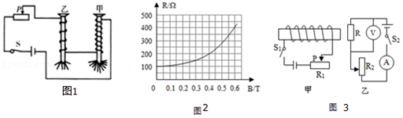

实验中通过观察电磁铁的不同，可以判断电磁铁的磁性强弱不同．

当滑动变阻器滑片向左移动时，电磁铁甲、乙吸引大头针的个数（填“增加”或“减少”），说明电流越，电磁铁磁性越强．

实验中用到的一种重要科学研究方法是(     )．

小明又查阅了有关资料知道：物理学中常用磁感线来形象地描述磁场，用磁感应强度（用字母\( B\)表示）来描述磁场的强弱，它的国际单位是特斯拉（符号是\( \text{T}\)），磁感应强度\( B\)越大表明磁场越强；\( B=0\)表明没有磁场．有一种电阻，它的大小随磁场强弱的变化而变化，这种电阻叫做磁敏电阻，图2所示是某磁敏电阻\( R\)的阻值随磁感应强度\( B\)变化的图象．为了研究某磁敏电阻\( R\)的性质，小明设计了如图3所示的电路进行实验，请解答下列问题：
①当\({\text{S}}_{1}\)断开，\({\text{S}}_{2}\)闭合时，电压表的示数为\( \text{3V}\)，则此时电流表的示数为 \( \text{A}\)．
②闭合\({\text{S}}_{1}\)和\({\text{S}}_{2}\)，移动两个滑动变阻器的滑片，当电流表示数为\( \text{0.04A}\)时，电压表的示数为\( \text{6V}\)，由图象可得，此时该磁敏电阻所在位置的磁感应强度为 \( \text{T}\)．

- A. 类比法
- B. 转换法
- C. 等效替代法
- D. 模型法

【答案】大头针个数，增加/大，B，0.03/0.3

## 22. （难度：简单）

将如图所示的电磁铁连入你设计的电路中（在虚线框内完成，器材自选）．

要求：

（1）电磁铁磁性有无可以控制；

（2）能改变电磁铁磁性的强弱；

（3）电路接通后使小磁针静止时在如图所示的位置．

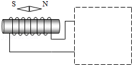

【答案】

    

## 23. （难度：简单）

如图，用笔画线代替导线将图中实物连接起来．要求：闭合开关后，使电磁铁的右端为\(\text{N}\)极，并且当滑动变阻器的滑片\(\text{P}\)向右移动时，电磁铁的磁性增强．

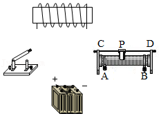

【答案】

    

## 24. 

如图所示，是上海磁悬浮列车的悬浮原理．请在右侧放大的图中画出轨道下方的车厢线圈的绕线，并标上\(\text{N}\)，\(\text{S}\)极．

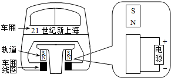

【答案】

    

## 25. （难度：适中）

如图所示，当给电磁铁​M通电，发现弹簧开始被压缩，过一会儿，条形磁铁和弹簧重新处于静止．此时把滑动变阻器的滑片​P向\( B\)端滑动，弹簧的长度逐渐变短．请用笔画线代替导线，把电路连接完整（导线不能交叉，弹簧在其弹性范围内）．

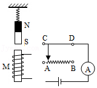

【答案】

    

## 26. （难度：简单）

城市下水道井盖丢失导致行人坠入下水道的悲剧时有发生．为此，某同学设计了一种警示电路：在井口安装一环形灯，井盖相当于开关\(\text{S}\)；正常情况下（\(\text{S}\)闭合），灯不亮；一旦井盖丢失（\(\text{S}\)断开），灯即亮起，以警示行人．请按要求连接图．

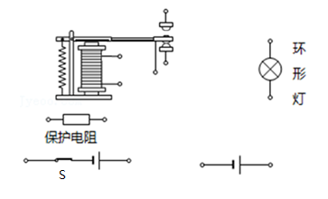

【答案】

    

## 27. 

如图所示，是小明设计的水位自动报警器，要求水位达到金属块\(\text{A}\)时红灯亮，没达到\(\text{A}\)时绿灯亮，由于控制电路电压太低，为了增大电磁铁对衔铁的吸引力，小明在衔铁上固定一个永磁体（上端为\(\text{S}\)）以确保水位达到\(\text{A}\)时电磁铁吸下衔铁红灯亮，请你画出电磁铁的绕线并完成工作电路图．

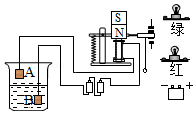

【答案】

    

## 28. （难度：适中）

如图是一种温度报警器的原理图，请用笔画线代替导线，将电路连接完整，要求在平常情况下，绿灯亮，红灯不亮，当温度达到一定值时，衔铁被电磁铁吸引，向下绿灯熄灭，红灯亮．

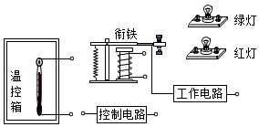

【答案】

    

## 29. （难度：适中）

如图是电加热恒温箱的原理图．控制电路由电源\( {U}_{1}\)、电磁继电器、滑动变阻器\( {R}_{2}\)和热敏电阻\( {R}_{1}\)组成，其中热敏电阻\( {R}_{1}\)随温度升高阻值减小；工作电路由电源\( {U}_{2}\)和加热器\( {R}_{0}\)组成．请按照题意用笔画线代替导线将图中的控制电路和工作电路连接完整．

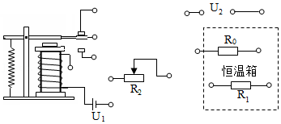

【答案】

    

## 30. 

如图甲，是一种双向双动式和面机．和面机工作时，搅拌器可以正反搅拌．小明利用如图乙所示电磁继电器控制搅拌器的正反转，请将工作电路连接完整．

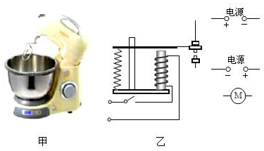

【答案】

    

