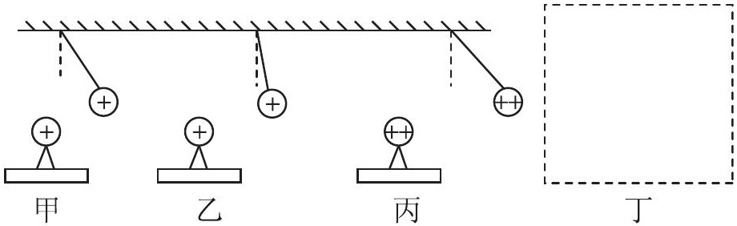
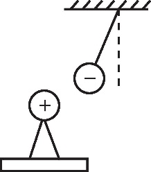
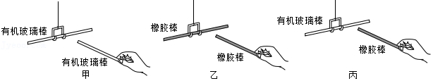

# 知识点·电荷间的相互作用规律（同步练习）

> 教材：物理·九年级全一册·沪科技版2024新教材 ｜ 来源：国家中小学智慧教育平台·在线练习 ｜ 共 3 题

## 1. 填空题（难度：适中）

用干燥毛巾多次摩擦PVC管和塑料丝做成的章鱼造型．将章鱼往上抛，再将PVC管放在章鱼下方，章鱼在空中漂浮，如图所示．这是因为PVC管和章鱼带上了（选填“同种”或“异种”）电荷而相互的原理．

【答案】同种，排斥

【解析】​

## 2. 

高斌同学参观科技馆时，对一组静电实验兴趣浓厚，回来后他进行了探究，结合探究的环节他画出了下中的四幅图．

从图甲（或图乙或图丙）可得出结论：；

比较图和可知，电荷间作用力的大小与电荷的多少有关；

比较甲、乙两图可得出结论：；

从图丁可得到结论：异种电荷相互吸引．请你把图丁补充上去．

【答案】同种电荷相互排斥，乙/丙，电荷量相等时，电荷间的距离越远，电荷间的作用力越小，

       

【解析】​

## 3. 填空题（难度：适中）

在“探究带电物体间的相互作用”活动中
（1）小明发现用干燥的丝绸摩擦过的有机玻璃棒和用干燥毛皮摩擦的橡胶棒都能吸引纸屑，这说明它们都带了“电”，用摩擦的方式使物体带电叫做；
（2）将其中一根棒悬挂起来是为了；
（3）如图，将两个带电棒相互靠近，发现相互排斥的是图，相互吸引的是图；

   
（4）把其它经过摩擦而带电的物体分别去靠近上面的玻璃棒和橡胶棒，发现若跟玻璃棒吸引的，就会跟橡胶棒排斥；而跟橡胶棒吸引的，就会跟玻璃棒排斥，由此可推理得出的结论是．

【答案】摩擦起电，使其在水平面内能够自由转动，甲乙，丙，自然界只存在两种电荷

【解析】​
