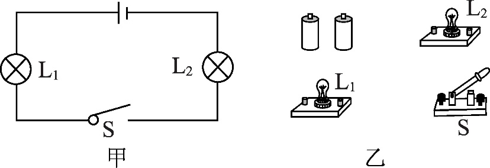
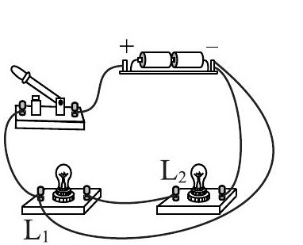
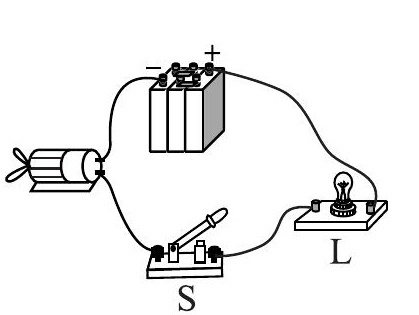
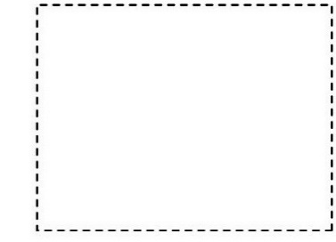

# 知识点·电路作图；实物电路图连接（同步练习）

> 教材：物理·九年级全一册·沪科技版2024新教材 ｜ 来源：国家中小学智慧教育平台·在线练习 ｜ 共 3 题

## 1. （难度：简单）

根据图甲中电路连接图乙中实物图。

【答案】

    

【解析】​

## 2. 

图是一名同学所连接的电路，这个电路中多接了一根导线。请你找出这根多余的导线，在这根导线上画“×”，并在虚线框中画出对应的正确的电路图。
‎ 

     

【答案】

    

【解析】​

## 3. （难度：适中）

请根据图中的实物连接图在虚线框内画出对应的电路图。

    

【答案】

    

【解析】​
