# 知识点·电路的正确连接（同步练习）

> 教材：物理·九年级全一册·沪科技版2024新教材 ｜ 来源：国家中小学智慧教育平台·在线练习 ｜ 共 6 题

## 1. 多选题（难度：简单）

下列做法在连接电路中必要的是（     ）．

- A. 连接电路的过程中，开关必须处于断开状态
- B. 每处接线都必须接牢，保证接触良好
- C. 必须从电源正极开始依次连接各元件，最后达到电源负极
- D. 接线完毕后仔细检查电路，确认无误后再闭合开关，防止出现电源短路

【答案】A/B/D

【解析】​

## 2. 多选题（难度：适中）

使用电池的时候，不允许用导线直接把电源的两极连接起来，这是因为（    ）．

- A. 这样连接电路，用电器无法工作
- B. 这样连接有触电危险
- C. 这样连接会在导线中产生很大的电流，损坏电池
- D. 这样连接电路中电流太大，会烧坏用电器

【答案】A/C

【解析】​

## 3. 单选题

如图所示的电路中，闭合开关后小灯泡都能发光的是（     ）．

- A. 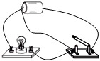
- B. 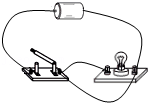
- C. 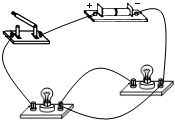
- D. 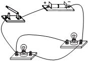

【答案】D

【解析】​

## 4. 多选题（难度：适中）

在图中，开关闭合后两灯均能发光的是（     ）．

- A. 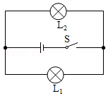
- B. 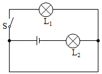
- C. 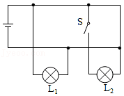
- D. 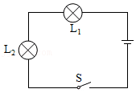

【答案】A/D

【解析】​

## 5. 单选题（难度：简单）

手电筒的结构如图所示，按下按键时，电路接通小灯泡发光．该手电筒的电路图，选项图中正确的是（     ）．

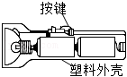

- A. 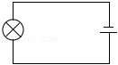
- B. 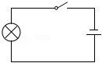
- C. 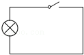
- D. 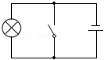

【答案】B

【解析】​

## 6. 单选题

在如图的各个电路图中，符合如图实物连接的是（     ）．

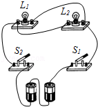

- A. 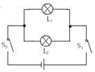
- B. 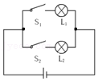
- C. 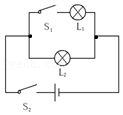
- D. 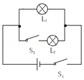

【答案】A

【解析】​
