# 知识点·电阻的测量（同步练习）

> 教材：物理·九年级全一册·沪科技版2024新教材 ｜ 来源：国家中小学智慧教育平台·在线练习 ｜ 共 24 题

## 1. 单选题（难度：适中）

在“伏安法”测电阻的实验中，下列注意事项中不正确的是（　　）

- A. 连接电路时，开关应断开
- B. 在无法估计被测电压、电流的大小时，可用试触法选取合适的量程
- C. 将变阻器连入电路时，滑片应放到使电路中电流最大的位置
- D. 电压表应该与待测电阻并联

【答案】C

【解析】​

## 2. 单选题（难度：简单）

某同学做伏安法测电阻的实验时，无论怎样移动滑动变阻器的滑片，发现电压表的示数均为零，而电流表的指针指在满量程之外，这时（    ）

- A. 一定是电压表已损坏，应立即断开开关
- B. 可能是电流表与电源两极直接相连，应立即断开开关
- C. 可能是电压表发生了故障，而电流表既未接错也未损坏
- D. 可能是电流表与电压表接成了串联电路

【答案】B

【解析】​

## 3. 单选题（难度：简单）

如图所示，滑动变阻器在电学实验中起到重要的作用，除保护电路外，它还能改变电路中的电流和电压，下列试验中，关于滑动变阻器的作用，下列说法正确的是（　　）

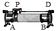

- A. 在“测量未知定值电阻Rx的阻值”的实验中，其主要作用是为了多次测量，得出普遍规律
- B. 在“测量小灯泡功率”的实验中，其主要作用是为了多次测量求平均值，减小误差
- C. 在探究“电流与电压关系”的实验中，其主要作用是改变电压，便于多次测量，得出普遍规律
- D. 在探究“电流与电阻关系”的实验中，其主要作用是保持R两端的电压不变，便于多次测量，求平均值，减小误差

【答案】C

【解析】​

## 4. 单选题

如图是“伏安法测电阻”实验电路图，下列说法中不正确的是（     ）

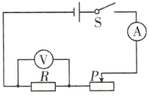

- A. 在连接电路时，应将变阻器滑片调至右端
- B. 连接电路时，要使电流从电压表和电流表的“+”接线柱流入，“一”接线柱流出
- C. 多次测量求平均值是为了减小误差
- D. 向左移动滑动变阻器的滑片时，电流表、电压表的示数都变大，R的阻值也变大

【答案】D

【解析】​

## 5. 单选题（难度：适中）

用伏安法测灯泡电阻实验中，将正常的电压表和电流表接入电路，当闭合开关后发现电流表有示数，电压表示数为零，移动滑片P时，电流表示数有变化，电压表示数始终为零，则故障是（     ）

- A. 滑动变阻器接触不良
- B. 开关接触不良
- C. 小灯泡两端短路
- D. 小灯泡灯线丝断了

【答案】C

【解析】​

## 6. 单选题

在“伏安法测电阻”的实验中，某同学在连接电路时电表量程选择正确，但不慎将两表的位置接错，连成如图所示情况，那么闭合开关S后引起的后果是（　　）

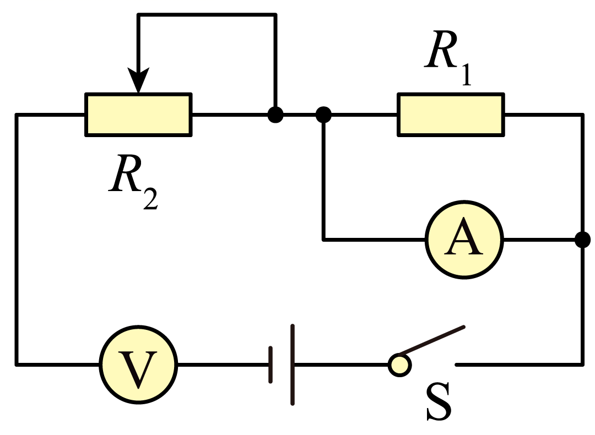

- A. 电流表和电压表都被损坏
- B. 电流表被损坏，电压表示数为零
- C. 电流表被损坏，电压表有示数
- D. 电流表示数为零，电压表有示数

【答案】D

【解析】​

## 7. 单选题（难度：简单）

小明探究杠杆的平衡条件时，通过增减钩码并移动钩码获得3组数据，小华在测量未知电阻时，通过调节滑动变阻器获得了3组数据，这两个实验采用多次实验的目的，下列说法正确的是（　　）

- A. 都是为了找出普遍规律
- B. 都不是为了找出普遍规律
- C. 小华的操作是为了多次测量减小误差
- D. 小明的操作是为了多次测量减小误差

【答案】C

【解析】​

## 8. 多选题（难度：适中）

某同学利用如图所示的电路做“伏安法测电阻”的实验，已知电源电压恒为8V，实验中该同学填写的实验数据如表所示。下列说法正确的是（　　） 
序号
1
2
3
4

U/V
2.0
3.0
4.0
5.0

I/A
0.20
0.32
0.38
0.48

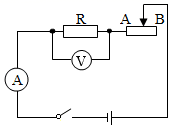

- A. 实验采用多次测量的方法是为了寻找普遍规律
- B. 连电路时滑动变阻器的滑片应置于图中的A端
- C. 用该电路和器材可以探究“电流与电压的关系”
- D. 本实验中所测定值电阻的阻值大小约为10Ω

【答案】C/D

【解析】​

## 9. 单选题

如图为小明做“伏安法测电阻”的实验电路图，图中有电流表（量程0～0.6A，0～3A）、电压表（量程0～3V，0～15V）、滑动变阻器（阻值变化范围为0～12Ω）、被测电阻Rx（约6Ω，按6Ω计算）及由三节新干电池串联组成的电源。若实验要求电表指针不超过量程，且几次测量指针都偏过电表刻度盘的中线。则变阻器连入电路的阻值至少为（　　）

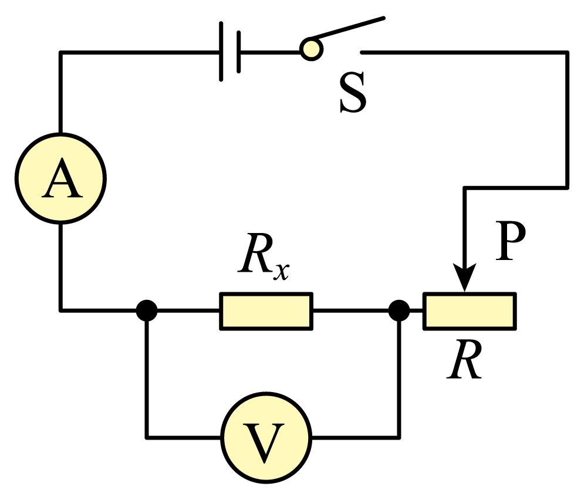

- A. 1.5Ω
- B. 2Ω
- C. 2.5Ω
- D. 3Ω

【答案】D

【解析】​

## 10. 多选题（难度：简单）

​小明为了测量小灯泡在不同电压下的电阻，设计了如图所示的电路。闭合开关S，无论如何调节滑动变阻器的滑片P，都发现小灯泡L不发光，电压表无示数，则出现上述现象的原因可能是（　　）​

​
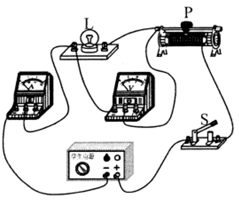

- A. 电源电压较小
- B. 小灯泡短路
- C. 小灯泡断路
- D. 滑动变阻器断路

【答案】B/D

【解析】​

## 11. 填空题（难度：简单）

电学中经常按如图电路连接实物进行实验．该实验装置可以测量的物理量有、、等（填物理量的符号）。

【答案】<em>U</em>，<em>I</em>，<em>R</em>

【解析】​

## 12. 填空题（难度：适中）

​在“探究导体中电流与电压的关系”实验中，连接电路时电键处于状态；实验中通过改变的方法， 获得多组实验数据，进而归纳得出实验结论。在“用电流表、电压表测电阻”的实验中，实验原理是，获得多组实验数据的目的是为了。

【答案】断开    ，导体两端的电压    ，<em><em>$R=\frac {U} {I}$</em></em>  ，减小误差

【解析】​

## 13. 填空题

利用伏安法测电阻时常常用到如图所示的甲、乙两种电路，某同学实验时所用电流表的内阻约为10Ω，电压表的内阻约为20kΩ，待测电阻的阻值约为100Ω，为了减小误差，他应该采用图甲所示的连接方法，利用该方法进行实验时，测量结果会偏（选填“大”或“小”）。

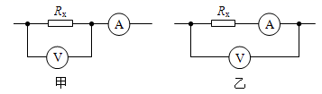

【答案】小

【解析】​

## 14. 填空题

​在“测量小灯泡电阻”的实验中，小明在实验过程中，无论怎么调节滑动变阻器的滑片，都不能使小灯泡两端电压达到2.5V，电流表示数在调节过程中改变。其原因可能是。

【答案】电源电压低

【解析】​

## 15. 填空题（难度：适中）

​用如图甲所示的伏安电路测量小灯泡的电阻，闭合开关，发现小灯泡不亮，电流表的指针几乎不偏转，原因是。解决问题后，测得小灯泡伏安曲线如图乙所示，随着电压增大，小灯泡的电阻（选填“增大、减小或不变”）。​

​
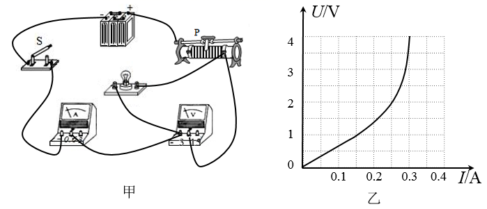

【答案】灯泡断路    ，增大

【解析】​

## 16. 填空题（难度：简单）

​小文测小灯泡的电阻，电路如图甲所示闭合开关S前，滑动变阻器的滑片P应滑到b端，这样做的目的是；闭合开关S，调节滑动变阻器，电流表的示数如乙图所示，若此时电压表的示数为3V，则此时灯丝的电阻为Ω。​

​
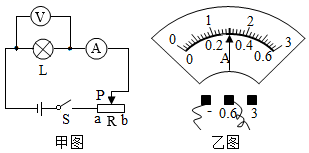

【答案】保护电路    ，10

【解析】​

## 17. （难度：适中）

某兴趣小组的同学利用如图所示的电路测量待测电阻R的阻值。实验中电源电压为3V且恒定不变，滑动变阻器的规格为“50Ω、1A”。

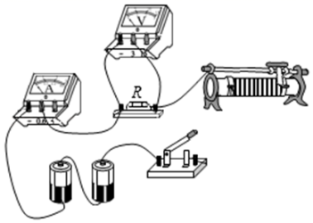
 ​

用笔画线代替导线将图甲的实物图连接完整，使滑动变阻器接入电路的阻值刚好处于最大值。

检查发现表格中有数据遗漏，遗漏数据应当为A，求得定值电阻R阻值为Ω。​
实验次数
1
2
3
4

U/V
0.60
0.90
1.50
2.00

I/A
0.06
0.09
 
0.20​

小明连接好电路后，闭合开关，发现电压表指针立即偏转到满刻度的位置。其原因可能是（写出一个即可）。

【答案】

 

 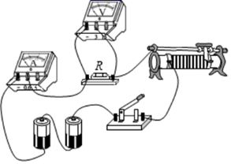     

，0.15    /10，电阻<i>R</i>断路    

【解析】提示：解析视频请查看最后一题。

提示：解析视频请查看最后一题。

​

## 18. （难度：适中）

在测量额定电压为2.5V小灯泡正常发光时的电阻实验中：

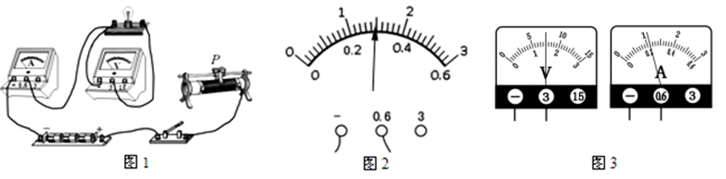

用笔画线代替导线，将图1的电路连接完整。

开关S闭合前，应把如图中滑动变阻器的滑片P置于（填“左”或“右”）端；

除故障后，闭合开关S，调节滑动变阻器，顺序读取实验数据。其中第三次读取数据时，电压表、电流表的示数如图3所示，请把数据填入实验表格内；​

电压U/V
0.5
1
​ 
2
2.5
2.8

电流I/A
0.14
0.18

0.25
0.28
0.30

实验测得小灯泡两端电压为2V时的电阻为Ω​​​​；

小刚同学根据表格中的数据计算后发现：在不同电压下，小灯泡灯丝的电阻不相等。你认为造成这种结果的原因是：小灯泡的电阻随温度的升高而。（选填“增大”或“减小”）

电压表的内阻虽然很大，但也会影响小灯泡电阻的测量结果，本实验测得的小灯泡电阻与真实值相比偏。

【答案】

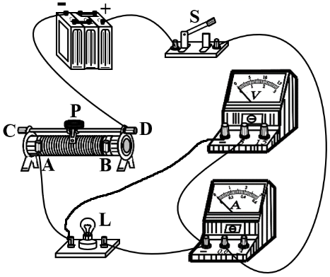    

，左，1.5/0.22，8  ，增大，小

【解析】提示：解析视频请查看最后一题。

提示：解析视频请查看最后一题。

提示：解析视频请查看最后一题。

提示：解析视频请查看最后一题。

提示：解析视频请查看最后一题。

​

## 19. 

实验小组在“测量小灯泡正常发光时电阻”的实验中，设计了如图甲的电路图，小灯泡的额定电压为2.5V，电源电压为6V。
​​
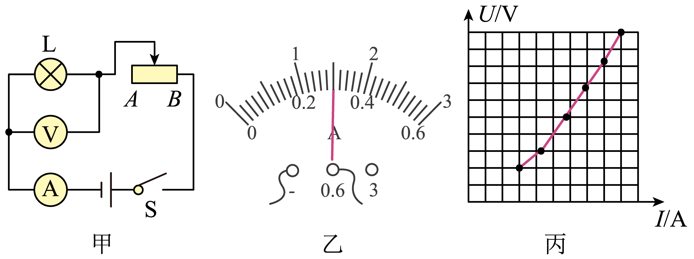
​

发现有一根导线连接错误，请你在连接错误的导线上打“×”，若没有发现错误，闭合开关，会出现___现象。在图中补画出正确的连线。闭合开关前，他应将滑动变阻器的滑片调到___端(填“A”或“B”)端；

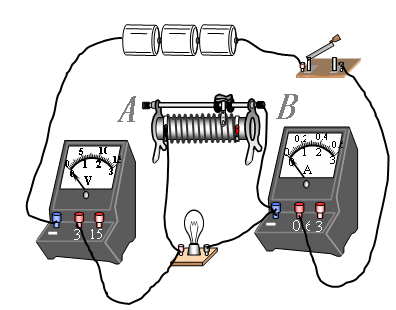

闭合开关后移动滑片到某位置，电压表的示数为2V，为了测量小灯泡正常发光时的电阻，应将滑片P向（选填“A”或“B”）端移动；

​​当小灯泡正常工作，此时电流表的示数如图乙所示为A，则小灯泡正常发光时电阻为Ω（结果保留1位小数）。根据实验数据画出小灯泡U-I关系图像如图丙（坐标轴上的数值已被擦除）。分析图像丙可知，当小灯泡两端电压增大时，小灯泡的电阻（选填“增大”、“减小”或“不变”），造成这一现象的原因是灯丝电阻要受的影响。

【答案】

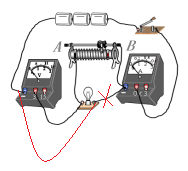    

电压表损坏

<i>B</i>

，<i>A</i>        ，0.3    /8.3    /增大    /温度

【解析】提示：解析视频请查看最后一题。

提示：解析视频请查看最后一题。

​

## 20. （难度：简单）

某同学用如图甲所示的实验装置测小灯泡的电阻。

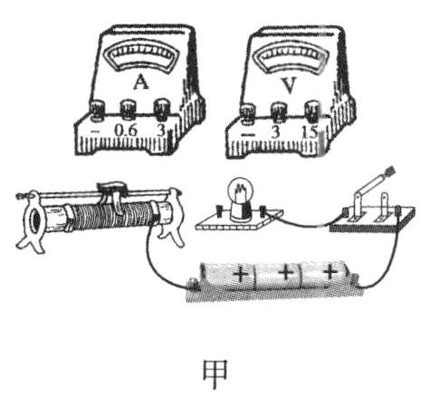

请你帮他用笔画线代替导线连接好实物电路，导线不允许交叉。

连接好电路闭合开关前，滑动变阻器的滑片应调至最\( (\)填“左”或“右”\( )\)端，这样做的目的是。

​该同学完成实验并将实验数据绘制成如图乙所示的图像，当小灯泡两端的电压为2.0V​时，小灯泡的电阻为​Ω​．​

​​
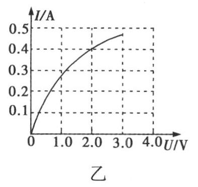

该同学提出在测量定值电阻的阻值实验中，绘制的\(I-U\)​​​图像是一条直线，而本实验得到的却是一条曲线，你认为原因可能是。

【答案】

如图所示。 

​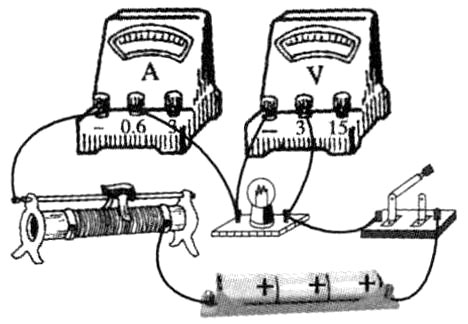​

，左/保护电路，5，灯丝的电阻随温度的升高而增大

【解析】提示：解析视频请查看最后一题。

提示：解析视频请查看最后一题。

提示：解析视频请查看最后一题。

​

## 21. 

小明在“用电流表和电压表测量未知电阻Rx的阻值”的实验电路。

闭合开关前，他发现电路中有一根导线连接错了，请你在接错的导线上打一个叉，并画出正确的连线。在方框中根据改正后的电路画出电路图。

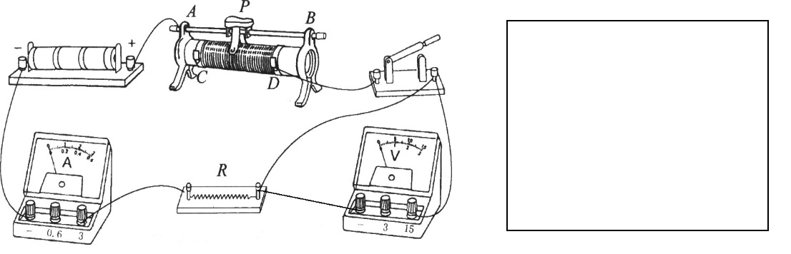

如果实验中出现电流表有示数，电压表示数为零的现象，其故障可能是______。

连接电路正确后，闭合开关，将滑片P向左移动时，电压表示数。（选填“变大”、“变小”或“不变”）

小聪同学进行实验，某次实验中电压表示数如图乙所示，电压表的示数为V，电流表示数如图丙所示，被测电阻Rx＝Ω。

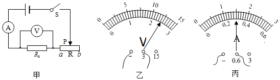

此实验要多次测量电阻值，多次测量的目的是。

- A. 电流表的正负接线柱接反
- B. 电压表的量程选小了
- C. 电阻Rx发生了短路
- D. 把滑动变阻器下端两接线柱连入电路

【答案】
​​​​​

，C，变小，2.4V/8&Omega;，求平均值，减小误差

【解析】提示：解析视频请查看最后一题。

提示：解析视频请查看最后一题。

提示：解析视频请查看最后一题。

提示：解析视频请查看最后一题。

​

## 22. 单选题（难度：适中）

用伏安法测灯泡电阻实验中，将正常的电压表和电流表接入电路，当闭合开关后小灯泡不发光，电流表、电压表都有示数。下面说法合理的是（     ）

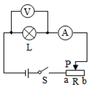

- A. 灯泡不亮的原因可能是滑动变阻器接触不良
- B. 灯泡不亮的原因可能是小灯泡两端短路
- C. 下一步的操作应该是调节滑动变阻器，观察小灯泡能否发光
- D. 下一步的操作应该是断开开关，更换小灯泡

【答案】C

【解析】​

## 23. 填空题（难度：简单）

在“伏安法测电阻”实验中，某小组的实验电路如图甲所示。

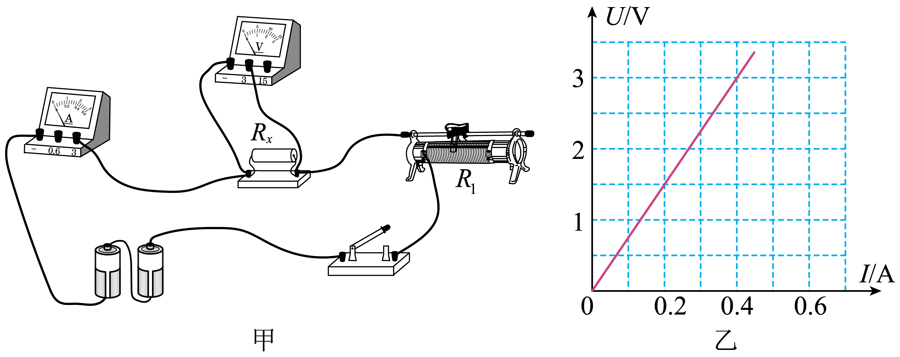
 
数据序号
1
2
3
4
5

电压U/V
0.75
1.0
1.5
2.0
2.5

电流I.A
0.09
0.14
0.22
0.28
0.32

（1）本实验的原理是；
（2）由两节新干电池串联组成的电源两端电压大约是V；
（3）闭合开关前，应将变阻器滑片放在其最（填“左”或“右”）端，闭合开关后，发现两个电表中只有一个电表有示数，初步检查确认，接线完好且两个电表无故障，则发生故障的元件应是（填“电源”“电阻Rx”或“滑动变阻器R₁”）；
（4）排除故障后，经过多次测量得到的实验数据如表所示：
①为减小实验误差，小明依据多次测量取平均值的做法进行了如下运算：
\( {R}_{x}=\frac{\frac{0.75\mathrm{V}+1.0\mathrm{V}+1.5\mathrm{V}+2.0\mathrm{V}+2.5\mathrm{V}}{5}}{\frac{0.09\mathrm{A}+0.14\mathrm{A}+0.22\mathrm{A}+0.28\mathrm{A}+0.32\mathrm{A}}{5}}\approx 7.38\mathrm{\Omega }\) 
由此得电阻Rx＝7.38Ω，这样的算法是（填“合理”或“不合理”）的；
②小芳把表中的数据在坐标系中描点、连线，得到如图乙所示的U－I图象，由图可得电阻Rx＝Ω；

【答案】$ R=\frac{U}{I}$，3，右，电阻<em><em>R</em></em>x ，不合理，7.5 

【解析】​

## 24. 单选题

​用“伏安法测电阻”的实验中，有两位同学分别选用定值电阻和小灯泡为测量对象，在处理实验数据时，分别画出了\(U-I\)​​​​图像，如图甲、乙所示。对于图像的分析，以下说法错误的是（     ）

 ​
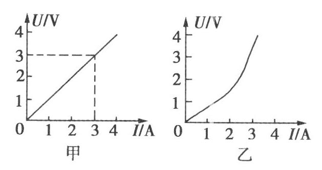
​​

- A. 由图甲可知，定值电阻的阻值为1Ω​​
- B. 由图甲可知，电阻是导体自身的性质，不随导体两端的电压和导体中电流的改变而改变
- C. 由图乙可知，小灯泡的电阻跟温度有关
- D. 为了减小误差，应该用多次测量取平均值的方法，测定小灯泡的电阻

【答案】D

【解析】​
