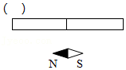
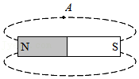
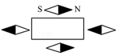
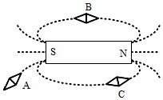
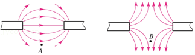
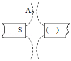
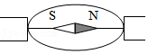
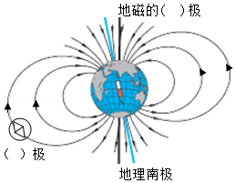

# 知识点·磁场（同步练习）

> 教材：物理·九年级全一册·沪科技版2024新教材 ｜ 来源：国家中小学智慧教育平台·在线练习 ｜ 共 9 题

## 1. （难度：简单）

磁体旁的小磁针静止时所指的方向如图所示．请在括号中标出磁体左端的磁极并画出通过小磁针中心的一条磁感线．
 

【答案】

     

## 2. （难度：简单）

如图所示，请用箭头标出\( A\)点的磁感线方向．

【答案】

      

## 3. （难度：适中）

请在图中标出条形磁体旁静止的小磁针的\( N\)、\( S\)极．

【答案】

      

## 4. 

在一个圆纸盒内有一个条形磁体，圆纸盒外放着一些小磁针，各个小磁针静止时的指向如图所示（黑色表示\( N\)极），根据圆纸盒外小磁针的指向，请你在圆纸盒内画出条形磁体，并标出条形磁体的\( N\)、\( S\)极．

【答案】

     

## 5. （难度：简单）

在图中标出\( A\)、\( B\)、\( C\)三点小磁针静止时北极所指的方向及磁感线的方向

【答案】

     

## 6. （难度：适中）

标出磁极的名称和\(A\)​、\(B\)​两点的磁场方向．

【答案】

      

## 7. （难度：适中）

根据图中已标明的磁极，在\( A\)点标出磁感线方向，在括号内标出另一磁铁的磁极．

【答案】

     

## 8. 

请根据图中小磁针静止时\( N\)极的指向，标出两个磁极的极性和磁感线方向.

【答案】

      

## 9. 

如图为地磁场的示意图，请在括号内填上地磁的磁极和小磁针右下端的磁极（选填“\( N\)”或“\( S\)”）．

【答案】

      

