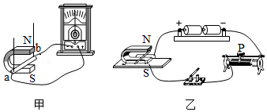
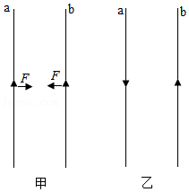
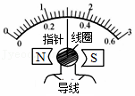
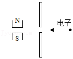
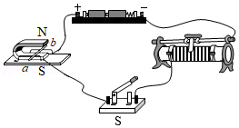
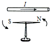
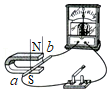
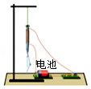
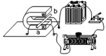
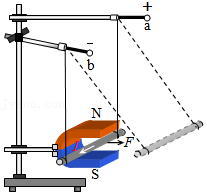

# 知识点·磁场对通电导线的作用（同步练习）

> 教材：物理·九年级全一册·沪科技版2024新教材 ｜ 来源：国家中小学智慧教育平台·在线练习 ｜ 共 9 题

## 1. 填空题（难度：简单）

探究“磁场对电流的作用”应选用如图中（选填“甲”或“乙”）所示的装置进行实验．在这个现象中导体受力运动的方向与的方向和磁场方向有关．利用此实验原理可制成（选填“电动机”、“发电机”）．

【答案】乙，电流，电动机

## 2. 单选题

如图所示，把一个在家庭电路中正在发光的灯泡放到蹄形磁体中间，发现灯丝不断晃动，关于这种现象，下列说法中正确的是（    ）．

- A. 灯丝晃动是因为灯丝是钨制成，能够被磁体吸引
- B. 灯丝晃动是因为磁场对通电导体有力的作用
- C. 该现象中，内能转化为机械能
- D. 利用该现象原理可以制成发电机

【答案】B

## 3. 填空题（难度：适中）

实验发现，两条平行放置的直导线，当通以相同方向的电流时，通电导线\( b\)产生的磁场对\( a\)导线具有向右的作用力；通电导线\( a\)产生的磁场对\( b\)导线具有向左的作用力，如图甲所示．如果改变\( a\)导线中的电流方向，如图乙所示．此时\( b\)导线受到\( a\)导线作用力的方向（选填“向左”或“向右”）．

【答案】向右

## 4. 单选题（难度：适中）

如图所示是实验室中电流表的内部结构图，处在磁场中的线圈有电流通过时，线圈会带动指针一起偏转．线圈中的电流越大，指针偏转角度越大．则下列说法正确的是（    ）．

- A. 该装置利用了电流的热效应原理
- B. 线圈中有电流通过时，把电能全部转化为内能
- C. 改变线圈中的电流方向，其转动方向不会改变
- D. 线圈中的电流越大，其所受的磁场力越大

【答案】D

## 5. 填空题

如图所示，一束电子自右向左从狭缝里射出，穿过磁场时受到磁场力的作用而向纸面内偏转．若将两个磁极对调，则电子束将向纸面（选填“内”或“外”）偏转．你判断的理由是．

【答案】外，通电导体在磁场中受磁场力的方向与电流方向、磁场方向有关；当磁极对调后，电流方向没有改变，因此电子束偏转方向与原来应相反

## 6. 填空题（难度：简单）

在探究“电动机为什么会转动”的实验中：我们首先想到的是磁体间发生相互作用是因为一个磁体放在了另一个磁体的磁场中，由于通电导体周围也存在磁场，磁体会对通电导体产生力的作用吗？
（1）如图所示，将一根导体\( ab\)置于蹄形磁体的两极之间，未闭合开关时导体静止，闭合开关后，导体，说明磁场；
（2）断开开关，将图中磁体的\( N\)和\( S\)极对调，再闭合开关，会发现导体\( ab\)的运动方向与对调前的运动方向相反，说明通电导体在磁场中的受力方向与有关；
（3）如果同时改变磁场方向和电流方向，（选填“能”或“不能”）确定受力方向与磁场方向或电流方向是否有关．

【答案】运动，通电导体有力的作用，磁场方向，不能

## 7. 单选题（难度：简单）

如图是一台正在工作的电风扇．下列四个实验能反映其工作原理的是（    ）．

- A. 
- B. 
- C. 
- D. 

【答案】B

## 8. 填空题（难度：适中）

在验证磁场会给通电导线作用力的实验中，小东连接了如图所示的实验电路，闭合开关后，发现导体棒\( ab\)没有动．经检查，各元件完好，电路连接无故障．
（1）请你猜想导体棒不动的原因是，
（2）写出检验你的猜想是否正确的方法：．

【答案】电源电压太低或磁体磁性太弱，增大电源电压或换成磁性更强的磁场，观察导体棒$ab$是否运动，若动则有关，若不动则无关

## 9. 填空题

小红在学习了磁场对通电导体有力的作用后，进一步查阅资料，了解到当电流与磁场垂直时，磁场对通电导体的作用力大小与磁场强弱、导体在磁场中的长度以及导体中的电流大小有关．她设计了如图所示的装置，验证磁场对通电导体的作用力大小跟电流大小有关．实验步骤如下：
\( \text{①}\)将一根导体棒用两根细线悬挂在铁架台上，将一蹄形磁铁竖直固定在铁架台上，并让导体棒与蹄形磁铁磁极间的磁感线方向垂直．
\( \text{②}\)给导体两端加电压\( {U}_{1}\)，闭合电路，观察悬线偏转的角度\( {\alpha }_{1}\)．
\( \text{③}\)给导体两端加电压\( {U}_{2}\)，\( {U}_{2}>{U}_{1}\)，闭合电路，观察悬线偏转的角度\( {\alpha }_{2}\)．
根据以上信息，回答下列问题：
（1）如果\( {\alpha }_{1}\)  \( {\alpha }_{2}\)（选填“等于”或“不等于”），即可验证磁场对通电导体的作用力大小与电流大小有关．
（2）小红想进一步探究磁场对通电导体的作用力大小与导体在磁场中的长度是否有关，于是她更换了另一根较长的导体棒，并更换了一个较大的蹄形磁铁，她这样做存在的问题是．

【答案】不等于，没有控制磁场强弱和电流大小、导体棒质量相同
