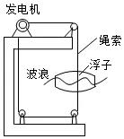
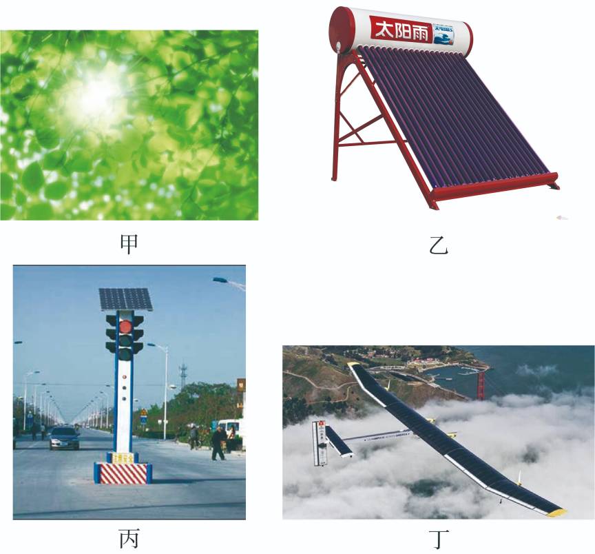
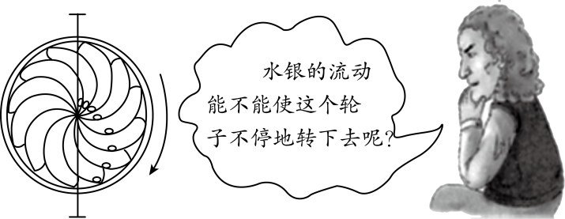

# 知识点·能量转移和能量转化的方向性（同步练习）

> 教材：物理·九年级全一册·沪科技版2024新教材 ｜ 来源：国家中小学智慧教育平台·在线练习 ｜ 共 8 题

## 1. 单选题

某大学的研究团队研发出一种新型钙钛矿材料，该材料可在光照、温度变化、压力变化的情况下产生电能，有着广阔的应用前景. 该材料不能直接实现的能量转化是（    ）.

- A. 光能→电能
- B. 内能→电能
- C. 机械能→电能
- D. 化学能→电能

【答案】D

【解析】​

## 2. 单选题（难度：简单）

关于能量的转化与转移，下列说法中不正确的是（   ）.

- A. 内能可以从温度高的物体向温度低的物体转移，也可以从温度低的物体向温度高的物体转移；
- B. 内能可以转化为机械能，机械能也可以转化为内能；
- C. 内能在转化或转移过程中一定有能量损失；
- D. 能量可以从一种形式转化为其他形式，也可以从一个物体转移到其他物体，在转化和转移的过程中，能量的总量保持不变

【答案】A

【解析】​

## 3. 单选题（难度：适中）

下列实例与能量转化相对应正确的是（  ）.

- A. 汽油燃烧：化学能转化为内能；
- B. 太阳能电池：太阳能转化为化学能；
- C. 热机：利用机械能转化为内能；
- D. 给充电宝充电：电能全部转化为内能

【答案】A

【解析】​

## 4. 填空题（难度：简单）

如图所示是振荡浮子式波浪发电原理图，浮子随着波浪起伏运动，带动发电机运转，利用原理产生电流，将能转化为电能. 这种波浪提供的能源属于（选填“可再生”或“不可再生”）能源. 

【答案】电磁感应，机械能，可再生

【解析】​

## 5. 单选题

2021年12月30日，中科院合肥物质科学研究院等离子体物理研究所有“人造太阳”之称的全超导托卡马克核聚变实验装置（EAST）实现1056秒超长放电运行，中国“人造太阳”再创最长放电纪录. 这其中用到了大量与能源、信息和材料的相关知识，下列说法正确的是（    ）.

- A. 太阳能、核能和潮汐能都属于可再生能源
- B. 当前的核电站是利用原子核裂变释放的能量发电的
- C. “超导体”用于电饭锅的发热体可提高其热效率
- D. 汽车上的北斗定位导航系统是利用声波进行定位和导航的

【答案】B

【解析】​

## 6. 单选题（难度：适中）

太阳能是人类优先开发和利用的新能源之一，关于太阳能的利用，下列说法正确的是

- A. 图甲中，绿色植物通过光合作用将太阳能转化为化学能
- B. 图乙中，太阳能热水器通过做功方式将太阳能转化为水的内能
- C. 图丙中，太阳能交通信号灯将太阳能直接转化为信号灯的光能
- D. 图丁中，首架环球航行的太阳能飞机将太阳能直接转化为飞机的机械能

【答案】A

【解析】​

## 7. 填空题（难度：适中）

如图所示，达·芬奇曾经思考的永动机不可能成功，最根本的原因是违背了；生活中水总是自发地从高处往低处流，无法自发从低处往高处流，这一现象说明能量的转化具有. 

【答案】能量守恒定律，方向性

【解析】​

## 8. 填空题

“张北柔性直流电网”这项工程是北京2022年冬奥会重点配套工程，让北京冬奥会场馆100%使用绿色清洁电能，它选择的是将能等可再生能源转化为电能，若能在输电能等方面采用材料，由于没有电阻，还可以大大降低电流的热效应引起的电能损耗.

【答案】太阳（或填风、水），超导

【解析】​
