# 零散题目汇编（每知识点 ≤2 题）

> 教材：物理·九年级全一册·沪科技版2024新教材 ｜ 由 97 个小知识点文件合并，便于检索。

## 知识点·串联电路和并联电路的辨别

## 1. 填空题（难度：适中）

街边的路灯总是同时亮，同时灭，它们是（填“串联”或“并联”）的，要达到如此效果，对开关的安装要求是，如图所示是一款学校常用的应急照明灯，当外部电路有电时，应急灯不亮，停电时应急灯发光，小李将应急灯中的任意一个灯泡断开，另一个灯泡仍然发光，则应急灯的两个灯泡是（填“串联”或“并联”）的．

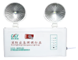

【答案】并联，接在干路上，并联

【解析】​

## 知识点·串联电路和并联电路的辨别；导体

## 1. 填空题（难度：简单）

我国家庭电路中的电视机和电灯是联的；在玻璃、橡胶和铁棒等材料中，常温下是最容易导电的是．

【答案】并，铁棒

【解析】​

## 知识点·串联电路和并联电路的辨别；电路的基本连接方式

## 1. 

如图所示电路中，各元件及连接均完好．

闭合开关，电流表指针（选填“偏转”或“不偏转”），灯\( {\text{L}}_{1}\) （选填“亮”或“不亮”），灯\( {\text{L}}_{2}\) （选填“亮”或“不亮”）．

拆掉一根导线 （选填\( \text{a}\)、\( \text{b}\)、\( \text{c}\)、\( \text{d}\)），可以让\( {\text{L}}_{1}\)和\( {\text{L}}_{2}\)串联．

只改动一根导线可以让\( {\text{L}}_{1}\)与\( {\text{L}}_{2}\)并联，请在图中表示出来，（用“×”划掉改动的线）．

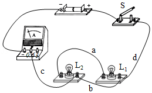

【答案】偏转/不亮/不亮，$ \text{b}$，

如下图

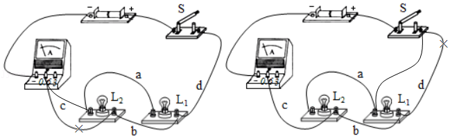    

【解析】​

## 知识点·串联电路和并联电路的辨别；电路的基本连接方式；电源及其能量转化

## 1. 填空题（难度：适中）

小明学习了电学知识后，研究了下面的甲、乙两个电路，发现开关在电路中能起到不同的作用．

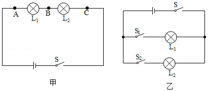
       
（1）小明在连接电路时，应按照一定的顺序连接，在连接过程中，开关应该是的．
（2）如图甲所示，当开关闭合时两个灯都发光，当开关断开时两个灯都不发光，说明开关在电路中能起到的作用．若把开关从\( A\)分别换到\( B\)、\( C\)的位置，发现都能控制两个灯的亮灭，说明在串联电路中开关的作用和它的无关．
（3）图乙中，位于干路上的开关，它能控制所有用电器．开关\( {\text{S}}_{\text{1}}\)能控制灯泡．

【答案】断开，控制，位置，$\text{S}$ ，$ {\text{L}}_{\text{1}}$ 

【解析】​​

​​

## 2. 填空题（难度：简单）

酸甜多汁的水果不仅可以为我们的身体提供能量，还可以发电呢，如图所示，几只水果提供的电力足以点亮一排规格相同的发光二极管！
（1）水果电池将能转化为电能，为了使发光二极管更亮，这三个水果电池应该（选填“串联”或“并联”）；
（2）当连接好电路后，这些相同规格的发光二极管中只有一个不亮，经检查整个电路连接及所有元件均完好，则这些发光二极管是（选填“串联”或“并联”）的，这个发光管不亮的可能原因是：．

【答案】化学，串联，并联，二极管正负接线柱接反了

【解析】​​

​​

## 知识点·串联电路和并联电路的辨别；电路的基本连接方式；电路的三种状态

## 1. 填空题

小刚和小强在组成串并联电路的实验中．
（1）在连接电路的过程中，开关应该（选填“断开”或“闭合”）．
（2）小刚连接了如图所示电路，如果合上开关，两个灯泡都将（选填“不会发光”或“会被烧坏”），出现（选填“断路”“短路”或“通路”）现象．
（3）小刚想将电路全部拆散，重新连接．小强认为只需拆除（填字母）这一根导线，就能成为串联电路．
（4）连接成串联电路后，若把\( {\text{L}}_{\text{1}}\)的灯泡拧下来，则看到的现象是灯泡\( {\text{L}}_{\text{2}}\) （选填“亮”或“不亮”），说明在串联电路中，各个用电器之间（选填“互不”“相互”）影响．
（5）楼道中的电灯是由声控开关和光控开关共同控制的，只有在天暗并且有声音时才能亮，所以声控开关、光控开关及灯是联的．

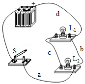

【答案】断开，不会发光，短路，b，不亮，相互，串

【解析】​​

​​

## 知识点·串联电路和并联电路的辨别；电路的基本连接方式；电路的三种状态．

## 1. 填空题

如图所示的电路中，当闭合\( {\text{S}}_{\text{1}}\)、\( {\text{S}}_{\text{3}}\)，断开\( {\text{S}}_{\text{2}}\)时，灯\( {\text{L}}_{1}\)、\( {\text{L}}_{\text{2}}\)联；当闭合\( {\text{S}}_{\text{2}}\)、\( {\text{S}}_{\text{3}}\)，断开\( {\text{S}}_{1}\)时，有电流通过的灯是．

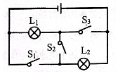

【答案】并 ，$ {\text{L}}_{\text{1}}$

【解析】​

## 知识点·串联电路的电流规律；电流表的使用．

## 1. 单选题（难度：适中）

如图，三个不同的灯泡接在电源上，\( {A}_{1}\)的示数为\( {I}_{1}\)，\( {A}_{2}\)的示数为\( {I}_{2}\)，\( {A}_{3}\)的示数为\( {I}_{3}\)，各表读数关系正确的是（    ）．

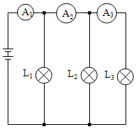

- A. \( {I}_{1}={I}_{2}={I}_{3}\)
- B. \( {I}_{1}={I}_{2}+{I}_{3}\)
- C. \( {I}_{3}>{I}_{2}>{I}_{1}\)
- D. \( {I}_{1}>{I}_{2}>{I}_{3}\)

【答案】D

【解析】​

## 知识点·信息、能源

## 1. 单选题

下列关于核能及其利用，说法正确的是（    ）.

- A. 任何两个原子核都可以发生聚变
- B. 目前人类已建立核电站，利用核聚变发电
- C. 在核电站中，发生的是可以控制的链式反应
- D. 在核电站中，厚重的保护层，是为了避免核燃料从内部逸出

【答案】C

【解析】​

## 知识点·凝固

## 1. 填空题（难度：适中）

寒冷的冬天，好奇的小明将舌头粘在了铁管上，这是由于（填物态变化的名称）造成的．施救人员用盐（或者浓盐水），很快就会使舌头和铁管分开，因为这样做的目的是降低点．

【答案】凝固，熔

【解析】​

## 知识点·凝固图象

## 1. 填空题（难度：简单）

如图所示，是甲、乙两种液态物质的凝固图象，从图中可看出其中物质是晶体，它的凝固点是 \( \text{℃}\)，在第\( \text{8min}\)时，这种晶体处于状态. 

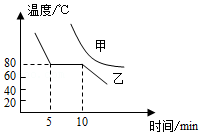

【答案】乙  ，80  ，固液共存

【解析】​

## 知识点·凝固现象

## 1. 填空题（难度：简单）

为确保2022年北京冬奥会顺利举行，需要进行人工造雪. 造雪机在工作时，不断将水吸入，并持续从前方喷出“白雾”，在“白雾”下方沉积成一层“白雪”. 造雪机在造雪过程中，水发生的最主要物态变化是. 

【答案】凝固

【解析】​

## 2. （难度：适中）

夏天，吃冰棍是一种解暑的方法，刚刚从冰箱冷冻室取出的冰棍，我们吃的时候，有时会将舌头“粘住”，请解释这个现象.

【答案】

从冰箱冷冻室中取出的冰棍，温度较低，吃冰棍的时候，舌头上的水遇到温度较低的冰棍放热凝固成冰，从而粘在冰棍上，因此舌头会被&ldquo;粘住&rdquo;.

【解析】​

## 知识点·函数图像分析

## 1. 填空题（难度：简单）

​如图甲是一种能自动测定油箱内油量的装置原理图。电源电压恒为24 V，定值电阻R0 ＝10 Ω，A为油量表(由电流表改装而成)，Rx为压敏电阻，其阻值与所受压力的对应关系如图乙所示。当油箱中油量逐渐减少时，Rx上受到的压强逐渐，Rx的阻值逐渐。若当油箱中装满油时，电路中的电流是0.6 A，则此时Rx上受到的压力是N。当油箱中油量为零时，电路中的电流是。

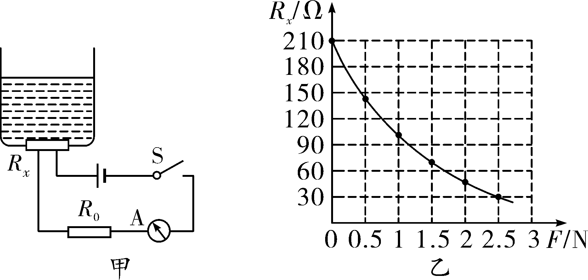

【答案】变小       ，变大        ，2.5       ，0.11

【解析】​

考点分析：欧姆定律应用；函数图像分析。

## 知识点·功率的概念与单位

## 1. 单选题（难度：简单）

一台机器的功率是150W，它表示的含义是（    ）.

- A. 这台机器所做的功只能是150J
- B. 这台机器正常工作每分钟可做功150J
- C. 这台机器正常工作每秒钟可做功150J
- D. 这台机器正常工作每秒钟可做功150W

【答案】C

【解析】​

## 知识点·升华

## 1. 单选题（难度：简单）

如图是冰雕展中“火车头”冰雕作品．展出当地的气温一直持续在﹣10℃以下，可是冰雕作品在一天天变小，此过程发生的物态变化是（    ）．

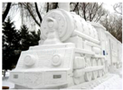

- A. 升华
- B. 熔化
- C. 汽化
- D. 凝华

【答案】A

【解析】​

## 知识点·卫星通信

## 1. 单选题（难度：简单）

下列说法不正确的是（  ）．

- A. 大多数通信卫星绕地球转动的周期都是24小时
- B. 通信卫星可以在地球上任一点与地球保持“静止”
- C. 在地球周围均匀地配置三颗同步地球卫星就可以实现全球通信
- D. 通信卫星既可以接收微波信号，又可以发送微波信号

【答案】B

【解析】​

## 2. 单选题（难度：适中）

下列关于通信卫星的说法正确的是（  ）．

- A. 卫星通信就是利用卫星来向地面发射电磁波的
- B. 通信卫星相当于一个太空微波中继站，它是用来转发地面站发送的信号的
- C. 卫星通信发送广播信号
- D. 卫星通信接收电视信号

【答案】B

【解析】​

## 知识点·原子结构、元电荷与带电情况．

## 1. 填空题（难度：简单）

在探索比分子更小的微观粒子的历程中，人们首先发现了，进而认识到原子是由和构成的．

【答案】电子，原子核，核外电子

【解析】​

## 知识点·吸热和放热

## 1. 多选题（难度：简单）

如图所示有关物态变化的现象中，吸热的是（    ）．

- A. 

游泳上岸风吹很冷
- B. 

夏天吃冰棍解热
- C. 

烧水时易被水蒸气烫伤
- D. 

食物下面放干冰保鲜

【答案】A/B/D

【解析】​

## 知识点·实物的电路连接

## 1. （难度：简单）

以笔画线代替导线，按电路图甲把实物图乙连接起来．（导线不允许交叉）

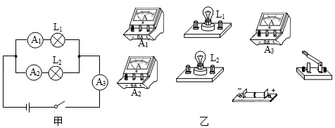

【答案】

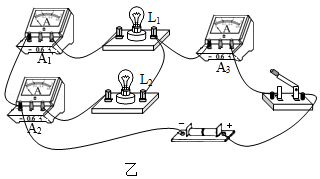     

【解析】​

## 2. （难度：简单）

如图所示在图中电流表\( \text{A}\)的示数为\( \text{0}\text{.}\text{5A}\)，\( {\text{A}}_{1}\)的示数为\( \text{0}\text{.}\text{2A}\)，若要\( {\text{A}}_{2}\)测\( {\text{L}}_{2}\)的电流，请将\( {\text{A}}_{2}\)正确地连入电路．

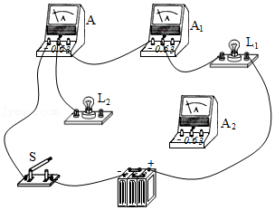

【答案】

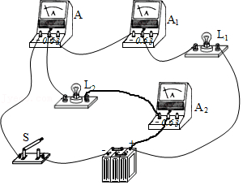     

【解析】​

## 知识点·实物的电路连接．

## 1. （难度：适中）

如图所示，电流表\( {A}_{3}\)的示数为\( \text{0}\text{.}\text{18A}\)，电流表\( {A}_{2}\)的示数为\( \text{0}\text{.}\text{58A}\)，通过灯泡\( {L}_{1}\)的电流为\( \text{0}\text{.}\text{3A}\)，求：

（1）通过灯泡\( {L}_{2}\)和\( {L}_{3}\)的电流分别是多少？

（2）电流表\( {A}_{1}\)的读数是多少？

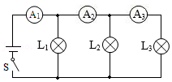

【答案】

（1）通过灯泡$ {L}_{2}$的电流是$ \text{0}\text{.}\text{4A}$；通过灯泡$ {L}_{3}$的电流是$ \text{0}\text{.}\text{18A}$．（2）电流表$ {A}_{1}$读数是$ \text{0}\text{.}\text{88A}$．

【解析】​

## 知识点·容量

## 1. 填空题（难度：简单）

如图所示为某型“无人机”，它有4个旋翼，可通过无线电操控，实现无人航拍。​​ 
（1）无人机的一个旋翼的电动机额定功率为30W额定电压为15V，此电动机正常工作时，通过的电流为A。
（2）该机所用电池的参数为输出电压15V、容量5000mA•h，它能够提供的电能是J；若电能的80%用于飞行，飞行时的实际功率为100W，则该机最多能飞行时间。

【答案】2，2.7&times;105，2160s

【解析】​

## 知识点·导体和绝缘体的区别

## 1. 多选题（难度：简单）

关于导体和绝缘体的下列说法中，正确的是（    ）．

- A. 导体善于导电是因为导体内有大量的电荷存在
- B. 有些绝缘体在一定的条件下可能变为导体
- C. 绝缘体不善于导电，是因为绝缘体内没有电荷存在
- D. 金属、大地、人都是导体

【答案】B/D

【解析】​

## 知识点·常见物质三种状态

## 1. 填空题（难度：简单）

夏天，小明买了一些雪糕，为了储存，他把雪糕放在冰箱的冷冻室里，此时的雪糕是态；在吃的时候，雪糕在嘴里变成了态；如果有一点滴到地上，一会儿就不见了，这时它又变成了态.

【答案】固  ，液  ，气

【解析】​

## 知识点·并联电路的电流规律；串联电路和并联电路的辨别．

## 1. （难度：简单）

某同学在探究“串联电路电流的特点”时，将两个规格不同的小灯泡\( {L}_{1}\)、\( {L}_{2}\)串联起来，实验电路图如图甲所示．

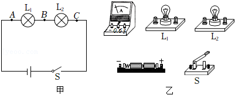

根据实验电路图，用笔画线将图乙中的实物连接起来，电流表测\( A\)处电流．

该同学连接好电路后，用开关“试触”观察到电流表指针迅速偏转到零刻线左侧，则他连接的电路存在的问题是．

正确连接电路后，闭合开关\( S\)，发现\( {L}_{1}\)灯不发光，\( {L}_{2}\)灯发光．该同学猜想可能是\( {L}_{1}\)灯被短接了．他拿来一根导线进行检验，根据看到的现象判断出他的猜想是错误的．
请写出他检验时的做法及观察到的现象．
做法：．
现象：．

【答案】

 

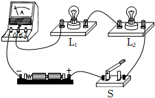     

，电流表正负接线柱接反了，用一根导线接在$ {L}_{2}$两端/ 观察到$ {L}_{1}$发光了

【解析】​

## 2. 多选题

如图甲所示，闭合开关\( S\)后，两个灯泡都能发光，图乙为电流表\( {A}_{1}\)指针的位置，如果电流表\( {A}_{2}\)读数是\( \text{0}\text{.}\text{6A}\)，则下列说法正确的是（    ）．

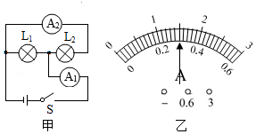

- A. 电流表\( {A}_{1}\)一定连接“3A”接线柱
- B. 灯泡\( {L}_{1}\)和\( {L}_{2}\)并联
- C. 电流表\( {A}_{1}\)的读数是0.3A
- D. 通过灯\( {L}_{1}\)的电流为0.9A

【答案】A/B/D

【解析】​

## 知识点·并联电路的电流规律；串联电路和并联电路的辨别；电流表的使用；电流表的读数方法．

## 1. 填空题（难度：简单）

如图所示是一种\( \text{L}\text{E}\text{D}\)护眼台灯，由\( \text{6}\)个\( \text{LED}\)灯泡并联组成．若通过每只\( \text{LED}\)灯泡的电流为\( \text{15mA}\)，则这种\( \text{LED}\)灯正常工作时的总电流为 \( \text{A}\)．

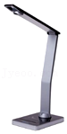

【答案】0.09

【解析】​

## 知识点·并联电路的电流规律；串联电路的电流规律．

## 1. 多选题（难度：适中）

如图所示，已知电流表\( A\)的示数为\( \text{1}\text{.}\text{5A}\)，电流表\( {A}_{1}\)的示数为\( \text{0}\text{.}\text{8A}\)，电流表\( {A}_{2}\)的示数为\( \text{1}\text{.}\text{2A}\)，有关通过\( {L}_{1}\)的电流的大小说法正确的是（    ）．

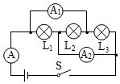

- A. 通过\( {L}_{1}\)的电流的大小为\( \text{0}\text{.}\text{3A}\)
- B. 通过\( {L}_{1}\)的电流的大小为\( \text{0}\text{.}\text{7A}\)
- C. 通过\( {L}_{2}\)的电流的大小为\( \text{0}\text{.}\text{5A}\)
- D. 通过\( {L}_{3}\)的电流的大小为\( \text{0}\text{.}\text{5A}\)

【答案】B/C

【解析】​

## 知识点·并联电路的电流规律；电流表的使用；电流表的读数方法

## 1. 填空题

如图甲所示是小明探究串联电路电流特点的实验电路图：
实验序号
电流表的位置
\( A\) 
\( B\) 
\( C\) 

1
电流\( I\text{/A}\)
0.3
0.3
0.3

2
电流\( I\text{/A}\)
0.4
0.4
0.4

3
电流\( I\text{/A}\)
0.2
0.2
0.2

（1）小明最好选择两个小灯泡的规格是的（填“相同”或“不相同”）．
（2）小明连电路时，刚连完最后一条导线，灯泡\( {L}_{1}\)、\( {L}_{2}\)就亮了，他在实验操作中不当之处：．
（3）表格是小明实验中测得的三组数据：由表格数据可得出结论：．
（4）实验中，小明同学通过改变电源电压而获得三组不同电流值，请你提出能改变电路中的电流值的另外一种实验操作方法：．
（5）小红同学在做实验时，闭合开关前，电流表的指针指在零刻度处；当闭合开关试触时，发现电流表指针摆动出现了如图乙所示的情况．请分析她在电流表的使用上存在的问题是．

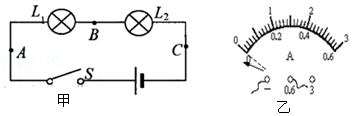

【答案】不相同，连接电路时开关没有断开，串联电路中各处的电流都相等，换用不同规格的灯泡做实验，电流表正负接线柱接反了

【解析】​

## 知识点·并联电路的电流规律；电流表的读数方法．

## 1. （难度：适中）

在“探究并联电路电流特点”的实验中，小华设计了如图1所示的电路进行实验．

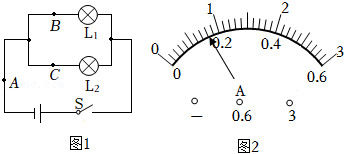

连接电路时，开关应处于状态．

实验中，在\( A\)、\( B\)、\( C\)三处各接入一个电流表，并选择合适的量程．闭合开关，测得\( A\)、\( B\)、\( C\)三处的电流分别为\( {I}_{A}\)、\( {I}_{B}\)、\( {I}_{C}\)．更换多组（选填“相同”或“不同”）规格的灯泡重复实验，部分实验数据如表所示．
实验序号
\( {I}_{A}\text{/A}\) 
\( {I}_{B}\text{/A}\) 
\( {I}_{C}\text{/A}\) 

1
0.46
0.18
0.28

2
0.36
0.20
0.16

3
0.7
0.32
0.38

分析实验数据可得：在并联电路中，干路电流与各支路电流的关系是（写出关系式）．

小华在某次实验时，测得\( C\)处电流\( {I}_{C}\)为\( \text{0}\text{.}\text{30A}\)，观察到\( A\)处电流表指针位置如图2所示，则\( A\)处电流大小为 \( \text{A}\)．

【答案】断开，不同，$ {I}_{A}={I}_{B}+{I}_{C}$，0.8

【解析】​

## 知识点·并联电路的电流规律；电路的三种状态

## 1. 填空题

在“用电流表测电流”的实验中，某同学接成如图\( a\)所示的电路．当开关都闭合后两灯都发光，两个电流表的指针所指位置均为图\( b\)所示，则通过灯\( {L}_{1}\)的电流为 \( \text{A}\)．若\( {S}_{2}\)断开，电流表\( {A}_{1}\)的示数（填“变大”“不变”或“变小”）．

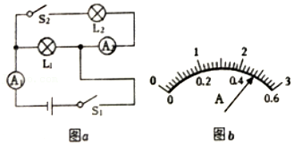

【答案】1.92；，变小

【解析】​

## 知识点·微波通信

## 1. 单选题（难度：简单）

以下关于微波的说法不正确的是（     ）．

- A. 微波属于电磁波
- B. 微波的性质接近于光波，大致沿直线传播
- C. 进行长距离微波通信时，应通过中继站进行转播
- D. 微波中继站间的距离大约为50 km，而且只能建立在地球表面

【答案】D

【解析】​

## 2. 单选题（难度：适中）

微波通信需要中继站，其原因是（  ）．

- A. 微波信号衰减特别快
- B. 微波信号传播速度慢
- C. 微波沿直线传播，不能沿地球表面绕射
- D. 微波信号易于被干扰，信号易丢失

【答案】C

【解析】​

## 知识点·探究串并联电路中的电流特点实验．

## 1. 填空题

如图所示，\( {L}_{1}\)、\( {L}_{2}\)两灯泡串联，用电流表测得\( a\)点的电流为\( I\)，则\( b\)点的电流 \( I\)（填“大于”、“等于”或“小于”）．

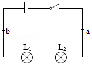

【答案】等于

【解析】​

## 知识点·探究物质凝固时的温度变化规律

## 1. 

小明发现严冬季节水缸里的水结冰了，但腌菜缸里的盐水却没有，小明猜想，水中加入别的物质后，一定会对水的凝固点产生影响. 为了验证这一猜想，他将一些盐放入水中，并把盐水用容器盛好放入冰箱，研究盐水的凝固过程. 每隔一定时间，小明就观察盐水状态、测出温度，并将凝固过程记录的温度数据画成了凝固图象如图甲所示. 

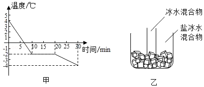

从图象中可以看出盐水的凝固过程用了 \( \text{min}\).

从图象中得到盐水在凝固时的温度将（选填“变大”、“变小”或“不变”）.

实验中盐水的凝固点为 \( \text{℃}\)，它属于（填“晶体”或“非晶体”）. 在第\( \text{15min}\)时物质处于状态. 实验验证了小明的猜想，因为与水相比，凝固点变（选填“高”或“低”）了.

实验中小明同学发现盐水凝固时间较长，在不改变原来实验装置的情况下，请你告诉他一种缩短盐水凝固时间的方法：.

如果将一个装有冰水混合物的试管放入正在熔化的盐冰水混合物中如图乙所示，试管中的冰水混合物中的冰会（选填“变多”、“变少”或“不变”）.

【答案】10，不变，﹣2/晶体/固液共存/低，减少盐水的质量，变多

【解析】​

## 知识点·探究物质熔化时的温度变化规律

## 1. （难度：简单）

物理兴趣小组的同学用如图甲所示的实验装置，探究某种物质熔化时的温度变化规律. 
实验过程中，小明同学记录的实验数据如表所示： 
时间/\( \text{min}\)
0.5
1
1.5
2
2.5
3
3.5
4
4.5
5
5.5
6

温度/\( \text{℃}\)
40
42
44
46
48
48
48
48
50
53
56
59

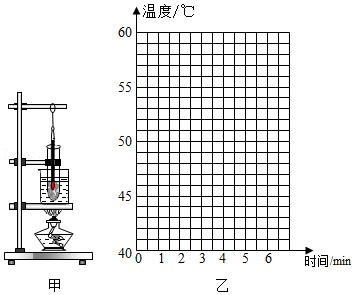

请根据小明记录的实验数据，在图乙所示的坐标系中描点，并绘制本次实验中温度随时间变化的图象.

根据图象可知该物质是（选填“晶体”或“非晶体”），当它的温度达到\( \text{45}\text{℃}\)时，其状态是 （选填“固态”、“液态”或“固液共存态”）.

实验过程中，同组的小丽同学每隔\( \text{1min}\)记录一次温度值，你认为（选填“小明”或“小丽”）记录的数据更便于找到规律，理由是.

【答案】

如图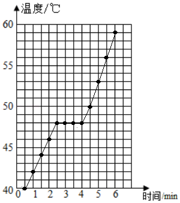    

，晶体/固态，小明/小明记录的实验数据更多，更精确.

【解析】​

## 2. （难度：适中）

小明选择蜂蜡和海波探究“不同固态物质在熔化过程中温度的变化是否相同”，设计的实验装置如图甲所示. 

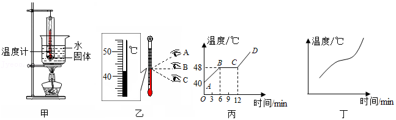

将温度计正确插入蜂蜡和海波中，观察温度计示数时如图乙所示，其中视线正确的是. 此时温度计的示数 \( \text{℃}\)；

丙图是小明绘制的海波的熔化图象，图中\( BC\)段表示海波的熔化过程，此过程中海波（选填“吸收”或“放出”）热量，温度（选填“升高”、“降低”或“不变”）. 第\( \text{10min}\)海波处于（选填“固”、“液”或“固液共存”）态；

丁图是小明绘制的蜂蜡的熔化图象，根据图象可知，蜂蜡属于（选填“晶体”或“非晶体”），判断依据是.

【答案】B/42，吸收/不变/固液共存，非晶体/熔化过程没有固定的熔点

【解析】​

## 知识点·探究物质熔化的实验装置

## 1. 填空题

如图甲是在20℃左右的室温下“探究冰熔化”的实验装置，不用酒精灯加热是（选填“正确”或“错误”）的；图乙是“探究蜡烛熔化”的实验装置，该加热方式的优点是. 根据探究过程可知，冰在熔化时温度（选填“升高”、“不变”或“降低”），所以冰是（选填“晶体”或“非晶体”），金属铜的熔化特点与冰的熔化特点（选填“相同”或“不相同”）. 

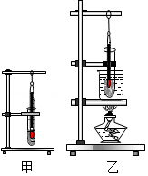

【答案】正确，能使物质受热均匀，不变，晶体，相同

【解析】​

## 知识点·摩擦起电的实质；物体带电现象

## 1. 填空题

如图，用一段细铁丝做一个支架，作为转动轴，把一根中间戳有小孔（没有戳穿）的饮料吸管放在转动轴上，吸管能在水平面内自由转动．用餐巾纸摩擦吸管使其带电．
（1）把某个物体放在带电吸管一端的附近，发现吸管向物体靠近，由此（选填“能”或“不能”）判断该物体是否带电；
（2）把丝绸摩擦过的玻璃棒放在用纸巾摩擦过的吸管一端的附近，发现吸管被吸引，则可判断餐巾纸带电；在此过程中，失去了电子；
（3）继续将玻璃棒与吸管接触，在接触的瞬间，电子从转移到．

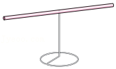

【答案】不能，正，纸巾，吸管，玻璃棒

【解析】​

## 知识点·摩擦起电的实质；电荷间的相互作用规律；绝缘体；物体带电现象

## 1. 多选题（难度：适中）

如图甲所示，小丽在透明塑料板下放了一张爱心的图案，用丝绸裹住手指，照着图案用力摩擦塑料板后，均匀撒上木屑，竖起塑料板轻敲，板上就留下了一颗由木屑组成的爱心，如图乙所示，这个过程模拟了静电复印．下列说法正确的是（    ）．

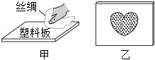

- A. 塑料板是绝缘体
- B. 摩擦过程中创造了电荷
- C. 摩擦后的塑料板和丝绸带上了同种电荷
- D. 木屑留在塑料板上是由于带电体吸引轻小物体

【答案】A/D

【解析】​

## 知识点·无线电广播信号的发射和接收

## 1. 单选题（难度：适中）

关于无线电广播的发射和接收，下列说法正确的是（    ）.

- A. 话筒把声音信号转化成音频信号后，直接通过天线发射出去
- B. 话筒把声音信号转化成音频信号后，需要加载到高频电磁波上再发射出去
- C. 载波发生器将音频电信号加载到高频电磁波上
- D. 调制器可以把声音信号从高频信号中取出

【答案】B

【解析】​

## 2. 单选题（难度：简单）

下列关于收音机的说法中不正确的是（  ）.

- A. 收音机的天线是接收空间电磁波的装置
- B. 转动收音机的调谐旋钮是为了选出带有信号的所需要的高频电磁波
- C. 收音机内部的电子电路(解调器)从选出的高频电磁波中取出相应的音频信号，并放大送至扬声器
- D. 收音机中的扬声器将声音信号转换成电信号

【答案】D

【解析】​

## 知识点·晶体和非晶体的区别

## 1. 填空题（难度：简单）

炎热的夏天，铺有沥青的路面会变软，这是因为沥青是（选填“晶体”或“非晶体”），没有一定的，受热后会逐渐变软. 酒精的凝固点是\( \text{-}\text{117}\text{℃}\)，它在\( \text{-}\text{115}\text{℃}\)时的状态是态.

【答案】非晶体，熔点，液

【解析】​

## 知识点·晶体和非晶体的理解

## 1. 单选题（难度：适中）

关于晶体与非晶体，下列说法正确的是（     ）.

- A. 晶体与非晶体在熔化过程中温度都升高
- B. 晶体有确定的熔点，非晶体没有确定的熔点
- C. 晶体熔化时吸热，非晶体熔化时不吸热
- D. 当晶体处于熔点温度时，它的状态应该是固体或液体

【答案】B

【解析】​

## 知识点·晶体和非晶体的认识

## 1. 单选题（难度：简单）

下列物质中全都是晶体的是（     ）.

- A. 铁、沥青、松香
- B. 萘、冰、铜
- C. 金、海波、石蜡
- D. 冰、石英、玻璃

【答案】B

【解析】​

## 知识点·晶体在熔点温度时所处的状态

## 1. 单选题（难度：简单）

萘的熔点为\( \text{80}\text{℃}\)，则\( \text{80}\text{℃}\)的萘处于（     ）.

- A. 固态
- B. 液态
- C. 固液共存态
- D. 以上三种情况都有可能

【答案】D

【解析】​

## 知识点·晶体熔化的条件和特点

## 1. 单选题

把盛有碎冰块的大试管插入烧杯里的碎冰块中，用酒精灯对烧杯底部慢慢加热，如图所示. 当烧杯里的冰块大部分熔化时，试管中的冰（     ）. 

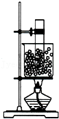

- A. 也熔化一部分
- B. 一点都没熔化
- C. 全部熔化
- D. 下边的熔化，上边的没熔化

【答案】B

【解析】​

## 知识点·晶体熔化的特点

## 1. 多选题（难度：适中）

小明用装有海波的大试管放在装有热水的大烧杯中进行熔化实验（如图甲）. 根据温度计\( A\)和\( B\)的示数，绘制海波和热水的温度随时间变化图象（如图乙）. 以下说法正确的是（     ）. 

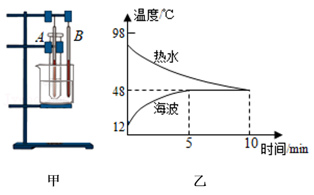

- A. 海波是晶体，熔点是 \( \text{48}\text{℃}\)
- B. 海波在 \( \text{5}\text{﹣}\text{10min}\) 之间放热，温度不变
- C. 第 \( \text{8min}\) 时，海波处于固液共存状态
- D. \( \text{10min}\) 后，海波会继续熔化

【答案】A/C

【解析】​

## 2. 多选题

两套完全相同的如图甲所示的加热装置，两套装置的试管中分别装有少量的相等体积的\( M\)固体和\( N\)固体，它们的温度—加热时间曲线如图乙所示，在\( \text{35min}\)内\( M\)物质从固体熔化成了液体，\( N\)物质始终是固体，则下列说法正确的是（     ）. 

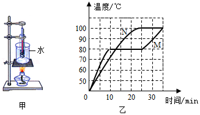

- A. 这种“水浴法”加热的优点是被加热物质受热比较均匀，缺点是加热温度一般不会超过\( \text{100}\text{℃}\)
- B. 由图乙知，\( M\)、\( N\)都是晶体，\( M\)的熔点为\( \text{80}\text{℃}\)
- C. 由图乙知，\( M\)、\( N\)的熔化过程要吸收热量
- D. 由图乙知，\( M\)是晶体，\( N\)是非晶体

【答案】A/C

【解析】​

## 知识点·根据实物图画电路图．

## 1. （难度：适中）

请根据如图所示的实物图，画出对应的电路图．

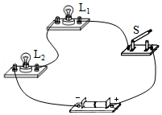

【答案】

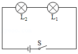    

【解析】​

## 知识点·正电荷与负电荷；物体带电现象．

## 1. 填空题（难度：适中）

一根用毛皮摩擦过的橡胶棒靠近碎纸屑，发现纸屑被吸引，如图所示，这是因为与毛皮摩擦过的橡胶棒带有（选填“正”或“负”）电荷而将碎纸屑吸引起来，说明带电体具有的性质．

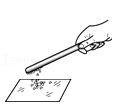

【答案】负，吸引轻小物体

【解析】​

## 知识点·正电荷与负电荷；验电器的原理及使用．

## 1. 填空题（难度：简单）

毛皮摩擦过的橡胶棒上带有的电荷叫做电荷．若将一带电体靠近用毛皮摩擦过的橡胶棒时，它们互相排斥，则带电体所带的电荷是电荷．验电器是根据同种电荷互相的原理制成的．

【答案】负，负，排斥

【解析】​

## 知识点·汽化

## 1. 填空题（难度：适中）

如图所示，中国国家速滑馆“冰丝带”采用的是目前最先进、环保的二氧化碳跨临界直冷制冰技术．这种技术的原理是：在冰面下布满制冰管，使液态二氧化碳在制冰管中流动，当液态二氧化碳（填物态变化的名称）为气态二氧化碳时，会从周围吸热，使水结冰，并且使冰面保持一定的温度．

【答案】汽化

【解析】​

## 知识点·浮力的应用

## 1. 单选题（难度：简单）

被\( 100\text{℃}\)的水蒸气烫伤比被\( 100\text{℃}\)的水烫伤更严重些，这是因为（      ）

- A. 水蒸气的温度比水高
- B. 水蒸气液化时要吸收大量的热
- C. 水蒸气比水传热快
- D. 水蒸气液化时要放出大量的热

【答案】D

【解析】​

## 知识点·液化

## 1. 填空题

气锅鸡是云南的名菜之一，“舌尖上的中国”曾播放过．其做法是：将盛有小鸡块和佐料的气锅（如图所示）放在盛有清水的汤锅之上，再放到火上蒸．为了保持鸡肉原汁原味，主要是蒸汽通过气锅中间的气嘴将鸡蒸熟．汤汁是蒸汽（选填“吸热”或“放热”）后（填物态变化名称）而形成的．

【答案】放热  ，液化

【解析】​

## 知识点·熔化吸热

## 1. 单选题（难度：简单）

夏天用\( \text{0}\text{℃}\)的冰或质量相等的\( \text{0}\text{℃}\)的水来冷却汽水，结果是（     ）.

- A. 用冰的冷却效果更好，因为冰的温度低
- B. 用水的冷却效果更好，因为水比冰更容易吸热
- C. 用冰的冷却效果更好，因为\( \text{0}\text{℃}\)的冰熔化为\( \text{0}\text{℃}\)的水时吸收热量
- D. 两者冷却效果相同

【答案】C

【解析】​

## 知识点·熔化吸热凝固放热

## 1. 单选题（难度：适中）

一种“\( \text{55}\text{℃}\)保温杯”，外层为隔热材料，内层为导热材料，夹层间有“神奇物质”. 开水倒入杯中后，水温很快降为\( \text{55}\text{℃}\)且能较长时间保持不变. “神奇物质”在该过程中（     ）. 

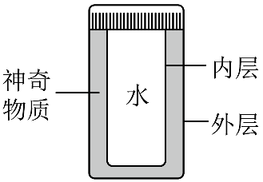

- A. 一直吸热且状态不变
- B. 一直吸热且由固态变为液态
- C. 先吸热，后放热；先熔化后凝固
- D. 先放热，后吸热；先凝固后熔化

【答案】C

【解析】​

## 2. 单选题

夏天，小明从冰箱冷冻室中取出几个冰块，放入装有常温矿泉水的杯中. 过一会儿，她用吸管搅动冰块，发现这几个冰块“粘”到一起了. 如图所示，下列说法正确的是（     ）. 

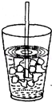

- A. 冰块周围的水发生了熔化现象，使冰块“粘”到一起
- B. 从放入冰块到冰块完全熔化过程中，杯内水温始终没有改变
- C. 低温的冰块从周围的水吸收热量，使周围的水凝固，所以“粘”在一起
- D. 冰块使水快速降温，是因为水从冰块吸收了热量

【答案】C

【解析】​

## 知识点·熔化吸热凝固放热的应用

## 1. （难度：简单）

我国研制的一种聚乙烯材料，超过40℃时完全熔化，低于15℃时完全凝固. 有人设计，把这种材料制成小颗粒，掺在水泥中制成地板或墙板，在昼夜温度变化大的地区用这种地板和墙板修筑房屋，便可以起到调节室温的作用，并达到节能的目的. 请你根据所学的物理知识简要解释.

【答案】

当气温超过40℃时，该材料完全熔化，此过程吸收热量，使室内温度不致上升太高或太快；当温度低于15℃时，该材料完全凝固，此过程放出热量，使室内温度不致降得太低或太快，从而调节室温，达到节能目的.

【解析】​

## 知识点·熔化和凝固图象

## 1. 填空题（难度：适中）

如图分别对应甲、乙两种物质的熔化或凝固图象，其中图是凝固图象；图乙线段\( LM\)对应的过程中物质（选填“吸热”、“不吸放热”或“放热”）. 图甲\( GH\)段物体的状态是态，只降低这两种液态物质的温度，先凝固. 

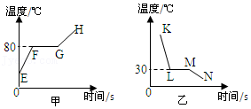

【答案】乙，放热，液，甲

【解析】​

## 知识点·熔化和凝固的温度—时间图象

## 1. 单选题（难度：简单）

“奋斗者”号载人潜水器的壳体使用了我国自主研发的新型高强、高韧钛合金. 金属钛是一种晶体，其熔化时温度随时间变化的图象为图中的（     ）.

- A. 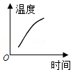
- B. 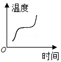
- C. 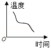
- D. 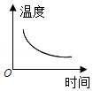

【答案】B

【解析】​

## 知识点·熔化图象

## 1. 填空题（难度：简单）

在一标准大气压和加热条件完全相同的情况下，甲、乙、丙三种物质温度\( T\)随加热时间\( t\)变化的情况如图所示，可以看出，这三种物质中，可能是同种物质的是，这两种物质的质量较大的是 . 

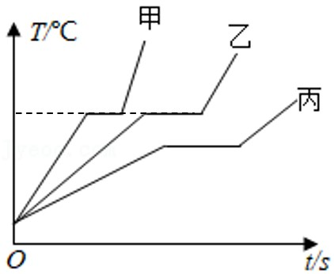

【答案】甲乙，乙

【解析】​

## 知识点·熔点和凝固点

## 1. 填空题（难度：简单）

下表列出了几种物质在标准大气压下的熔点，根据表中数据回答：
物质
固态水银
固态酒精
固态甲苯
萘

熔点/\( \text{℃}\)
﹣39
﹣117
﹣95
80.5

水银和酒精的凝固点分别是和，若要测量固态甲苯的熔化温度，温度计的玻璃泡里应选 作为测温物质.

【答案】$ \text{﹣}\text{39}\text{℃}$  ，$ \text{﹣}\text{117}\text{℃}$  ，酒精

【解析】​

## 2. 填空题

火山爆发时往往会有岩浆涌出. 如图，从火山口涌出的岩浆是多种物质成分组成的液体，在流淌过程中不断降温，就会按下列顺序先后在火山口（写出一种物态变化名称）形成一系列的矿物：橄榄石—辉石—角闪石—黑云母—正长石—白云母—石英. 由此可以判断出这些矿物的熔点依次. （选填“升高”或“降低”）

【答案】凝固  ，降低

【解析】​

## 知识点·熔点的应用

## 1. 单选题（难度：适中）

CCTV 3•15晚会曝光黄金造假：个别不法商贩为牟取暴利，在黄金中掺入少量金属铱颗粒，已知黄金的熔点是\( \text{1064.6}\text{℃}\)，铱的熔点是\( \text{2443.0}\text{℃}\)，可以有效检测黄金制品中有无铱颗粒的手段是（     ）.

- A. 加热至\( \text{1064.6}\text{℃}\)并观察有无铱颗粒
- B. 加热至\( \text{1065.0}\text{℃}\)并观察有无铱颗粒
- C. 加热至\( \text{2444.0}\text{℃}\)并观察有无铱颗粒
- D. 加热至\( \text{3507.6}\text{℃}\)并观察有无铱颗粒

【答案】B

【解析】​

## 知识点·熔点的理解

## 1. 单选题（难度：适中）

根据下表中几种物质的熔点（在标准大气压下）判断下列说法中正确的是（     ）. 
物质名称
固态水银
金
铜
铁
钨
固态氢

熔点/\( \text{℃}\)
﹣39
1064
1083
1535
3410
﹣259

- A. 铜球掉入铁水中不会熔化
- B. 在零下255摄氏度时，氢是固态
- C. 水银温度计可测量零下\( \text{40}\text{℃}\)的气温
- D. 电灯泡内的灯丝宜用钨丝制作，因为它的熔点较高

【答案】D

【解析】​

## 知识点·熔点的理解及熔化吸热

## 1. 填空题（难度：适中）

冬天降雪后会造成路面结冰，为了防止交通事故，市政部门在路面上抛洒了融雪剂，如图所示，融雪剂能（选填“降低”或“提高”）雪的熔点，加快雪的熔化. 降雪后人们发现天气比降雪时要冷得多，这主要是因为雪熔化时要（选填“放出”或“吸收”）大量的热量导致的. 

【答案】降低  ，吸收

【解析】​

## 知识点·物体带电情况的判断；力的作用效果

## 1. 填空题

如图所示，用丝绸摩擦过的玻璃棒，靠近吸管的一端，发现吸管被推开，由此说明力可以改变吸管的，吸管带的是（选填“正”或“负”）电荷．

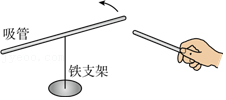

【答案】运动状态，正

【解析】​

## 知识点·物体带电情况的判断；静电现象

## 1. 单选题（难度：适中）

如图所示，舞台上有一个“静电球”，当女孩触摸“静电球”时，头发会一根根地“飞”起来并散开，关于这个现象，下列说法正确的是（    ）．

- A. 头发与静电球带的是异种电荷
- B. “飞”起来的头发上产生了电荷
- C. “飞”起来的头发带的是同种电荷
- D. 头发“飞”起来是由于静电球的吸引

【答案】C

【解析】​

## 知识点·物态变化辨别

## 1. 单选题（难度：简单）

下列情景中，哪一个过程属于物态变化（     ）.

- A. 一块铁放在火炉中烧红了
- B. 一根铜丝被折弯了
- C. 放久的食物变质了
- D. 阳光下，小雪人“流汗”了

【答案】D

【解析】​

## 知识点·物质熔化的温度—时间图象

## 1. 单选题（难度：适中）

如图为甲、乙两种物质熔化时温度随加热时间变化的图象，下列说法正确的是（     ）. 

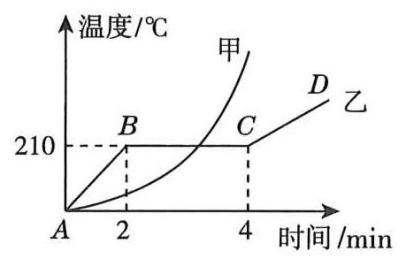

- A. 甲物质是晶体，乙物质是非晶体
- B. 甲物质的熔点为\( \text{2}\text{10}\text{℃}\)
- C. 乙物质在\( BC\)段时处于固液共存状态
- D. 乙物质在\( BC\)段温度不变，不吸热

【答案】C

【解析】​

## 2. 单选题（难度：适中）

在“探究固体熔化时温度的变化规律”实验中，小明同学利用如图甲所示的装置对物质加热，得到如图乙所示的温度随时间变化的图象. 下列说法中（     ）. 
①按图甲所示的实验装置组装器材，应按照自上而下的顺序进行
②该物质熔点为\( \text{0}\text{℃}\)，熔化过程持续了大约\( \text{10min}\)
③该物质是晶体，在\( BC\)段处于固液共存状态
④该物质在\( BC\)段由于温度保持不变，所以不吸收热量

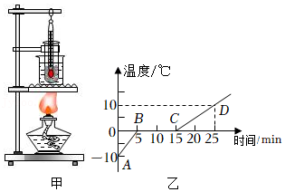

- A. 只有②③正确
- B. 只有②④正确
- C. 只有③④正确
- D. 只有①③正确

【答案】A

【解析】​

## 知识点·特殊法测电阻

## 1. 填空题（难度：适中）

小明想测量小灯泡正常发光时电阻，设计了如下电路，小灯泡正常工作时电流为\({I}_{额}\)​​，已知电源电压为U、R2最大阻值为R2。

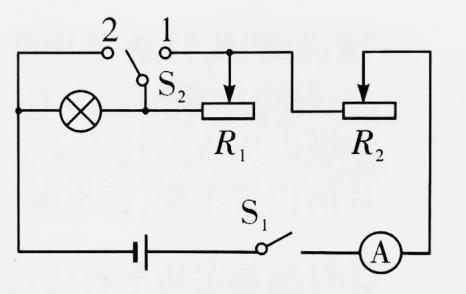

（1）闭合开关S1，S2接1，移动滑动变阻器R2的滑片，是电流表示数为。
（2）闭合开关S1，S2接2，保持滑动变阻器的滑片位置不变，调节另一滑动变阻器滑片，使电流表示数为；再将滑动变阻器R2的滑片滑到最右端，读出电流表示数为\(I\)​；
（3）小灯泡正常发光的电阻表达式为RL=。

【答案】${I}_{额}$，<i>R</i><i>2</i>，${I}_{额}$，<em><em>R</em></em><em><em>L</em></em>=<latex class="math-tex">\(\frac {U} {I}-{R}_{2}\)</latex>

【解析】​

考点分析：欧姆定律在串并联电路中的应用；等效替代法测电阻。

## 知识点·电压和电阻

## 1. （难度：简单）

在探究“串联电路电压的规律”实验中，电源是新的两节干电池。

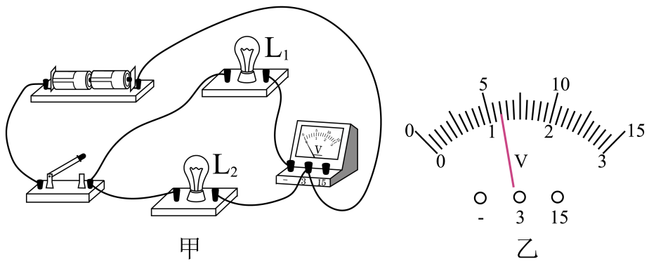

电压表的量程应该选用V，理由是；

连接电路的过程中应让开关，实验中如果将电压表串联进电路，闭合开关（选填“会”或“不会”）损坏电压表；

要用电压表测L₂两端的电压，连接电路如图甲所示，如果此时闭合开关，观察到的现象是（说出其中的一个现象即可）；

图中只有一根导线连错了，请你在连错的导线上划“×”，并用笔画线表示导线将电路连接正确；

改正电路后，闭合开关，如图乙所示，电压表的示数为V，灯L₁两端的电压是V；

他们在测量L₂两端的电压时，电压表示数突然变为0，则电路故障可能是灯断路或灯短路，如果此时观察到有一只灯亮，则发生的故障是。

【答案】0～3/电源电压为3V，断开/不会，L$_{1}$不亮、电压表示数为电源压，

，1.2/1.8，L$_{1}$/L$_{2}$/L$_{2}$短路

【解析】​

## 知识点·电压表、电流表

## 1. 单选题（难度：简单）

如图甲所示的电路，先将开关S接到a，然后将开关S接到b.前后两次电压表指针偏转均如图乙所示，则下列说法中不正确的是。（      ）

- A. 电源电压为10V
- B. 灯L₁两端的电压为8V
- C. 通过灯L₁、L₂ 的电流之比为4∶1
- D. 灯L₁、L₂ 的电阻之比为4∶1

【答案】C

【解析】​

当S接a时，L₁和L₂串联，电压表测L₁和L₂两端电压，也测电源电压。S接b时，L₁和L₂串联，电压表测L₂电压，小于电源电压。由题知，前后两次指针偏转角度相同。则，S接a时电压表使用大量程读数为10V，即电源电压为10V，故A正确。S接b时，电压表使用小量程读数为2V。由串联电路电压规律可得，L₁电压为8V，L₂电压为2V，故B正确。L₁、L₂电压之比为4:1，电阻值比为4:1。串联电路，电流处处相等，电流之比为1:1，故C错误，D正确。故选C。
考点分析：串并联电路电压、电流规律；电压表使用与读数。

## 知识点·电池容量

## 1. 填空题

小充同学看见他爸爸的手机锂电池上面标明电压为3.7V，容量为3000mA∙h，则它充满电后存储的电能为J；经查，该手机的待机电流为15mA，则该手机最长待机时间为h。

【答案】39960，200

【解析】​

## 2. 填空题

某品牌手机充电宝，上面标有电压为5V，容量为12000mA∙h，它充满电后，可以储存的电能是J，在充电过程中，将电能转化为能储存。

【答案】2.16&times;105，化学

【解析】​

## 知识点·电流

## 1. 单选题（难度：简单）

关于电流，下列说法中错误的是（     ）．

- A. 电流是表示电流快慢的物理量
- B. 电流是表示电流强弱的物理量
- C. 电流的单位是安培，符号是“\( \text{A}\)”
- D. 电流的符号是“\( I\)”，单位可以用毫安，也可以用微安

【答案】A

【解析】​

## 知识点·电流与电阻关系实验

## 1. 

东东同学学习了电学知识以后，选用三节新的干电池作为电源，并设计了如下的电学实验。探究导体中电流与导体电阻的关系。选用的定值电阻的阻止分别是5Ω、10Ω、15Ω、20Ω。

​按照甲图所示的电路图，把乙实物电路补充完整，当滑动变阻器的滑片向左滑动时，电流表示数增大。

​（1）闭合开关后，东东发现电流表没有示数，电压表有示数，电路中出现的故障可能是。

（2）东东排除故障后，把5Ω的电阻接入电路，闭合开关，适当调节滑片的位置，电流表的示数如图丙所示，其示数为A。

（3）断开开关S，把5Ω的电阻换成10Ω的电阻，再次闭合开关后，滑片应向（填“左”或“右”）端移动。

（4）在此实验中，滑动变阻器接入电路的阻值范围是。

​东东同学在电源电压未知，缺少电流表的情况下，设计了如图丁所示的电路图（R0阻值已知），来测量未知电阻RX的阻值。

（1）闭合S、S1，断开S2，适当调节滑片的位置，电压表示数为U1。

（2）闭合S、S2，断开S1，滑动变阻器滑片的位置保持不变，电压表示数为U2。

（3）未知电阻的阻值RX＝（用字母表示）。

【答案】

如图所示；

，电阻断路（或电流表短路）/0.4/右/6.25Ω~25Ω，<latex class="math-tex">\(\frac {{U}_{1}-{U}_{2}} {{U}_{2}}{R}_{0}\)</latex>

【解析】提示：解析视频请查看最后一题。

提示：解析视频请查看最后一题。

​

考点分析：电流与电阻关系实验；电路连接；电路故障；欧姆定律应用；特殊法测电阻。

## 2. （难度：简单）

小明同学所在实验小组在做“探究导体中电流跟电阻的关系”实验中，实验器材有：电源（2节新干电池）、电流表、电压表、定值电阻四只（5Ω、10Ω、20Ω、40Ω各一只），滑动变阻器RA​（20Ω 1A）、开关、导线若干。

​

如图甲所示是连接的实物图，图中有一根导线连接错误，请在连接错误的导线上打“X”，并用笔画线代替导线将电路连接完整。

连接电路时，开关应处于状态，连接完成后，应将滑动变阻器滑片移至（选填“A”或“B”端）。

连接完成后，闭合开关前，电压表指针偏向零刻度线左侧，原因可能是;若闭合开关后，电压表指针依然偏向零刻度线左侧，原因可能是。

电路改接正确后，闭合开关，电流表示数为零，电压表指针有明显偏转，则电路存在的故障可能是。

排除故障后，小明在实验过程中，先将5Ω电阻接入电路，移动滑动变阻器滑片，当电压表示数如图乙所示为V时，记下此时电流表示数。接着断开开关，将5Ω电阻换成10Ω电阻，他下一步的操作是。再改接其他定值电阻，重复上述步骤。

下表是小明记录的实验数据，老师看了之后指出第四组数据有错误理由是。​

实验次数
1
2
3
4

电阻/Ω
5
10
20
40

电流/A
0.4
0.2
0.1
0.06

由表中正确数据得出的结论是：。

为顺利完成实验，应控制定值电阻两端电压不低于V。

同组小红同学在小明完成实验后，又借来阻值为60Ω的定值电阻，发现无论怎样调节滑动变阻器都无法使电压表示数达到可控电压，原因是，解决方法是。

本实验（选填“能”或“不能”）用小灯泡代替定值电阻进行实验，原因是。

【答案】
 ​​

，断开/A，电压表指针未调零/电压表正负接线柱接反，定值电阻R断路，2/向A端移动滑动变阻器滑片直至电压表示数为2V。，没有控制定值电阻两端电压为2V。，在导体两端电压一定是，通过导体的电流与导体的电阻成反比。，2，滑动变阻器最大阻值太小。/更换最大阻值更大的滑动变阻器。（或串联阻值不低于10&Omega;且合适的定值电阻。或更换电压低于3V且合适的电源。），不能/小灯泡电阻随温度的变化而变化。

【解析】提示：解析视频请查看最后一题。

提示：解析视频请查看最后一题。

提示：解析视频请查看最后一题。

提示：解析视频请查看最后一题。

提示：解析视频请查看最后一题。

提示：解析视频请查看最后一题。

提示：解析视频请查看最后一题。

提示：解析视频请查看最后一题。

提示：解析视频请查看最后一题。

​

考点分析：电流与电阻关系实验；电路连接；电路故障；欧姆定律应用。

## 知识点·电流和电路

## 1. （难度：适中）

在“探究并联电路电流规律”的实验中

为了防止损坏电流表，在不能事先估计电流大小的情况下，应先进行，以正确选择电流表或电流表的量程．​

小方连接的部分电路如图所示，请你将电路连接完整．

小方将以上电路连接完整后，闭合开关，发现灯泡\( {\text{L}}_{1}\)和\( {\text{L}}_{2}\)发光,电流表\( {\text{A}}_{1}\)和\( {\text{A}}_{2}\)有示数,电流表\( \text{A}\)的示数为零．电路故障可能是．

【答案】试触     ，

，电流表$ \text{A}$短路

【解析】​

## 2. （难度：适中）

如图所示是探究“串联电路电流的特点”的实验电路图．

实验中，所选两个小灯泡的规格应该是（选填“相同”或“不相同”）的．在连接电路时，开关应．

‎​

下表是某同学在实验中测得的一组数据．请你指出表格所记录的数据中，明显错误的一个数值是，造成错误的原因是​（填字母）．

A. 电流表分度值搞错了

B. 电流表正、负接线柱接反了

C. 电流表用小量程测，按大量程读数​

D. 电流表用大量程测，按小量程读数

当用电流表测出\( A\)、\( B\)、\( C\)三点的电流并记录数据后，下一步应该做的是（填字母）​．

‎A．整理器材，结束实验

B．换不同规格的小灯泡再测几组电流值

C．分析数据，得出结论

D．换电流表的另一量程再测一组电流值

实验中发现两个串联的小灯泡都不发光，用电流表与\( {\text{L}}_{1}\)并联，\( {\text{L}}_{2}\)不亮；用电流表与\( {\text{L}}_{2}\)并联，\( {\text{L}}_{1}\)亮．如果故障只有一处，那么故障是．

【答案】不相同/断开，1.5/C，B，$ {\text{L}}_{2}$断路

【解析】​

## 知识点·电流把信息传到远方

## 1. 单选题（难度：适中）

电磁铁和炭精盘分别为电话话筒和听筒的主要部件，它们所在位置（    ）.

- A. 都位于听筒
- B. 都位于话筒
- C. 电磁铁位于话筒，炭精盘位于听筒
- D. 电磁铁位于听筒，炭精盘位于话筒

【答案】D

【解析】​

## 知识点·电流的大小

## 1. 

电流表测电流的实验中：

根据如图甲所示的电路，可知电流表测的是灯的电流．合上开关后如果电流表的示数如图乙所示，则通过该灯的电流是 \( \text{A}\)．

若合上开关后，只有一个灯亮，电流表指针不发生偏转，那么可能的原因是（   ）．

只要改动一根导线就可测总电流，请在图中用“×”号指出需改动的导线，并用笔画线，在图中作出改动．

- A. 灯\( {\text{L}}_{1}\)短路
- B. 灯\( {\text{L}}_{2}\)短路
- C. 灯\( {\text{L}}_{1}\)断路
- D. 灯\( {\text{L}}_{2}\)断路

【答案】$ {\text{L}}_{2}$/0.46  ，D，

 

      

【解析】​

## 知识点·电流的形成及方向

## 1. 单选题（难度：简单）

下列关于电流、电路的说法正确的是（     ）．

- A. 电流的形成需要有电源，且要有闭合回路
- B. 电流都是由自由电子定向移动形成的
- C. 绝缘体不善于导电的原因是其内部没有电荷
- D. 电流的方向一定与负电荷移动的方向相同

【答案】A

【解析】​

## 知识点·电流的形成及方向;电源的能量转化

## 1. 多选题（难度：适中）

下列关于电和电流说法中不正确的是（     ）．

- A. 从能的转化角度说，电池是把化学能转化成电能的装置
- B. 电源外部，电流从正极经过用电器流向负极
- C. 电荷运动就能形成电流
- D. 金属导电时，自由电子移动方向和电流方向相反

【答案】C/D

【解析】​

## 2. 多选题

在学校的第三届科技节上“新能源发明”项目中，有一组如图所示的作品，分别用柠檬和西红柿连着的液晶显示器，来自低年级的参观者们十分好奇．关于这个作品，下列说法正确的是（     ）．

- A. 液晶显示器能够工作是因为有大量的质子发生定向移动
- B. 电路中电流的方向是“+”→“ a”→“b”→“﹣”
- C. 柠檬能够作为电源是因为创造了电荷
- D. 水果电池工作时是将化学能转换成电能

【答案】B/D

【解析】​

## 知识点·电流的测量

## 1. 填空题

某同学用如图所示的电路测灯泡\( {\text{L}}_{1}\)的电流．
（1）该图中电流表的接法错误是．
（2）若要测量通过灯\( {\text{L}}_{2}\)的电流，但只允许变动原图中的一根导线中的一个端点的连线位置，则应将导线从接线柱移动到接线柱上．

【答案】正、负接线柱接反了，a   ，负，正

【解析】​

## 知识点·电流的测量；电流表的读数方法

## 1. 填空题（难度：适中）

如图所示是用电流表测量电流的实物连接图，请按要求回答：

      
（1）图甲中电流表测量的是通过灯泡的电流．
（2）如果电流表示数如图乙所示，则电流表测出的电流是 \( \text{A}\)．
（3）如果要用电流表测通过灯\( {\text{L}}_{\text{1}}\)和\( {\text{L}}_{\text{2}}\)的总电流，且只允许移动一根导线，应将导线（填“\( \text{a}\)”“\( \text{b}\)”或“\( \text{c}\)”）的右端接在电流表的（填“﹣”“0.6”或“3”）接线柱上．

【答案】$ {\text{L}}_{2}$ ， 0.5， b， 

【解析】​

## 知识点·电流表的使用；串联电路和并联电路的辨别

## 1. 多选题（难度：简单）

如图所示，下列说法正确的是（    ）．

- A. \( {\text{L}}_{1}\)与\( {\text{L}}_{2}\)的连接方式是串联
- B. \( {\text{L}}_{1}\)与\( {\text{L}}_{2}\)的连接方式是并联
- C. 电流表甲测的是通过\( {\text{L}}_{1}\)的电流
- D. 电流表甲测的是通过\( {\text{L}}_{2}\)的电流

【答案】B/D

【解析】​

## 知识点·电流表的使用；电流的方向

## 1. 填空题（难度：适中）

在如图所示的电路中，电流表测的是通过的电流（选填“\( \text{L}\)支路”、“\( {R}_{\text{滑}}\)支路”或“干路”），通过灯\( \text{L}\)的电流方向为（选填“\( \text{A→B}\)”或“\( \text{B→A}\)”）；断开开关，电流表示数将（选填“变小”“不变”或“变大”）．

【答案】$ {R}_{\text{滑}}$支路，B→A，不变

【解析】​

## 知识点·电流表的使用；电路的三种状态

## 1. 单选题（难度：适中）

如图所示，粗心的小强把电流表接在了\( {\text{L}}_{1}\)的两端．此时如果闭合开关，一定会发生（   ）．

- A. 电源短路
- B. 电流表损坏
- C. \( {\text{L}}_{1}\)不亮
- D. \( {\text{L}}_{2}\)的灯丝烧断

【答案】C

【解析】​

## 知识点·电流表的读数方法；电流表的使用

## 1. 填空题（难度：适中）

如图甲所示电路，当开关\( \text{S}\)闭合后，电流表的指针偏转如图乙所示，其中\( \text{a}\)电流表的左端是它的接线柱，通过小灯泡\( {\text{L}}_{\text{2}}\)的电流为 A．

【答案】负，0.9

【解析】​

## 知识点·电源及其能量转化

## 1. 填空题（难度：适中）

把两种不同的金属片插入柠檬，制成“水果电池”。用电压表测量水果电池的电压，如图所示，则金属片为水果电池的正极，水果电池是将化学能转化为能。

【答案】A，电

【解析】​

## 2. 填空题

如图，小明用电压表测水果电池电压，由图可知：该水果电池的负极、是片，用水果电池给电路供电时，将能转化为电能。

【答案】铁，化学

【解析】​

## 知识点·电源及其能量转化；电路的组成

## 1. 填空题（难度：简单）

如图所示，这是人们利用充电桩给电动汽车充电时的情景，此时电动汽车上的锂离子电池相当于电路中的（选填“用电器”或“电源”）；充电过程中，将能转化为能。

【答案】用电器，电，化学

【解析】​

## 知识点·电磁波是怎样产生的

## 1. 单选题（难度：简单）

关于电磁波的产生，下列说法中正确的是（    ）.

- A. 任何通电导体周围空间都会产生电磁波
- B. 照明线路周围不会产生电磁波
- C. 直流电在通断过程中会产生电磁波
- D. 日光灯启动不会产生电磁波

【答案】C

【解析】​

## 2. 单选题（难度：适中）

听收音机时，偶尔会听到里面有杂音，产生这一现象的原因可能是（   ）.

- A. 旁边台灯打开的瞬间
- B. 附近的电焊机在工作
- C. 雷雨天气闪电发生时
- D. 以上均有可能

【答案】D

【解析】​

## 知识点·电能

## 1. 单选题（难度：适中）

甲、乙两个用电器的电压之比为2：1，电流之比为1：2，通电时间之比为5：4，则两个用电器消耗的电能之比为(    )。

- A. 5∶1
- B. 5：4
- C. 4：5
- D. 5：8

【答案】B

【解析】​

## 2. 单选题（难度：适中）

​​华为M30电池铭牌如图，其新一代快充技术——supercharge，手机支持最大10V/4A超级快充，兼容4.5V/5A快充和5V/2A慢充。手机同时支持27W华为无线超级快充。关于电池信息下列说法错误的是(     )。

​

- A. 电池从没电到充满最快大约用时27min
- B. 充满电后，约储存电能1.8×10⁴J
- C. 电池容量处还可以标有18Wh
- D. 电池从没电到利用无线快充充满大约用时40min

【答案】B

## 知识点·电能与实际功率

## 1. 填空题

将标有“6V 3W”、“6V 6W”的甲、乙两个灯泡，串联接在9V的电源上，则此时电路中的电流是A，甲灯的实际功率是W。（忽略温度对灯丝电阻的影响）

【答案】0.5，3

【解析】​

## 2. 填空题（难度：简单）

一盏标有“6V  3W”字样的小灯泡，接入电压为18V的电路中，若要使灯泡能正常发光，则需要串联一个阻值为Ω的电阻，该电阻消耗的功率为W。

【答案】24，6

【解析】​

## 知识点·电荷间的相互作用规律；正电荷与负电荷

## 1. 填空题（难度：简单）

如图所示，用毛皮摩擦过的橡胶棒带电，图中实验现象说明的规律是．

【答案】负，异种电荷相互吸引

【解析】​

## 知识点·电视的发射和接收

## 1. 单选题（难度：简单）

观众在家中选择不同频道观看电视直播时，实际上是在改变（  ）.

- A. 电视台发射的电磁波的波速
- B. 电视机接收的电磁波的波速
- C. 电视台发射的电磁波的频率
- D. 电视机接收的电磁波的频率

【答案】D

【解析】​

## 知识点·电路图及元件符号

## 1. 填空题（难度：简单）

如图所示，在\( A\)、\( B\)两个虚框内分别填入电源和开关的电路符号，需要满足：当开关都闭合时，两灯组成并联电路。正确完成后的电路图中\( A\)框内填的符号是，\( B\)框内填的符号是。

【答案】，

【解析】​

## 2. 填空题（难度：适中）

小明设计了一个轿车仪表盘上提醒司机车门是否关好的电路工作原理图，如图所示，若四个车门中任意一个车门未关好，指示灯（选择“发光”或“不发光”），若四个车门都关好了，指示灯（选择“发光”或“不发光”）。电路中的电阻\( R\)的作用是。

【答案】发光，不发光，保护电路

【解析】​

## 知识点·电路图及元件符号；电路的三种状态

## 1. 填空题

如图所示，当断开开关\( {\text{S}}_{\text{1}}\)、闭合\( {\text{S}}_{\text{2}}\)时，电路为路，灯；当断开开关\( {\text{S}}_{\text{2}}\) 、闭合\( {\text{S}}_{\text{1}}\)时，电路为路，灯；当同时闭合开关\( {\text{S}}_{\text{1}}\)、\( {\text{S}}_{\text{2}}\)时，电路路，灯；当同时断开开关\( {\text{S}}_{\text{1}}\)、\( {\text{S}}_{\text{2}}\)时，电路为路，灯。（填电路的状态及对应的灯\( \text{L}\)工作情况）

【答案】短，不亮，通，亮，短，不亮，断，不亮

【解析】​

## 知识点·电路的三种状态

## 1. 填空题（难度：简单）

如图所示是一种定时课间音乐播放装置的原理图。“播放器”是有电流通过时会播放音乐的装置。闭合开关\( \text{S}\)，当“定时开关”处于状态时，指示灯会亮，播放器会播放音乐。

【答案】断开

【解析】​

## 2. 填空题（难度：适中）

在如图所示的电路中，
（1）当\( {\text{S}}_{\text{1}}\)、\( {\text{S}}_{\text{2}}\)都断开时，称为路；
（2）当\( {\text{S}}_{\text{1}}\)、\( {\text{S}}_{\text{2}}\)都闭合时，称为路；
（3）当\( {\text{S}}_{\text{1}}\)闭合、\( {\text{S}}_{\text{2}}\)断开时，称为路。

【答案】断，短，通

【解析】​

## 知识点·电路的三种状态；串联电路和并联电路的辨别；电流表的使用

## 1. 多选题（难度：适中）

小华用如图所示电路进行如下操作，下列说法正确的是（    ）．

- A. 直接将\( A\)、\( B\)连接，闭合开关后电路短路
- B. 测量电流时，应将电流表“+”接在\( A\)点，“﹣”接在\( B\)点
- C. 在\( A\)、\( B\)间接电流表，闭合开关后电流表有示数
- D. 在\( A\)、\( B\)间接另一灯泡，两灯泡是并联的

【答案】B/C

【解析】​

## 知识点·电路的三种状态；电路的连接

## 1. 填空题

如图所示的电路，开关\( \text{S}\)闭合后，电路将是（选填“通路”“断路”或“短路”）。要使两灯串联，只要拆除导线（选填“​​​\(\text{ab}\)​”或“​​​\(\text{cd}\)​”）即可；要使两灯并联，只要将导线\(\text{c}\)​端改接在端（选填“​​​\(\text{a}\)​”“​​​\(\text{b}\)​”或“​​​\(\text{d}\)​”）。

【答案】短路，cd  ，a（或b）

【解析】​

## 知识点·电路的基本连接方式

## 1. 填空题（难度：简单）

探究串联电路的结构和特点：如图所示，闭合开关，两灯都发光；断开开关，两灯都不发光．把开关改接到\( B\)、\( C\)处，重复实验，现象相同．由此得到初步结论：．

【答案】在串联电路中，开关控制所有用电器，开关位置改变，其控制作用不变．

【解析】​

## 2. 填空题（难度：简单）

探究串联电路的结构和特点：如图所示，闭合开关，两灯都发光；断开开关，两灯都不发光．把开关改接到\( B\)、\( C\)处，重复实验，现象相同．由此得到初步结论．

【答案】在串联电路中，开关控制所有用电器，开关位置改变，其控制作用不变

【解析】​

## 知识点·电路的基本连接方式．

## 1. 填空题（难度：适中）

在图（a）所示的电路中，灯\( {\text{L}}_{\text{1}}\)与\( {\text{L}}_{\text{2}}\)是连接，电流表是在电路中（均选填“串联”或“并联”）．电压表测量的是灯的电压，它的示数如图（b）所示为伏．

【答案】串联，串联，$ {\text{L}}_{\text{2}}$，1.8 

【解析】​

## 2. 填空题

如图所示为小亮设计的电路图，闭合开关时，\( {\text{L}}_{\text{1}}\)、\( {\text{L}}_{\text{2}}\)和\( {\text{L}}_{\text{3}}\)组成串联电路；闭合开关时，\( {\text{L}}_{\text{1}}\)和\( {\text{L}}_{\text{2}}\)组成并联电路．如果要使灯\( {\text{L}}_{\text{2}}\)亮、灯\( {\text{L}}_{\text{1}}\)、\( {\text{L}}_{\text{3}}\)不亮，则应将闭合开关．

【答案】$ {\text{S}}_{\text{3}}$ ，$ {\text{S}}_{\text{1}}$和$ {\text{S}}_{\text{2}}$，$ {\text{S}}_{\text{1}}$

【解析】​

## 知识点·电路的基本连接方式；电路的三种状态

## 1. 填空题（难度：适中）

用所学过的知识回答如图所示的电路问题．
（1）如图甲所示，把玻璃珠接入电路中，闭合开关\( \text{S}\)，发现小灯泡\( \text{L}\)不发光，说明玻璃球是；现给玻璃珠加热，当玻璃珠加热到红炽状态时，发现小灯泡\( \text{L}\)发光说明处于红赤状态的玻璃珠是（以上两空均选填“导体”或“绝缘体”）．
（2）如图乙所示的是一个封闭的电路盒，盒面上有两个灯泡和一个开关，拨动开关，两个灯泡或一齐亮、或一齐灭．
①有同学说，这两个灯泡是串联的，你认为这位同学的看法（选填“一定”或“不一定”），理由是．
②不打开盒子，也无任何辅助器材，一位同学用以下方法即可判断出两灯的连接方式，请你帮他把方法补充完整：拧下其中一个灯泡，若另一个灯泡仍发光，则是，若另一个灯泡不发光，则是（以上两空均选填“串联”或“并联”）．

【答案】绝缘体，导体，不一定，如果是并联的，开关接在干路中即可控制所有支路，并联，串联．

【解析】​

## 知识点·触电防护及救援措施

## 1. 单选题（难度：简单）

如果家中有人触电，在不能立即切断电源的情况下，千万不能用手直接去拉触电者，可以用一些物品使触电者脱离带电体．下列物品中不能使用的是（    ）

- A. 木擀面杖
- B. 橡胶手套
- C. 铝拖把杆
- D. 塑料凳子

【答案】C

【解析】​

## 2. 单选题（难度：适中）

当发现有人触了电，下列说法、做法正确的是（    ）
\( \text{①}\)不能直接去碰触电的人
\( \text{②}\)应该赶快切断电源
\( \text{③}\)可以用手直接将触电的人拉开
\( \text{④}\)用干燥的木棍、竹竿等绝缘体将电线挑开，使触电的人迅速脱离电源

- A. ①②③
- B. ①②④
- C. ①③④
- D. ①②③④

【答案】B

【解析】​

## 知识点·验电器的原理及使用

## 1. 填空题（难度：简单）

如图所示，拿一根带电的玻璃棒接触验电器，可以看到金属箔片张开，这是因为．

【答案】箔片带同种电荷相互排斥

【解析】​

## 知识点·验电器的原理及使用；电荷间的相互作用规律．

## 1. 填空题（难度：适中）

如图所示，用一带电体去接触验电器的金属球，验电器的两片金属箔片会张开，这是因为两片金属箔片带（选填“同种”或“异种”）电荷；用与毛皮摩擦过的橡胶棒去接触验电器的金属球，发现它两片金属箔片之间的张角变大，则原来验电器带（选填“正”或“负”）电荷．

【答案】同种，负

【解析】​
