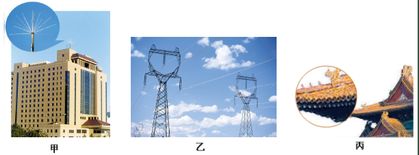

# 知识点·雷电现象与危害的防治（同步练习）

> 教材：物理·九年级全一册·沪科技版2024新教材 ｜ 来源：国家中小学智慧教育平台·在线练习 ｜ 共 4 题

## 1. 单选题（难度：简单）

遇到雷雨天气时，以下做法正确的是（    ）

- A. 躲在大树下避雨
- B. 在露天游泳池里游泳
- C. 避免使用手机
- D. 撑着金属杆的雨伞在野外行走

【答案】C

【解析】​

## 2. 单选题（难度：简单）

下列物质可制作避雷针的是（    ）

- A. 木棒
- B. 铁丝
- C. 玻璃
- D. 橡胶

【答案】B

【解析】​

## 3. 填空题（难度：简单）

雷电是大气中剧烈的现象．云层之间、云层和大地之间的电压可以达到几百万伏至几亿伏，放电时的电流可达几万安至十几万安，产生很强的光和声．高大的建筑物上安装可以避雷．当有雷电时，电荷会从避雷针传入大地，从而避免电流通过建筑物产生破坏作用，实质上是建筑物被．高压输电铁塔最上面的两条导线是用来．

【答案】放电，避雷针，短路，防雷击

【解析】​

## 4. 填空题（难度：简单）

发生雷电时，在云层和大地之间雷电的路径上有强大的电流通过，会给人们带来危害，雷电的路径往往经过地面上突起的部分，如树木、高大建筑物、室外天线等等．如图甲，为了防止雷电对一些高大建筑物造成损坏，要在这些建筑物上安装．高压输电铁塔最上面的两条导线（如图乙）也是通过很粗的金属线与相连．我国古代建筑上的龙角形铁制装饰物（如图丙）也有防雷击的作用．当一大片带负电的云接近建筑物时，云层中的负电荷通过避雷针经金属线导入大地，则此时金属线中的电流方向是从流向（选填“云层”或“大地”）．
 

【答案】避雷针，大地，大地，云层

【解析】​
