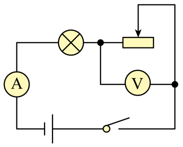
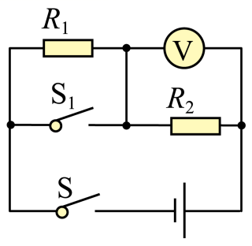

# 知识点·额定功率与实际功率（同步练习）

> 教材：物理·九年级全一册·沪科技版2024新教材 ｜ 来源：国家中小学智慧教育平台·在线练习 ｜ 共 4 题

## 1. 填空题（难度：适中）

将分别标有“8V  8W”和“8V  4W”的甲、乙两个定值电阻串联在电路中，使其中一个定值电阻正常工作，保证电路安全的情况下，定值电阻正常工作，两个定值电阻的总功率是W。

【答案】乙，6

【解析】​

## 2. 填空题

如图所示，电路中电源电压恒为4.5V，电压表量程为0～3V，电流表的量程为0～0.6A，滑动变阻器的规格为“35Ω 2A”，灯泡铭牌标有“3V 0.5A”的字样（忽略灯丝电阻变化）。闭合开关，为了保证电路的安全，调节滑动变阻器，则滑动变阻器允许调节的范围是Ω；在电压表达到最大值时，整个电路在1min内消耗的电能是J。

【答案】3～12，67.5

【解析】​

## 3. 填空题（难度：简单）

电阻R₁=20Ω, R₂=30Ω,将它们串联在电路中，则R₁ 、R₂的电压之比U₁：U₂=；如果将它们串联，此时R₁ 与R₂消耗的功率之比P₁：P₂=。

【答案】2：3，2：3

【解析】​

## 4. 填空题（难度：适中）

如图所示，电源电压不变，开关S闭合，S₁由闭合到断开时，电压表的示数由12V变为8V，此时电路的总功率（选填“变大”、“变小”或“不变”），定值电阻R₁与R₂的电功率之比为。

【答案】变小，1∶2

【解析】​
