# 第一节 电阻和变阻器（同步练习）

> 教材：物理·九年级全一册·沪科技版2024新教材 ｜ 来源：国家中小学智慧教育平台·在线练习 ｜ 共 157 题

## 1. 单选题（难度：适中）

一个滑动变阻器的铭牌上标有“20Ω 1A”的字样，对此铭牌意义的理解正确的是（　　）。

- A. 电阻最小值是20Ω，允许最大电流1A
- B. 电阻最小值是20Ω，允许最小电流1A
- C. 电阻最大值是20Ω，允许最大电流1A
- D. 电阻最大值是20Ω，允许最小电流1A

【答案】C

【解析】​

## 2. 单选题

如图所示，某调光小台灯的亮度可以通过亮度调节旋钮来控制。下列说法正确的是（　　）。

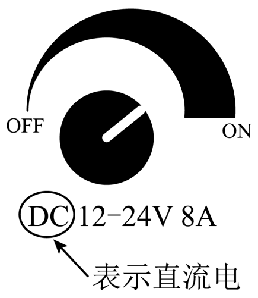

- A. 小台灯的灯丝是用超导体材料制造的
- B. 控制旋钮相当于一个定值电阻
- C. 小台灯工作时的额定电压是\({\rm{220V}}\)
- D. 小台灯工作电压调节范围为\({\rm{12}} - {\rm{24V}}\)

【答案】D

【解析】​

## 3. 单选题（难度：简单）

如图中对验电器和滑动变阻器标记的各部件中，通常情况下，属于绝缘体的是（　　）。

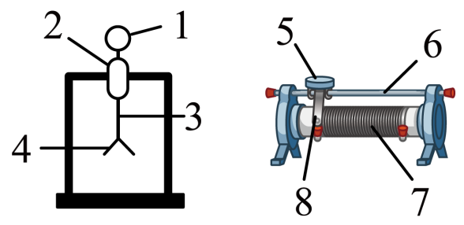

- A. 2、8
- B. 3、6
- C. 4、7
- D. 1、5

【答案】A

【解析】​

## 4. 单选题（难度：简单）

如图所示，是闭合电路中，滑动变阻器的接法，下列判断正确的是（    ）。

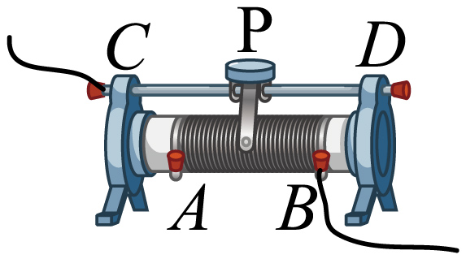

- A. 滑片向左移动，变阻器的阻值变大
- B. 滑片向右移动，变阻器的阻值变大
- C. 电流必须从上接线柱流进变阻器，从下接线柱流出
- D. 电流必须从下接线柱流进变阻器，从上接线柱流出

【答案】A

【解析】​

## 5. 单选题（难度：适中）

变阻器在日常生活中的应用非常广泛，如：汽车的油量表、风力测定仪、台秤压力器及调亮度的电灯、调热度的电锅和调转动强度的电风扇等都利用了变阻器的原理来工作。如图所示用滑动变阻器来控制灯泡的亮度，为了满足当滑片P向左移动时，灯泡的发光会更亮一些，则图中导线的线头F应该接在滑动变阻器的（　　）。

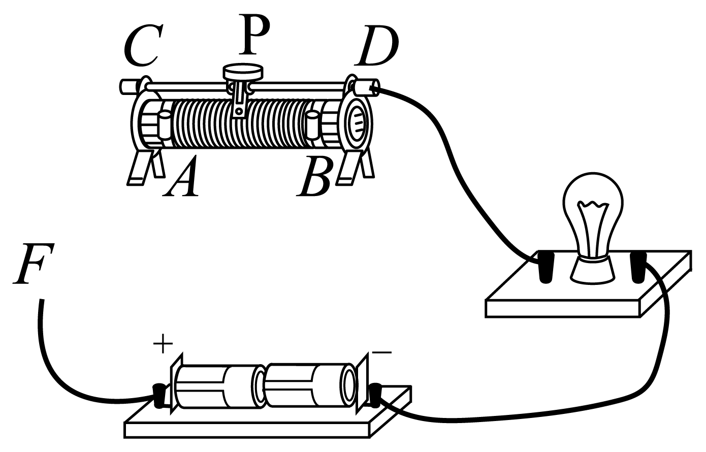

- A. 接线柱A上
- B. 接线柱B上
- C. 接线柱C上
- D. 接线柱D上

【答案】A

【解析】​

## 6. 单选题（难度：适中）

如图甲所示电路，将一滑动变阻器接在a、b两点间，闭合开关，灯泡能发光．现要使滑动变阻器滑片P向左移动，灯泡变亮，则图乙中的滑动变阻器连入电路的接线柱应是（     ）。

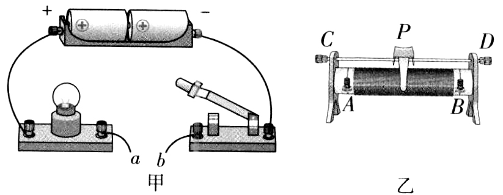

- A. A和B
- B. A和C
- C. B和D
- D. C和D

【答案】B

【解析】​

## 7. 单选题（难度：简单）

如图所示的电路中，当闭合开关后滑动变阻器滑片向右滑动时电压表读数会（　　）。

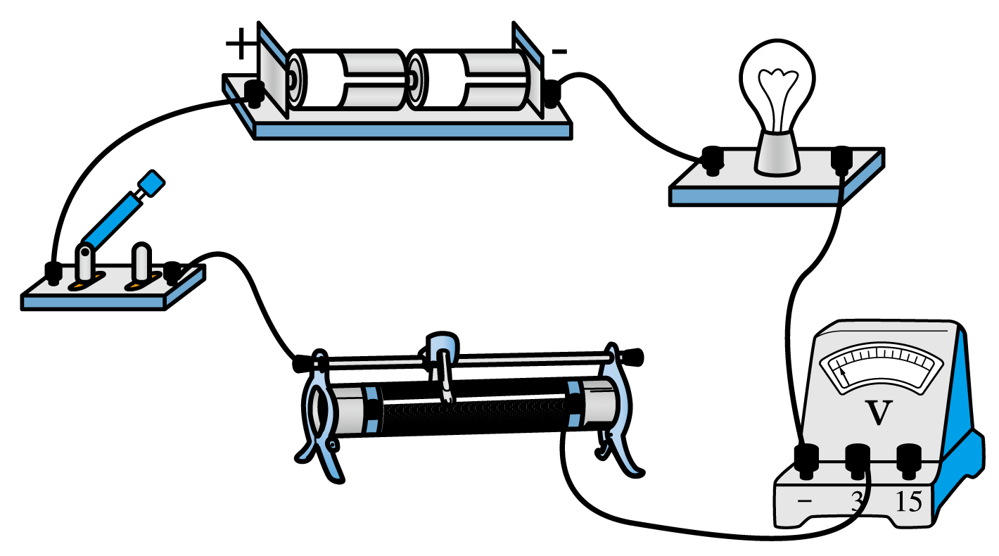

- A. 变大
- B. 变小
- C. 不变
- D. 先变小后变大

【答案】C

【解析】​

## 8. 单选题（难度：简单）

在如图所示的四个电路中，合上开关，当滑动变阻器的滑片向右移动时，通过灯泡的电流变小，那么下列叙述中正确的是（　　）。

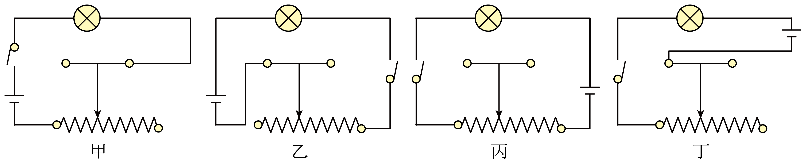

- A. 只可用甲图电路
- B. 用甲图或丁图电路都可以
- C. 只可用乙图电路
- D. 用乙图或丙图电路都可以

【答案】B

【解析】​

## 9. 单选题（难度：适中）

将两只滑动变阻器按如图所示的方法连接，如果把a、b两根导线接入电路，要使这两只变阻器接入电路中的总电阻最大，应如何放置滑片（     ）。

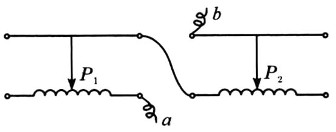

- A. P₁放在最右端，P₂放在最右端
- B. P₁放在最左端，P₂放在最左端
- C. P₁放在最右端，P₂放在最左端
- D. P₁放在最左端，P₂放在最右端

【答案】D

【解析】​

## 10. 单选题

滑动变阻器接入电路中闭合开关前是有要求的，下列滑动变阻器的接法在开关闭合前连接正确的是（　　）。

- A. 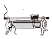
- B. 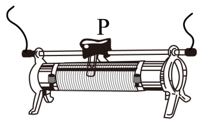
- C. 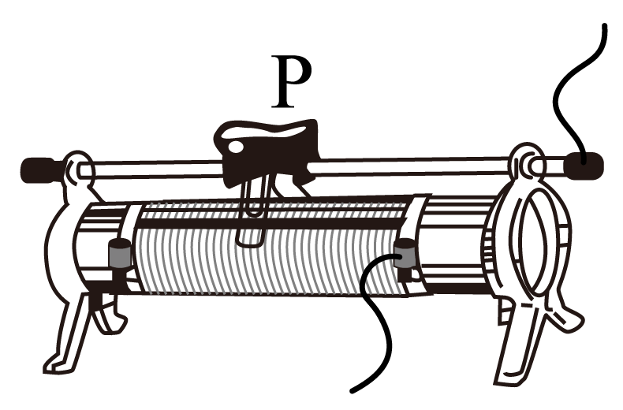
- D. 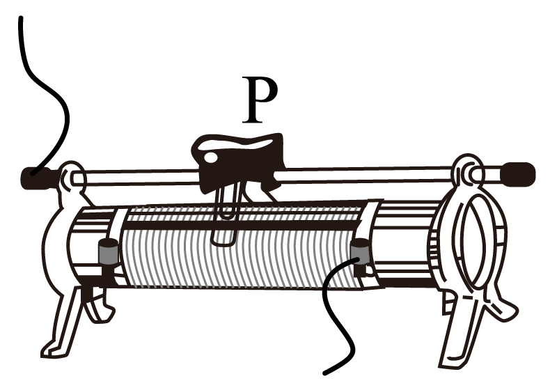

【答案】A

【解析】​

## 11. 单选题

“乐思”小组在学习使用滑动变阻器的实验中，连接了如图所示的电路，下列分析正确的是（     ）。

​​

​​

- A. 若M接C点，N接D点，滑动变阻器与灯泡并联
- B. 连接电路时，若M接C点，N接B点，闭合开关前，滑片P应移动到最左端
- C. ​​​​​​若M接C点，N接B点，闭合开关，滑片P向右移，电灯变暗
- D. 若M接C点，N接D点，闭合开关，滑片P向右移，电灯变暗

【答案】B

【解析】​

## 12. 单选题

如图所示的各电路中，同种元件的规格相同。当开关闭合后，能利用滑动变阻器使灯泡由正常发光到渐暗，到最后熄灭，又不会造成事故的电路是（　　）。

- A. 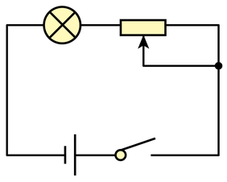
- B. 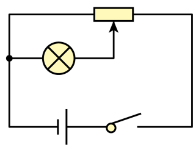
- C. 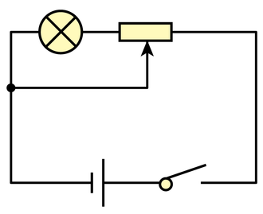
- D. 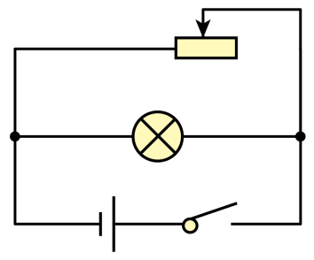

【答案】B

【解析】​

## 13. 单选题（难度：简单）

为限制超载确保运输安全，某地区对过往的货车实施计重收费，如图为称重计的原理图，下列分析正确的是（　　）。

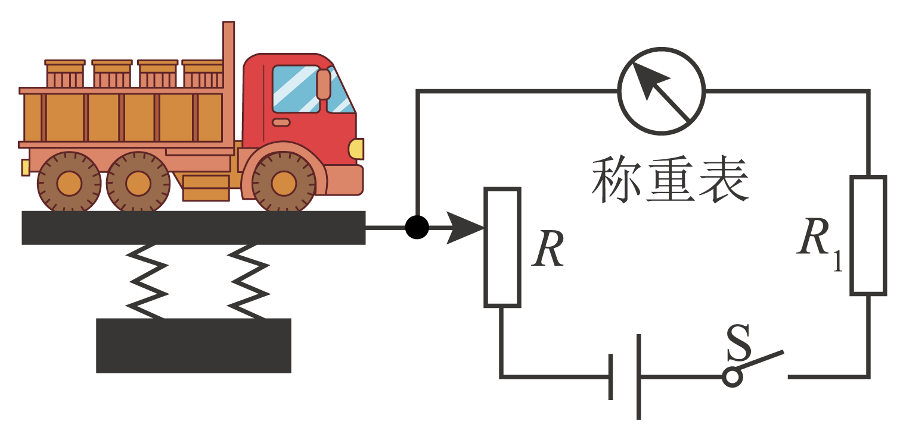

- A. 称重计相当于一个电压表
- B. 电路中的电阻R1是没有作用的
- C. 车辆越重时，电路中电流越小
- D. 车辆越重时，称重计的示数越大

【答案】D

【解析】​

## 14. 单选题（难度：简单）

如图所示是灯泡和滑动变阻器所组成的电路，下列选项中的各图与该图连接相同的是（       ）。

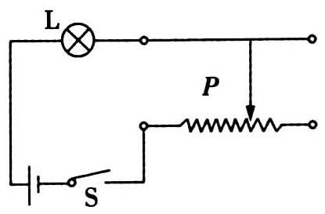

- A. 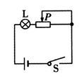
- B. 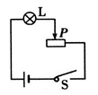
- C. 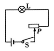
- D. 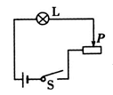

【答案】D

【解析】​

## 15. 多选题（难度：适中）

（多选）如图所示的电路，能利用滑动变阻器调节电灯亮度的电路是（   ）。​

- A. 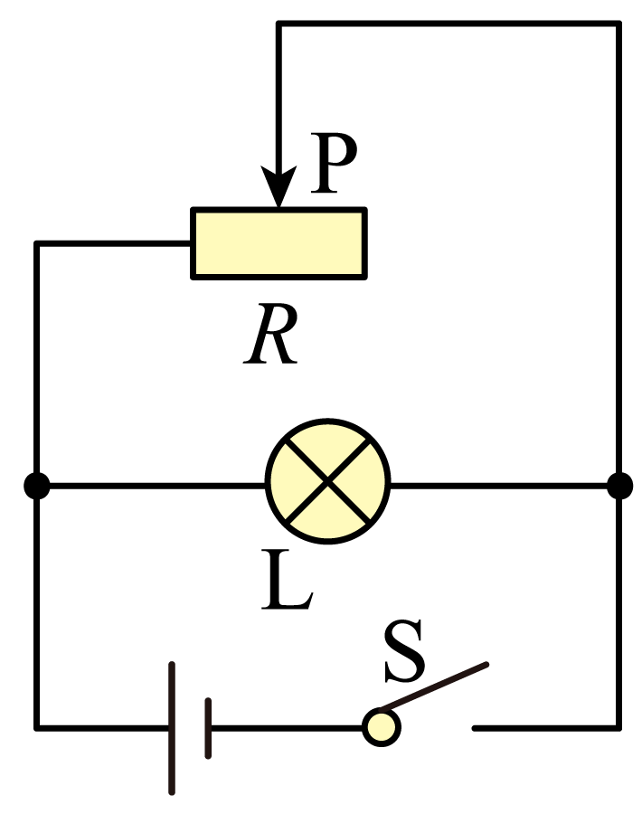
- B. 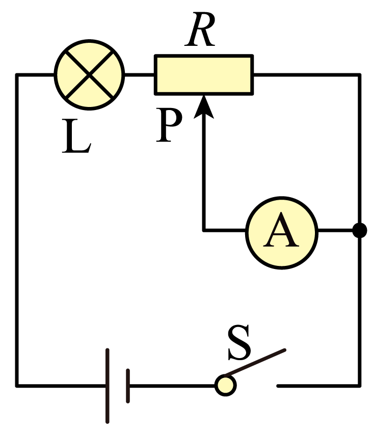
- C. 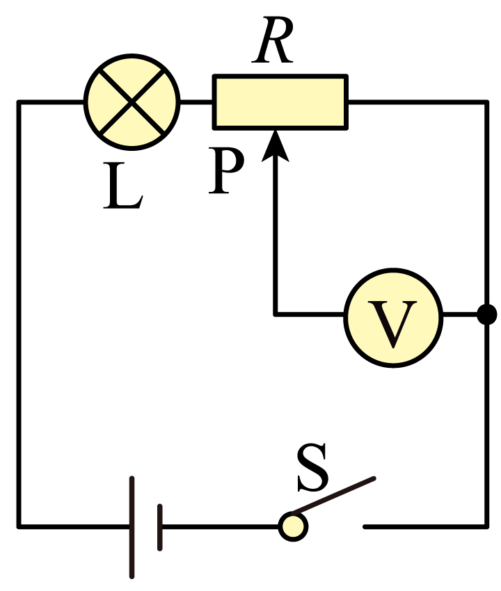
- D. 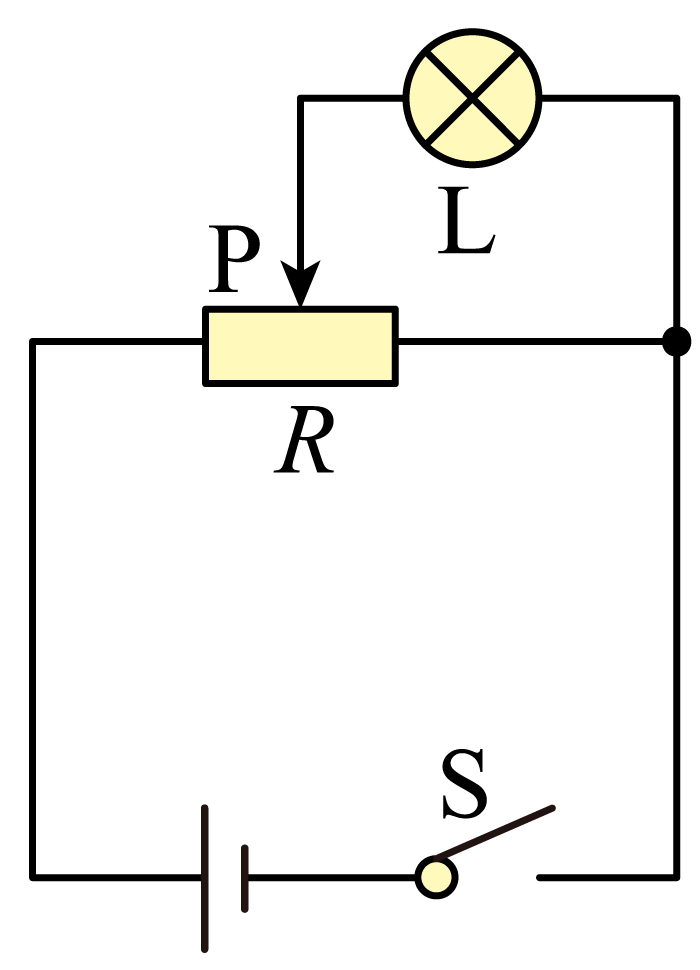

【答案】B/D

【解析】​

## 16. 单选题（难度：适中）

如图所示是科技创新小组的同学们发明的电子握力器的内部结构示意图。电源电压不变，滑动变阻器b端固定在绝缘底座上，手柄A与滑动变阻器滑片固定在一起，同步运动，握力为零时，滑片处于a端。L是一个电阻不变的指示灯，力量计由一个电流表改装而成．使用时，先闭合开关S，再用手握住手柄，A手柄向下运动压缩弹簧，握力就显示在力量计表盘上．下列有关握力计的说法正确的是（　　）。

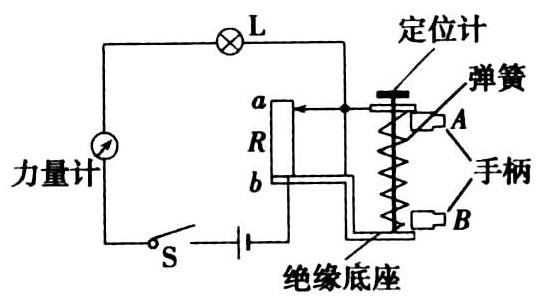

- A. 握力越大，灯泡越亮，力量计的示数越大
- B. 改装而成的力量计的零刻度线就是原电流表的零刻度线
- C. 握力越大，电路总电阻越大，总电流越小
- D. 握力越大，弹簧的长度越长

【答案】A

【解析】​

## 17. 单选题（难度：简单）

下列不需安装电位器的是（       ）。

- A. 调温电熨斗
- B. 无极调光台灯
- C. 收音机的音量调节旋钮
- D. 家用白炽灯

【答案】D

【解析】​

## 18. 单选题（难度：适中）

如图甲所示是一个好玩的灯具，当顺时针转动灯具，灯就逐渐变暗，直至熄灭。实际上是由一个电位器控制着灯泡的亮度。图乙是这个电位器的结构图，a、b、c是它的三个接线柱，a、c分别与弧形电阻丝的两端相连，b与金属滑片相连。转动灯具，滑片在弧形电阻丝上同向滑动即可调节灯泡亮度，该滑片跟着灯具一起转动。下列分析正确的是（　　）。

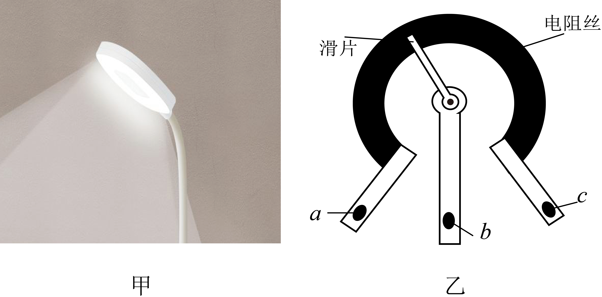

- A. 电位器与灯泡并联
- B. 电位器是通过改变接人电路中电阻丝的横截面积来改变灯泡亮度的
- C. 该电路中，电位器只将a、b接入电路
- D. 该电路中，电位器只将b、c接入电路

【答案】C

【解析】​

## 19. 单选题

物理实践活动中，小东利用图所示的电位器和灯泡制作了一个可调节亮度的小台灯，下列说法正确的是（　　）。

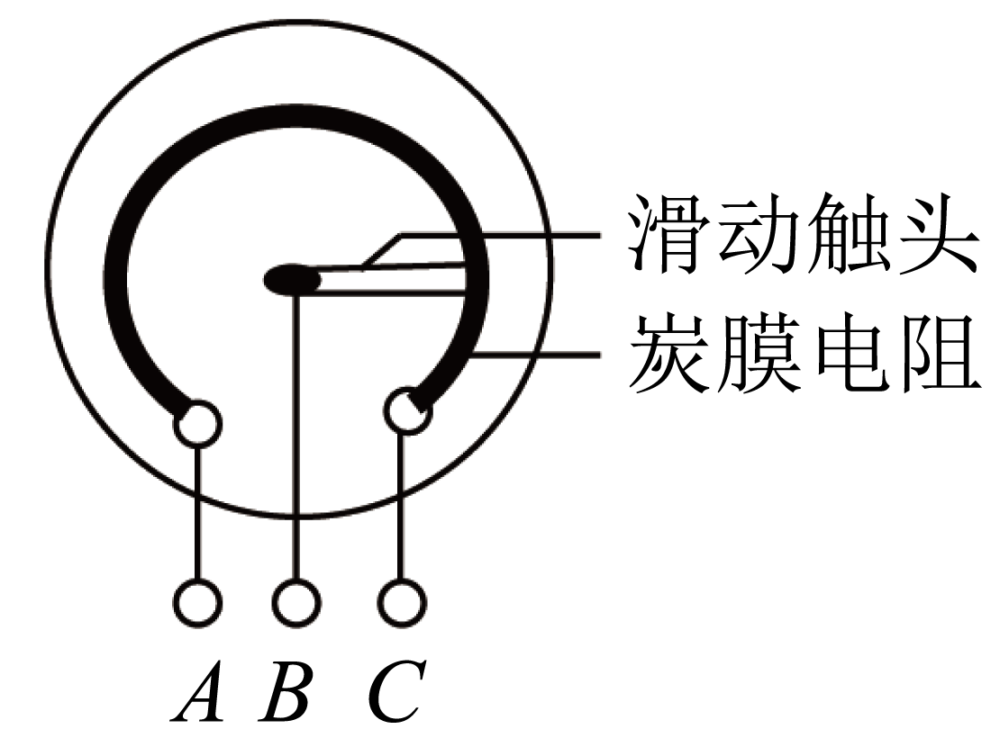

- A. 电位器与灯泡是并联的
- B. 可以将接线柱A、B和C同时接入电路
- C. 若接线柱A和B接入电路，滑动触头顺时针转动时，灯泡变暗
- D. 若接线柱B和C接入电路，滑动触头逆时针转动时，灯泡变亮

【答案】C

【解析】​

## 20. 单选题（难度：简单）

小明同学在做“用滑动变阻器改变电流”实验时，连接了如图所示的电路，将滑动变阻器的滑片移动到最大阻值处，闭合开关S，发现小灯泡不亮．接下来的操作，在以下步骤中最合理的是（     ）。

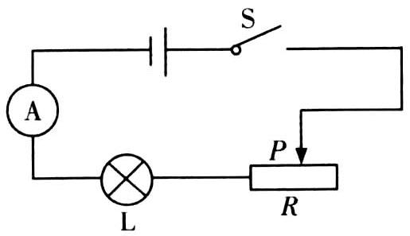

- A. 断开开关S，更换灯泡重新实验
- B. 断开开关S，增加电池的节数重新实验
- C. 断开开关S，拆掉导线重新连接电路
- D. 观察电流表的示数是否为零，判断电路是否断路

【答案】D

【解析】​

## 21. 单选题（难度：简单）

如图所示的电路中，开关S

闭合后，若滑动变阻器的滑片移到最下端，可能出现的现象是（        ）。

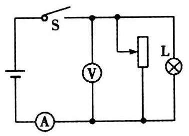

- A. 烧坏灯泡和电流表
- B. 烧坏灯泡和电源
- C. 烧坏电流表和电压表
- D. 烧坏电流表和电源

【答案】D

【解析】​

## 22. 填空题（难度：简单）

滑动变阻器是靠改变来改变电阻的，从而可以改变电路中的；使用滑动变阻器时，应将它与所要控制的电路联。

【答案】接入电路中电阻丝长度，电流，串

【解析】​

## 23. 多选题

（多选）如图所示的实验电路，闭合开关后，无论怎样移动滑片小灯泡都不发光，若灯泡或滑动变阻器只有一处发生故障，则能判断出故障元件的办法是（导线各处连接完好）（　　）。

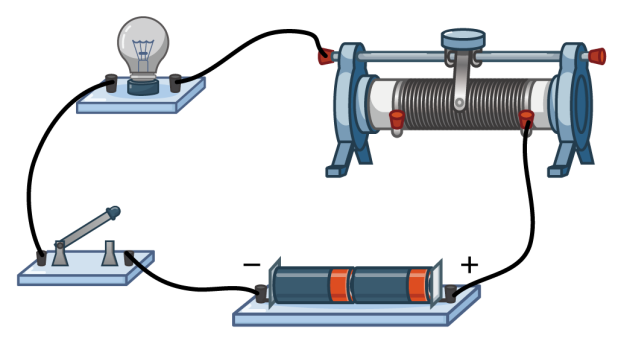

- A. 将不发光的小灯泡连同底座一并更换为新的
- B. 再次实验用电压表依次替换灯泡和滑动变阻器，观察指针偏转情况
- C. 将电流表串联接入电路中，观察指针偏转情况
- D. 将电压表逐次并联在灯泡和滑动变阻器两端，观察指针偏转情况

【答案】A/D

【解析】​

## 24. 填空题（难度：适中）

如图所示，滑动变阻器铭牌上标有“120Ω   2A”字样，则该变阻器的阻值变化范围是，“2A”是它的；当P在A端时，接入电路的电阻为Ω；P在B端时，接入电路的电阻为Ω；P在AB中点时，接入电路的电阻为Ω。

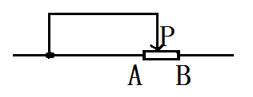

【答案】0～120&Omega;，允许通过的最大电流，120，0，60

【解析】​

## 25. 填空题

如图所示，用A、B两个金属夹子将一根铅笔芯接入电路中，当夹子B左右移动时，由于变化，导致铅笔芯接入电路的电阻值发生变化，小灯泡的亮度随之变化。若将A、B两个金属夹子间的铅笔芯换成塑料吸管，小灯泡（选填“会”或“不会”）发光。

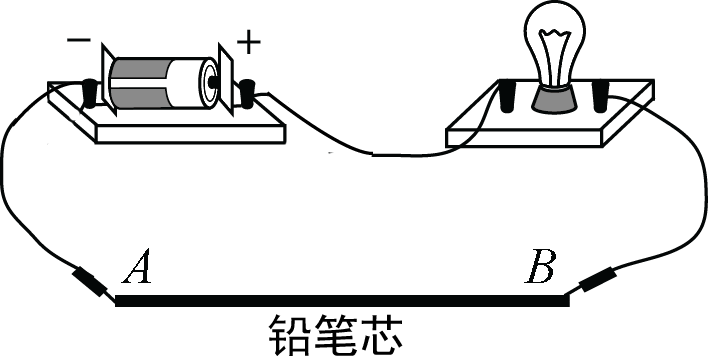

【答案】铅笔芯接入电路的长度发生，不会

【解析】​

## 26. 填空题（难度：简单）

滑动变阻器的原理是通过改变连入电路中导线的来改变电阻的，从而改变电路中的电流．如图所示是滑动变阻器的结构示意图，要使滑片P向右滑动时电阻变大，应接入的接线柱为两个或两个接线柱，若使滑动变阻器相当于一个定值电阻，应接入两个接线柱。

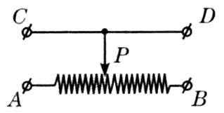

【答案】长度，<em>AC</em>，<em>AD</em>，<em>AB</em>

【解析】​

## 27. 填空题（难度：简单）

莱芜城区基本普及了纯电动公交车。纯电动公交车的“心脏”是电动机，车上的调速装置相当于（填电学器材名称），行驶的过程中，司机师傅踩下或者松开调速踏板，可以改变电动机中的大小。

【答案】滑动变阻器，电流

【解析】​

## 28. 填空题

闭合开关后，如图甲所示的电路中，滑动变阻器连入电路中的电阻丝是段；如图乙所示的电路中，滑动变阻器连入电路中的电阻丝是段（均选填“aP”、“Pb”或“ab”）。

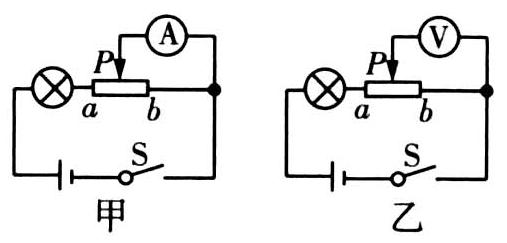

【答案】<em>aP</em>，<em>ab</em>

【解析】​

## 29. 填空题（难度：简单）

滑动变阻器是通过改变接入电路中电阻丝的来改变电阻的。如图甲所示，当滑片向右端移动时，它的电阻值（填“变大”､“变小”或“不变”）。如图乙中电阻箱的读数是Ω。

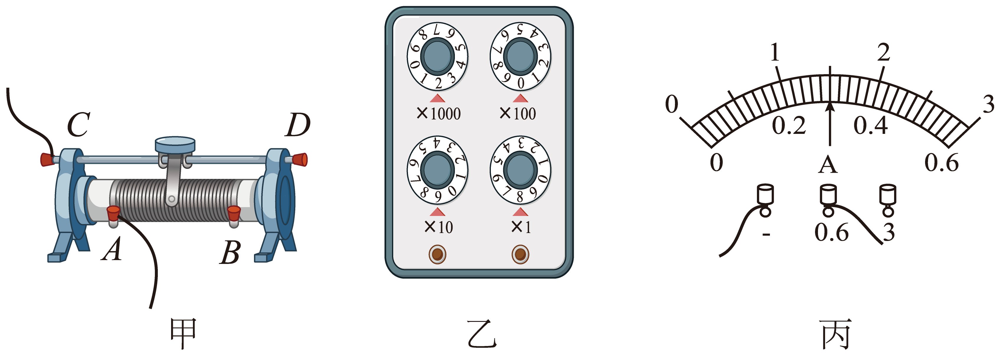

【答案】长度，变大，2098

【解析】​

## 30. 填空题

如果把甲、乙两图变阻器接入电路中，甲图的示数是，乙图的示数是。

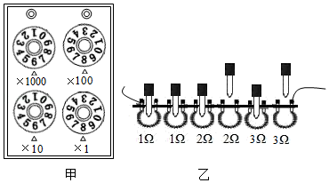

【答案】6868&Omega;，5&Omega;

【解析】​

## 31. 填空题（难度：适中）

小明自制了一盏可调节亮度的台灯，电路如图所示，小灯泡规格是“6V  3W”。请完成以下问题：

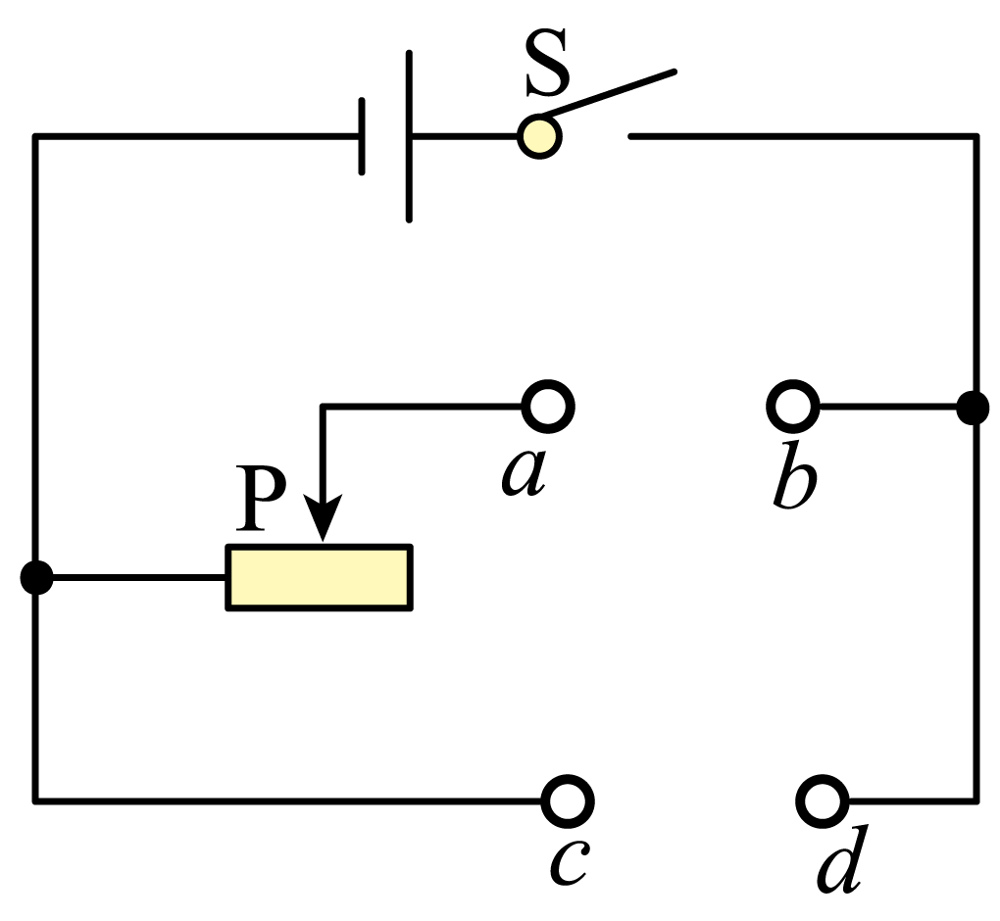
  
（1）​粗心的小明忘记把灯泡画上去，你认为灯泡应画在图中之间（选填“a、b”或“c、d”）；
​（2）​连好电路后，若要使灯泡变暗，应将滑动变阻器的滑动片向（填“左”或“右”）移动。

【答案】<i>a</i>、<i>b</i>，右

【解析】​

## 32. 填空题（难度：适中）

三种仪器的读数分别为、、。

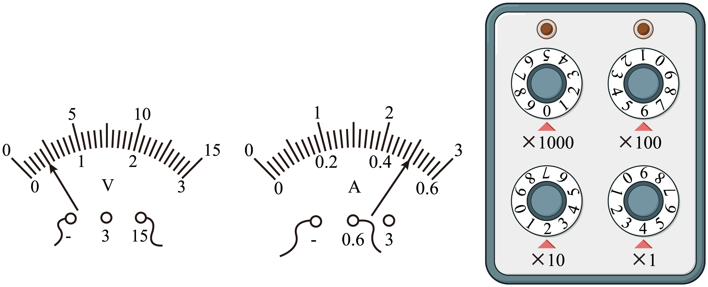

【答案】2V，0.5A，624&Omega;

【解析】​

## 33. 填空题（难度：简单）

如图为旋转式交阻器的结构图，A、B、C为变阻器的三个接线柱，P为旋钮触片。将该变阻器接入电路中调节灯泡的亮度，当顺时针旋转旋钮触片时，灯变亮，则应连接接线柱（选填“A、B”“B、C” 或“A、C” ）和灯泡联后接入电路中。

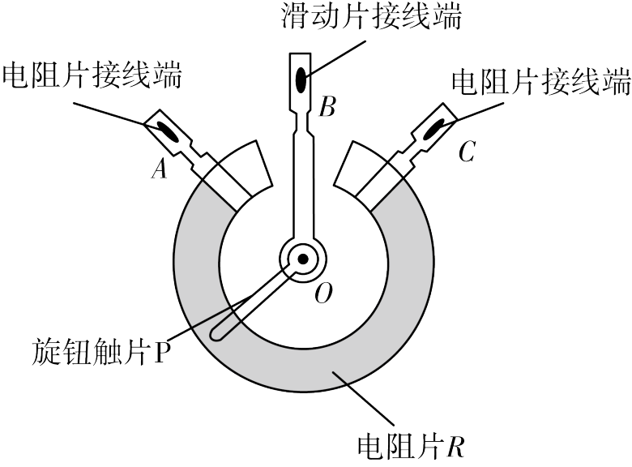

【答案】A、B，串

【解析】​

## 34. 填空题

为了完成“用滑动变阻器改变灯泡亮度” 的实验，小佑收集了很多材料和长度都相同但粗细不同的铅笔芯。如图所示，是用他身边的器材自制的简易调光灯电路。

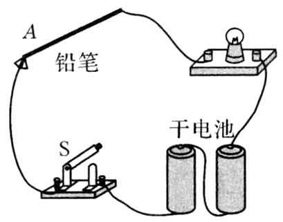
 
（1）闭合开关，夹子A向右移动的过程中灯泡亮度应该（“变亮”、“变暗”或“不变”）；
（2）夹子A从最左端移动到右端的过程中，他发现灯泡亮度变化不明显，他应该调换更（填“粗”或“细”）的铅笔芯来做实验；
（3）通过实验小佑发现，通过改变接入电路的电阻线来改变电阻是最方便实现的。
（4）通过实验现象请你推想，如果有长度和横截面积均相等的铜线和镍铬合金线，用线制作滑动变阻器更适合。

【答案】变亮，细，长度，镍铬合金

【解析】​

## 35. 填空题

如图所示是一种自动测定油箱内油量多少的装置，R′是定值电阻，R是滑动变阻器，它的金属滑片是金属杠杆的一端，则图中电表是表（选填“电压”或“电流”），油量减少时，R接入电路中的电阻将，且该表示数将。（后两空均填“变大”、“变小”或“不变”）

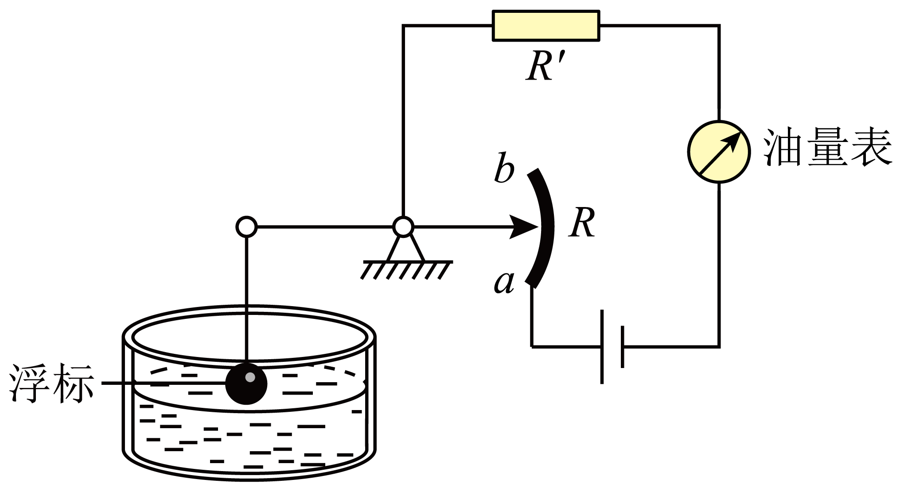

【答案】电流，变大，变小

【解析】​

## 36. 填空题

旋转式变阻器与滑动变阻器相比，外形不同，但原理都是通过改变接入电路的电阻丝的来改变其连入电路的电阻。若图中旋转式变阻器的A、C接线柱连入电路，则连入电路的弧形电阻片是段（选填“AP”、“PB”或“AB”

），当轴顺时针旋转时，它连入电路的电阻将（选填“变大”、“变小”或“不变”）。

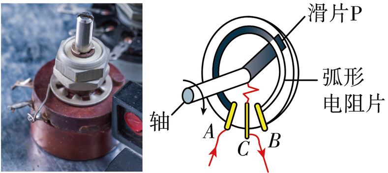

【答案】长度，AP，变大

【解析】​

## 37. 填空题（难度：适中）

如图所示是电视机的“音量Volume”按钮，它的实质是一个。若要使声音的响度变大，则应将滑片b向 （a或c）方向滑动，此时电流 。（选填“变大”或“变小”）

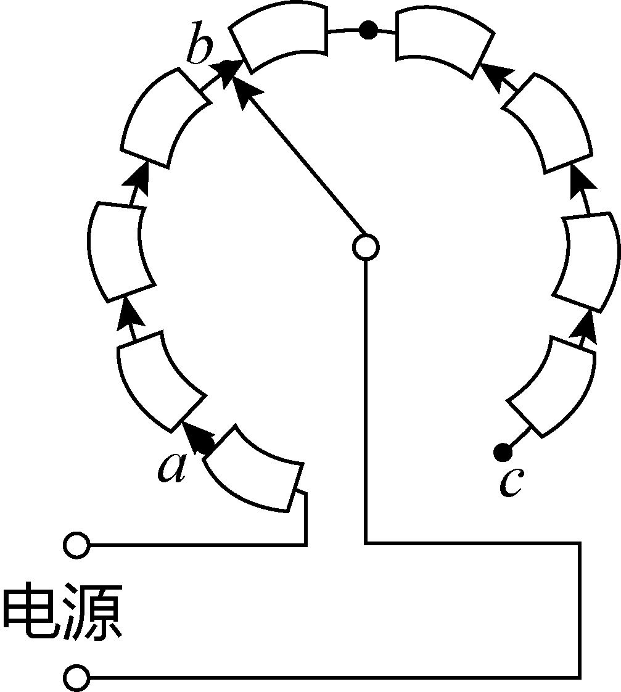

【答案】滑动变阻器，<em><em>a</em></em>，变大

【解析】​

## 38. （难度：适中）

小芳想用如图所示的器材，设计一个可以调节小灯泡亮度的电路，要求：滑动变阻器的滑片向左滑动时，灯泡的亮度变暗；用电流表测灯泡的电流，电压表测灯泡两端的电压。

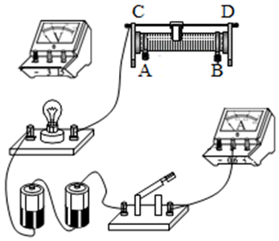

请你用笔画线代替导线连接电路；

连接电路时的开关应处于状态，实验前滑片P应放在端，此时发现电流表指针位于零刻线偏左的位置，则接下来的操作是；

在实验中如果无论如何移动滑动变阻器的滑片，灯泡亮度都不改变，而且很暗，原因是。

【答案】

 

，断开/最左/应调零，滑动变阻器接线接在<i>A</i>、<i>B</i>两接线柱上

【解析】​

## 39. （难度：简单）

如图所示的实验器材，现用电流表、电压表分别测出通过小灯泡的电流和小灯泡两端的电压。电路中电流约为0.5A，并用变阻器改变小灯泡的电流，要求滑片向右滑动时灯泡变亮。

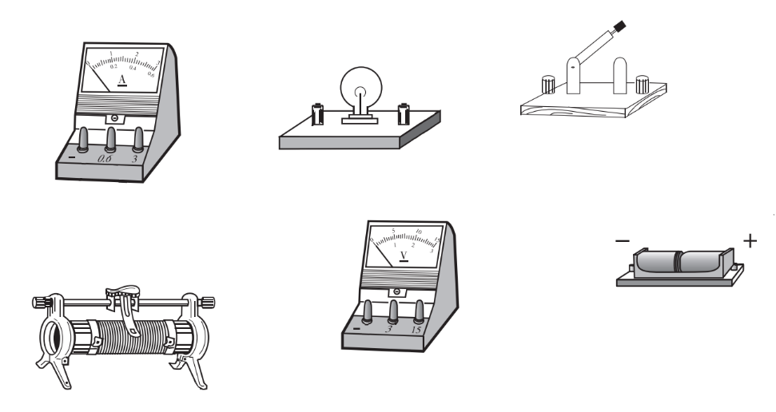

请用笔画线代替导线按要求将实物图连接完整；

连接电路前开关应处于状态；

实验中，若闭合开关，小灯泡不亮，但电压表示数约等于电源电压，此时故障可能是；如移动滑片P发现两表示数均比较小且不变，则原因为。

【答案】

    

，断开，小灯泡断路/滑动变阻器两接线柱同接在下接线柱

【解析】​

## 40. （难度：适中）

如图所示，在方框内画出对应的电路图。
 
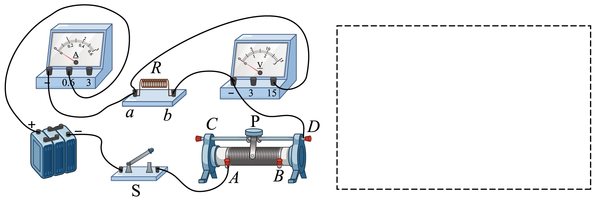

【答案】

 

【解析】​

## 41. （难度：简单）

在如图所示的电路中，有两根导线尚未连接，请用笔画线代替导线补上。补上后要求：闭合开关S，向左端移动滑动变阻器的滑片P，电压表示数变大并且电路正确。
 
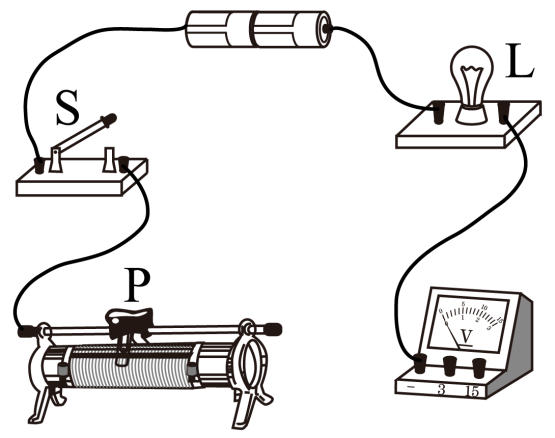

【答案】

 

【解析】​

## 42. 

利用如图所示的器材，用电流表测流过L₁的电流，要求两灯并联，滑动变阻器的滑片向右移动时，小灯泡L₂变亮，开关控制两灯，将电路补充完整，然后在方框内画出它的电路图。
 
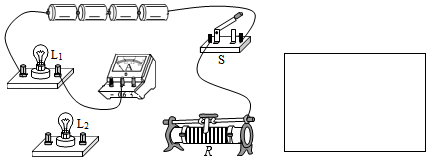

【答案】

 

【解析】​

## 43. （难度：简单）

根据实物图画电路图。
 

【答案】

 

【解析】​

## 44. （难度：简单）

请将图中所示的电路组件用笔画线代替导线连成电路，要求：开关S闭合后，滑动变阻器的滑片P向左滑动时，灯泡L₂变亮，但灯泡L₁的亮度不变；开关S断开后，灯泡L₁、L₂都不亮。
 

【答案】

 

【解析】​

## 45. 

如图虚线框内是光敏变阻器的结构图，AB为阻值均匀的薄膜电阻，EF为一条导电电极（相当于导线），在AB、EF之间是光导电层（无激光照射时为绝缘体；有激光照射时被照射处的光导电层导电，在该点处将薄膜电阻和导电电极接通），1、2、3为接线柱。请将光敏变阻器正确串联到下面电路中，要求开关闭合后，当激光束水平左移时灯泡变暗。
 

【答案】

 

【解析】​

## 46. （难度：适中）

在图所示的电路中，有两根导线尚未连接，请用笔画线代替导线补上，补上后要求：
①闭合开关S后，小灯泡L才能发光；
②当滑动变阻器的滑片P向左移动时，小灯泡L亮度不变，电流表的示数变小。 
 

【答案】

 

【解析】​

## 47. （难度：适中）

现有电源（6V）、灯泡、电流表、电压表、滑动变阻器、开关各一个，导线若干。请用笔画线代替导线连接实物电路，要求：
（1）电流表测通过灯泡的电流（约0.4A）；
（2）电压表测灯泡两端的电压，正常发光时灯泡两端的电压约为3.8V；
（3）滑动变阻器的滑片向右移动时灯泡变暗。
 

【答案】

 

【解析】​

## 48. （难度：适中）

小乐在物理兴趣小组研究了一种调光台灯，如图是它的内部电位器（滑动变阻器）的内部结构示意图，a、b、c是它的三个接线柱，请用笔画线代替导线按要求完成电路的连接，要求：闭合开关时，旋钮带动滑片逆时针转动时，灯泡变亮（电源未画出）。
 

【答案】

 

【解析】​

## 49. （难度：简单）

如图甲是小明家台灯的电位器示意图，小明发现顺时针旋转旋钮（滑片）时，灯泡变暗，请你帮小明把该电位器连入乙图。
 

【答案】

 

【解析】​

## 50. 

如图甲是生活中常见的亮度可调的台灯，顺时针旋动调光的电位器旋钮时灯会变亮，图乙是模拟台灯的工作电路图，a、b、c为电位器的接线柱。请你用笔画线代替导线连接此工作电路图。
 

【答案】

 

【解析】​

## 51. 单选题（难度：适中）

下列各电路元件中，阻值最大的是（　　）

【答案】A

## 52. 单选题（难度：简单）

关于导体的电阻，下列说法中错误的是（　　）

【答案】A

## 53. 单选题（难度：简单）

若用电阻丝调节台灯的亮度，所选用的电阻丝规格如下表所示，其中电阻最小的是（　　） 编号材料长度/m横截面积/<latex class="math-tex">\( {\text{mm}}^{\text{2}}\)</latex>①镍铬合金0.50.5②0.50.2③1.00.2④1.00.5

【答案】A

## 54. 单选题（难度：简单）

用实验研究导体的材料、长度、横截面积对电阻的影响时，供选择的导线规格如表：
材料
编号
长度/m
横截面积/mm²
材料
编号
长度/m
横截面积/mm²

镍
铬
合
金
①
1
0.4
锰
铜
合
金
⑤
1
0.4

②
1
0.8
⑥
1
0.8

③
2
0.4
⑦
2
0.4

④
2
0.8
⑧
2
0.8

你认为下面对导体选择最合理的一组是（　　）

- A. ①②⑤⑥
- B. ⑤⑥⑦⑧
- C. ②③⑥⑦
- D. ①⑤⑥⑦

【答案】D

【解析】如果探究电阻与导体材料的关系时，导体的长度和横截面积不变，导体的材料不同，所以可以选择的导体有：①⑤或②⑥或③⑦或④⑧；
如果探究电阻与导体长度的关系时，导体的材料和横截面积不变，导体的长度不同，所以可以选择的导体有：①③或②④或⑤⑦或⑥⑧；
如果探究电阻与导体横截面积的关系时，导体的材料和长度不变，导体的横截面积不同，所以可以选择的导体有：①②或③④或⑤⑥或⑦⑧；
从分析的结果可以看出，只有D选项中的导体可以探究影响电阻大小的因素。
故选D。

## 55. 单选题（难度：适中）

下列做法中，可以使电阻丝阻值增大的是（　　）

【答案】A

## 56. 单选题（难度：适中）

白炽灯长期使用后，钨丝会变细．变细后的钨丝与原来相比（　　）

【答案】A

## 57. 单选题（难度：简单）

下列哪个物理量不是决定导体电阻大小的因素（　　）

【答案】A

## 58. 单选题（难度：简单）

a是铜导线，b是铝导线，二者的长度相同，则（　　）

- A. a导线的电阻大
- B. b导线的电阻大
- C. a、b导线的电阻一样大
- D. 无法比较哪个导线的电阻大

【答案】D

【解析】a是铜导线，b是铝导线，二者的长度相同，当不知道横截面积的大小，所以无法判定其电阻的大小。故ABC不符合题意，D符合题意。
故选D。

## 59. 单选题（难度：适中）

下列说法正确的是（　　）

【答案】A

## 60. 单选题（难度：适中）

一根导体的电阻为R，要使这根导体连入电路的电阻变小，可以采用的方法是（　　）

- A. 将导线对折后连入电路
- B. 将导线拉长后连入电路
- C. 减小导线两端的电压
- D. 增大导线中的电流

【答案】A

【解析】导体的电阻是导体本身的一种性质，电阻大小与导体的材料、长度、横截面积有关，与导体两端的电压和通过的电流无关。将导体对折，导体长度变短，横截面积变大，导体电阻变小；将导体拉长，导体长度变长，横截面积变小，导体电阻变大。故A正确，BCD错误。
故选A。

## 61. 单选题（难度：适中）

下列关于导体的各项中，不能决定导体电阻大小的是（　　）

【答案】A

## 62. 单选题（难度：简单）

如图所示，AB和BC是由不同材料制成的长度相同、横截面积不同的两段导体，将它们串联后接入电路中，下列说法正确的是（　　）

【答案】A

## 63. 单选题（难度：适中）

A、B是同种材料制成的电阻，它们的长度相等，A的横截面积是B的两倍，将它们串联在电路中，则电阻两端电压UA、UB和导体中电流IA、IB间的关系正确的是（　　）

【答案】A

## 64. 单选题（难度：适中）

如图为“探究电阻大小与哪些因素有关”的实验电路图，电阻丝的长度、材料、板截面积情况如图所示（\( {S}_{\text{a}}={S}_{\text{b}}={S}_{\text{c}}<{S}_{\text{d}}\)），则下列说法正确的是（　　）
    

- A. 研究电阻与材料的关系可以选a和b
- B. 研究电阻与长度的关系可以选a和c
- C. 研究电阻与横截面积的关系可以选c和d
- D. 实验中为了电路安全最好在电路中再串联一个电压表

【答案】A

【解析】A．电阻大小可能与导体的材料、长度和横截面积有关，研究电阻与材料的关系要控制长度和横截面积相同，使电阻丝材料不同，故可以选a和b，故A正确；
B．研究电阻与长度的关系，要控制导体的材料和横截面积不变，而a和c材料不同，故B错误；
C．研究电阻与横截面积的关系，要控制导体的材料、长度相同，而c和d长度不同，故C错误；
D．实验中为了电路安全最好在电路中再串联一个灯泡，灯泡能分担一定的电压，可以保护电路，串联电压表，电压表相当于断路，电流表几乎无示数，故D错误。
故选A。

## 65. 单选题（难度：适中）

如图所示，在探究影响导体电阻大小因素的实验中，导线a、b、c粗细相同，b、d粗细不同，a、b、d长度相同（忽略温度的影响）．能探究导体电阻大小与导体横截面积有关的是（　　）

【答案】A

## 66. 单选题（难度：适中）

如图所示电路，当给玻璃丝加热时，小灯泡会慢慢亮起来（不考虑灯丝电阻的变化），此过程中逐渐增大的物理量是（　　）

【答案】A

## 67. 单选题（难度：适中）

如图所示，甲、乙两根材料和长度相同的导体，乙的横截面积较大，把它们并联在电路中，下列说法正确的是（　　）

【答案】A

## 68. 单选题（难度：适中）

某同学采用如图的实验装置“探究影响导体电阻大小的因素”，实验中用到了甲乙两根电阻丝的粗细相同，下列说法错误的是（　　）

【答案】A

## 69. 单选题（难度：适中）

如图所示，AB和BC是由同种材料制成的长度相同、横截面积不同的两段导体，将它们串联后连入电路中。比较这两段导体的电阻，通过它们的电流的大小及这两段导体两端的电压，有（　　）

【答案】A

## 70. 单选题（难度：适中）

某同学做了一个如图所示的“魔法火焰”实验：加热铅笔芯时，小灯泡慢慢亮了起来！下列有关判断正确的是（　　）
    

- A. 电源电压变大
- B. 铅笔芯电阻变大
- C. 电路中电流变大
- D. 小灯泡功率变小

【答案】C

【解析】A．由图可知，电源是2节干电池，随着工作时间增长，电源电压会减小，故A错误；
BCD．根据题意，当用一支蜡烛加热铅笔芯时，小灯泡慢慢亮了起来，说明温度影响铅笔芯的电阻，小灯泡慢慢亮了起来，说明小灯泡的实际功率变大，由\( P={I}^{2}{R}_{\text{L}}\)可知，电路中的电流变大了，当电路中的电流变大时，由欧姆定律可知，铅笔芯的电阻变小，说明铅笔芯的电阻随温度升高而变小，故C正确，BD错误。
故选C。

## 71. 单选题（难度：适中）

如图所示，这是探究“影响导体电阻大小的因素”的实验电路图，电阻丝的长度、材料、横截面积情况如图所示<latex class="math-tex">\( （{S}_{a}={S}_{b}={S}_{c}<{S}_{d}）\)</latex>。下列说法正确的是（　　）

【答案】A

## 72. 单选题（难度：简单）

如图所示为电路中常用的铜芯导线，它是由多股铜导线外包绝缘皮制成。下列措施中能减小其电阻的是（　　）

【答案】A

## 73. 单选题（难度：适中）

如图所示，电路中的钨丝是将一个白炽灯去除玻璃罩制成的，闭合开关S，小灯泡L发光，钨丝不发光；向钨丝吹气时，小灯泡L变亮；用酒精灯给钨丝加热，小灯泡L逐渐变暗直至熄灭，下列说法正确的是（　　）

【答案】A

## 74. 单选题（难度：适中）

关于导体的电阻，如果不考虑温度对电阻的影响，下列说法正确的是（　　）

【答案】A

## 75. 单选题（难度：适中）

以下做法能使导体电阻变大的是（　　）

【答案】A

## 76. 填空题（难度：适中）

在家庭电路中不能用湿手触摸开关，是因为在潮湿的情况下，人体的电阻会___，在电压一定的情况下，通过人体的电流会___（两空都选填“变大”、“变小”或“不变”）。

## 77. 单选题（难度：适中）

在家庭电路中，刚打开电灯时，灯泡容易烧坏，原因是（　　）

【答案】A

## 78. 填空题（难度：适中）

导体的电阻是导体本身的一种性质，它的大小与导体的、长度、和温度有关。

【答案】材料，横截面积

【解析】电阻是导体对电流的阻碍作用，导体的电阻是导体本身的一种性质，不同材料导电能力不同，同一材料的导体长短、粗细、温度发生变化时，电阻也会改变，故导体电阻的大小与导体的材料、长度、横截面积和温度有关。

## 79. 多选题（难度：适中）

下列有关导体电阻的说法中正确的是（　　）

【答案】A

## 80. 多选题（难度：适中）

某市技术监督部门曾对市场上的电线产品进行抽查，发现有一个品牌的铜芯电线不符合规格：①用镀铜的铝芯冒充铜芯；②电线直径明显比说明书上标定的直径小。这种电线不符合规格的原因是（　　）

【答案】A

## 81. 多选题（难度：适中）

温度相同的情况下，关于导体的电阻，说法正确的是（　　）

【答案】A

## 82. 多选题（难度：适中）

下列有关电阻的说法中错误的是（　　）

【答案】A

## 83. 多选题（难度：适中）

小轩用如图所示的器材进行“探究影响电阻大小的因素”实验。a、b为长度相同的镍铬合金丝（合金丝外面没有绝缘层），b的横截面积是a的二倍，关于此实验，下列说法正确的是（　　）

【答案】A

## 84. 多选题（难度：适中）

“探究影响导体电阻大小的因素”的实验装置如图所示，在实验中使用四根电阻丝，其中A是锰铜合金丝，B、C和D是镍铬合金丝。   （1）实验中通过观察______比较电阻丝电阻的大小；（2）将编号为A、B的电阻丝分别接入电路进行实验，发现接B导线时，灯泡明显变暗，可得出结论：导体的电阻大小与导体的______有关。从导电性能看，锰铜合金和镍铬合金，______更适合制作电阻器；（3）将编号为______

【答案】A

## 85. 多选题（难度：适中）

小阳想探究影响电阻大小的因素。他连接了如图所示的电路进行实验，其中两根镍铬合金丝的粗细相同。将两根电阻丝分别接入电路中，闭合开关后，记录两次实验电流表的示数。根据上述实验，下列说法中正确的是（　　）
       

- A. 此实验探究的是导体的电阻与材料的关系
- B. 此实验探究的是导体的电阻与温度的关系
- C. 此实验需要保持电源电压不变
- D. 此实验中用电流表示数的大小反映电阻的大小

【答案】C/D

【解析】AB．由控制变量法可知，材料、横截面积相同，长度不同，故实验探究的是导体的电阻与长度的关系，故A错误，故B错误；
C．此实验中用电流表示数的大小反映电阻的大小，根据欧姆定律\( I=\frac{U}{R}\)可知，需要保持电压不变，故C正确；
D．在电路中分别接上不同的导体，通过观察电流表的示数来比较导体电阻的大小，即将电阻的大小转换为电流的大小，这就是转换法，故D正确。
故选CD。

## 86. 多选题（难度：适中）

如图所示，把一段铅笔芯用金属夹A、B接入电路，闭合开关后小灯泡发光。保持A的位置不变而将B沿铅笔芯向A滑动，发现灯泡变得更亮。对于上述实验，下列说法中正确的是（　　）

【答案】A

## 87. 多选题（难度：适中）

如图为探究影响电阻大小的因素实验，a、c、d导体的材料相同，a、b、d导体横截面积相同，a、b、c导体的长度相同，下列分析正确的是（　　）
       

- A. 分别将导体b、d接入电路进行实验，可以探究导体材料与电阻的关系
- B. 电压一定时电流表的示数越大说明导体的电阻越大
- C. 电路串联接入小灯泡既可保护电路也可判断电流变化
- D. 分别将导体a、d接入电路进行实验，得到实验结论被实际应用到了滑动变阻器的工作原理中

【答案】C/D

【解析】A．要探究导体材料与电阻的关系，应控制导体的长度和横截面积相同，材料不同，但导体b、d的长度不相同，所以它们不能用来探究导体材料与电阻的关系，故A错误；
B．根据欧姆定律知道，导体两端电压一定时，通过导体的电流与导体的电阻成反比，所以电压一定时，电流表的示数越大，说明导体的电阻越小，而不是越大，故B错误；
C．在电路中串联接入小灯泡可以起到限流作用，防止电流过大而损坏设备，这是保护电路的一种措施，同时，小灯泡的亮度可以直观地反映电流的变化，电流增大时灯泡会更亮，电流减小时灯泡会变暗，所以可以用来判断电流的变化，故C正确；
D．分别选用导体a、d电阻丝进行实验，即此时的材料和横截面积相同，但长度不同，从而得出结论：在材料和横截面积相同，导体长度越长，电阻越大，该结论被实际应用到了滑动变阻器的工作原理中，故D正确。
故选CD。

## 88. 单选题（难度：适中）

小明用如图所示的器材做“探究影响电阻大小的因素”的实验。a、b为长度一样的镍铬合金丝，b比a的横截面积大。关于此实验，下列说法中正确的是（　　）
      

- A. 接入电路的合金丝的电阻越大，小灯泡越亮
- B. 利用此装置只能探究导体电阻大小和横截面积的关系
- C. 利用此装置能探究导体电阻大小和横截面积、长度的关系
- D. 为了准确比较两根合金丝的电阻，需在电路中串联一个电压表

【答案】C

【解析】A．接入电路的电阻越大，电路中电流越小，小灯泡越暗，故A错误；
BC．可以选择接入a、b来探究导体电阻与横截面积的关系，也可以选择一根电阻丝，通过移动夹子的位置来改变接入电路的电阻丝的长度，因此还可以研究导体电阻与长度的关系，故B错误，C正确；
D．为了准确比较两条合金丝的电阻，可在电路中串联一个电流表，根据电流的大小来判断电阻的大小，故D错误。
故选C。

## 89. 填空题（难度：适中）

某科学兴趣小组用下表中材料做“探究影响导体电阻大小的因素”实验时，将鳄鱼夹从较长的镍铬合金丝d的A端逐渐滑向B端时，发现电流表示数逐渐增大。    导体编号长度/m横截面积/mm2材料a0.50.4锰铜合金b0.50.4镍铬合金c0.50.2镍铬合金d1.00.2镍铬合金(1)在上面的实验中，电阻的大小并不能直接观察，而是通过电流表的示数来反映，电流表的示数越大，说明电阻丝的电阻越___，这里用到

## 90. 多选题（难度：适中）

在“设计制作一个调光灯”的实践活动中，小明设计了如图电路，用A、B两个金属夹子将一根铅笔芯接入电路中，当B夹子左右移动时，小灯泡的亮度会发生变化。下列关于这一装置的说法中正确的是（　　）

【答案】A

## 91. 填空题（难度：适中）

小明利用如图所示的装置探究导体的电阻与哪些因素有关。实验板上固定着四根金属丝a、b、c、d，它们的材料、长度和横截面直径如表中所示，不考虑温度对电阻的影响。
    

序号
材料
长度/m
横截面积

a
锰铜合金
1.0
0.8

b
镍铬合金
1.0
0.8

c
镍铬合金
1.0
1.2

d
锰铜合金
0.5
0.8

（1）该实验中，通过观察来比较导体电阻的大小。实验中把不同的电阻丝分别接入电路，闭合开关后记录对应的电流表的示数，电流表的示数越大则反映出所接入的电阻丝的阻值越（选填“大”或“小”）。
（2）利用金属丝和（填写材料序号），能探究导体的电阻大小与导体的材料是否有关。
（3）依次把M、N跟b和c的两端连接，闭合开关，记下电流表的示数，分析比较这两根金属丝电阻的大小，能得出导体的电阻大小与有关。
（4）依次把M、N跟a和d的两端连接，闭合开关，记下电流表的示数，分析比较这两根金属丝电阻的大小。小明所探究的问题是：？

【答案】电流表的示数，小，a，b，横截面积，导体的电阻大小与导体的长度是否有关

【解析】（1）[1][2]电阻是导体对电流的阻碍作用，电阻越大，对电流的阻碍作用越大，电流越小，该实验中，通过观察电流表的示数来比较导体电阻的大小，电流表的示数越大则反映出所接入的电阻丝的阻值越小，这里用到了转换法。
（2）[3][4]探究导体电阻大小与导体的材料的关系，应控制导体的长度、横截面积相同，故应选择金属丝ab。
（3）[5]b和c导体的材料相同，长度相同，横截面积不同，电阻不同，可知导体的电阻大小与横截面积有关。
（4）[6]a和d导体的材料相同，横截面积相同，长度不同，电阻不同，可知导体的电阻大小与长度有关。

## 92. 多选题（难度：适中）

如图所示，长度相同、横截面积不同的同种材料制成的金属棒AB和BC连在一起接入电路，则（　　）
      

- A. \( {U}_{\text{AB}}={U}_{\text{BC}}\)
- B. \( {I}_{\text{AB}}={I}_{\text{BC}}\)
- C. \( {R}_{\text{AB}}>{R}_{\text{BC}}\)
- D. \( {U}_{\text{AB}}>{U}_{\text{BC}}\)

【答案】B/C/D

【解析】金属棒AB和BC连在一起接入电路，因两金属棒串联，所以通过两部分导体的电流相等，即\( {I}_{\text{AB}}={I}_{\text{BC}}\)；由于导体AB和BC的材料相同，长度相同，但是横截面积不同，且\( {S}_{\text{AB}}<{S}_{\text{BC}}\)，所以，AB段导体的电阻大于BC段的电阻，即：\( {R}_{\text{AB}}>{R}_{\text{BC}}\)， 根据\( I=\frac{U}{R}\)可得\( U=IR\)，所以，\( {U}_{\text{AB}}>{U}_{\text{BC}}\)，故A不符合题意， BCD符合题意。
故选BCD。

## 93. 填空题（难度：适中）

实验桌上有如图甲、乙所示的实验器材，各电阻丝的横截面积分别为S或2S。小刚利用这些器材探究电阻丝的电阻大小与横截面积是否有关，实验步骤如下：①按图乙连接实验电路，电流表调零；②将接头M、N分别接在电阻丝A和C的两端，闭合开关，记录电流和电阻丝横截面积。请回答：(1)小刚是通过观察___，可以比较出合金线电阻的大小。(2)在小刚的实验探究中，存在的问题是：___。

## 94. （难度：适中）

如图，是探究影响导体电阻大小因素的实验装置：
      

编号
材料
长度/m
横截面积/mm²

A
镍铬合金
0.5
0.5

B
镍铬合金
1.0
0.5

C
镍铬合金
0.5
1.0

D
锰铜合金
0.5
0.5

实验中小明通过观察小灯泡的亮度来比较电流大小，但发现更换电阻丝后小灯泡亮度变化不明显，因此它可以通过来比较电阻丝电阻的大小，他想拆掉小灯泡，老师告诉他小灯泡还有一个作用是

要探究导体电阻与导体材料是否有关，应将两根电阻丝接入电路中。

若将A、C两根电阻丝接入电路中，电流表的示数不同，初步得到的结论是：当材料和长度相同时，导体的电阻跟有关。

小明把一根白炽灯的钨丝接入电路，并用酒精灯加热，发现小灯泡的亮度逐渐变暗，得出导体的电阻还可能跟有关的结论。

【答案】电流表示数/保护电路，A、D，横截面积，温度

【解析】[1][2]更换电阻丝后小灯泡亮度变化不明显，电路中串联了电流表，电阻不同时，电路中电流大小不同，因此它可以通过观察电流表示数来比较电阻丝电阻的大小；灯泡有一定的电阻，可以起到保护电路作用，从而防止烧坏电流表。

要探究导体电阻与导体材料是否有关，应控制导体长度与横截面积相同而材料不同，由表中数据可知，应选编号为A、D的两根电阻丝进行实验。

由表中数据可知，A、C两电阻丝的材料、长度相同而横截面积不同，将A和C两电阻丝接入电路中M、N两点间，电流表示数不相同，表明电阻丝阻值不同，由此可知：当材料和长度相同时，导体的电阻跟横截面积有关。

当用酒精灯对钨丝进行加热时，钨丝的温度就会升高，小灯泡的亮度逐渐变暗，说明电路中电流变小，则钨丝的电阻增大，这表明导体电阻的大小跟导体的温度有关。

## 95. 填空题（难度：适中）

图中所示，是研究决定电阻大小因素的实验，AB和CD是粗细不同、长度相同的镍铬合金线．这个实验研究的是导体电阻大小跟导体的___ 是否有关。

## 96. 填空题（难度：适中）

在探究影响导体电阻大小的因素时，小兵、小红两位同学作出了如下猜想：①导体的电阻与导体的长度有关；②导体的电阻与导体的横截面积有关；③导体的电阻与导体的材料有关。实验室提供了4根电阻丝，规格、材料如下表：编号材料长度/m横截面积/mm2A镍铬合金0.50.5B镍铬合金1.00.5C镍铬合金0.51.0D锰铜合金0.50.5（1）为了验证上述猜想①，应该选用编号为___两根电阻丝进行实验；如果选用编号

## 97. 填空题（难度：适中）

我们已经学习了电流和电压，它们和另外一个物理量一电阻， 被称为电学“三巨头”，如图所示的情境形象地反映了这三巨头之间的关系．请根据图中的信息回答:     （1）图中B表示___，C表示___．(均选填“电流”“电压”或“电阻”)（2）相同条件下，电阻大小与导体横截面积的关系是___．

## 98. 单选题（难度：适中）

如图所示为一块长方体金属导体，分别从六个面的中心引出一个接线柱，将该导体选择其中两个接线柱接入电路，则（　　）
     

- A. 上下接入电阻最大
- B. 前后接入电阻最大
- C. 左右接入电阻最小
- D. 任意接法电阻相等

【答案】B

【解析】导体电阻大小与导体的材料，长度，横截面积以及温度等有关，在其他条件相同时，长度越长，电阻越大；横截面积越大，电阻越小，由图可知，当前后接入时，导体的横截面积最小，长度最长，因此电阻最大，上下接入时，长度最短，横截面积最大，电阻最小，左右接入长度与横截面积为中等，电阻中等，故ACD不符合题意，B符合题意。
故选B。

## 99. 单选题（难度：适中）

如图所示的电路中，甲、乙两个导体长度相同、材料和横截面积不同，已知它们的横截面积S甲<S乙．闭合开关后，通过甲、乙的电流相同．则下列说法中正确的是（　　）

【答案】A

## 100. 单选题（难度：适中）

科技小组在“制作调光灯”的实践活动中，设计了如图所示电路，用A、B两个回形针将一根铅笔芯接入电路中，当B左右移动时，小灯泡亮度会发生变化。下列说法正确的是（　　）

【答案】A

## 101. 填空题（难度：适中）

如图，将包装口香糖的锡箔纸剪成中间较窄的细条，然后将锡箔细条的两端连接电池正负极，很快发现细条中较窄处开始冒烟起火，这是因为细条将电池短路。若ab段长度等于bc段长度，则ab段电阻___ bc段电阻（选填“大于”或“小于”）。

## 102. 单选题（难度：适中）

如图所示，在探究“影响电阻大小的因素”实验时，分别接入粗细相同的两根镍铬合金丝，下列说法错误的是（　　）

【答案】A

## 103. （难度：适中）

有长、宽不同，但材料、厚度均相同的四个矩形金属电阻，如图所示．将这四个电阻分别接在相同的电路中，则闭合开关后电流表读数最大的是（　　）        A．B．C．D．

## 104. 单选题（难度：适中）

滑动变阻器，是通过改变下列哪个因素来改变接入电路中电阻大小的（　　）

【答案】A

## 105. 单选题（难度：适中）

滑动变阻器的滑片滑动时，接入电路的电阻发生变化的原因是（　　）

【答案】A

## 106. （难度：适中）

做“用滑动变阻器改变电流”的实验时，闭合开关后灯泡不亮，电流表仅有微弱的指针偏转。接下来应该（　　）A．拆下导线重新连接B．换功率小的灯泡重新实验C．改变滑片位置观察现象D．换电流表的小量程重新实验

## 107. 单选题（难度：适中）

如图所示，滑动变阻器连入电路的示意图中，当滑片P向右滑动时，连入电路的电阻变大的是（　　）

【答案】A

## 108. 单选题（难度：简单）

如图能用滑动变阻器调节小灯泡由亮到灭的电路是（　　）

【答案】A

## 109. 单选题（难度：适中）

如图，用A、B两个金属夹将一根铅笔芯接入电路中，将A固定，当B向右移动时，小灯泡的亮度会发生变化。下列说法中错误的是（　　）

【答案】A

## 110. 单选题（难度：适中）

滑动变阻器瓷筒上缠绕的合金线应该（　　）

【答案】A

## 111. 单选题（难度：适中）

将如图所示的变阻器接入电路中，当滑片向左移动时，要使电阻减少，下列哪种接法正确（　　）

【答案】A

## 112. 单选题（难度：适中）

在设计和制作一个“模拟的调光灯”的综合实践活动中，9年级的物理兴趣小组设计了下面的几个调光灯的电路图，图中小灯泡的规格都是“3V  0.5A”，所用的定值电阻的电阻值都是6Ω，电源电压图上所示。要求：滑片滑动时，灯泡的亮度连续调节且不能烧坏小灯泡。你认为设计最合理的调光灯电路是（　　）

【答案】A

## 113. 单选题（难度：简单）

如图电路所示，若要求变阻器的滑片P向右移动时，电流表的示数减小，应将滑动变阻器哪两个接线柱接到M、N之间（　　）

【答案】A

## 114. 单选题（难度：适中）

如图是电动汽车“油门”示意图，其实质是变阻器，脚向下踩“油门”时，旋钮滑片可以绕O点在电阻圈上逆时针转动，通过控制流经电动机电流的大小来控制汽车速度，当脚向下踩“油门”时汽车速度加快，接入电路的电阻变小。下列分析正确的是（　　）

【答案】A

## 115. 单选题（难度：适中）

滑动变阻器在生活中的应用十分广泛，如图甲为可调风速的电风扇，其简化工作电路示意图如图乙。a、b间接有如图丙所示自动断电安全装置，c、d间接有如图丁所示用于调节风速的机械电位器。闭合开关S，下列说法正确的是（　　）

【答案】A

## 116. 单选题（难度：适中）

如图所示，当开关闭合后，滑动变阻器的滑片向右移动时（　　）
    

- A. 电流表的示数变大，灯变亮
- B. 电流表的示数变小，灯变亮
- C. 电流表的示数变小，灯变暗
- D. 电流表的示数不变，灯亮度不变

【答案】A

【解析】解答：当滑征向右移动时,接入电阻变小,故电路中总电阻减小,因电压不变,由欧姆定律I=U/R可得，电流增大，故电流表示数变大，灯泡的实际功率变大，故亮度变大．
故选A.

## 117. 单选题（难度：适中）

如图所示，将两个滑动变阻器串联后连入电路，要使电路中的电流最小，则滑片P1和P2所处的位置是（　　）

【答案】A

## 118. 单选题（难度：适中）

小静同学练习使用滑动变阻器连接电路如图甲所示；图乙中两根镍铬合金丝横截面积相同、长度不同；下列关于这两个实验说法正确的是（　　）
      

- A. 只有将滑动变阻器与小灯泡串联，才能使滑动变阻器和小灯泡中的电流相同
- B. 图乙实验结论反映了滑动变阻器的工作原理
- C. 图乙中闭合开关后，下方镍铬合金丝中的电子从左往右发生定向移动
- D. 闭合开关后，要使小灯泡由暗变亮，图甲中滑动变阻器的滑片应向右移动

【答案】B

【解析】A．图甲中，滑动变阻器与小灯泡串联时，通过两者的电流相等，两者并联，滑片调到变阻器接入电路的阻值与小灯泡的阻值相同时，两者两端的电压相等，据欧姆定律知，通过两者的电流也相等，故A错误；
B．图乙中，合金丝的材料及横截面积相同，接入电路的阻值不变，电路中的电流不同，说明导体的电阻与长度有关，而滑动变阻器是通过接入电路中的电阻丝的长度来改变接入电路的阻值的，故B正确；
C．闭合开关后，图乙中，电流由合金丝的左流向右，而电流规定为正电荷的定向移动方向，则电子是从右向左定向移动的，故C错误；
D．图甲中，闭合开关，滑片向右移动时，变阻器接入电路的阻值变大，电路的总电阻变大，电流变小，小灯泡亮度变暗，故D错误。
故选B。

## 119. 单选题（难度：简单）

如图是滑动变阻器接入电路中的情形，当滑片P向右滑动时，连入电路的电阻变小的有（　　）个。

【答案】A

## 120. 单选题（难度：适中）

如图所示的滑动变阻器的四种接法中，当滑片P向右移动时，使电路中的电阻变小的接法是（　　）
     

- A. ①②
- B. ③④
- C. ②③
- D. ①④

【答案】D

【解析】①④滑动变阻器接入了右半段，滑片右移，连入电路的电阻丝变短，电阻变小；②③滑动变阻器接入了左半段，滑片右移，连入电路的电阻丝变长，电阻变大。故ABC不符合题意，D符合题意。
故选D。

## 121. 单选题（难度：适中）

如图是某品牌风扇调速开关和用于调速的电位器结构图，A、B、C为电位器的三个接线柱，转动滑片可调节风扇转速。下列分析正确的是（　　）

【答案】A

## 122. 单选题（难度：简单）

如图为某电位器的内部结构图，为满足顺时针旋转滑片而使该电位器电阻增大，则下列接线方法中正确的是（　　）

【答案】A

## 123. 单选题（难度：适中）

如图所示，用滑动变阻器控制灯的亮度，若要求滑片<latex class="math-tex">\( P\)</latex>向右端滑动时灯变亮，则变阻器连入电路中正确的接法是（　　）

【答案】A

## 124. 单选题（难度：适中）

观察如图中的滑动变阻器．在其各个组成部分中，都属于导体的是（　　）

【答案】A

## 125. 单选题（难度：适中）

电位器是变阻器的一种，某同学买了一个电位器，如图所示，该同学想把它与灯泡串联起来，利用它改变灯泡的亮度；请仔细观察，现想使滑动触头顺时针转动时灯泡变亮，以下接线方法正确的是（　　）

【答案】A

## 126. 单选题（难度：适中）

如图所示是滑动变阻器的示意图。下列说法错误的是（　　）（提示：20℃时，100cm/1mm2的铜丝的电阻约为0.017Ω，镍铬合金丝的电阻约为1Ω）

【答案】A

## 127. 单选题（难度：适中）

如图甲所示为可调亮度的台灯，如图乙所示为其用于调光的电位器的结构图，a、b、c是它的三个接线柱，a、c分别与弧形电阻丝的两端相连，b与金属滑片相连。当转动电位器的旋钮时，滑片会在弧形电阻丝上滑动，即可调节灯泡亮度。下列说法正确的是（　　）

【答案】A

## 128. 多选题（难度：适中）

滑动变阻器是一种较常见的电学器材．物理实验室中有一标有“\( 20\Omega \) 0.5A”的滑动变阻器，小明同学对它进行了研究，得出以下结论，其中正确的是（　　）

- A. 此滑动变阻器能连入电路中的最大阻值是\( 20\Omega \)
- B. 此滑动变阻器在使用中能读出0和\( 20\Omega \)之间的任一阻值
- C. 当通过此滑动变阻器中的电流不超过0.5A时，它能安全使用
- D. 在开关闭合前，滑动变阻器的滑片应滑到最大值处

【答案】A/C/D

【解析】由滑动变阻器铭牌“20\( \mathrm{\Omega }\)0.5A”可知，该滑动变阻器的最大阻值是20Ω，滑动变阻器允许通过的最大电流是0.5A，由此可知：
A．此滑动变阻器能连入电路中的最大阻值是20Ω，故A正确，符合题意；
B．把滑动变阻器串联接入电路，移动滑片，可以改变滑动变阻器接入电路的阻值，但不能准确知道滑动变阻器接入电路的阻值是多少，故B错误，不符合题意；
C．当通过此滑动变阻器中的电流不超过0.5A时，它能安全使用，故C正确，符合题意；
D．在开关闭合前，为了保护电路，应当使滑动变阻器阻值全部接入电路，故D正确，符合题意；

## 129. 单选题（难度：适中）

当滑动变阻器的滑片P向右移动时，接入电路的阻值变大。选择的接线柱是（　　）

【答案】A

## 130. 多选题（难度：适中）

将图所示的滑动变阻器连入电路，要求当滑动变阻器的滑片P向B端移动时，接入电路中的电阻变大，则滑动变阻器连入电路的接线柱应是（　　）
     

- A. A和D
- B. A和C
- C. B和D
- D. B和C

【答案】A/B

【解析】当滑动变阻器的滑片P向B端移动时，接入电路中的电阻变大，即划片左侧电阻丝接入电路，因此上接线柱CD任选，下接线柱接A位置，故选AB。

## 131. 多选题（难度：适中）

当滑动变阻器的滑片向b端滑动时，下列四种接法中，变阻器阻值变小的是（　　）

【答案】A

## 132. 单选题（难度：简单）

如图所示电阻箱的示数为（　　）

【答案】A

## 133. 多选题（难度：适中）

如图所示，当滑片P向左滑动时，滑动变阻器接入电路中阻值变小的是（　　）

【答案】A

## 134. 填空题（难度：适中）

变阻器工作原理：___。

## 135. 填空题（难度：适中）

家庭电路电压___V，为马路两旁的路灯同亮同灭，它们的连接方式是___联；家里的各用电器间___联，照明灯跟控制它的开关___联。房间内有一个调光灯开关，转动旋钮灯泡亮度发生变化，此元件相当于___。如图所示若要实现沿顺时针旋转调节旋钮时，灯泡变亮，必须将___（选填“AB”、“AC”或“BC”）接入电路。

## 136. 填空题（难度：适中）

如图为调光台灯工作的简化电路图，电位器的工作原理是通过改变___，从而改变灯泡的亮度；若顺时针旋转滑片P，灯泡亮度___（选填“变亮”“不变”或“变暗”），电位器中通过的电流变化：___（选填“变大”“不变”“变小”“不确定”）。

## 137. 填空题（难度：适中）

在“设计制作调光灯”活动中，小华用铅笔芯、曲别针、导线夹和电源等器材搭建了如图甲所示电路。当曲别针从铅笔芯左端滑至右端时，小灯泡亮度将变___；图乙和图丙为另两种方案，其中灯光可调范围更大的是方案___（选填“乙”或“丙”）。

## 138. 填空题（难度：适中）

如图所示，电阻箱的示数是\( \text{Ω}\)。
     

【答案】5784

【解析】电阻箱的示数是
\( R=5\times 1000\mathrm{\Omega }+7\times 100\mathrm{\Omega }+8\times 10\mathrm{\Omega }+4\times 1\mathrm{\Omega }=5784\mathrm{\Omega }\)

## 139. 填空题（难度：适中）

如图甲所示，电阻箱接入电路的阻值为Ω，图乙为亮度可调的台灯，电位器（就是滑动变阻器）是调节其亮度的装置；图丙为电位器的内部结构示意图，\( a\)、\( b\)、\( c\)是它的三个接线柱，旋钮带动滑片转动，若顺时针旋转旋钮时灯泡发光变亮，则需将（填“\( a\)和\( b\)”“\( b\)和\( c\)”或“\( a\)和\( c\)”）接线柱接入电路。关于电位器上电阻丝的材料，应该选用（填“铜丝”或“镍铬合金丝”），在闭合开关前，应将阻值调到（填“最大”或“最小”）来保护电路。
     

【答案】2000，b和c，镍铬合金丝，最大

【解析】[1]电阻箱的示数为
\( {R}_{\mathrm{箱}}=2\times 1000\mathrm{\Omega }+0+100\mathrm{\Omega }+0\times 10\mathrm{\Omega }+0\times 1\mathrm{\Omega }=2000\mathrm{\Omega }\)[2]顺时针旋转旋片时，灯泡变亮，原因是电流变大，则电路中电阻变小，则应连接接线柱b和c与灯泡串联后接入电路。
[3]在长度和粗细都相同的情况下，镍铬合金丝的电阻大，这样在移动滑片改变相同的长度时，镍铬合金丝的阻值会有明显的变化，起到明显改变电阻的目的，而用铜丝制作的话，达不到明显改变电阻的目的；因此关于电位器上电阻丝的材料，应该选用镍铬合金丝。
[4]电源电压一定，在变阻器连入电阻最大时，电路中电流最小，因此在闭合开关前，应将阻值调到最大处，对电路起保护作用。

## 140. 填空题（难度：适中）

在实践活动中，小华设计了一款用电位器进行调光的台灯（电位器实质是一种变阻器），如图所示，当滑片逆时针旋转时，灯泡变暗，此时接入电路中的接线柱为。电位器通过改变接入电路中电阻片的来改变接入电路中的电阻大小。
     

【答案】<i>A</i><i>、</i><i>B</i>，长度

【解析】[1] 当滑片逆时针旋转时，灯泡变暗，说明电路中电流变小，变阻器接入的电阻变大。观察电位器结构，接入A、B接线柱时，逆时针旋转滑片会使接入电路的电阻丝变长，电阻增大，电流减小，灯泡变暗。
[2]电位器通过滑片在电阻片上的滑动，改变接入电路中电阻片的长度，从而改变电阻大小。

## 141. 填空题（难度：适中）

小明收集了很多材料和长度相同，但粗细不同的铅笔芯，自制了如图所示的简易调光灯。闭合开关，固定夹子的位置，将铜环向左移，灯泡亮度会变___，这是通过改变铅笔芯的___来改变电阻。为了使灯泡亮度变化更明显，他应选用更___（选填“粗”或“细”）的铅笔芯来做实验。

## 142. 填空题（难度：适中）

如图是学生实验中常用的滑动变阻器，滑动变阻器上接线柱A、下接线柱B分别连接导线。滑片移动到不同位置时，A、B两接线柱间电阻丝的（选填“长度”“横截面积”或“材料”）不同，则滑动变阻器接入电路的电阻大小不同；若图中滑片向A端移动时滑动变阻器接入电路的电阻（选填“增大”“减小”或“不变”）。
    

【答案】长度，增大

【解析】[1]滑动变阻器的工作原理是通过改变接入电路中电阻丝的长度来改变电阻的，故当滑片移动到不同位置时，A、B两接线柱间电阻丝接入电路的长度不同，从而使滑动变阻器接入电路的电阻大小不同。
[2]如图所示，当滑片向A端移动时，A、B间接入电路的电阻丝的长度变长，在材料和横截面积不变时，长度越长，电阻越大，所以此过程中滑动变阻器接入电路的电阻增大。

## 143. 填空题（难度：适中）

如图是一种可以改变收音机音量大小的电路元件结构示意图，A、B、C是固定的铜片，d是一段弧形电阻，旋钮触片一端与B连接、另一端可在d上滑动．为了使旋钮触片逆时针转动时音量增大（通过该元件的电流增大），应将该元件的铜片B和铜片___ 接入电路．

## 144. 填空题（难度：适中）

如图甲是常用的一种可调风速的风扇，图乙为其用于调风速的电位器，a、b、c是它的三个接线柱，a、c分别与弧形电阻丝的两端相连，b与金属滑片相连，转动旋钮，通过改变接入电路中电阻丝的长度来改变风扇风速，风扇的电动机与电位器___（选填“串联”或“并联”）；若将___接入电路中，顺时针转动旋钮时，风扇风速加快。

## 145. 填空题（难度：适中）

导游、老师经常借助“小蜜蜂”进行讲解、授课，调节音量的元件是一个电位器（如图所示）。当把旋钮（滑动触头）按顺时针方向旋转时，音量变大，则接入电路的接线柱是___（选填“A和B”“B和C”或“A和C”）。

## 146. 填空题（难度：适中）

如图所示，小红在做“用滑动变阻器改变电流”的实验。闭合开关前，应当将滑动变阻器的滑片P移到端。闭合开关后，当滑片P向右移动时，灯泡的亮度将。
    

【答案】左，变亮

【解析】[1]实验开始前要将滑动变阻器移动到阻值最大的一端保护电路，由图可得当滑动变阻器移动到最左端时阻值最大。
[2]滑动变阻器与小灯泡串联，当滑片P向右移动时，电路总电阻减小，电流增大，灯泡亮度变亮。

## 147. 填空题（难度：适中）

如图所示，旋盘式电阻箱连入电路的电阻．
    

【答案】8029&Omega;．

【解析】解：由图可知，电阻箱接入电路的阻值为R=8×1000Ω+0×100Ω+2×10Ω+9×1Ω=8029Ω．
故答案为8029Ω．

## 148. 多选题（难度：适中）

如图所示，<latex class="math-tex">\( \text{BD}\)</latex>、<latex class="math-tex">\( \text{CE}\)</latex>是两根完全相同的电阻丝，金属滑片<latex class="math-tex">\( \text{P}\)</latex>跨在两根电阻丝上，当滑片向左或向右滑动时，灯<latex class="math-

【答案】A

## 149. 多选题（难度：适中）

小林想测量小灯泡正常发光时的电阻，小灯泡的额定电压为2.5V。实验电路如图甲所示，根据实验过程及现象，下列四个选项中，判断正确的是（　　）
     

- A. 为使小灯泡正常发光，电压表示数应为2.5V
- B. 图乙中的电流表示数为2.5A
- C. 电压表示数为2V时，为了使灯泡正常发光，滑动变阻器的滑片应向右移动
- D. 小灯泡正常发光时的电流如图乙所示，则灯泡的电阻为5Ω

【答案】A/C/D

【解析】A．小灯泡的额定电压为2.5V，电压表测小灯泡两端的电压，为使小灯泡正常发光，电压表示数应为2.5V，故A正确；
B．图乙中电流表选用小量程，分度值为0.02A，电流表示数为0.5A，故B错误；
C．灯在额定电压下正常发光，示数为2V小于灯的额定电压2.5V，应增大灯的电压，根据串联电路电压的规律，应减小变阻器的电压，由分压原理，应减小变阻器连入电路中的电阻大小，故滑片向右移动，直到电压表示数为额定电压；故C正确；
D．小灯泡正常发光时的电流如图乙所示，电流表示数为0.5A，由欧姆定律，则灯泡的电阻为
\( R=\frac{U}{I}=\frac{\text{2.5V}}{\text{0.5A}}=5\mathrm{\Omega }\) 
故D正确。
故选ACD。

## 150. （难度：适中）

请指出如图所示的电路连接中的错误，并说出改正的方法．
     

【答案】

滑动变阻器应该上下各一个接线柱接入电路

【解析】滑动变阻器应该上下各一个接线柱接入电路，电路中连接了上边两个接线柱．

## 151. 填空题（难度：适中）

如图甲所示是汽车、摩托车的油量表（由电流表改装而成）的原理示意图，R′是定值电阻，R是滑动变阻器。打开阀门A，油面下降，滑片向移动，油量表（电流表）示数变。如图乙所示，该电阻箱的示数是Ω。

【答案】上，小，1893

【解析】[1][2]打开阀门A，油面下降，浮标向下运动，杠杆左端向下移动，右端滑片向上移动，滑动变阻器接入的电阻变大，根据欧姆定律，电压一定时，电路中电流变小，即油量表（电流表）示数变小。
[3]如图乙所示，该电阻箱的示数是
\( R=1\times 1000\mathrm{\Omega }+8\times 100\mathrm{\Omega }+9\times 10\mathrm{\Omega }+3\mathrm{\Omega }=1893\mathrm{\Omega }\)

## 152. 多选题（难度：适中）

如图所示为滑动变阻器的示意图，下列说法中正确的是（　　）

【答案】A

## 153. 多选题（难度：适中）

如图所示，甲为可调亮度的台灯，乙为电位器的结构图，b与金属滑片相连转动旋钮可调节灯泡亮度。下列分析正确的是（　　）

【答案】A

## 154. 填空题（难度：适中）

学习了滑动变阻器以后，小明同学制作了一个简易调光灯，装置如下图所示，他把滑动端的金属夹首先夹在铅笔芯的B端，这样做的目的是使铅笔芯连入的电阻为___，金属夹向A端移动的过程中，电路中的灯泡将变___。（填“变亮”“变暗”或“不变”）

## 155. （难度：适中）

下列选项中，当变阻器滑片向左移动时，变阻器连入电路中电阻值变大的是（　　）
A．

B．

C．

D．

【答案】

C

【解析】A．由图可知，向左移动滑片时，滑动变阻器接入电路的电阻丝长度变短，滑动变阻器连入电路的阻值变小，故A不符合题意；
B．由图可知，滑动变阻器同时接下面两个接线柱，滑动变阻器接入电路的电阻为全部电阻，移动滑片，滑动变阻器接入电路的阻值不变，故B不符合题意；
C．由图可知，向左移动滑片时，滑动变阻器接入电路的电阻丝长度变长，滑动变阻器接入电路的阻值变大，故C符合题意；
D．由图可知，向左移动滑片时，滑动变阻器接入电路的电阻丝长度变短，滑动变阻器连入电路的阻值变小，故D不符合题意。
故选C。

## 156. 多选题（难度：适中）

如图所示电路，若要求变阻器的滑片P向右移动时，电流表的示数减小，应将滑动变阻器哪两个接线柱接到M、N之间（　　）
     

- A. b、c
- B. a、c
- C. b、d
- D. a、d

【答案】B/D

【解析】若要求变阻器的滑片P向右移动时，电流表的示数减小，滑动变阻器接入电路的阻值增大，则滑动变阻器的左下接线柱接入了电路，即a接线柱接入了电路，两个上接线柱任意一个接入电路都行，故a、c或a、d两接线柱接到MN之间。
故选BD。

## 157. 单选题（难度：简单）

如图所示的滑动变阻器的四种接法中，当滑片P向右移动时使电路的电阻变小的接法是（　　）

【答案】A
