# 第三节 测量：用电流表和电压表测量电阻（同步练习）

> 教材：物理·九年级全一册·沪科技版2024新教材 ｜ 来源：国家中小学智慧教育平台·在线练习 ｜ 共 17 题

## 1. 单选题（难度：适中）

下列图像中，能正确描述“伏安法”测小灯泡电阻的实验中I-U关系的是（    ）

【答案】B

【解析】“伏安法”测小灯泡电阻时，小灯泡的灯丝电阻随温度升高而增大。根据欧姆定律\(I=\frac{U}{R}\)，当电压U增大时，灯丝温度升高、电阻R增大，电流I的增长速率会变慢，因此I−U图像是一条逐渐趋于平缓的曲线。 
A．图像是过原点的直线，对应电阻不变的定值电阻，不符合小灯泡电阻的变化规律，故A不符合题意； 
B．图像中电流随电压增大而增大，增长速率逐渐变慢，符合小灯泡灯丝电阻随温度升高而增大的特点，故B符合题意； 
C．图像中电流随电压增大而减小，不符合电路的基本规律（电压增大时电流应增大），故C不符合题意； 
D．图像中电流随电压增大而急剧增大，对应电阻减小的情况，与小灯泡灯丝电阻的变化规律相反，故D不符合题意。   
故选B。

## 2. 单选题（难度：适中）

某同学用电压表和电流表测电阻的实验中，下列注意事项最没有必要的是（    ）

【答案】A

## 3. 单选题（难度：适中）

小奇利用如图所示的电路测量电阻<latex class="math-tex">\({{R}_{\text{x}}}\)</latex>的阻值。关于该实验，下列说法正确的是（    ）

【答案】A

## 4. 填空题（难度：适中）

在测量定值电阻的实验中，某同学测量电阻两端的电压和通过电阻的电流时，电压表和电流表的指针位置如图所示，则该定值电阻大小为___<latex class="math-tex">\(\Omega \)</latex>。

## 5. 多选题（难度：适中）

小明利用如图甲所示的电路来测量R的阻值，电源电压为3V，R的阻值约为\(10\Omega \)，闭合开关后，电压表指针的位置如图乙所示。对于该实验，下列说法正确的是（    ）

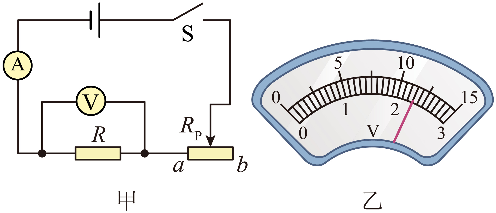

- A. 闭合开关前，滑动变阻器的滑片应移至a端
- B. 电流表的测量范围应该选择0~3A
- C. 图乙中电压表的读数为2.3V
- D. 多次测量求平均值是为了减小测量误差

【答案】C/D

【解析】A．闭合开关前，为了保护电路，滑动变阻器的滑片应移至阻值最大端，由图甲可知，滑动变阻器的滑片应移至b端，故A错误；
B．电源电压为3V，R的阻值约为10Ω，则滑动变阻器阻值为0时，电路中的最大电流\(I=\frac{U}{R}=\frac{3\text{V}}{10\text{ }\!\!\Omega\!\!\text{ }}=0.3\text{A}\)
由于电路中的最大电流小于0.6A，所以电流表的量程应该选择0~0.6A，故B错误；
C．由于电源电压为3V，所以R两端电压不会超过3V，故图乙中电压表选择0~3V量程，分度值为0.1V，示数为2.3V，故C正确；
D．测量R的阻值实验中，多次测量求平均值是为了减小测量误差，故D正确。
故选CD。

## 6. 单选题（难度：适中）

如图所示的实验电路，下列说法中错误的是（    ）

【答案】A

## 7. （难度：适中）

小明和小文用如图甲所示电路测量未知电阻<latex class="math-tex">\({{R}_{\text{x}}}\)</latex>的阻值。

## 8. （难度：适中）

关于“用电压表和电流表测量定值电阻的阻值”的实验，回答下列问题：

## 9. 单选题（难度：适中）

在“伏安法测电阻”的实验中，有两名同学分别选用定值电阻和小灯泡作为测量对象，在处理实验数据时，画出了定值电阻和小灯泡的<latex class="math-tex">\(U-I\)</latex>图像，分别如图甲、乙所示，则对于图像的分析，以下说法错误的是（    ）

【答案】A

## 10. 单选题（难度：适中）

如图甲、乙均为电学实验中常用的实验原理图，下列说法错误的是（    ）

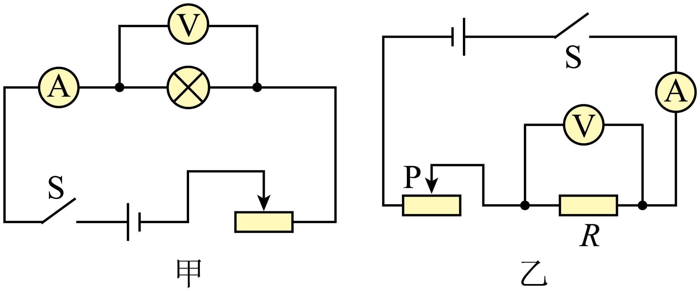

- A. 甲图可以测小灯泡额定功率，也可以探究电流与电压的关系
- B. 乙图可以测定值电阻的阻值，也可以探究电流与电阻的关系
- C. 乙图在“探究电流与电阻关系”的实验中，利用滑动变阻器控制电阻两端的电压不变
- D. 甲图测小灯泡电阻时，移动滑动变阻器滑片得到多组数据，不可以求平均值减小误差

【答案】A

【解析】A．甲图，通过改变滑动变阻器接入电路的电阻，可以测小灯泡额定功率，但是在“探究电流与电压的关系”实验中，需要保持定值电阻的阻值不变，而灯泡的电阻会随温度改变发生变化，故A错误，符合题意；
 BC．乙图可以根据\(I=\frac{U}{R}\)测定值电阻的阻值，在“探究电流与电阻关系”的实验中，需要保持电阻两端的电压不变，更换不同阻值的电阻时，通过调节滑动变阻器的阻值，控制电阻两端的电压不变，故BC正确，不符合题意；
 D．在“测量小灯泡电阻”的实验中，由于小灯泡的电阻随温度的变化而变化，不是一个定值，所以多次测量的目的不是求平均值减小实验误差，而是为了观察电阻随电压、电流的变化情况，故D正确，不符合题意。
故选A。

## 11. 单选题（难度：适中）

如图是测量小灯泡电阻的电路，闭合开关后，下列说法正确的是（    ）

【答案】A

## 12. 单选题（难度：适中）

小然同学用图方案进行了“测定值电阻的阻值”和“测小灯泡的电阻”两个实验，下列说法正确的是（    ）

【答案】A

## 13. 填空题（难度：适中）

测量小灯泡电阻的实验中，实验原理是___，小灯泡两端电压为2.6V时，与小灯泡串联的电流表的示数如图所示，通过小灯泡的电流为___A，此时小灯泡的电阻为___。（结果保留一位小数）

## 14. 单选题（难度：适中）

李华家的LED灯出现故障，他利用图甲所示的电路测量与灯珠串联的定值电阻R的阻值。电源电压为3V，R的阻值约为10Ω，闭合开关，调节滑动变阻器，电流表指针的位置如图乙所示。关于该实验，下列说法正确的是（    ）

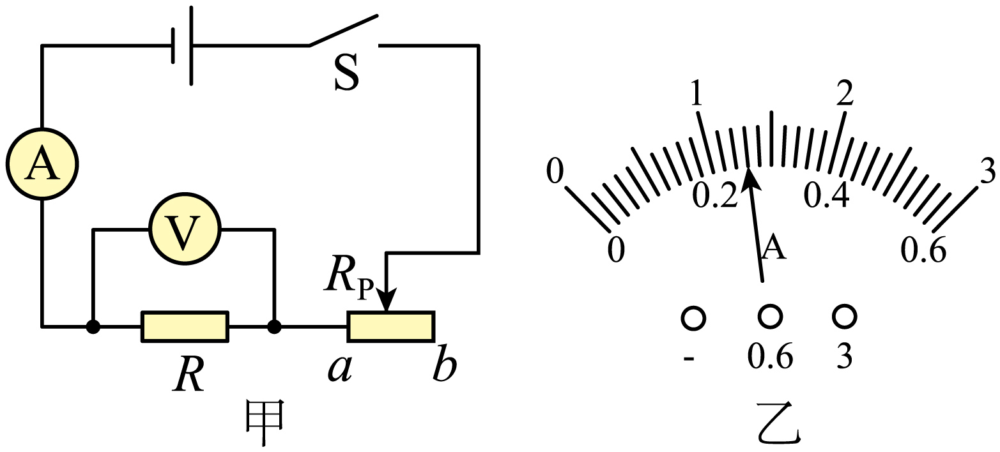

- A. 电压表的测量范围应选择0~15V
- B. 电流表的测量范围应选择0~3A
- C. 图乙所示的电流表的读数为0.26A
- D. 多次测量求平均值可让结论更具普遍性

【答案】C

【解析】由图可知，定值电阻R与滑动变阻器串联，电压表测量R两端的电压，电流表测量电路中的电流。
A．电源电压为3V，电压表与电阻R并联，测量R两端的电压。根据串联电路电压的特点，电阻R两端的电压不会超过电源电压3V，因此电压表应选择0~3V的测量范围，量程小，分度值小，测量误差小，故A错误；
B．当滑动变阻器接入电路的电阻为0时，电路中电流最大，电路中的最大电流约为\({{I}_{}}=\frac{U}{R}=\frac{3\text{V}}{10\Omega }=0.3\text{A}\)
为了减小读数误差，电流表应选择0~0.6A的测量范围，故B错误；
C．因为电流表选择0~0.6A的测量范围，分度值为0.02A，则图乙所示的电流表的读数为0.26A，故C正确；
D．本实验是测量定值电阻的阻值，多次测量求平均值的目的是为了减小实验误差，而不是为了让结论更具普遍性，故D错误。
故选C。

## 15. （难度：适中）

小聪从废旧收音机上拆下一个完好的定值电阻\(R\)，他想知道该电阻的阻值，采用“伏安法”进行测量，图甲实验所用电源电压为3V。

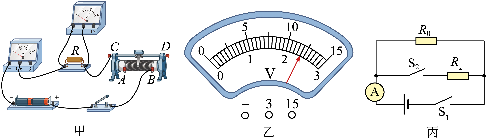

请用笔画线表示导线，补全图甲实物电路的连接；

闭合开关后，发现电压表有示数，电流表无示数，由此可判断产生的故障是；

排除故障后，正确连接电路。移动滑动变阻器滑片到某一位置时，发现电流表示数为0.24A，电压表示数如图乙所示，为\(\text{V}\)，则定值电阻\(R\)的阻值为\(\text{ }\!\!\Omega\!\!\text{ }\)；

为了减小实验误差，小聪应采取的措施是：；

【答案】

　

，电阻$R$处断路　，2.4/10，多次测量求平均值

【解析】伏安法测电阻，将待测电阻和电流表及滑动变阻器串联在电路中，电压表并联在电阻两端即可。

电流表没有示数说明电路断路，电压表有示数，说明电压表与电源相连，所以故障可能是定值电阻R断路。

[1]电压表选用的小量程，故分度值为0.1V，读数为2.4V。
[2]根据欧姆定律可得\(R=\frac{U}{I}=\frac{2.4\text{V}}{0.24\text{A}}=10\text{ }\!\!\Omega\!\!\text{ }\)

一次实验测得的结果误差较大，为了减小实验误差，应多次测量求平均值。

## 16. （难度：适中）

小明所在物理实验小组用“伏安法”测未知电阻的阻值。

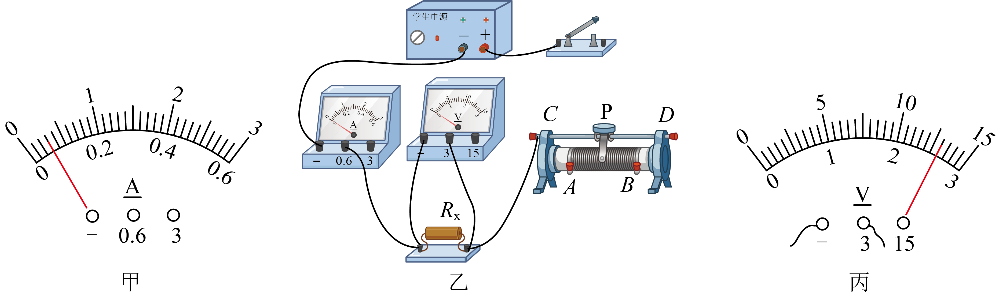

小明在检查仪器时，发现电流表的指针如图甲所示，则小明接下来的操作是对；

如图乙所示是小明测量定值电阻的实物图（不完整）。请用笔画线代替导线，连接成完整的电路。要求：滑动变阻器的滑片P向右移动时，电流表示数变小（请勿更改原有导线，导线不能交叉）；

为了保护电路，闭合开关前，应将滑动变阻器的滑片P置于（选填“A”或“B”）端；

小明闭合开关后，发现电流表示数为零，但电压表有示数，此时电路中的一处故障可能是；

小明排除故障后，移动滑动变阻器的滑片，当电流表的示数为0.2A，电压表的示数如图丙所示，则本次实验测得定值电阻\({{R}_{x}}\)的阻值是\(\Omega \)；

为减小实验误差，小明接下来的操作是。本实验中滑动变阻器除保护电路外的作用是：。

【答案】电流表调零　，

　

，<i>B</i><i>　</i>，待测电阻${{R}_{x}}$断路　，13　，移动滑动变阻器的滑片，改变待测电阻${{R}_{x}}$的电压和电流，多次实验并求电阻的平均值/调节待测电阻两端的电压

【解析】小明在检查仪器时，发现电流表的指针没有指在零刻度线，所以小明接下来的操作是对电流表调零。

滑动变阻器的滑片P向右移动时，电流表示数变小，则变阻器阻值变大，所以变阻器应选择左下接线柱串联到电路中，作图如下：

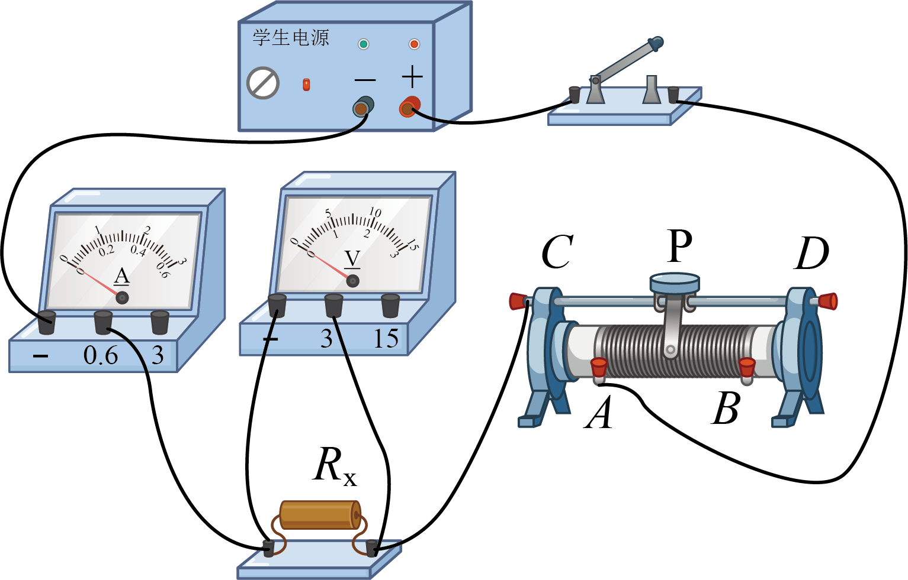

为了保护电路，闭合开关前，应将滑动变阻器的滑片P置于阻值最大处，即B端。

闭合开关后，发现电流表示数为零，说明发生断路，但电压表有示数，说明电压表两端与电源相通，此时电路中的一处故障可能是待测电阻\({{R}_{x}}\)断路。

如图丙所示，电压表选用小量程，分度值为0.1V，示数为2.6V，则定值电阻\({{R}_{x}}\)的阻值为\(R=\frac{U}{I}=\frac{2.6\text{V}}{0.2\text{A}}=13\Omega \)

[1][2]本实验是测量类实验，为减小实验误差，小明接下来的操作是移动滑动变阻器的滑片，改变待测电阻\({{R}_{x}}\)的电压和电流，多次实验并求电阻的平均值。所以本实验中滑动变阻器除保护电路外的作用是调节待测电阻两端的电压从而多次实验。

## 17. （难度：适中）

实践小组的同学们进行“伏安法测定小灯泡电阻”的实验，小灯泡的额定电压为2.5V（阻值约为\(10\text{ }\!\!\Omega\!\!\text{ }\)），滑动变阻器规格为“\(20\text{ }\!\!\Omega\!\!\text{ }\)  \(1\text{A}\)”。

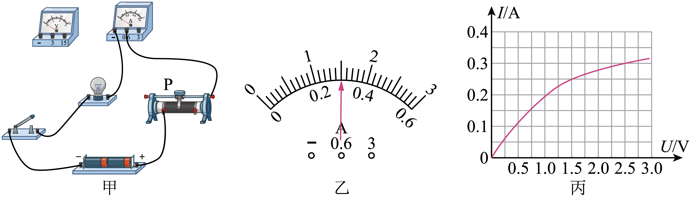

请你用笔画线代替导线，将图甲中的电路连接完整（导线不得交叉）。

滑动变阻器在实验中除保护电路外，还有作用。

经检查无误后，接通电路，向左移动滑动变阻器的滑片P，观察到表示数为时，表明小灯泡正常发光，此时电流表示数如图乙所示，则小灯泡正常发光时的阻值为\(\Omega \)。还可以计算灯泡的额定功率为\(\text{W}\)。继续向左移动滑片，则可能出现的现象有（写出一条即可）。

小明同学多次改变小灯泡两端的电压，测出对应的电流后，根据实验数据绘制了如图丙所示的\(U-I\)图像，图像不是一条经过原点的直线原因是：。

【答案】

　

，改变小灯泡两端的电压　，电压/2.5V/8.3/0.75/小灯泡变亮，小灯泡的电阻受温度的影响

【解析】由于小灯泡的额定电压为2.5V，所以电压表选用0~3V的量程，电压表与小灯泡并联且正接线柱与小灯泡的右接线柱相连，负接线柱与小灯泡的左接线柱相连，如图所示：

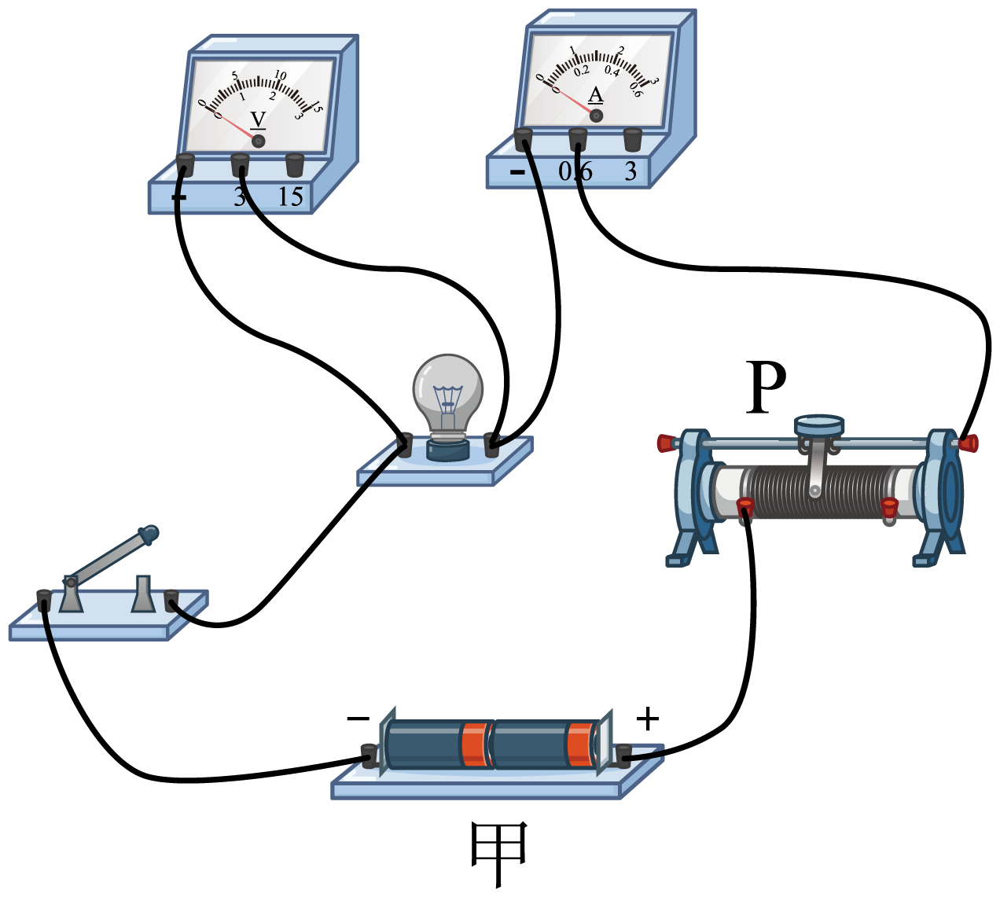

滑动变阻器的基本作用是保护电路，此实验中主要作用是改变小灯泡两端的电压，测出多组电压值和电流值。

[1][2]小灯泡在额定电压下正常发光，所以检查无误后，接通电路，向左移动滑动变阻器的滑片P，观察到电压表的示数为2.5V时，表明小灯泡正常发光。
[3][4]由图甲可知，电流表选用小量程0~0.6A，分度值为0.02A，电流表示数为0.3A，即小灯泡的额定电流为0.3A。根据\(I=\frac{U}{R}\)可知，小灯泡正常发光时的阻值为\({{R}_{\text{L}}}=\frac{{{U}_{\text{L}}}}{{{I}_{\text{L}}}}=\frac{\text{2}\text{.5V}}{\text{0}\text{.3A}}\approx 8.3\Omega \)
小灯泡的额定功率为\({{P}_{}}={{U}_{}}{{I}_{}}=2.5\text{V}\times 0.3\text{A}=0.75\text{W}\)
[5]滑片继续向左移动，滑动变阻器接入电路的电阻减小，根据\(I=\frac{U}{R}\)可知，电路中的电流增大，小灯泡两端的电压变大，根据\(P=UI\)可知，小灯泡的实际功率变大，即小灯泡变亮。

由图丙可知，绘制的U-I图像不是一条过原点的直线，表示小灯泡两端的电压和电流之比不是定值，原因是小灯泡的电阻受温度的影响。
 
14．小明从废旧玩具上拆下一个完好的定值电阻\(R\)，他想知道该电阻的阻值，采用“伏安法”进行测量，图甲实验电路所用电源的电压恒为3V。

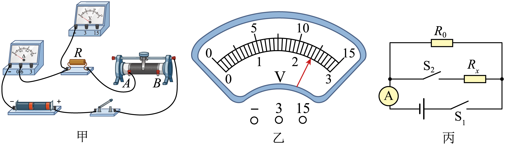

(1)请用笔画线表示导线，补全图甲实物电路的连接；
(2)闭合开关后，发现电流表有示数，电压表无示数，由此可判断产生的故障可能是______；
(3)排除故障后，正确连接电路。移动滑动变阻器滑片到某一位置时，发现电流表示数为0.20A，电压表示数如图乙所示，为______V，则定值电阻\(R\)的阻值为______\(\text{ }\!\!\Omega\!\!\text{ }\)；
(4)小明觉得一次实验测量结果不规范，想要多次测量求平均值减小误差，现在想要增大定值电阻\(R\)电压，滑动变阻器滑片应当向______滑动；
【答案】(1)

　(2)电阻R短路　(3)2.4　12　(4)左
【解析】（1）实验中电压表应与定值电阻\(R\)并联，电源电压为\(3\text{V}\)，所以电压表应选用小量程，作图如下：

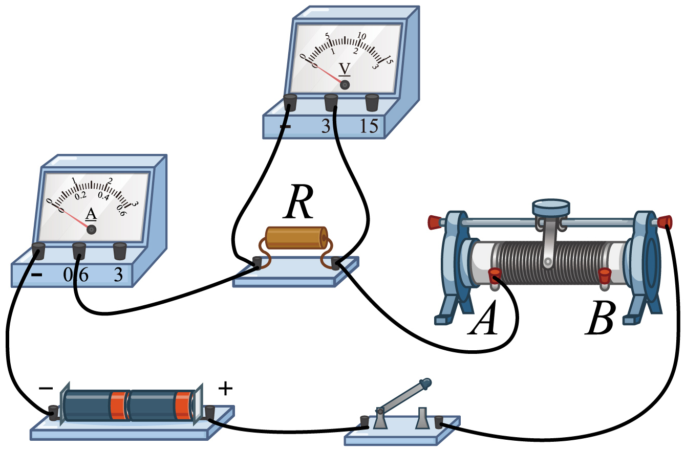

（2）闭合开关后，发现电流表有示数，则电路不可能断路，电压表无示数，则故障可能是与电压表并联的电阻\(R\)短路。
（3）[1][2]如图乙，电压表接入小量程，分度值为\(0.1\text{V}\)，读数为\(2.4\text{V}\)，则定值电阻\(R\)的阻值为\(R = \frac { U } { I } = \frac { 2 V } { 0 . 2 A } = 1 0 \Omega ??\)
（4）要增大定值电阻\(R\)电压，根据串联电压规律，应减小变阻器的电压，根据串联分压原理，应向左移动滑动变阻器滑片，减小变阻器阻值。
 
【题干】15．小明和小文用如图甲所示电路测量未知电阻\({{R}_{\text{x}}}\)的阻值。

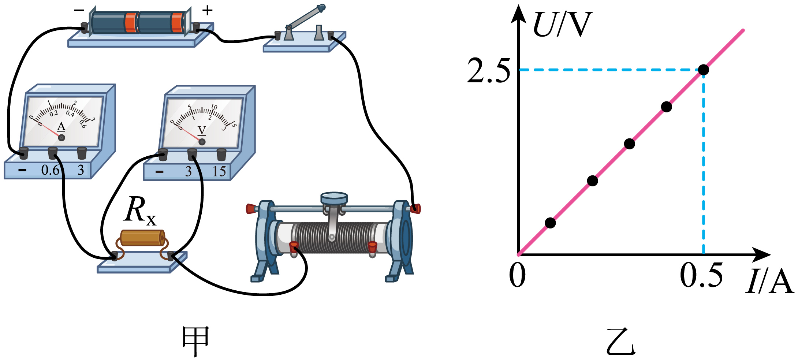

(1)此实验的原理是________。
(2)连接电路时，开关应该________。
(3)闭合开关，小明发现两电表均无示数，则故障原因可能是________。
(4)排除故障后，小明和小文配合进行实验，并根据数据画出如图乙所示的\(U-I\)关系图像，由图像可知，该待测电阻\({{R}_{\text{x}}}\)的阻值为________\(\Omega \)。多次实验的目的是________。
【答案】(1)\(R=\frac{U}{I}\)　(2)断开　(3)滑动变阻器断路　(4)5　取平均值，减小误差
【解析】（
