# 第二节 探究：电流与电压、电阻的关系（同步练习）

> 教材：物理·九年级全一册·沪科技版2024新教材 ｜ 来源：国家中小学智慧教育平台·在线练习 ｜ 共 161 题

## 1. 单选题（难度：适中）

关于欧姆定律，下列说法正确的是（   ）

【答案】A

## 2. （难度：适中）

对电流跟电压和电阻之间的关系进行大量实验研究，并发现\( I=\frac{U}{R}\)的物理学家是（　　）
A．牛顿  B．安培  C．欧姆  D．伏特

【答案】

C

【解析】德国物理学家欧姆最先通过实验归纳出一段导体中电流跟电压和电阻之间的关系\( I=\frac{U}{R}\) ，即欧姆定律，故C符合题意，ABD不符合题意。
故选C。

## 3. 单选题（难度：适中）

由欧姆定律公式<latex class="math-tex">\( I=\frac{U}{R}\)</latex>变形得<latex class="math-tex">\( R=\frac{U}{I}\)</latex>，下列说法中正确的是（    ）

【答案】A

## 4. 单选题（难度：适中）

下列说法正确的是（     ）

【答案】A

## 5. （难度：适中）

下列说法正确的是（   ）A．电压越大，电流一定越大  B．电阻越小，电流一定越大C．导体中电流为零时，电阻也为零  D．同一导体两端电压越大，电流越大

## 6. 单选题（难度：适中）

下列关于电流、电压、电阻关系的说法中正确的是（   ）

【答案】A

## 7. 单选题（难度：适中）

（本题正文受平台版权限制，题干见下方预览图：在学过欧姆定律后，同学们有以下认识，下列说法错误的是（_）

）

## 8. 单选题（难度：适中）

关于电流、电压和电阻的关系，下列说法正确的是（   ）

【答案】A

## 9. 单选题（难度：适中）

几位同学学习了欧姆定律后，根据\( I=\frac{U}{R}\)导出了\( R=\frac{U}{I}\)，于是他们提出了以下几种看法，你认为正确的是（　　）

- A. 当电压为零时，电阻R也为零
- B. 当电压增大2倍时，电阻R增大2倍
- C. 当电流强度增大2倍时，电阻R减小2倍
- D. 电阻是导体本身的性质，当电压为零时，电阻阻值不变

【答案】D

【解析】由\( R=\frac{U}{I}\)可知，导体的电阻等于导体两端的电压与通过它的电流的比值，而电阻是导体本身的一种属性，只与导体的材料、长度、横截面积和温度有关，与导体两端的电压和通过它的电流无关，当电压为零时，电阻阻值不变，故D正确，ABC错误。
故选D。

## 10. 单选题（难度：适中）

对欧姆定律的理解，下列说法中错误的是（　　）

【答案】A

## 11. 单选题（难度：适中）

（本题正文受平台版权限制，题干见下方预览图：由欧姆定律公式_latex_class=_math-tex_(_I=_frac{U}{R}_)_latex_变形得_latex_class=_math-tex_）

## 12. 单选题（难度：适中）

根据欧姆定律，以下说法中正确的是（　　）

【答案】A

## 13. 单选题（难度：适中）

关于欧姆定律公式<latex class="math-tex">\( I=\frac{U}{R}\)</latex>，下列说法正确的是（　　）

【答案】A

## 14. 单选题（难度：适中）

某物理兴趣小组的同学们就一些物理问题进行讨论，下列说法正确的是（　　）

- A. 根据\( R=\frac{U}{I}\)可知，电阻与电压成正比，与电流成反比
- B. 由公式\( R=\frac{U}{I}\)可知，当电压增大为原来的2倍时，电阻增大为原来的2倍
- C. 由公式\( U=IR\)可知，导体两端的电压跟通过导体的电流成正比
- D. 由\( I=\frac{U}{R}\)可知，通过导体的电流跟它两端的电压成正比，跟导体的电阻成反比

【答案】D

【解析】AB． 导体电阻是导体的一种性质，只与导体的材料、长度和横截面积以及温度有关，与电压、电流无关，故AB错误；
CD．电压是使电荷定向移动形成电流的原因，对于一个确定的导体来说，它两端电压越大，通过它的电流越大。电阻是导体对电流的阻碍作用，电压一定时，导体电阻越大，通过它的电流越小。所以，通过导体的电流跟它两端的电压成正比，跟导体的电阻成反比。故C错误，D正确。
故选D。

## 15. 单选题（难度：适中）

关于电学知识，下列说法不正确的是（　　）

- A. 由欧姆定律\( I=\frac{U}{R}\)变形可得\( R=\frac{U}{I}\)，说明导体的电阻与其两端电压成正比
- B. 摩擦起电的实质是电荷发生了转移
- C. 家庭电路中，同时工作的用电器越多，总电阻越小
- D. 电能表是测量电功的仪表

【答案】A

【解析】A．电阻是导体的固有属性，由材料、长度、横截面积和温度决定，与电压和电流无关，故A错误，符合题意；
B．摩擦起电的实质是原子核束缚电子能力不同，摩擦过程中电子发生了转移，使物体带电，故B正确，不符合题意；
C．家庭电路中的用电器通常并联连接，当同时工作的用电器增多时，并联支路增加，根据并联电路电阻关系可知，总电阻的倒数增大，因此总电阻减小，故C正确，不符合题意；
D．电能表是测量电路中消耗电能多少的仪表，即测量电功的仪表，故D正确，不符合题意。
故选 A。

## 16. 单选题（难度：适中）

对于欧姆定律的理解，下列说法正确的是（　　）

【答案】A

## 17. 单选题（难度：适中）

关于欧姆定律公式可变形为<latex class="math-tex">\( R=\frac{U}{I}\)</latex>，下列说法正确的是（    ）

【答案】A

## 18. （难度：适中）

根据欧姆定律公式<latex class="math-tex">\( I=\frac{U}{R}\)</latex>的变形式<latex class="math-tex">\( R=\frac{U}{I}\)</latex>及电阻的性质，可以判定（　　）A．当<latex class="math-tex">\( I\)</latex>变大时，<latex class="math-tex">\( \

## 19. 单选题（难度：适中）

关于导体的电阻的计算公式<latex class="math-tex">\( R=\frac{U}{I}\)</latex>，下列说法正确的是（　　）

【答案】A

## 20. 多选题（难度：适中）

由欧姆定律公式\( I=\frac{U}{R}\)变形得\( R=\frac{U}{I}\)，结合所学电学知识正确的是（　　）

- A. 导体的电阻跟通过导体的电流成反比
- B. 如果导体被拉长，则其电阻将变大
- C. 如果通过导体的电压变大，导体的电阻将变大
- D. 某一导体两端电压增大时，电流也增大，但其比值不变

【答案】B/D

【解析】A．电阻是描述导体对电流的阻碍作用的物理量，电阻是导体本身的性质，与通过导体的电流没有关系，故A错误；
B．如果导体被拉长，导体的材料不变，长度变长，横截面积变小，则其电阻将变大，故B正确；
C．电阻是导体本身的性质，与导体两端的电压无关，故C错误；
D．某一导体两端电压增大时，电阻是导体本身的性质，同一段导体，电阻不变，根据\( I=\frac{U}{R}\)可知，某一导体两端电压增大时，电流也增大，根据\( R=\frac{U}{I}\)可知，电压与电流的比值是电阻，故当电压增大时，电阻的大小不变，电压与电流的比值大小不变，故D正确。
故选BD。

## 21. 多选题（难度：适中）

关于电流、电压和电阻，下面说法正确的是（　　）

【答案】A

## 22. 填空题（难度：适中）

两个电路元件A和B中的电流与其两端电压的关系如图所示，若把A、B并联在1V的电源两端，则干路中的电流是___。

## 23. 多选题（难度：适中）

在研究“一定电压下，电流与电阻的关系”时，电路如图所示。电源电压恒为3V，滑动变阻器上标有“15Ω 1A”字样。在a、b间先后接入不同阻值的定值电阻，移动滑片P，使电压表示数为1.5V，读出电流表的示数。当20Ω的电阻接入a、b间时，电压表示数始终无法达到1.5V，其原因可能是（　　）

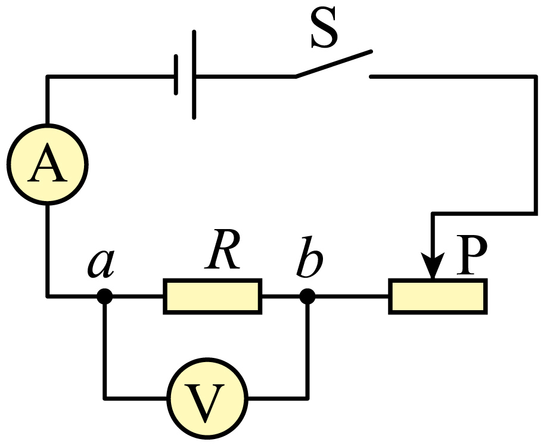

- A. 滑动变阻器的最大阻值太小
- B. 20Ω的阻值太小
- C. 电源电压3V太高
- D. 控制的电压1.5V太低

【答案】A/C/D

【解析】A．由图可知，定值电阻与滑动变阻器串联，电压表测量定值电阻两端的电压，当电压表示数为1.5V，定值电阻阻值为20Ω时，因电源电压为3V，此时根据串联电路电压规律可知，滑动变阻器两端电压也为1.5V，因为串联电路电流相等，所以此时滑动变阻器需要接入电路电阻也为20Ω。因为滑动变阻器的最大电阻\( 15\text{Ω}\)小于\( 20\text{Ω}\)，所以滑动变阻器的最大阻值太小有可能，故A正确；
B．因串联电路中总电阻等于各分电阻之和，所以电路中的电流：\( I=\frac{U}{R+{R}_{\mathrm{滑}}}\)，电压表的示数：\( {U}_{\text{R}}=IR=\frac{U}{R+{R}_{\mathrm{滑}}}R=\frac{U}{1+\frac{{R}_{\mathrm{滑}}}{R}}\)
当\( R=20\text{Ω}\)，\( {R}_{\mathrm{滑}}=15\text{Ω}\)时，\( {U}_{\text{R}}=\frac{U}{1+\frac{{R}_{\mathrm{滑}}}{R}}=\frac{3\text{V}}{1+\frac{15\text{Ω}}{20\text{Ω}}}=\frac{12}{7}\text{V}\approx 1.7\text{V}\)
根据串联分压可知，定值电阻的阻值越大，其两端电压越大，若认为20Ω的定值电阻阻值太小，将其换成阻值更大的电阻，其两端电压将大于1.7V，即电压表示数始终无法达到1.5V，故B错误；
C．电源的电压减小时，R两端分得的电压减小，可以使电压表的示数等于1.5V，所以电源电压3V太高有可能，故C正确；
D．由B选项可知，将20Ω的定值电阻接入电路中时，定值电阻两端电压约为1.7V，而现在控制电压为1.5V，因此控制的电压1.5V太低，可以提高控制的电压，例如可以使其达到2V即可完成实验，故D正确。
故选ACD。

## 24. 多选题（难度：适中）

如图，在做“探究电流与电阻的关系”的实验中，电源电压恒为6V，滑动变阻器规格为“20Ω，1A”，实验中控制定值电阻两端的电压为2.5V。当把定值电阻R的电阻由10Ω更换为15Ω进行操作时，无论怎样移动滑动变阻器滑片都无法使电压表达到规定数值，为继续完成探究，下列说法正确的是（    ）

【答案】A

## 25. 多选题（难度：适中）

某实践小组在做“探究电流跟电压的关系”实验过程中，经过几次实验探究，如图甲、乙、丙所示依次改进了实验电路图。下列说法正确的是（    ）

【答案】A

## 26. 多选题（难度：适中）

如图所示的电路图，在A、B两点间分别接入不同元件，可以进行不同的实验。下列描述正确的是（   ）

【答案】A

## 27. （难度：适中）

如图是小华同学按照物理课本探究“电流与电压关系”的实物图。请完成实物图的连接（电源电压为3V，要求滑片P向左滑时接入电阻变大）。

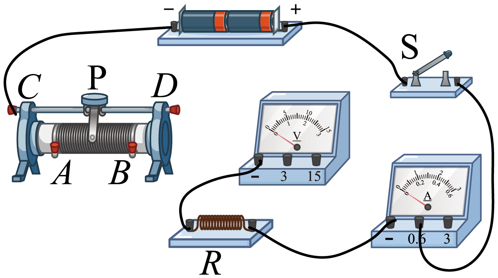

【答案】

 

【解析】探究“电流与电压关系”时，电压表与定值电阻并联，电源电压为3V，定值电阻两端电压不会超过3V，所以电压表选用小量程；滑动变阻器要与定值电阻串联，要求滑片P向左滑时接入电阻变大，故变阻器右下接线柱连入电路中，如图所示：

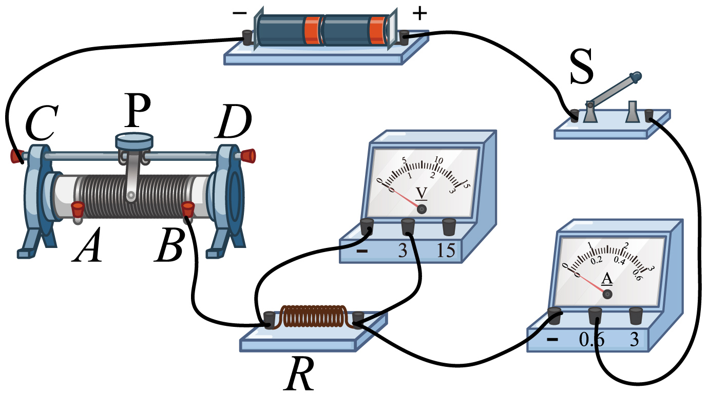

## 28. （难度：适中）

小明和小华一起探究电流与电阻的关系。请用笔画线代替导线将图中的电路补充完整，使滑动变阻器的滑片向左移动时电流变大。

## 29. 填空题（难度：适中）

对同一导体来说，其电阻是导体本身的一种性质，在温度不变时，其阻值通常___（选填“A．改变”或“B．不变”），此时通过它的电流与它两端的电压成___比。

## 30. 填空题（难度：适中）

如图甲所示，电源电压不变，定值电阻<latex class="math-tex">\( {R}_{1}=5\text{Ω}\)</latex>，灯L的电流I随其两端的电压U的变化曲线如图乙所示，闭合开关S，调节滑动变阻器<latex class="math-tex">\( {R}_{\text{P}}\)</latex>的阻值，当电流表示数为0.4A时，此时电压表示数为___V；继续调节<late

## 31. 单选题（难度：适中）

如图所示是两定值电阻甲和乙的电流与电压关系图像，下列说法中正确的是（　　）

【答案】A

## 32. 单选题（难度：适中）

小雅同学利用如图所示的电路探究“电流与电压的关系”，下列说法正确的是（    ）

【答案】A

## 33. 填空题（难度：适中）

在综合实践活动课上，小龙同学设计了如图甲所示的模拟调光灯电路。电源电压恒定，R1为定值电阻。闭合开关S后，将滑动变阻器R2的滑片P由最右端向左移动，直至灯泡L正常发光。此过程中，电流表A的示数随两电压表V₁、V₂（电压表V₂未画出）示数变化关系图像如图乙所示。小灯泡正常发光时的电流为A；电源电压为V。

【答案】0.5，4.5

【解析】[1][2]由图甲得，\( {R}_{1}\)、\( {R}_{2}\) 和灯泡串联，电流表测量电路电流，电压表V₁测量灯泡电压。
灯泡的电压变大，电流变大，图像中①表示灯泡的I-U图像，灯泡正常发光时，电路中电流最大为\( 0.5\mathrm{A}\)，此时灯泡电压为\( 2.5\mathrm{V}\)，由欧姆定律得，小灯泡正常发光时的电阻为\( {R}_{L}=\frac{{U}_{L}}{{I}_{L}}=\frac{2.5\mathrm{V}}{0.5\mathrm{A}}=5\mathrm{\Omega }\)
由图像得，电压表\( {\mathrm{V}}_{2}\)随电流增大而减小，说明电压表\( {\mathrm{V}}_{2}\)测量\( {R}_{1}\text{、}{R}_{2}\)电压或者测量\( {R}_{2}\)电压，由图像得，电流变化相同时，两电压表示数变化不同，则电压表\( {V}_{2}\)测量\( {R}_{2}\)电压，由欧姆定律得\( {R}_{1}=\frac{\mathrm{\Delta }U}{\mathrm{\Delta }I}=\frac{\left(3.5\mathrm{V}-2\mathrm{V}\right)-\left(1.5\mathrm{V}-0.5\mathrm{V}\right)}{0.4\mathrm{A}-0.2\mathrm{A}}=\)2.5Ω
利用串联电路的电压关系可知电源电压\( U={U}_{1}+{U}_{2}+{U}_{L}=0.2\mathrm{A}\times 2.5\mathrm{\Omega }+3.5\mathrm{V}+0.5\mathrm{V}=4.5\mathrm{V}\)

## 34. 填空题（难度：适中）

闭合如图甲所示电路的开关，将滑动变阻器的滑片由最右端移到最左端的过程中，电压表与电流表的示数变化的图像如图乙所示。则电源电压为V，定值电阻\( {R}_{0}\)的阻值为Ω。

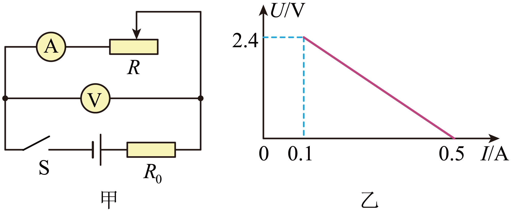

【答案】3，6

【解析】[1][2]定值电阻R0与变阻器R串联，电压表测变阻器两端电压。由图像可以看出，变阻器滑片在右端时，电压表示数为2.4V，电流表示数为0.1A，此时电源电压表示\( U=0.1\text{A}\times {R}_{0}+2.4\text{V}\)……①
当滑片移到左端时，变阻器连入的阻值为0，电流为0.5A，电源电压为\( U=0.5\text{A}\times {R}_{0}\)……②
联立①②式解得\( {R}_{0}=6\mathrm{\Omega }\)，电源电压为\( U=3\text{V}\)

## 35. 填空题（难度：适中）

在某一温度下，两个电路元件甲和乙中的电流与电压的关系如图所示，乙的电阻是___<latex class="math-tex">\( \text{Ω}\)</latex>，将甲、乙串联在<latex class="math-tex">\( 4\text{V}\)</latex>的电源两端，则流过元件甲、乙的电流是___A。若将甲、乙并联后接在1V的电源两端，那么流过干路的电流是___A。

## 36. 多选题（难度：适中）

在“探究电流与电阻关系”实验中，某同学根据实验数据作出如图所示的图像。下列说法正确的有（　　）

【答案】A

## 37. 填空题（难度：适中）

如图甲所示，是小灯泡的<latex class="math-tex">\( I-U\)</latex>图像，将小灯泡与定值电阻R接入如图乙所示电路中，若闭合开关<latex class="math-tex">\( {\text{S}}_{\text{1}}\)</latex>、<latex class="math-tex">\( {\text{S}}_{\text{2}}\)</latex>时，电

## 38. 填空题（难度：适中）

如图甲所示的电路，开关闭合后，滑动变阻器R2滑片从最左端移动到右端，电路中某两个电压表的示数随电流变化的图像如图乙所示，则电源电压为___V，滑动变阻器的最大阻值为___Ω。

## 39. （难度：适中）

有如下器材：电压为3V的电源、电压表、电流表、定值电阻R（5Ω、10Ω、20Ω、30Ω）、标有“10Ω、1A”字样的滑动变阻器<latex class="math-tex">\( {R}_{p}\)</latex>、开关及导线若干。

## 40. 多选题（难度：适中）

如图是电学中重要实验电路图，利用此电路图可以完成多个电学实验。若电源电压保持不变，不可忽略温度对灯丝电阻的影响，闭合开关S，下列说法正确的是（　　）

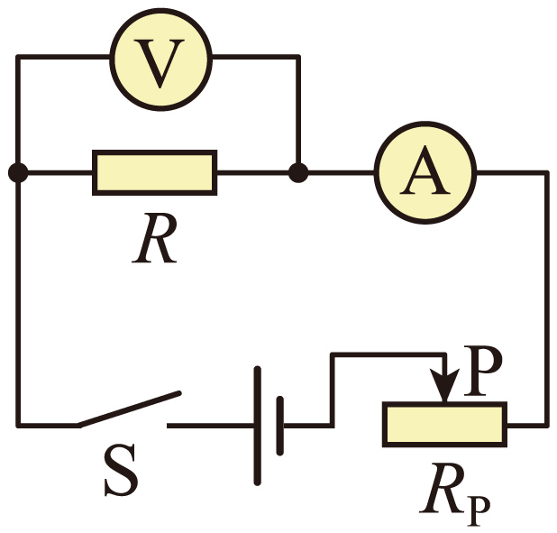

- A. 若将定值电阻\( R\)换成小灯泡，可以探究电流与电压的关系
- B. 若探究电流与电阻关系，定值电阻\( R\)由5\( \text{Ω}\)换成10\( \text{Ω}\)后，为完成实验，应将滑片左移
- C. 若要测量定值电阻\( R\)的值，可移动滑片记录多组数据，算出多个电阻值求其平均值，可以减小误差
- D. 上述三个实验中，滑动变阻器的作用相同，都是为了改变被测电阻\( R\)（或小灯泡电阻）的大小

【答案】B/C

【解析】分析电路，定值电阻R与滑动变阻器串联，电压表测R两端电压，电流表测电路电流。
A．探究电流与电压的关系时，需要控制电阻大小不变，小灯泡的灯丝电阻会随温度升高而增大，无法保证电阻恒定，因此不能用小灯泡完成该实验，故A错误；
B．探究电流与电阻的关系时，需要控制定值电阻两端电压不变，定值电阻\( R\)由\( \text{5Ω}\)换成\( \text{10Ω}\)后，根据串联分压原理，定值电阻两端电压会升高；要使电压回到原值，需增大滑动变阻器接入的电阻（分担更多电压），由图可知，滑片左移时滑动变阻器接入电阻变大，故B正确；
C．测量定值电阻的阻值时，移动滑片记录多组电压、电流数据，计算出多个电阻值再求平均值，能减小实验的偶然误差，故C正确；
D．探究电流与电压的关系：改变定值电阻两端电压，同时保护电路；探究电流与电阻的关系：控制定值电阻两端电压不变，同时保护电路；测量定值电阻阻值：改变定值电阻两端电压，测多组数据减小误差，同时保护电路，滑动变阻器不能改变被测电阻R（或小灯泡）的阻值，只是改变电路中的电流和电压。故D错误。
故选BC。

## 41. （难度：适中）

在“探究电压一定时电流与电阻的关系”实验中，实验器材有电压为6V的电源、电流表、电压表、滑动变阻器（40Ω　0.5A）和开关各一个，定值电阻4个（5Ω、10Ω、20Ω、25Ω）及导线若干。

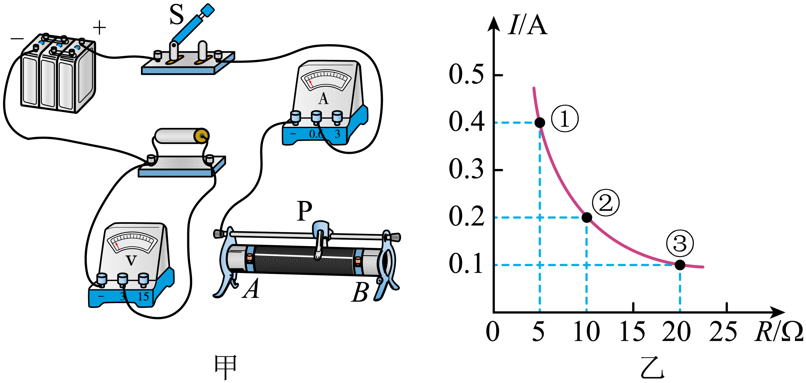

请用笔画线代替导线，将图甲电路连接完整（要求滑片P向A端滑动时，电流表示数变大）。

在连接电路时应开关；正确连接电路后，试触时，发现电压表指针迅速偏向最右端，电流表示数为零，则电路中出现的故障可能是定值电阻。

排除故障后，做了三次实验，并根据数据描绘出了如图乙所示的图像。三次实验中，滑片P的位置最靠近B端的是第（选填“①”“②”或“③”）次实验。分析图乙中的图像，可得出结论：导体两端的电压一定时，。

当改用25Ω的定值电阻继续做实验时，发现无论怎样移动滑片P，都无法使定值电阻两端的电压达到实验要求的值。仔细分析发现，可以采用（选填“增大”或“减小”）电源电压的方法来继续完成该实验。

实验中不能用小灯泡替换定值电阻，原因是。

【答案】

 

，断开/断路，③/通过导体的电流与导体的电阻成反比，减小，小灯泡灯丝的电阻随温度的变化而变化

【解析】要求滑片P向A端滑动时电流表示数变大，说明滑动变阻器接入电路的电阻变小，因此应将A接线柱与定值电阻的右端相连，这样滑片向A端滑动时，接入电路的电阻丝长度变短，电阻变小。如图所示：

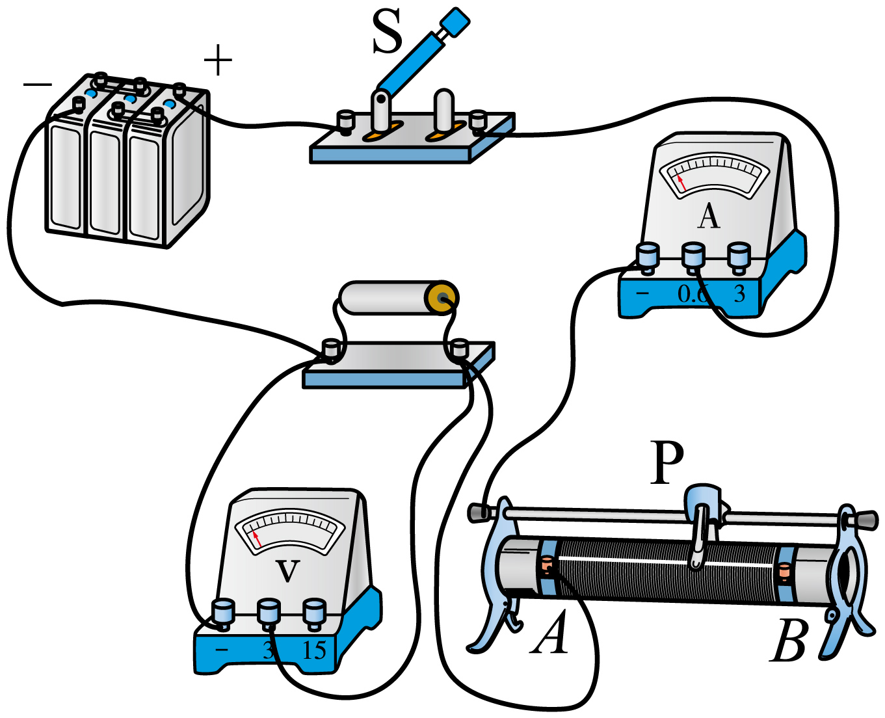

[1]为了保护电路，连接电路时应断开开关。
[2]试触时电压表指针迅速偏向右端，电流表示数为零，说明电压表串联在电路中，故障可能是定值电阻断路，此时电压测量电源电压，电流表无电流通过。

[1]滑动变阻器的滑片越靠近B端，接入电路的电阻越大。由图乙可知，第③次实验的定值电阻最大，为25Ω，根据串联电路分压规律，此时滑动变阻器需要接入更大的电阻才能保持定值电阻两端电压不变，因此滑片P最靠近B端的是第③次实验。
[2]分析图乙图像，可得出结论：导体两端的电压一定时，通过导体的电流与导体的电阻成反比。

当改用25Ω的定值电阻时，根据串联分压规律，定值电阻两端的电压会偏高。若无论怎样移动滑片都无法使定值电阻两端电压达到实验要求，说明滑动变阻器的最大阻值不足。此时可以减小电源电压，使定值电阻两端的电压更容易调整到实验要求的值。

小灯泡的灯丝电阻会随温度变化而改变，而本实验需要控制电阻不变，探究电流与电阻的关系，因此不能用小灯泡替换定值电阻。

## 42. 单选题（难度：适中）

如图是电阻甲和电阻乙的U—I关系图像，下列说法正确的是（   ）

【答案】A

## 43. （难度：适中）

额定电压均为6V的甲、乙两灯，<latex class="math-tex">\( I-U\)</latex>图线如图所示，下列分析正确的是（　　）①甲、乙两灯的电阻均随电压增大而减小②甲、乙两灯的额定功率之比为<latex class="math-tex">\( 2:1\)</latex>③甲、乙两灯串联接在电压为8V的电源两端时，乙灯更亮④甲、乙两灯并联接在电压为3V的电源两端时，乙灯更亮A．

## 44. 填空题（难度：适中）

如图为电学知识部分结构图，请补充完整。

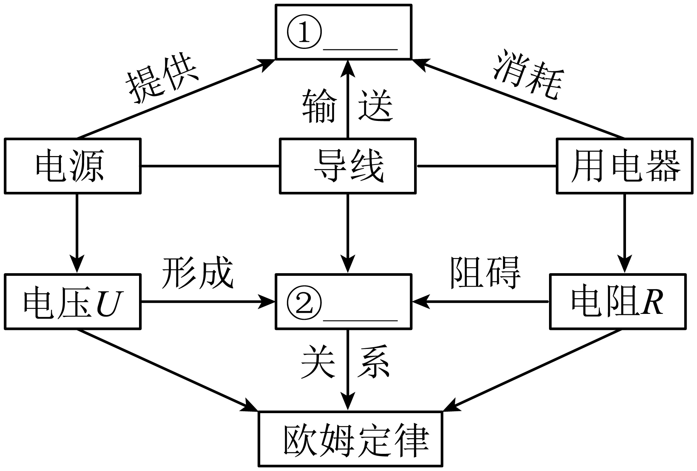

①；②。（选填“电流”、“电压”、“电阻”、“电能”）

【答案】电能，电流

【解析】[1][2]如图，电源的作用是为电路提供电能，因此①为电能；电源两端存在电压，导线中的自由电子在电压的作用下发生定向移动，形成电流，②为电流。

## 45. 单选题（难度：适中）

一定值电阻和灯泡的I－U图像如图所示，下列说法错误的是（　　）

【答案】A

## 46. 单选题（难度：适中）

小陈在学习物理的过程中做了很多笔记，下面是他画的物理量的变化图像，其中只有一个是正确的，这个是（　　）

- A. 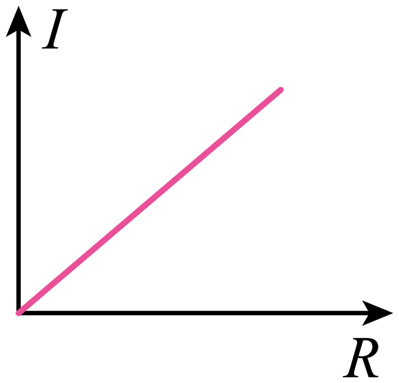
电压一定时，电流与电阻的关系
- B. 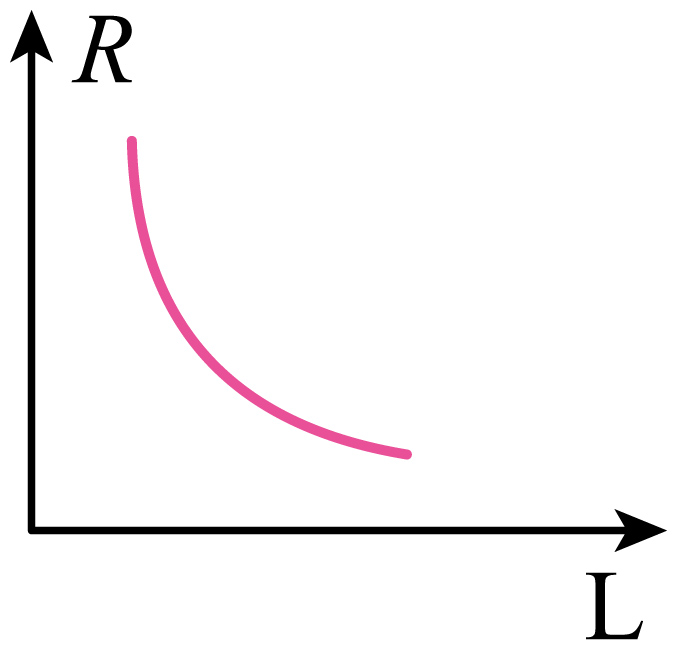
材料和横截面积相同时，导体的电阻与长度的关系
- C. 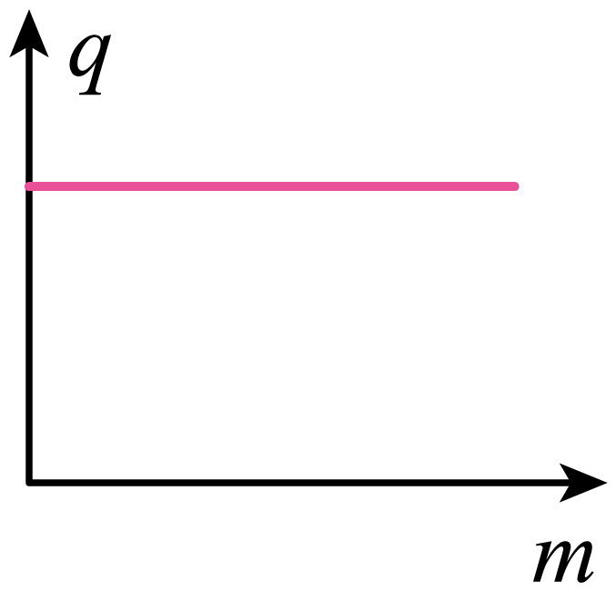
同种燃料的热值与其质量的关系
- D. 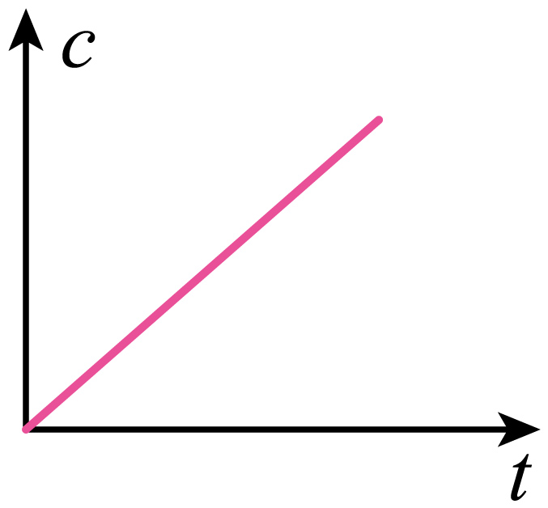
同种物质的比热容与温度的关系

【答案】C

【解析】A．导体两端的电压一定时，通过导体的电流与导体的电阻成反比，图中是正比例函数的图像，故A错误；
B．材料和横截面积相同时，导体的电阻与长度成正比，图中是反比例函数的图像，故B错误；
 C．燃料的热值只与燃料的种类有关，与燃料的质量、体积等无关，其图像应该为平行于横轴的直线，故C正确； 
D．比热容是物质的一种属性，与物质的种类，物态有关，与物质的温度无关；同种物质在同一物态的不同温度时，比热容不变，故D错误。
故选C。

## 47. 填空题（难度：适中）

如图是电阻甲和乙的I-U图像，若将甲、乙并联在2.5 V的电路中，甲、乙的电功率之比为___；若将甲、乙串联在电路中，当两者电阻相同时，电源电压为___V。

## 48. （难度：适中）

小昊用图甲所示电路探究电流与电压、电阻的关系，实验器材如下：电源（电压为3V），电流表（量程0~0.6A）， 电压表（量程0~3V） ， 滑动变阻器（0~15Ω、允许通过的最大电流为0.5A），阻值分别为5Ω、10Ω、15Ω、20Ω、25Ω的五个定值电阻，开关、导线若干。

## 49. （难度：适中）

电流、电压和电阻是电学中最基本的三个物理量。小康用如图甲所示的电路探究电流与电压、电阻的关系。电源电压恒为4.5V，滑动变阻器最大阻值20Ω。

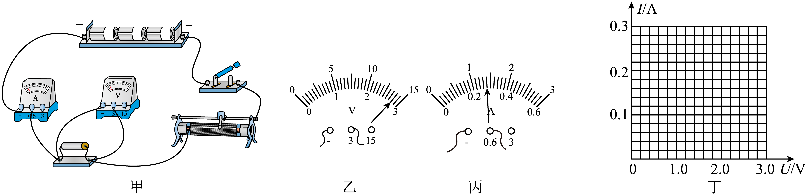

他先用阻值10Ω的定值电阻探究电流与电压的关系。
实验次序
1
2
3
4
5

电压U/V
1.6
2.0
2.2
2.4
a

电流I/A
0.16
0.20
0.22
0.24
b

①闭合开关前，应将滑动变阻器的滑片移到，否则，闭合开关时（填“电流表”或“电压表”）指针的偏转可能超出所用量程。
②闭合开关，移动滑片，记录了如下数据。第5次的电压表和电流表的示数如图乙、丙所示，请将示数填入表中a、b。
③请在图丁中描出表中前4次实验各组数据对应的点，并根据描出的点画出I-U图像。
④分析表中数据或图像的特点，可得出：电阻一定时，电流与电压成正比。得出此结论的理由是。

探究电流与电阻的关系，将5Ω电阻接入电路，记录电流表示数为0.3A；将电阻更换为10Ω，移动滑片直至电压表示数为V，记录电流表示数；再将电阻更换20Ω，发现无法完成实验。在电流表和电压表保持小量程不变的情况下，从本实验可行性与安全性考虑，应控制电阻两端的电压范围为。

【答案】最大阻值处/最右端/电流表/2.8/0.28/ /每次电压与电流的比值相等，且电流随电压的增加而增加，1.5/2.25~3V

【解析】[1][2]闭合开关前滑片未移到最右端，即最大阻值处，电路总电阻过小，电流过大，可能超出电流表量程，电压表测定值电阻电压，初始时电压不会过大，故是电流表指针偏转可能超量程。
[3][4]电压表若用0-3V量程，分度值0.1V，图乙指针指向2.8V；电流表若用0-0.6A量程，分度值0.02A，图丙指针指向0.28A。
[5]在I-U坐标系中，依次标出（1.6，0.16）、（2.0，0.20）、（2.2，0.22）、（2.4，0.24）这些点，用平滑直线连接，直线过坐标原点。如图所示：

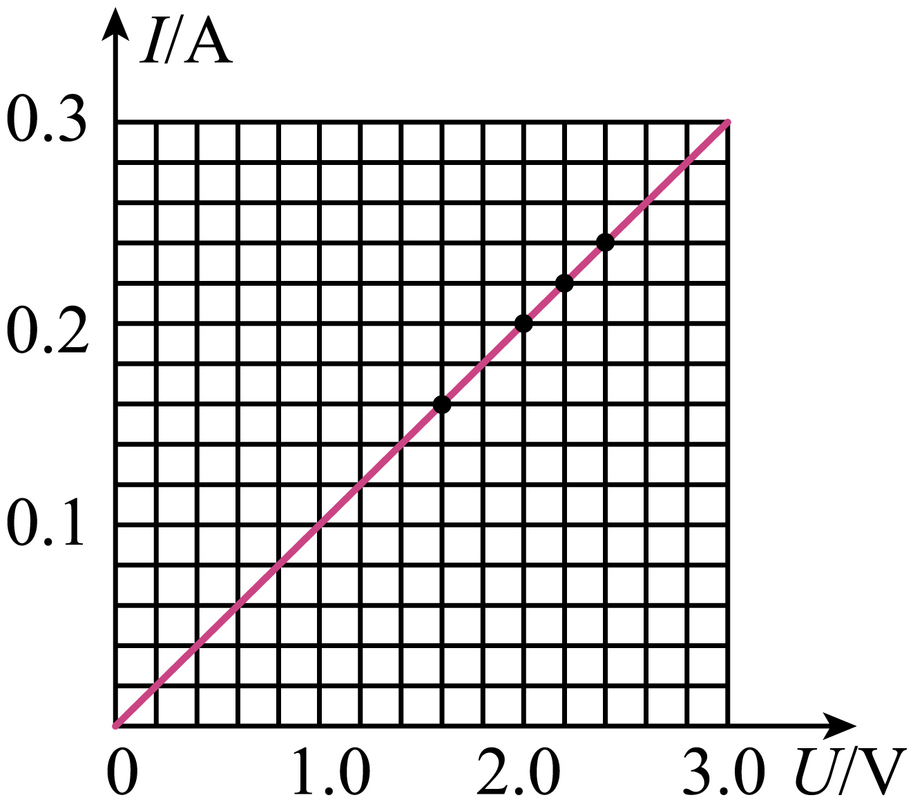

[6]电阻一定时，电压与电流的比值始终等于定值电阻阻值（10Ω），或I-U图像是过原点的倾斜直线，符合正比例函数特征，故可得结论为：电阻一定时，电流与电压成正比。

[1]探究电流与电阻关系时控制定值电阻两端电压不变。5Ω电阻接入时，电压\( U=IR=\text{0.3A}\times \text{5}\mathrm{\Omega }\text{=1.5V}\)
[2]更换电阻后需保持该电压不变。当定值电阻\( 2\text{0Ω}\)（最大），滑动变阻器\( {R}_{\mathrm{滑}}=20\text{Ω}\)（最大）时，根据串联分压原理可得\( \frac{{U}_{R}}{20\mathrm{\Omega }}=\frac{4.5\mathrm{V}-{U}_{R}}{20\mathrm{\Omega }}\)
解得\( {U}_{R}=2.\text{25V}\)，这是能控制的最小电压。电路中电流不能超过电流表0.6A量程，当\( R=5\text{Ω}\)时，U最大不超过\( 0.6\text{A}\times \text{5Ω=3V}\) 
同时也不能超过电源电压，故最大控制电压3V。即控制电阻两端电压范围为2.25~

## 50. 填空题（难度：适中）

用相同的材料制成长度相同的电阻\({R}_{1}\)、\({R}_{2}\)，它们的\(I-U\)图像如图所示。由图可知，两电阻中横截面积较大的是电阻。

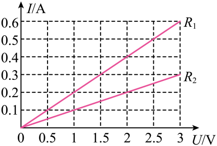

【答案】$ {R}_{1}$　

【解析】由图像可知，当\( U=3\text{V}\)时，通过\( {R}_{1}\)的电流\( {I}_{1}=0.6\text{A}\)，由\( I=\frac{U}{R}\)可得，\( {R}_{1}=\frac{U}{{I}_{1}}=\frac{3\text{V}}{0.6\text{A}}=5\text{Ω}\)
当\( U=3\text{V}\)时，通过\( {R}_{2}\)的电流\( {I}_{2}=0.3\text{A}\)，\( {R}_{2}=\frac{U}{{I}_{2}}=\frac{3\text{V}}{0.3\text{A}}=10\text{Ω}\)
\( {R}_{1}<{R}_{2}\)，\( {R}_{1}\)、\( {R}_{2}\)的材料、长度相同，因此横截面积较大的是电阻\( {R}_{1}\)。

## 51. （难度：适中）

某导体两端的电压为4V时，流过它的电流为0.5A，若该导体两端的电压变为原来的2倍，则导体的电阻和导体中的电流分别为（    ）A．16Ω  0.5A  B．16Ω  1A  C．18Ω  0.5A  D．8Ω  1A

## 52. （难度：适中）

有甲、乙两段导体，分别接在相同的电源电压下，通过甲导体的电流比通过乙导体的电流小，则（　　）A．甲导体的电阻大，导电能力弱  B．乙导体的电阻大，导电能力弱C．两导体的电阻一样大  D．不能确定两导体电阻的大小关系

## 53. （难度：适中）

一定值电阻两端的电压为4V时，通过的电流为1A。若电压减少到2V时，则通过的电流变为（　　）
A．0.25A  B．0.5A  C．1A  D．2A

【答案】

B

【解析】根据题意可得定值电阻的阻值为
\( R=\frac{U}{I}=\frac{4\text{V}}{1\text{A}}=4\mathrm{\Omega }\) 
若电压减少到2V时，则通过的电流变为
\( {I}_{1}=\frac{{U}_{1}}{R}=\frac{2\text{V}}{4\mathrm{\Omega }}=0.5\text{A}\) 
故ACD不符合题意，B符合题意。
故选B。

## 54. （难度：适中）

两个定值电阻R1=10Ω，R2=20Ω，串联接在6V电源上，R1两端电压为（  ）A．2V  B．3V  C．4V  D．6V

## 55. （难度：适中）

某导体两端电压为6V时，通过的电流为0.3A；若电压增大到9V，则通过的电流为（  ）
A．0.15A  B．0.3A  C．0.45A  D．0.6A

【答案】

C

【解析】根据欧姆定律\( I=\frac{U}{R}\)可得导体的电阻\( R=\frac{U}{I}=\frac{6\mathrm{V}}{0.3\mathrm{A}}=20\mathrm{\Omega }\)
电阻是导体本身的一种性质，与电压和电流无关，所以当电压增大到9V时，电阻仍为20Ω。此时通过的电流\( {I}^{\text{'}}=\frac{{U}^{\text{'}}}{R}=\frac{9\text{V}}{20\text{Ω}}=0.45\text{A}\)
故C符合题意，ABD不符合题意。
故选C。

## 56. （难度：适中）

如图，当<latex class="math-tex">\( {\text{S}}_{1}\)</latex>断开，<latex class="math-tex">\( {\text{S}}_{2}\)</latex>闭合；<latex class="math-tex">\( {R}_{1}\)</latex>与<latex class="math-tex">\( {R}_{2}\)</latex

## 57. （难度：适中）

随着超导材料突破，部分城市主干电网采用超导电缆输电，其电阻在低温下可视为零。低温环境下，加在超导电缆上的电压一定时，通过电缆的电流大小取决于（    ）
A．用电器  B．材料长度  C．材料横截面积  D．材料种类

【答案】

A

【解析】根据欧姆定律 ，当电压一定时，电流由总电阻决定。超导电缆的电阻在低温下可视为零，所以此时电路中的总电阻仅由用电器决定，从而影响电流大小；材料长度、横截面积和种类是导体电阻的影响因素，但超导电缆的电阻为零，这些因素不再起作用，故A符合题意，BCD不符合题意。
故选A。

## 58. （难度：适中）

R1、R2、R3是三个定值电阻，将它们并联起来接入电路，如图甲所示，闭合开关后，测得通过每个电阻的电流为I1＜I2＜I3；若将它们串联起来接入电路，如图乙所示，闭合开关后，各电阻两端的电压关系为（　　）  A．U1＞U2＞U3  B．U1＝U2＝U3  C．U3＞U2＞U1  D．U2＞U1＞U3

## 59. （难度：适中）

某导体两端电压为3V时，通过电流为0.2A，则其电阻为（　　）A．0.6Ω  B．6Ω  C．15Ω  D．30Ω

## 60. （难度：适中）

如图所示，电源电压不变，闭合开关S，滑片P向右滑动过程中，下列说法正确的是（　　）

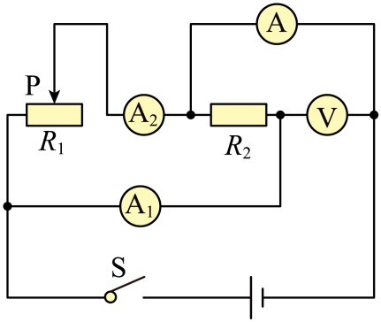
  
A．电流表A₁的示数变小  B．电流表A₂的示数不变
C．电压表V与电流表A示数的比值变大  D．电压表V与电流表A示数的乘积变大

【答案】

C

【解析】由电路图知，R1和R2并联，电流表A₁测量通过R2电流，电流表A₂测量通过R1电流，电流表A测量干路电流，电压表测量电源电压；由于电源电压不变，移动滑片时，电压表示数不变；闭合开关，当滑动变阻器的滑片P向右移动时，由于并联电路各支路互不影响，所以，通过R2的电流不变，电流表A₁示数不变；滑动变阻器变阻器R2连入电路的阻值变大，根据欧姆定律可知，通过滑动变阻器的电流变小，电流表A₂示数变小；根据并联电路的电流规律可知，干路中的电流变小，电流表A示数变小；电压表示数不变，电流表A示数变小，所以，电压表V与电流表A示数的比值变大、电压表V与电流表A示数的乘积变小，故ABD错误，C正确。
故选C。

## 61. （难度：适中）

某导体两端电压为6V时，通过电流为0.3A，则其电阻为（　　）
A．0.05Ω  B．1.8Ω  C．20Ω  D．60Ω

【答案】

C

【解析】由欧姆定律可知，电阻为\( R=\frac{U}{I}=\frac{6\text{V}}{0.3\text{A}}=20\text{Ω}\)
故ABD不符合题意；C符合题意。
故选C。

## 62. （难度：适中）

如图甲，小华同学将两灯泡串联接入电路，电流表\( {\text{A}}_{1}\)、\( {\text{A}}_{2}\)分别测电路中不同位置的电流。闭合开关后，灯\( {\text{L}}_{1}\)明显比灯\( {\text{L}}_{2}\)暗，电流表示数如图乙、丙所示。下列说法正确的是（   ）

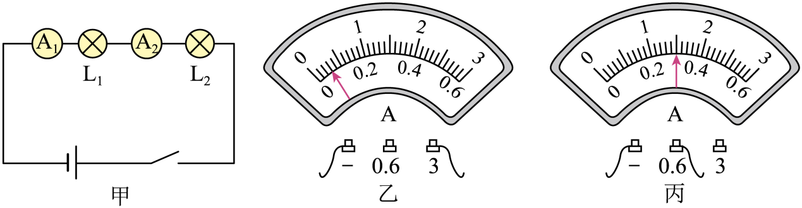

A．电流表\( {\text{A}}_{\text{1}}\)示数小于\( {\text{A}}_{\text{2}}\)示数  B．灯\( {\text{L}}_{1}\)、\( {\text{L}}_{2}\)两端电压一定不相等
C．两灯电阻可能相同  D．灯泡\( {\text{L}}_{1}\)额定功率一定小

【答案】

B

【解析】A．图乙中，电流表\( {\mathrm{A}}_{1}\)选择\( 0~3\mathrm{A}\)量程，示数为0.3A，图丙中，电流表\( {\mathrm{A}}_{2}\)选择\( 0~0.6\mathrm{A}\)量程，示数为0.3A，两个电流表的示数相等，故A错误；
B．两灯泡串联，通过两灯的电流相等，灯泡亮度不同，说明它们的实际功率不同，由\( P=UI\)可知，灯L₁、L₂两端电压一定不相等，故B正确；
C．两灯的电流相等，它们两端电压不相等，由欧姆定律\( I=\frac{U}{R}\)可知，两灯电阻不可能相同，故C错误；
D．灯\( {\text{L}}_{1}\)明显比灯\( {\text{L}}_{2}\)暗，说明灯泡L₁的实际功率一定小，不能确定其额定功率的情况，故D错误。
故选B。

## 63. 单选题（难度：适中）

公路检查站的“地磅”可以检测货车是否超载。如图所示是某种“地磅”的工作原理图，滑片P可在竖直放置的电阻R上滑动且接触良好，a、b为电流表或电压表。当货车质量增大时，由电表b改装成的显示器的示数也增大且不能超过它的量程。下列说法正确的是（      ）

【答案】A

## 64. 单选题（难度：适中）

如图所示，电源电压不变，R0为定值电阻，闭合开关S，向右移动滑片P的过程中（　　）

【答案】A

## 65. 单选题（难度：适中）

两电阻<latex class="math-tex">\( {R}_{1}\)</latex>、<latex class="math-tex">\( {R}_{2}\)</latex>的I-U图像如图所示，若将电阻<latex class="math-tex">\( {R}_{1}\)</latex>、<latex class="math-tex">\( {R}_{2}\)</latex>串联后接

【答案】A

## 66. 单选题（难度：适中）

将一根细金属丝置入柔性塑料中，可以制成用来检测物体形变的器件应变片，其结构如图甲所示。将它接入图乙所示的电路，电源电压不变，R为定值电阻。闭合开关S，当应变片随被检测物体发生拉伸形变时，塑料中的金属丝会被拉长变细，则电路中的（　　）

- A. 电压表和电流表示数都变大
- B. 电压表示数与电流表示数的比值变小
- C. 电路的总功率变大
- D. 定值电阻R的功率变小

【答案】D

【解析】AB．由于塑料中的金属丝会被拉长变细，导致电阻变大，则总电阻变大，又电源电压不变，根据欧姆定律可知电流变小，电流表示数变小，定值电阻R两端的电压变小，而应变片两端的电压变大，即电压表的示数变大。根据串联电路的电流特点和欧姆定律可知，电压表示数与电流表示数的比值即为应变片的电阻，应变片的电阻变大，因此电压表示数与电流表示数的比值变大，故AB不符合题意；
C．由前面分析可知，电路的电流变小，根据\( P=UI\)可知，电路的总功率变小，故C不符合题意；
D．由前面分析可知，电路的电流变小，根据\( P={I}^{2}R\)可知，定值电阻\( R\)的功率变小，故D符合题意。
故选D。

## 67. （难度：适中）

如图所示的电路中，电源电压为8V且保持不变，电阻\( {R}_{1}=5\mathrm{\Omega }\)，\( {R}_{2}=3\mathrm{\Omega }\)，闭合开关后，电压表的示数为（　　）

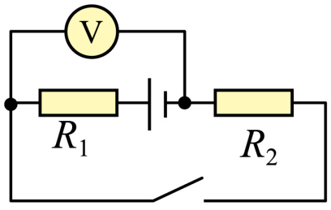

A．2V  B．3V
C．5V  D．8V

【答案】

B

【解析】由电路图可知，\( {R}_{1}、{R}_{2}\)串联，此时串联电路中的电流为\( I=\frac{U}{R}=\frac{8\mathrm{V}}{5\text{Ω}+3\mathrm{\Omega }}=1\text{A}\)，电压表测量\( {R}_{2}\)两端的电压，由\( I=\frac{U}{R}\)可知，\( {U}_{2}=I{R}_{2}=1\text{A}\times 3\text{Ω}=3\text{V}\)，故ACD不符合题意，B符合题意。
故选B。

## 68. 单选题（难度：适中）

如图所示的电路中，电源电压不变，R1为定值电阻，R2为滑动变阻器。闭合开关S，R2的滑片P在某一端点时，两表的示数分别为0.2A和3V；移动滑片P到某位置的过程中，两表的示数分别变化了0.3A和1.5V。下列说法中正确的是（　　）

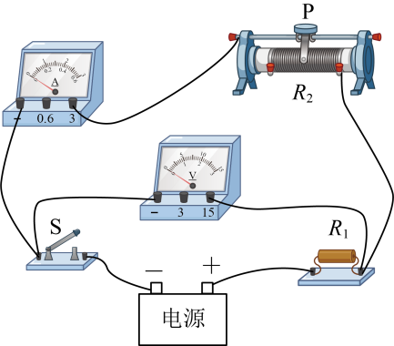

- A. 电源电压为4.5V
- B. R2的最大阻值为20Ω
- C. R1的阻值为15Ω
- D. 当电流表示数为0.4A时，R2接入电路的电阻为5Ω

【答案】D

【解析】由图可知，定值电阻\( {R}_{1}\)与滑动变阻器\( {R}_{2}\)串联，电压表测量\( {R}_{2}\)两端电压，电流表测量干路电流。
AC．设电源电压为\( U\)，根据题意，移动滑片时，两表示数分别变化了0.3A和1.5V，可得\( U-3\text{V}=0.2\text{A}\times {R}_{1}\)①，\( U-\left(3\text{V}-1.5\text{V}\right)=\left(0.2\text{A}+0.3\text{A}\right)\times {R}_{1}\)②，联立①②可得\( U=4\text{V}\)，\( {R}_{1}=5\mathrm{\Omega }\)，故AC错误；
B．由题意可知，闭合开关时\( I=0.2\text{A}\)，\( {U}_{2}=3\text{V}\)，移动滑片时，两表的示数分别变化了0.3A和1.5V，滑动变阻器在闭合开关时处于最大值，根据\( R=\frac{U}{I}\)，可得滑动变阻器最大阻值\( {R}_{2\mathrm{m}\mathrm{a}\mathrm{x}}=\frac{{U}_{2}}{I}=\frac{3\text{V}}{0.2\text{A}}=15\mathrm{\Omega }\)，故B错误；
D．当电流表示数\( {I}_{1}=0.4\text{A}\)时，电源电压\( U=4\text{V}\)，根据\( R=\frac{U}{I}\)，可得电路中总电阻\( {R}_{\mathrm{总}}=\frac{U}{{I}_{1}}=\frac{4\text{V}}{0.4\text{A}}=10\mathrm{\Omega }\)
定值电阻\( {R}_{1}=5\mathrm{\Omega }\)，根据串联电路电阻\( {R}_{\mathrm{总}}={R}_{1}+{R}_{2}\)，可求得此时滑动变阻器\( {R}_{2}\)接入的阻值\( {{R}_{2}}^{\text{'}}=10\mathrm{\Omega }-5\mathrm{\Omega }=5\mathrm{\Omega }\)
故D正确。
故选D。

## 69. 单选题（难度：适中）

在“伏安法测电阻”的实验中，小明根据测得的数据，绘制了定值电阻与小灯泡的电流与电压关系图像，如图所示。请根据图像信息，判断下列说法正确的是（　　）

【答案】A

## 70. 单选题（难度：适中）

将物理知识运用于生活中是学习物理的重要意义。小明设计了如图甲所示的模拟调光灯电路。电源电压恒定，\( {R}_{1}\)为定值电阻。闭合开关S后，将滑动变阻器\( {R}_{2}\)的滑片P由最右端向左移动，直至灯泡L正常发光。此过程中，电流表A的示数随两电压表\( {\text{V}}_{\text{1}}\)、\( {\text{V}}_{\text{2}}\)（电压表\( {\text{V}}_{\text{2}}\)未画出）示数变化关系图像如图乙所示。下列关于该电路正确的是：（    ）

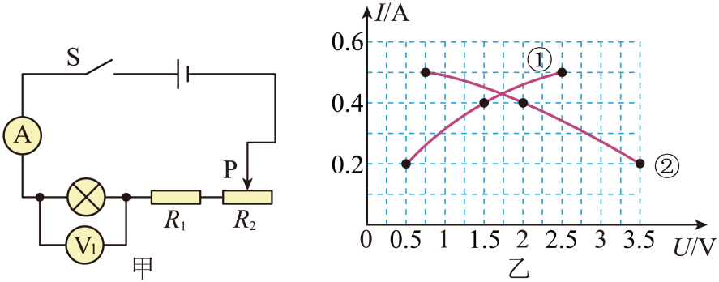

- A. 小灯泡正常发光时的电阻为10Ω
- B. 电压表\( {\text{V}}_{\text{1}}\)两端的变化量与电压表\( {\text{V}}_{\text{2}}\)两端的变化量相同
- C. 定值电阻为2.5Ω
- D. 电源电压是5V

【答案】C

【解析】A．由图甲可知，闭合开关S后，灯泡、R1、R2串联，电压表V₁测灯泡两端的电压，电压表V₂测滑动变阻器两端的电压，电流表测电路中的电流。因灯泡两端的电压越大时通过的电流越大，所以图乙中图线①是小灯泡的I-U图像，由图线②可知，电压表V₂的示数随电流表示数的增大而减小，所以电压表V₂测滑动变阻器两端的电压或测定值电阻和滑动变阻器两端的电压之和，因串联电路中各处的电流相等，且总电压等于各分电压之和，所以，由电流相等时两电压表的示数之和不相等可知，电压表V₂测滑动变阻器R2两端的电压，即并联在滑动变阻器R2两端，因此图像②表示通过R2的电流随电压变化关系。闭合开关S后，将滑动变阻器\( {R}_{2}\)的滑片P由最右端向左移动，直至灯泡L正常发光，此时变阻器连入电路的电阻最小，电路的总电阻最小，由\( I=\frac{U}{R}\)可知电路中的电流最大，由图乙可知最大电流为0.5A，此时灯泡两端的电压\( {U}_{\text{L}}=2.5\text{V}\)，小灯泡正常发光时的电阻\( {R}_{\text{L}}=\frac{{U}_{\text{L}}}{{I}_{\text{L}}}=\frac{2.5\text{V}}{0.5\text{A}}=5\mathrm{\Omega }\)
故A正确；
B．由图乙可知，电流从0.2A变化到0.4A，电压表V₁示数的变化量\( \left|\mathrm{\Delta }{U}_{1}\right|=\left|0.5\text{V}-1.5\text{V}\right|=1\text{V}\)
电压表V₂示数的变化量\( \mathrm{\Delta }{U}_{2}=3.5\text{V}-2\text{V}=1.5\text{V}\)
电压表\( {\text{V}}_{\text{1}}\)两端的变化量与电压表\( {\text{V}}_{\text{2}}\)两端的变化量不相同，故B错误；
CD．由图乙可知电路中的最小电流是0.2A，灯泡两端的电压为0.5V，变阻器R2两端的电压为3.5V，则电源的电压为\( U={U}_{\text{L}}″+{U}_{2}″+I{R}_{1}=0.\text{5V}+3.5\text{V}+0.2\text{A}\times {R}_{1}\)①
由图乙可知当电路中的电流是0.4A时，灯泡两端的电压为1.5V，变阻器R2两端的电压为2V，则电源的电压为\( U={U}_{\text{L}}\text{'}+{U}_{2}\text{'}+I\text{'}{R}_{1}=1.5\text{V}+2\text{V}+0.4\text{A}\times {R}_{1}\)②
由①②可得\( {R}_{1}=2.5\mathrm{\Omega }\)，\( U=4.5\text{V}\)，故C正确，D错误。
故选C。

## 71. 单选题（难度：适中）

如图所示，灯泡L甲、L乙的电阻分别为10Ω、20Ω，忽略温度对灯丝电阻的影响。闭合开关，通过L甲、L乙的电流分别为I1、I2，它们两端的电压分别为U1、U2，则（　　）

【答案】A

## 72. （难度：适中）

如图甲乙两电路中电源电压均保持不变，定值电阻\( {R}_{1}\)和\( {R}_{2}\)并联在如图甲所示电路中，闭合开关后电流表的示数为0.4A，断开开关后电流表示数如丙图所示；再将\( {R}_{1}\)和\( {R}_{2}\)串联在如图乙所示电路中，\( {R}_{1}\)两端电压\( {U}_{1}\)和\( {R}_{2}\)两端电压\( {U}_{2}\)之比为（   ）

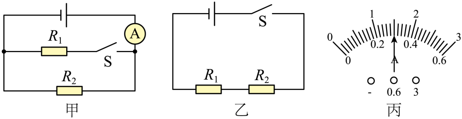

A．3:1  B．4:3  C．3:4  D．1:3

【答案】

A

【解析】如图甲所示，定值电阻\( {R}_{1}\)和\( {R}_{2}\)并联，电流表测量干路电流，故干路电流\( I=0.4\text{A}\)
当开关S断开后，电阻中只有\( {R}_{2}\)接入电路，此时电流表测量通过\( {R}_{2}\)的电流I2，根据并联电流规律可知，通过\( {R}_{2}\)的电流小于0.4A，如图丙中指针位置所示，故可知此时电流表连接的是0~0.6A的测量范围，分度值为0.02A，电流表的示数为0.3A，即通过\( {R}_{2}\)的电流\( {I}_{2}=0.3\text{A}\)
当开关S闭合时，通过\( {R}_{1}\)的电流\( {I}_{1}=I-{I}_{2}=0.4\text{A}-0.3\text{A}=\text{0.1A}\)
定值电阻\( {R}_{1}\)和\( {R}_{2}\)的阻值之比\( \frac{{R}_{1}}{{R}_{2}}=\frac{{I}_{2}}{{I}_{1}}=\frac{0.3\text{A}}{\text{0.1A}}=\frac{3}{1}\)
如图乙所示，\( {R}_{1}\)和\( {R}_{2}\)串联,根据串联分压可知，\( {R}_{1}\)两端电压\( {U}_{1}\)和\( {R}_{2}\)两端电压\( {U}_{2}\)之比\( \frac{{U}_{1}}{{U}_{2}}=\frac{{R}_{1}}{{R}_{2}}=\frac{3}{1}\)
故A符合题意，BCD不符合题意。
故选A。

## 73. 单选题（难度：适中）

如图甲所示的电路，\( {R}_{2}=30\text{Ω}\)。\( {\text{S}}_{\text{1}}\)和\( {\text{S}}_{\text{2}}\)闭合后，两电流表示数如图乙所示，下列说法正确的是（　　）

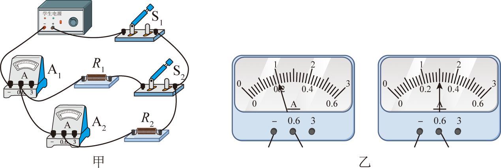

- A. 断开\( {\text{S}}_{\text{2}}\)，电流表\( {\text{A}}_{\text{2}}\)示数变大
- B. 电流表\( {\text{A}}_{\text{1}}\)测通过\( {R}_{1}\)的电流
- C. 电源电压为\( 9\text{V}\)
- D. \( {R}_{1}\)的阻值为\( 60\text{Ω}\)

【答案】D

【解析】电路结构分析：\( {\text{S}}_{\text{1}}\)和\( {\text{S}}_{\text{2}}\)闭合时，\( {R}_{1}\)与\( {R}_{\text{2}}\)并联，\( \text{A}₁\)测干路电流，\( \text{A}₂\)测\( {R}_{\text{2}}\)支路电流。
A．断开\( {\text{S}}_{\text{2}}\)，电路为只有\( {R}_{\text{2}}\)的简单电路，\( \text{A}₂\)仍测\( {R}_{\text{2}}\)电流，示数不变，故A错误；
B．\( \text{A}₁\)测干路电流，故B错误；
C．干路电流大于支路电流，由图通过\( {R}_{\text{2}}\)的电流为\( \text{0.2A}\)，\( {R}_{2}=30\text{Ω}\)，电源电压\( U=U₂=I₂R₂=0.2\text{A}\times 30\text{Ω}=6\text{V}\)
故C错误；
D．通过\( {R}_{1}\)的电流为\( I₁=0.3\text{A}-0.2\text{A}=0.1\text{A}\)
\( {R}_{1}\)的阻值为\( R₁=\frac{6\text{V}}{0.1\text{A}}=60\text{Ω}\)
故D正确。
故选D。

## 74. 单选题（难度：适中）

如图甲是小明为家庭养殖场设计的电热孵化器的工作原理图，\( {R}_{1}\)、\( {R}_{2}\)和\( {R}_{3}\)为阻值相同的加热电阻。控制电路中，电源电压恒为6V，R为滑动变阻器，热敏电阻\( {R}_{t}\)置于孵化器内，其阻值随温度的变化如图乙所示。当孵化器内温度升高到孵化温度时，衔铁被吸合，触点a与触点c接触，此时通过电磁铁的电流为20mA。下列说法正确的是（电磁铁线圈的电阻忽略不计）（　　）

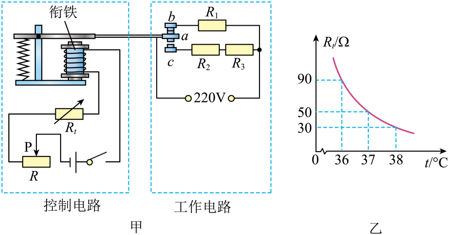

- A. 热敏电阻\( {R}_{t}\)的阻值随温度的升高而增大
- B. 衔铁被吸合后，工作电路中的电流变大
- C. 孵化温度为37℃时，R连入电路的阻值为50Ω
- D. 若想将孵化温度调高，应将R的滑片P向右调

【答案】D

【解析】A．由乙图可知，Rt随温度升高而减小，故A错误；
B．衔铁被吸合前，工作电路R1接入电路，衔铁被吸合后，工作电路R2、R3串联接入电路，电路总电阻变大，总电流变小，故B错误；
C．当温度为37°C时，Rt=50Ω，则R的阻值为
\( R=\frac{U}{I}-Rt=\frac{\text{6V}}{\text{0.02A}}\text{-50Ω=250Ω}\) 
故C错误；
D．温度升高，Rt阻值减小，控制电路的吸合电流、电源电压均不变，则变阻器R的阻值应增大，应将R的滑片向右调，故D正确。
故选D。

## 75. 单选题（难度：适中）

当空气湿度RH较大时，人体会感觉不舒服，已知人体感觉比较舒服的湿度RH范围是40~60%。小亮设计了一款湿度表，其原理如图甲所示，R0为500Ω的定值电阻，电源电压恒为10V，R1为湿敏电阻，其阻值随空气湿度的变化关系如图乙所示。下列说法正确的是（　　）

【答案】A

## 76. （难度：适中）

如图所示，长度相同、横截面积不同的铁棒AB和CD连接在一起接入电路中，则下列说法正确的是（   ）A．AB段电阻大，<latex class="math-tex">\( {I}_{AB}>{I}_{CD}\)</latex>  B．CD段电阻大，<latex class="math-tex">\( {I}_{AB}<{I}_{CD}\)</latex>C．AB段电阻大，<latex class="

## 77. 单选题（难度：适中）

如图的电路，电源电压恒定，<latex class="math-tex">\( {R}_{1}\)</latex>为定值电阻，<latex class="math-tex">\( {R}_{2}\)</latex>为滑动变阻器，闭合开关<latex class="math-tex">\( \mathrm{S}\)</latex>后，滑动变阻器滑片<latex class="math-tex">\(

【答案】A

## 78. 单选题（难度：适中）

图示为电阻<latex class="math-tex">\( {R}_{1}\)</latex>和<latex class="math-tex">\( {R}_{2}\)</latex>的<latex class="math-tex">\( I-U\)</latex>图像，下列分析不正确的是（   ）

【答案】A

## 79. 单选题（难度：适中）

如图甲所示电路，电源电压不变。当开关S闭合后，下列说法不正确的是（　　）

【答案】A

## 80. （难度：适中）

有甲、乙两根同种材料制成的电阻线，甲、乙长度相等，但甲较粗。若将它们串联在同一个电源上，则下列说法正确的是（　　）A．通过甲的电流小  B．通过乙的电流小C．甲两端的电压大  D．乙两端的电压大

## 81. 单选题（难度：适中）

小明在研究通过导体的电流与其两端电压关系时，根据测量数据绘制出如图所示的I﹣U图象。下列判断错误的是（　　）

【答案】A

## 82. （难度：适中）

惠惠同学总是随手关闭家里不必要使用的电灯等家用电器，每多关闭一个家用电器，下列说法正确的是（　　）A．总电阻变大  B．总电流变大C．总电压变小  D．总电流变小

## 83. （难度：适中）

在图示电路中，电源电压不变闭合电键S后，当滑动变阻器的滑片向左移动时，关于电压表与电流表示数的乘积和电压表与电流表示数的比值（　　）A．乘积变大，比值改变  B．乘积变大，比值不变C．乘积变小，比值改变  D．乘积变小，比值不变

## 84. （难度：适中）

小明设计了车载加热垫，其简化电路如图所示，电源电压恒为12V，R1、R2为阻值一定的电热丝，其中R2电阻为30Ω。闭合开关S1、S2，通过R1的电流为0.6A。求：

## 85. （难度：适中）

空气炸锅，因其烹制食物脂肪含量低，美味酥脆，无油烟味，深受广大市民青睐。如图甲所示，为某品牌空气炸锅，其发热元件为两个电阻，\( {R}_{1}=40\text{Ω}\)，\( {R}_{2}=\text{\hspace{0.17em}}220\text{Ω}\)，额定工作电压为220V，其内部加热部分的电路可简化为图乙所示电路，当开关S₁闭合，开关S接b端时为高温挡；开关S₁闭合，开关S接a端时为低温挡。

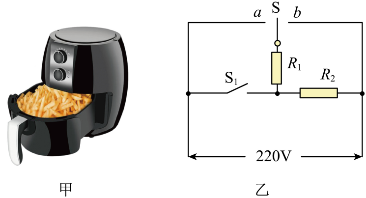

低温挡正常工作时，通过电阻\( {R}_{2}\)的电流；

高温挡正常工作时功率是多少?

某次使用空气炸锅时，高温挡加热\( 10\text{\hspace{0.17em}min}\)，这次加热过程中产生的热量是多少J？

【答案】

$ 1\text{\hspace{0.17em}A}$　

，

$ 1430\text{W}$　

，

$ 8.58\times {10}^{5}\text{J}$ 

【解析】当开关S₁闭合，开关S接a端时，空气炸锅处于低温挡，此时电阻R1被短路，电路为R2的简单电路；低温挡正常工作时，通过电阻\( {R}_{2}\)的电流\( {I}_{2}=\frac{U}{{R}_{2}}=\frac{220\text{V}}{220\mathrm{\Omega }}=1\)

2）当开关S₁闭合，开关S接b端时为高温挡；此时电阻R1和R2并联，电阻R1的功率为\( {P}_{1}=\frac{{U}^{2}}{{R}_{1}}=\frac{{\left(220\text{V}\right)}^{2}}{40\mathrm{\Omega }}=1210\text{W}\)
电阻R2的功率为\( {P}_{2}=\frac{{U}^{2}}{{R}_{2}}=\frac{{\left(220\text{V}\right)}^{2}}{220\mathrm{\Omega }}=220\text{W}\)
高温挡正常工作时功率为\( {P}_{\mathrm{高}}={P}_{1}+{P}_{2}\)

\( 10\text{W}+220\text{W}=1430\text{W}\) 
（3）高温挡加热的时间为\( t=10\text{min}=10\times 60\text{s}=600\text{s}\)
高温挡工作时，电能全部转化为内能，产生的热量等于消耗的电能；这次加热过程中产生的热量 \( Q=W={P}_{\mathrm{高}}\times t=1430\text{W}\times \)

## 86. （难度：适中）

为了动态监测学生的体重情况，科技创新小组设计了一台由电流表改装而成的简易体重计，其电路如图甲所示。已知电源电压恒为6V，定值电阻\( {R}_{0}=5\text{Ω}\)，R为压敏电阻，其阻值与所受到的压力关系如图乙所示，电流表量程为0～0.6A，踏板重力不计，求：

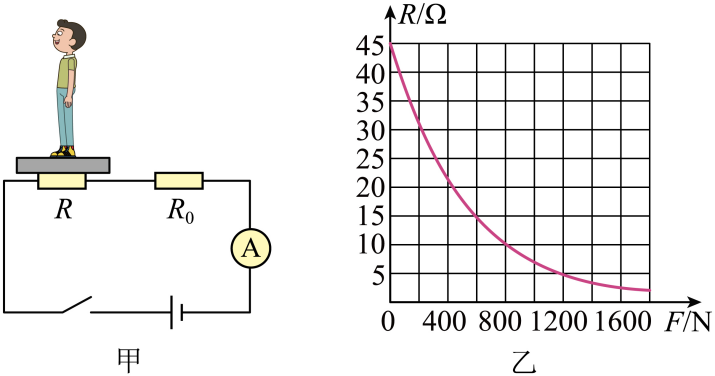

闭合开关，当体重计空载时，电路中的电流；

电流表上0.4A刻度处应该标多大的体重值；

小组成员认为，也可以用电压表改装成体重计，改装要求：随着体重的增加，电压表示数增大。若电压表量程为0～3V，求电压表改装的体重计能够称量的最大体重是多少？

【答案】

$ \text{0.12A}$　

，

800N　

，

1200N

【解析】当体重计空载时，压力\( F=0\text{N}\)，由图乙可知，此时压敏电阻阻值\( R=45\mathrm{\Omega }\)。
电路总电阻\( {R}_{\text{总}}=R+{R}_{0}=45\mathrm{\Omega }+5\mathrm{\Omega }=50\mathrm{\Omega }\)
电路中的电流\( I=\frac{U}{{R}_{\text{总}}}=\frac{6\text{V}}{50\mathbf{\Omega }}=0.12\)

2）当电流 \( {I}^{\mathrm{\text{'}}}=0.4\text{A}\)时，电路总电阻\( {R}_{\mathrm{总}2}=\frac{U}{{I}^{\mathrm{\text{'}}}}=\frac{6\text{V}}{0.4\text{A}}=15\mathrm{\Omega }\)
压敏电阻阻值\( {R}^{\mathrm{\text{'}}}={R}_{\mathrm{总}2}-{R}_{0}=15\mathrm{\Omega }-5\mathrm{\Omega }=10\mathrm{\Omega }\)
由图乙可知，当\( {R}^{\mathrm{\text{'}}}=10\mathrm{\Omega }\) 时，对应的压力\( {F}^{\mathrm{\text{'}}}=800\text{N}\)，即体重值为80

（3）电压表量程为\( 0\sim 3\text{V}\)，为使电压表示数随体重增加而增大，电压表应并联在定值电阻\( {R}_{0}\) 两端。当电压表示数最大\( {U}_{0}=3\text{V}\)时，电路中的电流\( {I}^{″}=\frac{{U}_{0}}{{R}_{0}}=\frac{3\text{V}}{5\mathrm{\Omega }}=0.6\text{A}\)
此时电路总电阻\( {R}_{\text{总}}^{″}=\frac{U}{{I}^{″}}=\frac{6\text{V}}{0.6\text{A}}=10\mathrm{\Omega }\)
压敏电阻阻值\( {R}^{″}={R}_{\text{总}}^{″}-{R}_{0}=10\mathrm{\Omega }-5\mathrm{\Omega }=5\mathrm{\Omega }\)
由图乙可知，当\( {R}^{″}=5\mathrm{\Omega }\) 时，对应的压力\( {F}^{″}=1200\text{N}\)，即最大

## 87. （难度：适中）

如图甲所示是小强“测量小灯泡的电阻”电路图，小灯泡正常发光的电压为2.5V，电阻约为<latex class="math-tex">\( 10\text{Ω}\)</latex>，现有两个滑动变阻器A和B，它们的规格分别是：A“<latex class="math-tex">\( 10\text{Ω}\)</latex> <latex class="math-tex">\( 1\text{A}\)

## 88. （难度：适中）

请用笔画线表示导线把图中的实物连接起来，已知电源为两节新的干电池，两个灯泡的电阻约为<latex class="math-tex">\( 10\mathrm{\Omega }\)</latex>。要求：两个小灯泡并联，开关同时控制两个小灯泡，电流表测量通过小灯泡<latex class="math-tex">\( {\text{L}}_{\text{2}}\)</latex>的电流，导线不能交叉。

## 89. （难度：适中）

如图所示，电压表和电流表分别测量灯泡两端的电压和通过它的电流，滑动变阻器的滑片向左滑动时，灯变亮，且通过灯的最大电流为0.3A。请你用笔画线代替导线将电路中缺少的两条导线补全。

## 90. （难度：适中）

小灯泡的额定电压为2.5V，正常发光时的电阻大约为10Ω，请用笔画线代替导线将图中的实验电路连接完整，要求：闭合开关后，滑片向右移动时小灯泡变暗（导线不能交叉）。

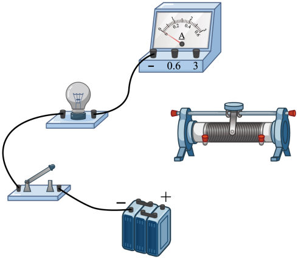

【答案】

 

【解析】因闭合开关后，滑片向右移动时小灯泡变暗，所以，灯泡与滑动变阻器串联，且滑片向右移动时变阻器接入电路中的电阻变大，故滑动变阻器的左下方接线柱和任意上方接线柱接入电路中；小灯泡的额定电压为2.5V，正常发光时的电阻大约为10Ω，则灯泡正常发光时的电流
\( I=\frac{U}{R}=\frac{2.5\text{V}}{10\mathrm{\Omega }}=\text{0.25A<0.6A}\) 
所以，电流表的量程为0～0.6A，且与滑动变阻器串联在电路中，如下图所示：

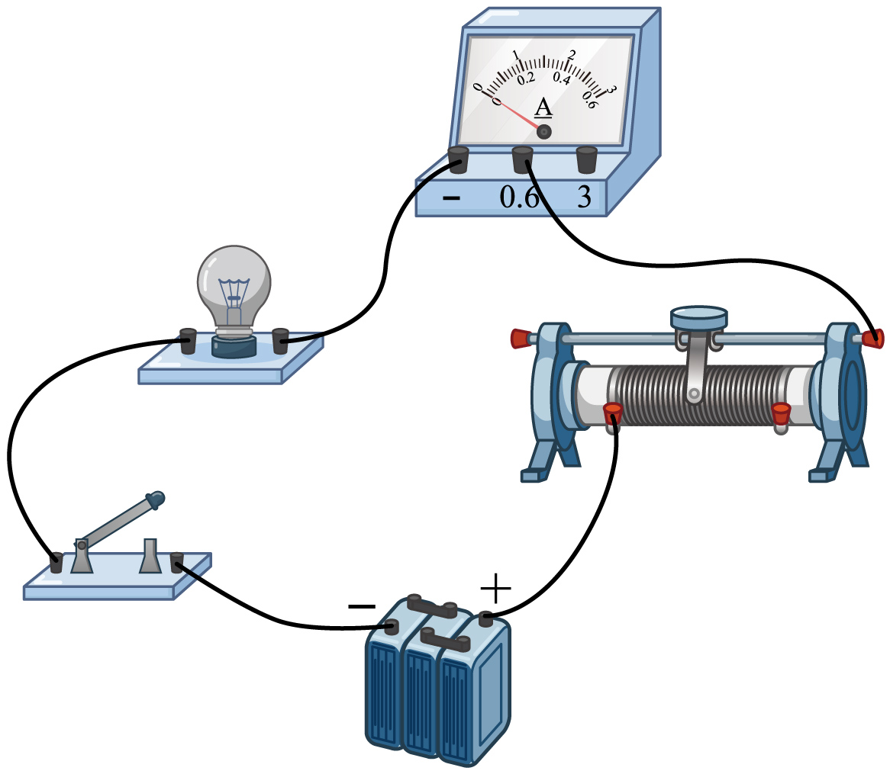

## 91. （难度：适中）

图甲是用电流表测量电流的电路图；根据电路图连接图乙的实物图。

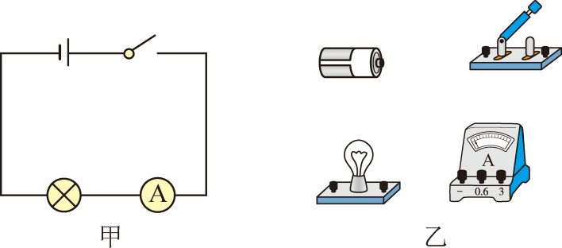

【答案】

 

【解析】电路图为灯泡、电流表、电源、开关串联的简单电路，从电源正极出发经过开关连接在电流表正接线柱上，实验室中小灯泡阻值约为5欧姆，此电路电源电压为一节干电池1.5V，产生的电流约为
\( I=\frac{U}{R}=\frac{1.5\mathrm{V}}{5\mathrm{\Omega }}=0.3\mathrm{A}\) 
未超过0.6A，所以电流表接小量程，偏转更明显，便于观察读数。再从负接线柱出发将灯泡串联接入电路后回到负极，如图所示：

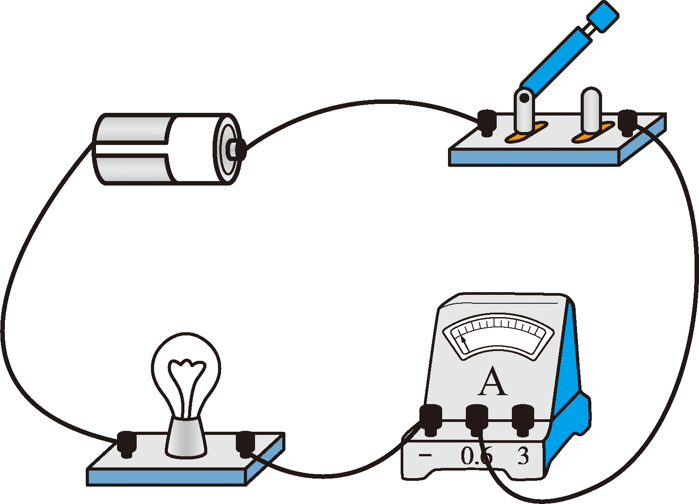

## 92. （难度：适中）

小明在进行“测量电阻<latex class="math-tex">\( {R}_{\text{x}}\)</latex>的阻值”实验时，实验电路如图甲所示。

## 93. （难度：适中）

如图所示，有灯泡L₁、L₂，开关S，电源（3V），电压表，电流表和导线若干，要求：L₁、L₂并联，开关控制整个电路，电流表测总电流，电压表测L₁的电压。请你用笔画线代替导线连接实物图（L₁、L₂电阻分别约为5Ω、10Ω）

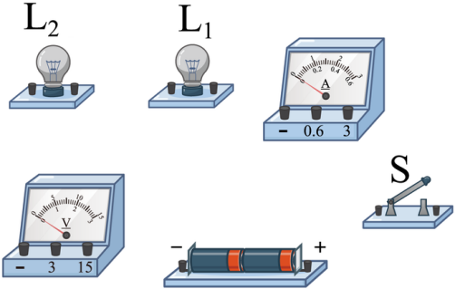

【答案】

 

【解析】经分析可知，L₁、L₂并联，开关和电流表位于干路，电压表并联在L₁两端，因为电源电压为3V，所以电压表的量程为0~3V；L₁、L₂电阻分别约为5Ω、10Ω，根据并联电路电阻规律可知
\( \frac{1}{{R}_{\mathrm{总}}}=\frac{1}{{R}_{1}}+\frac{1}{{R}_{2}}\) 
 
则电路中的总电阻
\( {R}_{\mathrm{总}}=\frac{{R}_{1}{R}_{2}}{{R}_{1}+{R}_{2}}=\frac{5\mathrm{\Omega }\times 10\mathrm{\Omega }}{5\mathrm{\Omega }+10\mathrm{\Omega }}=\frac{10}{3}\mathrm{\Omega }\) 
 
电路中的总电流
\( I=\frac{U}{{R}_{\mathrm{总}}}=\frac{3\mathrm{V}}{\frac{10}{3}\mathrm{\Omega }}=0.9\mathrm{A}\) 
 
则电流表应选用0~3A量程，实物图的连接如图所示

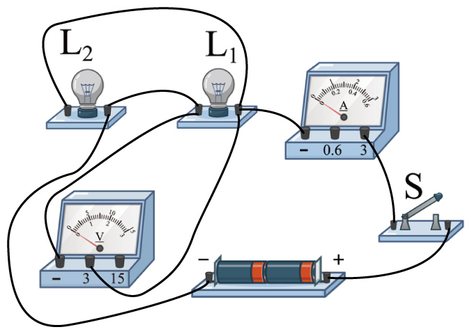

## 94. （难度：适中）

(1)请根据图中所示的实物图，在虚线框中画出对应的电路图。

请根据图中所示的实物图，在虚线框中画出对应的电路图。

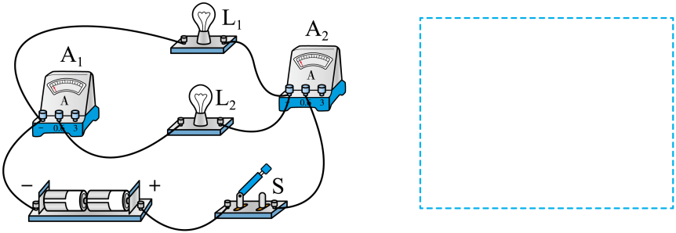

现有三个定值电阻\( {R}_{1}\)、\( {R}_{2}\)和\( {R}_{3}\)，它们之间的大小关系是\( {R}_{1}<{R}_{2}<{R}_{3}\)。如图中已经画出了通过定值电阻\( {R}_{2}\)的电流随其两端电压变化的图像，请你在图中分别画出定值电阻\( {R}_{1}\)与\( {R}_{3}\)的电流随电压变化的大致图像，并标上对应的字母。

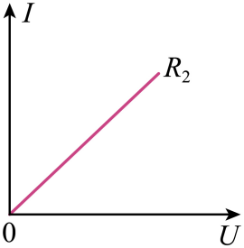

如图，请在电路中的“

”中填入电流表或电压表的符号，构成并联电路。

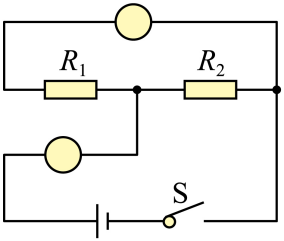

【答案】

 

，

 

，

 

【解析】根据如图所示的实物图可知，两灯泡并联连接，电流表\( {\text{A}}_{1}\)在\( {\text{L}}_{2}\)支路上测\( {\text{L}}_{2}\)的电流，电流表\( {\text{A}}_{2}\)在干路上，测干路电流，对应的电路图如图所示：

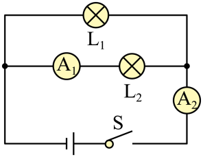

因为\( {R}_{1}<{R}_{2}<{R}_{3}\)，由可知，在电压相同时，通过\( {R}_{1}\)的电流最大，所以\( {R}_{1}\)的电流与电压关系的大致图像在\( {R}_{2}\)图像的上方，通过\( {R}_{3}\)的电流最小，所以\( {R}_{3}\)的电流与电压关系的大致图像在\( {R}_{2}\)图像的下方，如图所示：

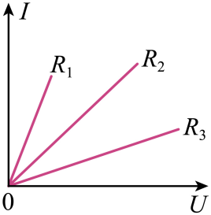

分析电路结构可知：当两电表均为电流表时，两电阻首首相连，尾尾相连，是并联，填表如下：

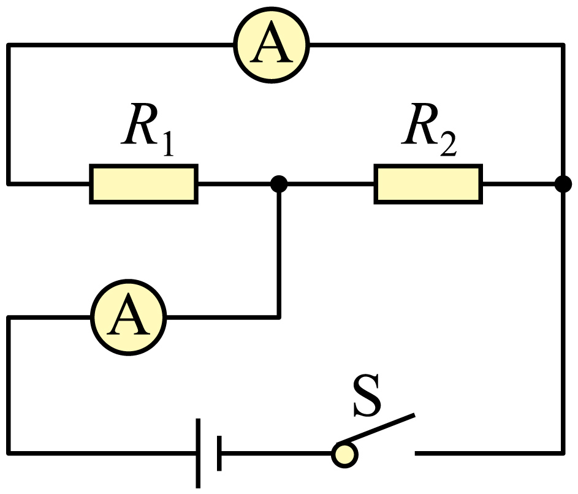

## 95. （难度：适中）

如图所示的电路中，电源电压U保持不变，定值电阻<latex class="math-tex">\( {R}_{1}>{R}_{2}\)</latex>，闭合开关S，通过电阻<latex class="math-tex">\( {R}_{1}\)</latex>、<latex class="math-tex">\( {R}_{2}\)</latex>和干路的电流分别是<latex class="ma

## 96. （难度：适中）

为了动态监测学生的体重情况，科技创新小组设计了一台由电流表改装而成的简易体重计，其电路如图甲所示。已知电源电压恒为6V，定值电阻<latex class="math-tex">\( {R}_{0}=5\text{Ω}\)</latex>，R为压敏电阻，其阻值与所受到的压力关系如图乙所示，电流表量程为0～0.6A，踏板重力不计，求：

## 97. （难度：适中）

小明设计了车载加热垫，其简化电路如图所示，电源电压恒为12V，R1、R2为阻值一定的电热丝，其中R2电阻为30Ω。闭合开关S1、S2，通过R1的电流为0.6A。求：

## 98. （难度：适中）

如图所示的电路中，R2的阻值为10 Ω。开关S₁、S₂闭合，电流表A₂的示数为0.3 A，电流表A₁的示数为0.5 A。开关S₂断开时，下列说法正确的是（　　）

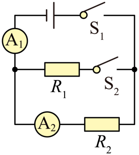

A．通过R1的电流为0.3 A  B．电流表A₁的示数为0.5 A
C．电流表A₂的示数为0.5 A  D．电阻R1的阻值为15 Ω

【答案】

D

【解析】由电路图可知，开关S₁、S₂闭合时，两电阻并联，电流表A₂测R2支路的电流，电流表A₁测干路的电流；开关S₁控制整个电路，开关S₂控制电阻R1；因为并联电路中干路电流等于各支路电流之和，所以，通过电阻R1的电流为
\( {I}_{1}=I-{I}_{2}=0.5\text{A}-0.3\text{A}=0.2\text{A}\) 
因为并联电路中各支路两端的电压相等，所以由欧姆定律可得，电源的电压
\( U={U}_{2}={I}_{2}{R}_{2}=0.3\text{A}\times 10\text{Ω}=3\text{V}\) 
由\( I=\frac{U}{R}\)可得，电阻R1的阻值
\( {R}_{1}=\frac{U}{{I}_{1}}=\frac{3\text{V}}{0.2\text{A}}=15\text{Ω}\) 
电流表A₂测R2支路的电流，开关S₂控制电阻R1，由于并联电路各支路互不影响，所以开关S₂断开时，通过R1的电流为0A，通过R2的电流不变，即电流表A₂示数不变仍为0.3A，此时电流表A₁的示数也为0.3A，故ABC错误，D正确。
故选D。

## 99. 多选题（难度：适中）

小亮在探究通过导体的电流与其电压的关系时，将记录的实验数据通过整理作出了如图所示的图像根据图像分析，下列说法中正确的是（   ）

【答案】A

## 100. （难度：适中）

小明在进行“测量电阻<latex class="math-tex">\( {R}_{\text{x}}\)</latex>的阻值”实验时，实验电路如图甲所示。

## 101. （难度：适中）

空气炸锅，因其烹制食物脂肪含量低，美味酥脆，无油烟味，深受广大市民青睐。如图甲所示，为某品牌空气炸锅，其发热元件为两个电阻，\( {R}_{1}=40\text{Ω}\)，\( {R}_{2}=\text{\hspace{0.17em}}220\text{Ω}\)，额定工作电压为220V，其内部加热部分的电路可简化为图乙所示电路，当开关S₁闭合，开关S接b端时为高温挡；开关S₁闭合，开关S接a端时为低温挡。

低温挡正常工作时，通过电阻\( {R}_{2}\)的电流；

高温挡正常工作时功率是多少?

某次使用空气炸锅时，高温挡加热\( 10\text{\hspace{0.17em}min}\)，这次加热过程中产生的热量是多少J？

【答案】

$ 1\text{\hspace{0.17em}A}$　

，

$ 1430\text{W}$　

，

$ 8.58\times {10}^{5}\text{J}$ 

【解析】当开关S₁闭合，开关S接a端时，空气炸锅处于低温挡，此时电阻R1被短路，电路为R2的简单电路；低温挡正常工作时，通过电阻\( {R}_{2}\)的电流\( {I}_{2}=\frac{U}{{R}_{2}}=\frac{220\text{V}}{220\mathrm{\Omega }}=1\)

2）当开关S₁闭合，开关S接b端时为高温挡；此时电阻R1和R2并联，电阻R1的功率为\( {P}_{1}=\frac{{U}^{2}}{{R}_{1}}=\frac{{\left(220\text{V}\right)}^{2}}{40\mathrm{\Omega }}=1210\text{W}\)
电阻R2的功率为\( {P}_{2}=\frac{{U}^{2}}{{R}_{2}}=\frac{{\left(220\text{V}\right)}^{2}}{220\mathrm{\Omega }}=220\text{W}\)
高温挡正常工作时功率为\( {P}_{\mathrm{高}}={P}_{1}+{P}_{2}\)

\( 10\text{W}+220\text{W}=1430\text{W}\) 
（3）高温挡加热的时间为\( t=10\text{min}=10\times 60\text{s}=600\text{s}\)
高温挡工作时，电能全部转化为内能，产生的热量等于消耗的电能；这次加热过程中产生的热量 \( Q=W={P}_{\mathrm{高}}\times t=1430\text{W}\times \)

## 102. 多选题（难度：适中）

如图所示的电路，电源电压保持不变，闭合开关S，滑动变阻器滑片P从a端移动到b端的整个过程中，电流表示数与电压表示数U的关系图象如图所示，下列说法正确的是（   ）

【答案】A

## 103. 单选题（难度：适中）

在某一温度下，连接在电路中的两段导体A和B中的电流与其两端电压的关系如图所示。由图中信息可知下列说法中错误的是（　　）

【答案】A

## 104. （难度：适中）

为了动态监测学生的体重情况，科技创新小组设计了一台由电流表改装而成的简易体重计，其电路如图甲所示。已知电源电压恒为6V，定值电阻<latex class="math-tex">\( {R}_{0}=5\text{Ω}\)</latex>，R为压敏电阻，其阻值与所受到的压力关系如图乙所示，电流表量程为0～0.6A，踏板重力不计，求：

## 105. （难度：适中）

空气炸锅，因其烹制食物脂肪含量低，美味酥脆，无油烟味，深受广大市民青睐。如图甲所示，为某品牌空气炸锅，其发热元件为两个电阻，<latex class="math-tex">\( {R}_{1}=40\text{Ω}\)</latex>，<latex class="math-tex">\( {R}_{2}=\text{\hspace{0.17em}}220\text{Ω}\)</latex>，额定工

## 106. （难度：适中）

小明设计了车载加热垫，其简化电路如图所示，电源电压恒为12V，R1、R2为阻值一定的电热丝，其中R2电阻为30Ω。闭合开关S1、S2，通过R1的电流为0.6A。求：

## 107. （难度：适中）

小明在进行“测量电阻\( {R}_{\text{x}}\)的阻值”实验时，实验电路如图甲所示。

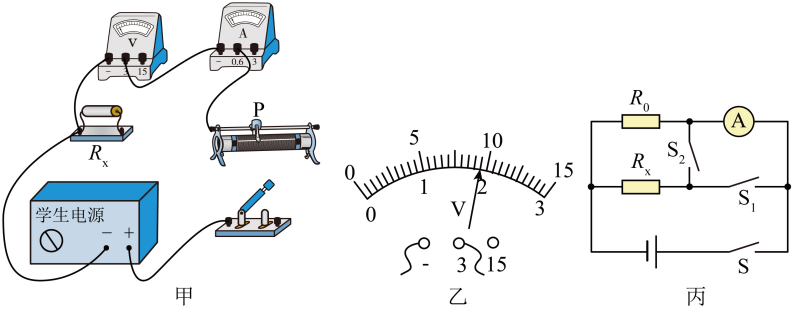

请用笔画线代替导线，将图甲中的实验电路连接完整，要求滑动变阻器的滑片P向右移动时接入电路的阻值变小。

闭合开关前，小明发现电流表指针指向“0”刻度线的左侧，接下来应对电流表进行的操作是。

调节好电流表后闭合开关，移动滑片P的过程中，发现电流表始终无示数，电压表示数较大且不变，经检查两电表完好，导线与接线柱接触良好，则故障原因可能是。

排除故障后，正确进行实验并将实验数据记录在下表中。第2次测量时电压表示数如图乙所示，读数为V。分析表格中的数据可得，待测电阻\( {R}_{\text{x}}\)的阻值为\( \mathrm{\Omega }\)（结果保留1位小数）。
实验次序
电压U/V
电流I/A
电阻\( R/\mathrm{\Omega }\)

1
1.2
0.12
10

2
 
0.20
 

3
2.4
0.24
10

若实验中电压表损坏，小明添加一个已知阻值为\( {R}_{0}\)的定值电阻，设计了如图丙所示的电路，同样测出了未知电阻\( {R}_{\text{x}}\)的阻值，请将实验步骤补充完整：
①只闭合开关S、\( {\text{S}}_{1}\)，读出并记录电流表示数\( {I}_{1}\)；
②只闭合开关，读出并记录电流表示数\( {I}_{2}\)；
③处理实验数据，则得\( {R}_{\text{x}}=\)（用\( {I}_{1}\)、\( {I}_{2}\)和\( {R}_{0}\)表示）。

【答案】

　

，对电流表进行调零　，R$_{x}$断路　，1.9/9.5，S/S$_{2}$　$ \frac{{I}_{1}{R}_{0}}{{I}_{2}-{I}_{1}}$

【解析】在测量电阻实验中，电压表应与待测电阻并联，电流表应与待测电阻串联；滑动变阻器应按照“一上一下”的方法串联在电路中，为了使滑片P向右移动时接入电路的阻值变小，则应把滑动变阻器的右下接线柱接入电路，作法：用一根导线把待测电阻Rx的右侧接线柱与电流表的“-”接线柱（或电压表的“3”接线柱）连接起来，用另一根导线把开关右侧接线柱和滑动变阻器的右下接线柱连接起来，如图所示：

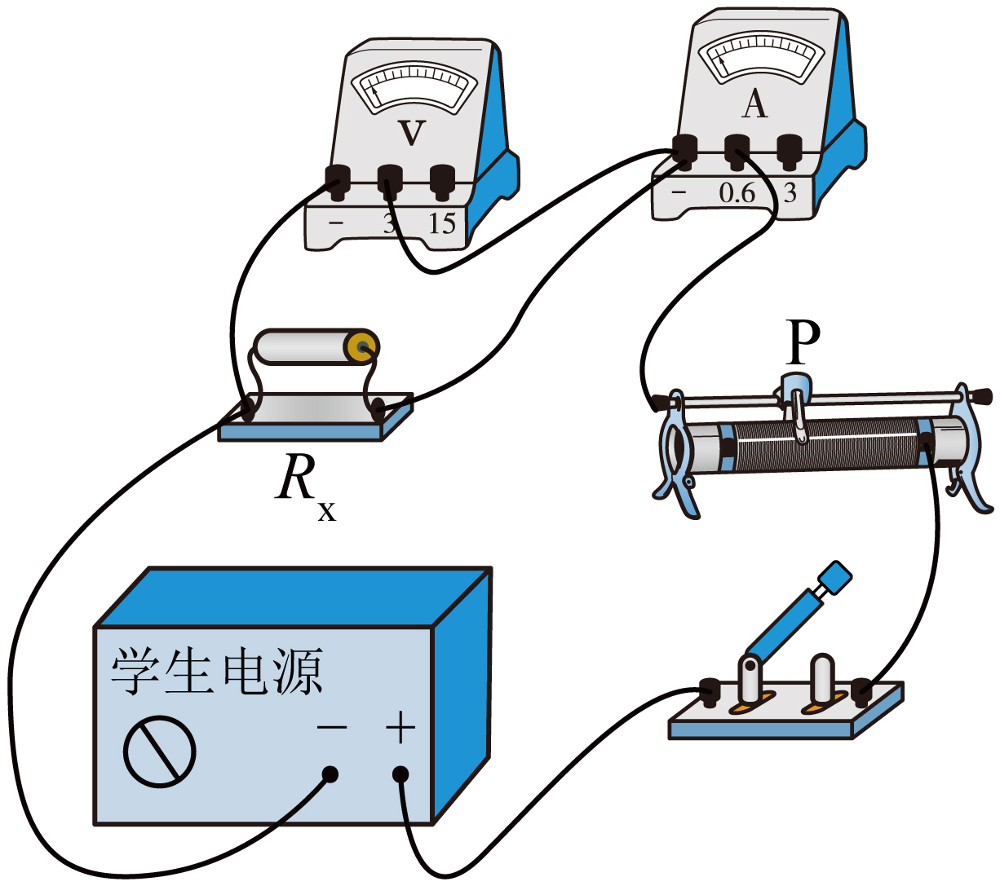

闭合开关前，电流表指针指向“0”刻度线的左侧，说明在使用前未对电流表进行调零，故接下来的操作是对电流表进行调零。

闭合开关，移动滑片P的过程中，发现电流表始终无示数，且两电表完好，说明电路发生断路。电压表示数较大且不变，说明电压表两接线柱到电源两极之间是通路，则故障原因可能是待测电阻Rx断路。

[1]由图乙可知，电压表连接的量程是“0~3V”，分度值为0.1V，示数为1.9V。
[2]由表格中的数据可得，Rx的电阻为\( {R}_{\text{x}}=\frac{{U}_{2}}{{I}_{2}}=\frac{\text{1.9V}}{\text{0.20A}}=9\)

（5）[1][2]由图丙可知，只闭合开关S、S₁，R0与Rx并联，电流表测量通过R0的电流，电流表示数为I1，即通过R0的电流为I1，由欧姆定律可知，R0两端的电压（即电源电压）为\( U={U}_{0}={I}_{1}{R}_{0}\)
如果仍保持R0与Rx并联，再测出通过干路的电流，利用并联电路电流的特点就可以求出通过Rx的电流，再利用欧姆定律就可以求出Rx的阻值了。只闭合S、S₂，此时R0与Rx仍是并联的，Rx两端电压与电源电压相等，即\( {U}_{\text{x}}=U={I}_{1}{R}_{0}\)，电流表测量干路电流，电流表示数为I2，由并联电路电流特点可知，此时通过Rx的电流为\( {I}_{\text{x}}={I}_{2}-{I}_{1}\)，则Rx的电阻为\( {R}_{\text{x}}=\frac{{U}_{\text{x}}}{{I}_{\text{x}}}=\frac{{I}_{1}{R}_{0}}{{I}_{2}-{I}_{1}}\)

## 108. （难度：适中）

小明同学利用如图甲所示的实验装置“探究电流与电压、电阻的关系”。已知电源电压为4.5V且保持不变，实验用到的定值电阻阻值分别为5Ω、10Ω、15Ω、20Ω、25Ω，滑动变阻器的规格为“0~50Ω”。

## 109. 单选题（难度：适中）

在电现象中，有四个同学们非常熟悉的实验：关于这四个电学实验，下列说法中不正确的是

- A. “探究电流与电压的关系”的实验中可用小灯泡替代定值电阻
- B. “探究电流与电阻的关系”的实验中滑动变阻器的作用是要控制定值电阻两端的电压不变
- C. “用伏安法测定值电阻的阻值”的实验中滑动变阻器的作用是为了方便多次测量求平均值来减小误差
- D. “探究影响电阻大小的因素”的实验中需要采用控制变量法

【答案】A

【解析】A,探究电流与电压的关系,需要保持电压一定,改变接入电路的电阻,而灯泡的电阻会随温度发生变化.此选项错误; B研究电流与电阻关系,要保持电阻一定,改变两端电压,. 滑动变阻器的作用是要控制定值电阻两端的电压不变，此选项正确;C,伏安法测电阻实验滑动变阻器的作用是多次测量求平均值来减小误差.此选项正确;D电阻与导体材料,长度和横截面积都有关系,研究其中一个物理量对电阻的影响,需要控制其它物理量,采用控制变量法.此选项正确.故选A.

## 110. 单选题（难度：适中）

在“探究电流跟电阻的关系”实验中，同学们绘制出的四条I﹣R图线如图所示，其中正确的图线是（　　）

【答案】C

【解析】由欧姆定律可知，在电压一定时，通过导体的电流与导体的电阻成反比，故C正确，ABD错误。
故选C。

## 111. 单选题（难度：简单）

某同学在探究“电流跟电阻、电压的关系”时，收集到的数据如下表，根据表中数据可得出的实验结论为（　）
电阻R/Ω
10
20
30

电流I/A
0.30
0.15
0.10

- A. 电阻一定时，电流与电压成正比
- B. 电阻一定时，电压与电流成正比
- C. 电压一定时，电阻与电流成反比
- D. 电压一定时，电流与电阻成反比

【答案】D

【解析】由表中的数据可知， 电阻越大，通过电阻的电阻越小，而电阻与电流的乘积相同，所以可以得到的结论为电压一定时，电流与电阻成反比．故选D．
【点睛】本题是电流--电阻图表，由图表可以得到“在电压一定时，电流与电阻成反比”的规律．

## 112. 单选题（难度：适中）

关于电流、电压、电阻的关系，下列说法正确的是（　　）

- A. 通过导体的电流越大，导体的电阻一定越小
- B. 导体的电阻与其两端电压和通过的电流没有关系
- C. 只要电路中有电压，就一定有电流
- D. 电压一定时，导体的电阻跟通过的电流成反比

【答案】B

【解析】A．电阻是导体本身具有的性质，与电流大小无关，故A错误；
B．导体电阻是导体本身具有的性质，只与材料、长度、横截面积、温度有关，导体电阻与其两端电压和通过的电流没有关系，故B正确；
C．电路中产生持续电流的条件有两个，一个是有电压，另一个是电路处处连通，所以电路中有电压，不一定有电流，故C错误；
D．电压一定时，通过导体的电流跟电阻成反比，电阻大小与电流大小无关，故D错误。
故选B。

## 113. 单选题（难度：适中）

小张在“探究通过导体的电流与其两端电压的关系”时，根据记录的实验数据得到了如图所示的图像，下列说法错误的是（　　）

【答案】A

## 114. 单选题（难度：适中）

探究“电流与电阻的关系”实验中，下列说法不正确的是（　　）

【答案】A

## 115. 单选题（难度：简单）

在如图所示电路中，R1是电阻箱、R2是滑动变阻器，在电路元件完好的情况下，利用该电路可以实现的是（　　）①随时调大电压表和电流表的示数②探究电流与电压的关系③探究电流与电阻的关系④调节R2，能显示出接入电路的阻值

【答案】A

## 116. 单选题（难度：适中）

探究“一段电路中电流跟电阻的关系”实验电路图如图所示.在此实验过程中，当A、B两点间的电阻由5Ω更换为10Ω为后，为了探究上述问题，他应该采取的正确操作是（　）

【答案】A

## 117. 单选题（难度：简单）

某同学利用如图所示的电路探究电流与电压、电阻的关系，下列有关说法错误的是（　　）
       
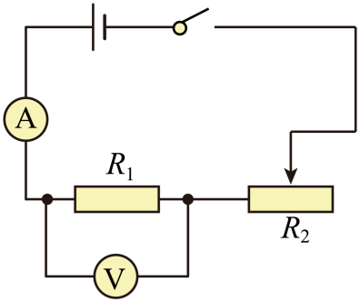

- A. 实验开始时，滑动变阻器的滑片处于阻值最大处，作用是保护电路
- B. 实验中，多次测量都是为了得到实验的普遍规律
- C. 探究电流与电压关系实验得出的结论是：当电阻一定时，电压与电流成正比
- D. 探究电流与电阻的关系时，用15Ω电阻替换10Ω电阻，为使电压表示数不变，应将滑片向右调节

【答案】C

【解析】A．实验开始时，滑动变阻器的滑片处于最大值端，作用是使电路中的电流最小，可以保护电路，故A正确，不符合题意；
B．实验中为得出普遍性的结论，从而需要多次测量，故B正确，不符合题意；
C．探究通过导体的电流与导体两端电压关系时，要控制电阻不变，记录电流随电压的变化关系，可得结论：当电阻一定时，电流与电压成正比，故C错误，符合题意；
D．探究电流与电阻的实验中应控制电压不变，即应保持电阻两端的电压不变，将定值电阻由10Ω改接成15Ω的电阻，根据串联分压原理可知，电阻增大，其分得的电压增大；根据串联电路电压的规律可知应增大滑动变阻器分得的电压，由分压原理，应增大滑动变阻器连入电路中的电阻，故应将滑片向左移动，使电压表示数不变，故D正确，不符合题意。
故选C。

## 118. 单选题（难度：适中）

同学们在“探究电流跟电压的关系”的实验中，对设计的电路进行了改进，如图甲、乙。下列说法正确的是：（　）
       
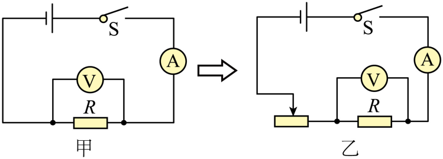

- A. 图甲中，使用不同阻值的电阻也能完成该探究实验
- B. 图甲改进为图乙，能实现多次实验，得到电流跟电压的关系
- C. 图乙中，移动滑动变阻器目的是保持电阻R两端电压不变
- D. 图乙中，仅利用本实验的器材可探究电流与电阻的关系

【答案】B

【解析】A．探究电流和电压的关系，需保持电阻不变，改变导体两端的电压，所以使用不同阻值的电阻不能完成该探究实验，故A错误；
BC．乙图添加了滑动变阻器，通过移动滑动变阻器的滑片，可以改变导体两端的电压，实现多次实验，得到电流跟电压的关系，故B正确，C错误；
D．在“探究电流跟电阻关系”的实验中，需控制电阻两端电压不变，多次改变电阻阻值，故需要添加几个阻值不同的电阻，故D错误。
故选B。

## 119. 单选题（难度：适中）

如图所示，在探究“电流跟电压的关系”实验中，下列说法中（　　）      ①探究电流跟电压的关系时，需要控制导体的电阻一定②滑动变阻器可以起到改变定值电阻两端电压的作用③多次实验是为了减小实验误差④实验的结论是：电流跟电压成反比

【答案】A

## 120. 单选题（难度：适中）

如图是电学中比较重要的电路图，利用此电路图可以完成初中电学的多个实验。若电源电压保持不变，不可忽略温度对灯丝电阻的影响，闭合开关S，下列说法正确的是（　　）
      
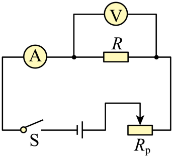

- A. 若探究电流与电阻关系，定值电阻R由5Ω换成10Ω后，为完成实验，应将滑片右移
- B. 若将定值电阻R换成小灯泡，可以探究电流与电压的关系
- C. 若要测量定值电阻R的值，可移动滑片记录多组数据，算出多个电阻值求其平均值，可以减小误差
- D. 在上述三个实验中，滑动变阻器的作用相同，都是改变电阻两端的电压和通过的电流

【答案】C

【解析】A.若探究电流与电阻关系，应控制定值电阻两端的电压不变，定值电阻R由5Ω换成10Ω后，由串联分压规律可知，定值电阻两端的电压变大，为完成实验，应让滑动变阻器两端的电压变大，将滑片左移动，故A错误；
B.探究电流与电压的关系，应控制定值电阻的阻值不变，而灯泡灯丝的电阻随温度的升高而增大，所以不可以探究电流与电压的关系，故B错误；
C.若要测量定值电阻R的值，为减小误差，可移动滑片记录多组数据，算出多个电阻值求其平均值，故C正确；
D.探究电流与电阻关系，滑动变阻器的作用是应控制定值电阻两端的电压不变；探究电流与电压的关系，和测量定值电阻R的值，滑动变阻器的作用是改变电阻两端的电压和通过的电流，故D错误。
故选C。

## 121. 单选题（难度：简单）

如图所示，探究“电流跟电压的关系”实验中，下列说法不正确的是（　　）

【答案】A

## 122. 单选题（难度：适中）

在“探究电流与电阻关系”的实验中，电路如图所示。先接入5Ω的定值电阻，移动滑片P，使电压表示数为2V，读出电流表示数。接着换上10Ω的定值电阻，不进行其他操作就闭合开关。此时电压表示数及应进行的操作是（　　）
      
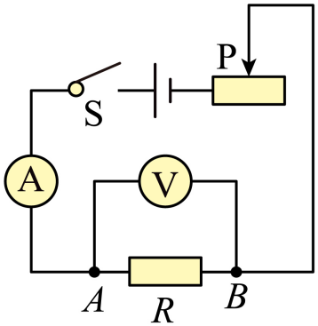

- A. 小于 2V、增大变阻器接入的阻值
- B. 小于2V，减小变阻器接入的阻值
- C. 大于2V，增大变阻器接入的阻值
- D. 大于2V，减小变阻器接入的阻值

【答案】C

【解析】当A、B两点间的电阻由5Ω更换为10Ω后，AB间的电压将增大，该实验要控制AB间的电压不变，所以下一步的操作是：向右滑动滑片，使滑动变阻器连入的电阻变大（分压变大），使AB间的电压减小，直到电压表的示数为2V为止，故C符合题意，ABD不符合题意。
故选C。

## 123. 单选题（难度：适中）

小刚同学用如图示电路探究“一段电路中电流跟电阻的关系”在此实验过程中，当A、B两点间的电阻由10Ω更换为15Ω后，为了探究上述问题，他应该采取的唯一操作是（　　）
      
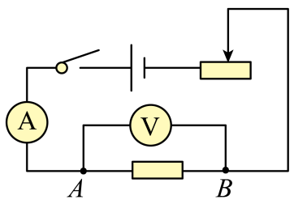

- A. 将电池个数增加
- B. 保持变阻器滑片不动
- C. 将变阻器滑片适当向左移动
- D. 将变阻器滑片适当向右移动

【答案】D

【解析】在滑动变阻器滑片位置不变的情况下，电路中由于将10Ω的定值电阻换成15Ω的定值电阻，使整个电路的电阻值R总增大，由\( I=\frac{U}{R}\)可知，电路中的总电流减小，此时滑动变阻器两端的电压U滑=IR滑，由于R滑不变，I减小，导致了U滑减小，而定值电阻两点之间的电压等于总电压减去滑动变阻器两端的电压，由于滑动变阻器两端的电压减小导致了定值电阻两点之间的电压增大，为了保证导体两端的电压不变，要减小定值电阻两点之间的电压U2，根据公式U2=IR2可知，R2为15Ω不变，只能减小电路中的电流，所以要使电路中的电阻增大，即滑片P向右端移动增大电阻。
故选D。

## 124. 单选题（难度：简单）

小明利用图的电路探究“导体中电流跟电阻的关系”。电源电压恒定不变，多次改变电阻箱R2的阻值，通过调节滑动变阻器接入电路的电阻R1，正确完成实验，记录各次实验中电压表示数U和电流表示数\( I\).则下列反映这四个量之间的变化关系图象中，一定不正确的是（　　）
         
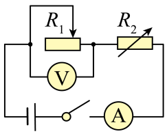

【答案】D

【解析】由图知道，R1、R2与电流表串联在电路中，电压表测R1两端电压，由控制变量法知道，探究“导体中电流跟电阻的关系”时应控制R2两端电压保持不变，
A．图像中，电路中电流与R1成反比，调节滑片后R1两端电压（即电压表示数）也保持不变，由U1 =I R1知道，I与R1成反比，故A正确，不符合题意；
B．图像中，R1两端电压不随R1的变化而变化。实验中要控制R2两端电压保持不变，电源电压恒定不变，由串联电路电压特点知道，应控制R1两端电压不变，当改变R2的阻值后，要保证R1两端电压不变，由串联电路的分压原理知道，需要改变R1连入电路的阻值，故B正确，不符合题意；
C．图像为过原点的直线，即R1与R2成正比。由于串联电路中电流处处相等，故I1 =I2，由欧姆定律知道，
\( \frac{{U}_{1}}{{R}_{1}}\text{=}\frac{{U}_{2}}{{R}_{2}}\)，
实验中要控制R2两端电压保持不变，也要控制R1两端电压不变，即
\( \frac{{U}_{1}}{{U}_{2}}\text{=}\frac{{R}_{1}}{{R}_{2}}\text{=}定值\)，
故C正确，不符合题意；
D．图像中，随电路中电流增大，R2 阻值变小。电源电压恒定不变，而
\( I=\frac{U}{{R}_{1}+{R}_{2}}\)，
电阻箱R2的阻值变化时，滑动变阻器R1的阻值也要发生变化，I与R2不是一次函数关系，故D错误，符合题意。

## 125. 单选题（难度：适中）

小刚用图所示电路探究“通过导体的电流跟电阻的关系”。实验过程中，当把电阻R由5Ω更换为10Ω后，为了探究上述问题，他应采取的操作是（　）

【答案】A

## 126. 单选题（难度：适中）

小刚同学用如图所示的电路研究电流跟电阻的关系。在实验过程中，当A、B两点间的电阻由5Ω更换为10Ω后，他下一步的操作是（　　）
     
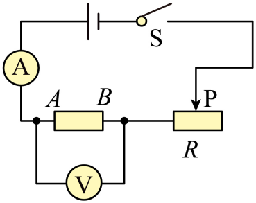

- A. 记录电流表和电压表的示数
- B. 将变阻器滑片向左移动
- C. 将变阻器滑片向右移动
- D. 增加电池的个数

【答案】C

【解析】研究电流跟电阻的关系时，应控制定值电阻两端电压保持不变。在实验过程中，当A、B两点间的电阻由5Ω更换为10Ω后，滑动变阻器的电阻值不变，电路中定值电阻的阻值变大，所以整个电路的总电阻值变大，由公式\( I=\frac{U}{R}\)可知，电路中的电流减小，此时滑动变阻器两端的电压减小，定值电阻两端电压变大，要使定值电阻两端的电压不变，应减小电路中的电流，增大滑动变阻器接入电路的电阻值，即将变阻器滑片适当向右移动，使电压表的示数不变。
故选C。

## 127. 单选题（难度：简单）

某导体中的电流与它两端电压的关系如图，下列说法正确的是（  ）
      
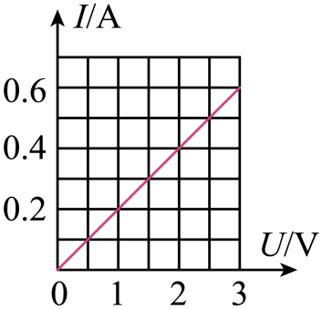

- A. 当导体两端的电压为0时，电阻为0
- B. 该导体的电阻随电压的增大而减小
- C. 当导体两端的电压为0时，电阻为5Ω
- D. 当导体两端的电压为2V时，电流为0.6A

【答案】C

【解析】图中的横坐标为电压U，图中的纵坐标为电流I；根据欧姆定律可知电阻R=U/I=3V/0.6A=5Ω，而导体的电阻与其两端电压的大小没有关系，当导体两端电压为0时，电阻大小仍为5Ω，A说法错误；B说法错误；C说法正确；从图中可得当导体两端的电压为2V时，电流大小为0.4A，答案选C．

## 128. 单选题（难度：适中）

小明同学为了探究电流跟电阻的关系，在如图所示的情况下，将A、B两点间10Ω的电阻更换为20Ω的电阻，下一步的操作应当是（　　）

【答案】A

## 129. 单选题（难度：适中）

如图所示，是探究电流与电压、电阻间的定量关系时所用的电路图，表格中是实验时记录的部分数据。下列说法正确的是（　　）实验序号U/VI/A①1.00.20②2.00.40③3.00.58

【答案】A

## 130. 单选题（难度：适中）

小明同学用控制变量法探究“电流跟电阻的关系”，电路如图所示。在此实验过程中，当A，B两点间的电阻由5Ω换成10Ω时，他下一步应采取的正确操作（　　）

【答案】A

## 131. 单选题（难度：适中）

根据“探究通过导体的电流与其两端电压的关系”实验做出的图像如图所示，下列说法正确的是（　）
      
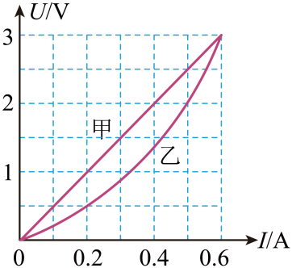

- A. 由图可得出“甲导体的电压与电流成正比”的结论
- B. 当导体乙两端的电压为2V时，通过导体乙的电流为0.4A
- C. 将两导体并联后接在3V的电源上，干路中的电流为0.9A
- D. 将两导体串联后，当电路中的电流为0.5A时，电源总电压为4.5V

【答案】D

【解析】A．由图可知：在电阻一定时，通过甲导体的电流与甲导体两端的电压成正比，而不是电压与电流成正比，故A错误； 
B．由图像可知，当导体乙两端的电压为2V时，通过导体乙的电流为0.5A，故B错误；
C．由图像可知，将两导体并联后接在3V的电源上，通过甲、乙的电流都为0.6A，干路中的电流为0.6A+0.6A=1.2A
故C错误；
D．由图像可知，将两导体串联后，当电路中的电流为0.5A时，甲的电压为2.5V，乙的电压为2V，则电源总电压为4.5V，故D正确。
故选D。

## 132. 多选题（难度：适中）

在电现象中，有四个同学们非常熟悉的实验：①探究电流与电压的关系；②探究电流与电阻的关系；③探究串联电路电压的规律；④探究影响电阻大小的因素。关于这四个电学实验，下列说法中正确是（　）

- A. ①实验中可用小灯泡替代定值电阻
- B. ②实验中滑动变阻器的主要作用是要保持定值电阻两端的电压不变
- C. ③实验中多次测量目的是为了减小误差
- D. ④实验中需要采用控制变量法

【答案】B/D

【解析】A．探究电流与电压的关系，需要保持电阻一定，改变接入电阻两端的电压，而灯泡的电阻会随温度发生变化，故A错误；
B．探究电流与电阻的关系，需要保持电压一定，改变电阻的大小，滑动变阻器的主要作用是要控制定值电阻两端的电压不变，故B正确；
C．探究串联电路电压的规律，多次测量是为了寻找普遍规律，故C错误；
D．电阻与导体材料、长度和横截面积都有关系，研究其中一个物理量对电阻的影响，需要控制其它物理量，采用控制变量法，故D正确。
故选BD。

## 133. 单选题（难度：适中）

于“探究电流跟电阻的关系”和“伏安法测量电阻”的这两个实验，下列说法不正确的是（　）

- A. 两个实验采用的都是控制变量的研究方法
- B. 两实验的实验电路在教科书中是相同的
- C. 前者收集多组数据的目的，是为了得出电流跟电阻的定量关系
- D. 后者收集多组数据的目的，是为了取电阻的平均值，减小误差

【答案】A

【解析】在“探究电流跟电阻的关系”时需要采用控制变量法，而“伏安法测量电阻”时不需要利用控制变量法，故A不正确；这两个实验的实验电路图都相同，故B正确；实验过程为了减小误差，常采用多次测量取平均值的办法进行分析解答，故CD都正确，即只有A符合题意，故选A．

## 134. 单选题（难度：适中）

小明同学在探究通过导体的电流与电阻的关系时，根据实验数据在图中描点作出图像，图中阴影部分面积大小表示的物理量为（　）
      
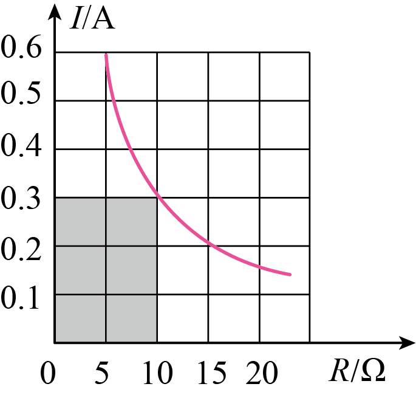

- A. 电流
- B. 电阻
- C. 电压
- D. 电能

【答案】C

【解析】根据控制变量法可知，探究电流与电阻的关系时要保持定值电阻两端的电压不变，结合\( U=IR\)可知在I-R图像中阴影部分面积表示的物理量为电压，故C符合题意，ABD不符合题意。
故选C。

## 135. 多选题（难度：适中）

在利用如图1所示的电路探究电流和电阻的关系时，电源电压保持3V不变，分别将5Ω、10Ω、15Ω、20Ω的定值电阻R连入电路，按实验要求测得通过各定值电阻的电流，描绘出如图2所示的图像，则下列判断中正确的是（　）

【答案】A

## 136. 多选题（难度：适中）

如图，在探究“电流与电阻的关系”实验中，关于滑动变阻器的说法正确的是（　　）

【答案】A

## 137. 多选题（难度：适中）

在探究“电压一定时，电流与电阻关系”的实验中，电路如图所示。先在A、B间接入5Ω的定值电阻R，移动滑片，使电压表示数为2V，读出电流表示数。接着取下5Ω的电阻分别换上10Ω、15Ω的定值电阻，移动滑片，使电压表示数仍为2V。但在实验中，当换上15Ω的定值电阻时，无论怎样移动滑片，电压表示数都不能回到2V。对于实验不能继续的原因和可能让实验继续进行下去的方法。下列分析正确的是（　　）

【答案】A

## 138. 多选题（难度：适中）

探究“通过电阻的电流与电阻的大小关系”时，我们一般需要先预设一个电压值，实验中保持电阻两端电压为预设值不变，现采用如图所示电路进行探究，器材：学生电源（ 6V）、滑动变阻器（15Ω，1A）、电流表、电压表、开关、三个定值电阻（ 5Ω、10Ω、15Ω）及导线若干，以下说法正确的是（　　）

【答案】A

## 139. 单选题（难度：适中）

某同学利用如图甲所示的电路进行实验，电源电压恒为3V，更换5个定值电阻Rx得到如图乙所示的图像。以下有关叙述正确的是（　　）

【答案】A

## 140. 单选题（难度：适中）

同学为了探究“电流跟电阻”的关系，在如图所示的情况下，将电阻R由10Ω的电阻更换为20Ω的电阻，闭合开关后，下一步的操作应当是（　　）

【答案】A

## 141. 单选题（难度：适中）

张华同学在探究通过导体的电流与其两端电压的关系时，将记录的实验数据通过整理作出了如图所示的图像，根据图像，下列说法错误的是（　　）
      

- A. 通过导体a的电流与其两端的电压成正比
- B. 导体a的电阻大于导体b的电阻
- C. 当在导体a的两端加上\( \text{2V}\)的电压时，通过导体a的电流为\( \text{0.4A}\)
- D. 当在导体b的两端加上\( \text{2V}\)的电压时，通过导体b的电流为\( \text{0.2A}\)

【答案】B

【解析】A．如图，导体a的\( I-U\)图线为一条过原点的斜线，是正比例函数图像，因此通过导体a的电流与其两端的电压成正比，故A正确，不符合题意；
C．由图线a可知，导体a两端的电压为\( \text{2V}\)时，通过导体a的电流为\( \text{0.4A}\)，故C正确，不符合题意；
D．由图线a可知，导体b两端的电压为\( \text{2V}\)时，通过导体b的电流为\( \text{0.2A}\)，故D正确，不符合题意；
B．导体a的电阻\( {R}_{\text{a}}=\frac{{U}_{\text{a}}}{{I}_{\text{a}}}=\frac{2.0\text{V}}{0.4\text{A}}=5\mathrm{\Omega }\)
导体b的电阻\( {R}_{\text{b}}=\frac{{U}_{\text{b}}}{{I}_{\text{b}}}=\frac{2.0\text{V}}{0.2\text{A}}=10\mathrm{\Omega }\)
导体a的电阻小于导体b的电阻，故B错误，符合题意。
故选B。

## 142. 单选题（难度：适中）

如图所示，探究“电流跟电压的关系”实验中，下列说法不正确的是（　　）

【答案】A

## 143. 多选题（难度：适中）

用如图所示电路“探究电流与电阻的关系”，所用器材：电源（6V），定值电阻<latex class="math-tex">\( {R}_{1}\)</latex>（5Ω、10Ω、15Ω、20Ω各1个）和规格为“15Ω  1A”的滑动变阻器<latex class="math-tex">\( {R}_{2}\)</latex>，下表为实验数据记录表。关于该实验，下列说法正确的是（　　）     序号电

【答案】A

## 144. 单选题（难度：适中）

沈青同学用如图甲所示的电路探究“电流与电阻的关系”．电源电压不变，实验数据如下表，若第四次实验时将定值电阻的阻值由15Ω调为某一阻值后，电流表的示数
如图中乙所示，则调换的电阻为（　）
实验次数
1
2
3
4

电阻R/Ω
5
10
15
 

电流I/A
1.2
0.6
0.4
 

     

- A. 20Ω
- B. 25Ω
- C. 30Ω
- D. 40Ω

【答案】A

【解析】探究“电流与电阻的关系”时，要保持不同的定值电阻两端的电压不变，据此由1、2、3次实验时的数据，根据欧姆定律可得出定值电阻两端的电压为：U=1.2A\( \times 5\mathrm{\Omega }=0.6\mathrm{A}\times 10\mathrm{\Omega }=0.4\mathrm{A}\times 15\mathrm{\Omega }=6\mathrm{V}\)，由图乙可读出电流表示数为0.3A，则调换的电阻为R\( =\frac{U}{{\mathrm{I}}^{\mathrm{\text{'}}}}=\frac{6V}{0.3A}=20\mathrm{\Omega }\).
故选A

## 145. 单选题（难度：适中）

小明在“探究电流与电阻的关系”时，连接的电路如图甲所示。他用阻值为5Ω、10Ω、15Ω、20Ω的定值电阻分别进行了4次实验，得到电流与电阻的关系图像如图乙所示。下列说法正确的是（　　）

【答案】A

## 146. 单选题（难度：适中）

小明用图甲的电路探究“电流跟电阻的关系”，并用实验数据作出I~R图像如图乙所示，关于该实验，下列说法中错误的是（　　）

【答案】A

## 147. 填空题（难度：适中）

用图甲所示的电路探究“电压一定时，通过导体的电流与电阻的关系”，已知电源电压恒为4V，实验用到的定值电阻R分别是5Ω、10Ω、15Ω、20Ω、25Ω。  （1）连接电路时，开关应处于___状态，滑动变阻器滑片移至___（填“左”或“右”）端；（2）将5Ω的电阻接入电路，闭合开关，调节滑动变阻器的滑片，直到电压表示数为2.5V，记下电流表示数。换用10Ω的电阻后，调节滑动变阻器的滑片，记下电流表的示

## 148. 多选题（难度：适中）

某同学利用如图甲所示的电路进行实验，电源电压恒为3V，更换5个定值电阻Rx，得到如图乙所示的图像。以下有关叙述正确的是（　　）
      

- A. 该同学研究的是电流和电压的关系
- B. 实验中电压表的示数保持2.5V不变
- C. 滑动变阻器阻值变化范围为1Ω～5Ω
- D. 将Rx从5Ω换成10Ω后，应将滑片P向左移

【答案】B/C

【解析】A．根据控制变量法，更换5个定值电阻Rx，即改变电阻的大小，故研究电流与电阻的关系，故A错误；
B．由图中数据知：电阻的电压为
\( U＝IR＝0.5\text{A}\times 5\text{Ω}＝0.1\text{A}\times 2\text{5Ω}＝2.5\text{V}\) 
实验中电压表的示数保持2.5V不变，故B正确；
C．由图乙知，电路的最大电流为0.5A，由串联电路的规律及欧姆定律，此时变阻器连入电路的最小电阻为
\( {R}_{\mathrm{小}}＝\frac{U}{{I}_{1}}-{R}_{1\text{x}}=\frac{3\text{V}}{0.5\text{A}}-5\mathrm{\Omega }=1\mathrm{\Omega }\) 
电路的最大电流为0.1A，由串联电路的规律及欧姆定律，此时变阻器连入电路的最大电阻为
\( {R}_{\mathrm{大}}＝\frac{U}{{I}_{2}}-{R}_{\text{4x}}=\frac{3\text{V}}{0.1\text{A}}-25\mathrm{\Omega }=5\mathrm{\Omega }\) 
故滑动变阻器阻值变化范围为1Ω～5Ω，故C正确；
D．将Rx从5Ω换成10Ω后，电阻变大，根据分压原理，电压表示数变大，因要控制电阻的电压不变，故应增大变阻器分得的电压，应增大变阻器连入电路的电阻，应将滑片P向右移，故D错误。
故选BC。

## 149. 单选题（难度：适中）

利用如图甲所示的电路探究电流和电阻的关系，电源电压恒为3V，分别将5Ω、10Ω、15Ω、20Ω、25Ω的定值电阻R连入电路，并根据实验数据描绘出I-R图像，如图乙所示；则以下选项错误的是（　　）

【答案】A

## 150. 单选题（难度：适中）

用如图所示电路探究“电压一定时，电流与电阻关系”的实验，在A、B间接入5Ω的定值电阻R，移动滑片P，使电压表示数为2V，读出电流表示数，接着取下5Ω的电阻分别换上10Ω、15Ω的定值电阻，移动滑片，使电压表示数仍为2V，当换上15Ω的定值电阻时，无论怎样移动滑片，电压表示数都不能回到2V。对此现象，下列分析正确的是（　　）
     

- A. 15Ω电阻太小，换一个更大的定值电阻，继续实验
- B. 变阻器的最大阻值太大，换一个最大阻值小一点的变阻器继续实验
- C. 在第一次接入5Ω的定电阻时，移动滑片，使电压表示数为定值1.5V，继续实验
- D. 将三个电阻按15Ω、10Ω、5Ω的由大到小的顺序接入进行实验，可以避免这种现象

【答案】D

【解析】AB．由图可知定值电阻R与滑动变阻器串联。根据串联电路的分压特点可知，当换用阻值更大的定值电阻时，电压表的示数将变大，为保证电压表的示数不变，应增大滑动变阻器的阻值。定值电阻越大，所需滑动变阻器的阻值越大，当电阻增大的某一值时，滑动变阻器不能使电阻两端的电压保持在2V不变，需要换一个最大阻值更大一点的变阻器继续实验，故AB错误；
D．将三个电阻按15Ω、10Ω、5Ω的由大到小的顺序接入进行实验，第一次实验中所需滑动变阻器的阻值最大，则剩余两个定值电阻电阻要小一些，所需滑动变阻器的阻值也要小一些，能使电阻两端的电压控制不变，故D正确；
C．在第一次接入5Ω的定值电阻时，使电压表示数为定值1.5V，根据串联分压原理可得
\( \frac{1.5\text{V}}{U-1.5\text{V}}=\frac{R}{{R}_{\mathrm{滑}}}\) 
左边为一定值，右边也为一定值，则完成实验所需滑动变阻器的阻值会更大，所以此时不能完成整个实验，故C错误。
故选D。

## 151. 多选题（难度：适中）

小红同学利用如图所示实验电路探究“电压一定时，电流与电阻的关系”，关于这个探究实验，下列说法正确的是（　）
      

- A. 实验通过调节电阻箱改变自变量
- B. 实验通过调节滑动变阻器改变自变量
- C. 实验通过调节电阻箱保持控制变量不变
- D. 实验通过调节滑动变阻器保持控制变量不变

【答案】A/D

【解析】在探究电流与电阻关系实验过程中，需要改变接入电路的电阻阻值大小，同时通过改变滑动变阻器接入电路阻值的多少来保持不同阻值的电阻两端电压一定，所以通过调节滑动变阻器保持电阻R两端电压不变． 
故选AD．

## 152. 单选题（难度：适中）

研究电流跟电压、电阻的关系，用如图所示的电路，分“保持电阻不变”和“保持电压不变”两步进行，在“保持电阻不变”这一步，实验要求是（　）  
     

- A. 保持R′的滑片位置不动
- B. 保持R不变，调节R′滑片到不同的适当位置
- C. 保持R的电压不变
- D. 保持电路中的电流不变

【答案】B

【解析】根据题意，本实验需要采用控制变量法，所以，研究电流跟电压的关系时，保持电阻不变，通过移动滑动变阻器的滑片，改变定值电阻的电压和电流；研究电流跟电压的关系时，应保持电阻不变，调节R′滑片到不同的适当位置，故选B．

## 153. 单选题（难度：适中）

在探究“电流与电阻的关系”的实物电路如图所示，电源电压恒为3V，实验准备了5Ω、10Ω、20Ω的电阻进行实验，当将5Ω的电阻接入R所在的位置时，调节滑动变阻器，使电压表的示数为2V，记下此时电流表的示数；接着用10Ω的电阻替换5Ω进行实验，应把滑动变阻器的滑片怎样移动，同时眼睛盯住电压表并保持示数为2V不变，才可能达到实验目的（　　）
      

- A. 向左
- B. 向右
- C. 不动
- D. 先向左再向右

【答案】B

【解析】根据串联分压原理可知，将定值电阻由5Ω改接成10Ω的电阻，电阻增大，其分得的电压增大；探究电流与电阻的实验中应控制电压不变，即应保持电阻两端的电压不变，根据串联电路电压的规律可知，应增大滑动变阻器分得的电压，由分压原理，应增大滑动变阻器连入电路中的电阻，即应该将滑片向右调节，使滑动变阻器的阻值变大。故B符合题意，ACD不符合题意。
故选B。

## 154. 单选题（难度：适中）

小华同学利用如图所示的电路做“伏安法测电阻”的实验，已知电源电压恒为6V，滑动变阻器标有“20Ω  1A”字样，实验中该同学填写的实验数据如表所示。下列关于实验的几种说法中正确的是（　）     序号12345U/V1.02.03.04.05.0I/A0.100.210.300.400.49①序号“1”的实验数据不是本实验中测得的②序号“4”的实验中，滑动变阻器与待测电阻的阻值之比为2∶1③序号“

【答案】A

## 155. 填空题（难度：适中）

小刚和小军在探究“电流与电压、电阻的关系”实验中：
     

（1）小刚探究“电流与电压的关系”，该实验中滑动变阻器的作用除了保护电路外，其作用主要是；
（2）实验中，所测的数据如表一所示，由表一得出的结论是；
表一

\( R=10\mathrm{\Omega }\) 
电压/V
1.5
2
2.5

电流/A
0.15
0.2
0.25

表二

\( U=2\text{V}\) 
电阻/Ω
5
10
20

电流/A
0.4
0.2
0.1

（3）小军探究“电流与电阻的关系”，所测的数据如表二所示：
①请依据表格和电路图分析，将AB间电阻由5Ω换成10Ω，闭合开关进行实验时，应向（选填“左”或“右”）移动滑片P，使电压表的示数保持V不变；
②由表二数据可得：。

【答案】改变定值电阻两端的电压，导体电阻一定时，通过导体的电流与导体两端的电压成正，右，2，导体两端电压一定时，通过导体的电流与电阻成反比

## 156. 单选题（难度：适中）

如图所示是电阻\( {R}_{\text{1}}、{R}_{\text{2}}\)的电压—电流关系图像，下列说法正确的是（　　）
        

- A. 电阻\( {R}_{\text{1}}\)两端电压为\( \text{4V}\)时，通过\( {R}_{\text{1}}\)的电流是\( \text{0.3A}\)
- B. 电阻\( {R}_{\text{1}}、{R}_{\text{2}}\)串联，当电流为\( \text{0.2A}\)时，\( {R}_{\text{1}}、{R}_{\text{2}}\)两端总电压为\( \text{3V}\)
- C. 电阻\( {R}_{\text{1}}、{R}_{\text{2}}\)并联到\( \text{2V}\)电压下，干路中的电流是\( \text{0.3A}\)
- D. 电阻\( {R}_{1}\)和\( {R}_{2}\)的阻值之比是\( 1:2\)

【答案】B

【解析】A．由图可知，当电阻\( {R}_{1}\)两端电压为\( \text{4V}\)时，通过其电流为\( \text{0.4A}\)，故A错误；
B．由图像可知，若电阻\( {R}_{1}、{R}_{2}\)串联，当电流为\( \text{0.2A}\)时，\( {R}_{1}、{R}_{2}\)两端电压分别为\( \text{2V}、\text{1V}\)，\( {R}_{1}、{R}_{2}\)两端总电压：\( U={U}_{1}+{U}_{2}=2\text{V}+1\text{V}=3\text{V}\)，故B正确；
C．由图像可知，电阻\( {R}_{1}、{R}_{2}\)并联到\( \text{2V}\)电压下时，通过\( {R}_{1}、{R}_{2}\)的电流分别为\( 0.2\text{A}、0.4\text{A}\)，干路中的电流为\( I={I}_{1}+{I}_{2}=0.2\text{A}+0.4\text{A}=0.6\text{A}\)，故C错误；
D．由图像可知，\( {R}_{1}、{R}_{2}\)为定值电阻，若电阻\( {R}_{1}、{R}_{2}\)串联，当电流为\( \text{0.2A}\)时，\( {R}_{1}、{R}_{2}\)两端电压分别为\( \text{2V}、\text{1V}\)，根据欧姆定律可得\( {R}_{1}=\frac{{U}_{1}}{{I}^{\text{'}}}=\frac{2\text{V}}{0.2\text{A}}=10\mathrm{\Omega },{R}_{2}=\frac{{U}_{2}}{{I}^{\text{'}}}=\frac{1\text{V}}{0.2\text{A}}=5\mathrm{\Omega }\)，电阻\( {R}_{1}\)和\( {R}_{2}\)的阻值之比为\( {R}_{1}:{R}_{2}=10\mathrm{\Omega }:5\mathrm{\Omega }=2:1\)，故D错误。
故选B。

## 157. （难度：适中）

在“探究电阻一定时电流与电压的关系”实验中，电源电压是3V；实验次数12345电压U/V0.511.522.5电流I/A0.10.20.30.40.5

## 158. 填空题（难度：适中）

小明想探究电流与电阻的关系，实验室提供了<latex class="math-tex">\( 5\mathrm{\Omega }\)</latex>、<latex class="math-tex">\( 10\mathrm{\Omega }\)</latex>和<latex class="math-tex">\( 20\mathrm{\Omega }\)</latex>的电阻各一个，如图所示，但是

## 159. （难度：适中）

某小组猜想电流与电压和电阻有关，现要探究电流与电压的关系。

为探究电流与电压的关系，实验中应控制不变；

该小组连接的部分电路如图所示，请用笔画线代替导线将电路补充完整（导线不能交叉）；
     

正确连接电路后，闭合开关前，滑动变阻器的滑片应调到最端；

试触时发现电压表和电流表的指针均不偏转。为查找故障，闭合开关，保持导线ab的a端不动，将b端依次接到A、B和C接线柱，电压表的指针均偏转，电流表指针均不偏转。若电路中只有一处故障，则发生的故障是；

排除故障后，闭合开关，通过移动的位置改变电阻两端的电压，测量电阻两端的电压U和对应的电流I，记录的实验数据如下表所示；
数据序号
1
2
3
4
5

电压U/V
1.60
1.90
2.20
2.50
2.80

电流I/A
0.16
0.19
0.22
0.25
0.28

分析表格中的数据，发现电压与其对应电流的比值，从而得出结论：。

【答案】电阻阻值，

 

，右，滑动变阻器断路，滑动变阻器滑片/不变/当电阻一定时，通过导体的电流与其两端的电压成正比

## 160. （难度：适中）

小明用图甲所示的电路探究“通过导体的电流与电阻的关系”，电源电压为3V保持不变，阻值为5Ω、10Ω、20Ω的定值电阻各一个，满足测量需求的电流表、电压表各一个。
      

闭合开关S前，滑动变阻器的滑片P应移到（选填“A”或者“B”）端；闭合开关S后，发现电流表有示数，电压表无示数，故障可能是定值电阻R。

排除故障后，接入5Ω的定值电阻，移动滑动变阻器的滑片，使电压表示数如图乙所示，读数为V，记录此时电流表示数。断开开关，将5Ω的定值电阻换为10Ω的定值电阻，闭合开关，移动滑片直到为止，再次记录电流表示数。更换20Ω的定值电阻继续实验。

图丙是另一同学利用自己的实验数据绘制的\( I-R\)图像。该同学（选填“能”或“不能”）得出正确结论，说明理由。

【答案】<i>B</i>/短路，1/电压表示数为1V，不能/没有控制定值电阻两端电压不变

## 161. （难度：适中）

某实验小组计划探究“电流与电压、电阻”的关系，设计的电路如图甲所示。

