# 第三节 热机（同步练习）

> 教材：物理·九年级全一册·沪科技版2024新教材 ｜ 来源：国家中小学智慧教育平台·在线练习 ｜ 共 117 题

## 1. 填空题

在四冲程内燃机工作过程中，一个工作循环中包括个冲程，对外做功次，曲轴转圈；若某汽油机的转速为1800r/min，则1s内汽油机对外做功次，1s内它完成个冲程．

【答案】4，1  ，2   ，15   ，60

## 2. 单选题（难度：适中）

甲、乙两台汽油机，\( {P}_{\text{甲}}>{P}_{\text{乙}}\)，\( {\eta }_{\text{甲}}\le {\eta }_{\text{乙}}\)，则（    ）．

- A. 甲比乙做功快
- B. 甲比乙做功多
- C. 甲比乙消耗燃油质量多
- D. 甲和乙消耗燃油质量一样多

【答案】A

## 3. 单选题（难度：简单）

做同样的有用功，甲、乙柴油机用时和消耗柴油对比如下，下列说法正确的是（    ）．
柴油机
完成工作量
时间
消耗柴油

甲
相同
3h
5kg

乙
2h
6kg

- A. 甲的功率较大，热机效率较低
- B. 甲的功率较大，热机效率较高
- C. 乙的功率较大，热机效率较高
- D. 乙的功率较大，热机效率较低

【答案】D

## 4. 单选题（难度：简单）

四冲程柴油机工作过程中，以下说法错误的是（    ）．

- A. 压缩冲程和做功冲程发生了能量的转化
- B. 做功冲程使汽车获得动力
- C. 排气冲程排出了汽车的尾气
- D. 吸气冲程吸入气缸的是柴油

【答案】D

## 5. 单选题（难度：简单）

下列关于柴油机与汽油机的说法中最恰当的是（    ）．

- A. 柴油机工作时噪声较小
- B. 柴油机工作时效率较高
- C. 柴油机主要用于轻便机械
- D. 二者结构相同，只是所用燃料不同

【答案】B

## 6. 单选题（难度：适中）

下列与四冲程汽油机有关的说法中正确的是（    ） ．

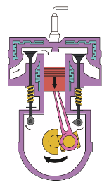

- A. 汽油机的效率较高，可达70%左右
- B. 汽油机的压缩冲程利用高温气体推动活塞对外做功
- C. 如图所示是吸气冲程
- D. 汽油机能量损失最大之处是燃料燃烧不完全

【答案】C

## 7. 多选题（难度：适中）

汽油机和柴油机有很多的异同点，下列有关四冲程汽油机和柴油机的异同点说法正确的是（      ）．

- A. 汽油机和柴油机都是内燃机
- B. 在吸气冲程中，汽油机吸入的只有空气，柴油机吸入的是柴油和空气的混合物
- C. 汽油机和柴油机的一个工作循环对外只做一次功，活塞往复两次
- D. 柴油机压缩冲程末的温度比汽油机高，燃料燃烧更完全，效率比汽油机高

【答案】A/C/D

## 8. 填空题（难度：适中）

一台单缸四冲程汽油机在做功冲程时，其气缸中的气体内能（填“增大”或“减小”）；若在1秒钟的时间内刚好完成40次工作循环，则该汽油机飞轮的转数为r/min．若该汽油机使用热值更高的燃料，则汽油机的效率（填“会”或“不会”）增大．

【答案】减小，4800  ，不会

## 9. 填空题（难度：适中）

“西气东输”工程已全线竣工，输送的燃料为天然气，这是利用了天然气较大的特性，而且使用天然气时对环境污染较小．天然气用掉一部分后，剩余天然气的热值（选填“变大”、“变小”或者“不变”），若完全燃烧10m3的天然气，能放出\( \text{J}\)的热量（天然气的热值为\( 8.4\times {10}^{7}\text{J/}{\text{m}}^{\text{3}}\)）．

【答案】热值，不变，$ 8.4\times {10}^{8}$

## 10. 填空题（难度：简单）

人们在选购轿车时，常常听到导购员介绍这辆车耗油少，这里耗油少是指汽油机的​高，行驶相同的路程，消耗燃料．

【答案】效率，少

## 11. 填空题

有一种“涡轮增压”（T型）轿车，通过给发动机更足量的空气使汽油更充分地燃烧，比普通轿车（L型）更节能，排气更清洁．同样的汽油加在T型轿车内与加在L型轿车内相比热值（选填“更大”、“一样大”或“更小”）；为防止发动机温度过高，用水进行冷却，这是利用水的较大；若散热器中装有\( \text{8kg}\)的水，水温升高\( \text{50}\text{℃}\)，水吸收的热量是\( \text{J}\)；若汽油机曲轴的转速为\( \text{3000r/min}\)，汽油机每秒内对外做功次．[\( {c}_{\text{水}}=\text{4.2×}{\text{10}}^{\text{3}}\text{J/}\left(\text{kg}\text{⋅℃}\right)\)]

【答案】一样大，比热容，$ 1.68\times {10}^{6}$，25

## 12. 填空题（难度：适中）

某实验小组利用如图所示的实验装置粗略测量蜡烛的热值\(q\)，图中\(A\)为穿有小木棍的容器（内装有水），\(B\)为下部开了许多通气孔的罩子．

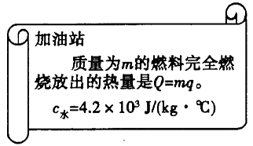
      
​（1）观察实验装置可知，实验小组同学是通过测量 间接测量蜡烛燃烧放出的热量；
​（2）要完成本实验，除了图中的实验器材，还必需的测量工具是和；
​（3）某次实验测得的数据如下表，则粗略测得这支蜡烛的热值\(q=\)\(\text{J}\text{／}\text{kg}\)．
物理量
测量值

容器中水的质量\(m\text{／}\text{g}\)
150

容器中水的初温\({t}_{1}\text{／}\text{℃}\)
25

容器中水的末温\({t}_{2}\text{／}\text{℃}\)
40

燃烧前蜡烛的质量\({m}_{1}\text{／}\text{g}\)
20.6

燃烧后蜡烛的质量\({m}_{2}\text{／}\text{g}\)
20

（4）本实验测出的热值会比真实值更，造成这一偏差的原因是（写一条即可）．

【答案】水吸收的热量，温度计，天平，\(1.575×1{0}^{7}\)，小，蜡烛燃烧释放的热量不能全部被水吸收

【解析】(1)实验小组同学是通过测量水所吸收的热量来间接测量蜡烛释放的热量；
(2)要完成本实验，需要测量水的温度与水和蜡烛的质量，因此还需要温度计与天平；
(3)这支蜡烛的热值\(q＝{Q}_{放}/{m}_{蜡}＝{Q}_{水吸}/{m}_{蜡}\)，又因为：\({Q}_{水吸}＝{c}_{水}{m}_{水}△{t}_{水}\)，代入数值，求得：蜡烛的热值\(q=1.575×1{0}^{7}\)J/kg  
(4)实验过程中蜡烛燃烧产生的热量有部分散失于空气中，蜡烛燃烧放出的热量没有全部被水吸收，因此实验测出的热值比真实值小。

## 13. 填空题（难度：适中）

小明利用图甲装置研究某燃料热值．他取少量燃料置于燃烧皿中，测出总质量为\( \text{30g}\)，点燃后对\( \text{100g}\)的热水加热\( \text{4min}\)立即熄灭燃料，再测得燃料和燃烧皿总质量为\( \text{25}\text{.}\text{8g}\)，并根据实验数据绘制的水温随时间变化的图象如图乙中\( a\)线所示．

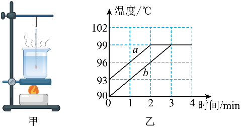
      
​（1）实验的第\( \text{2}\text{～}\text{4min}\)的过程中，水（选填“吸”或“不吸”）热；
​（2）已知此过程中燃料均匀燃烧放热，所放热量仅\( 60\%\)能被水吸收，\( \text{4min}\)内水吸收的热量
为\( \text{J}\)，则该燃料的热值为\( \text{J/kg}\)；[水的比热容为\( 4.2\times {10}^{3}\text{J/(kg∙}\text{℃}\text{)}\)，整个过程中忽略水的质量变化]
​（3）若实验装置和热损失比例均不变，利用该燃料加热另一杯水绘出了如图乙中\( b\)线，则这杯水的质量（选填“大于”“等于”或“小于”）上一杯水质量；
​（4）用此方法计算的燃料的热值比实际值的（选填“偏大”、“偏小”）．理由是​．

【答案】吸，5040，$ 2\times {10}^{6}$，等于，偏小，燃料不能完全燃烧

## 14. 填空题（难度：适中）

某同学学习了燃料的热值后，自己设计了一个实验来“探究煤油和菜籽油的热值大小关系”．他实验时组装了如图所示的两套规格完全相同的装置，并每隔1分钟记录一次杯中水的温度（见下表）：

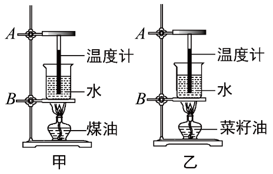

加热的时间/\( \text{min}\)
0
1
2
3
4
5
6

甲杯水温/\( \text{℃}\)
25
27
29
31
33
35
37

乙杯水温/\( \text{℃}\)
25
26
27
28
29
30
31

 
​（1）在安装、调整实验器材时，科学合理的顺序是（甲图中）；先调整固定的位置，再调整固定的位置；（以上两空均填“\( A\)”或“\( B\)”）
​（2）为了保证实验结论的可靠，实验时应控制两套装置中相同的量有加热时间和水的、；
​（3）通过表中记录的数据，你认为煤油和菜籽油两种燃料中，热值较大的是；
​（4）该同学实验前用天平测出了烧杯中水的质量及两油灯中燃料的质量，并由记录的数据、利用公式计算出了水吸收的热量，他认为通过这些数据能准确地计算出煤油和菜籽油的热值．你认为他的计算结果可靠吗？，为什么？．

【答案】B  ，A   ，质量，初温，煤油，不可靠，燃料燃烧产生的热量不能完全被水吸收、存在热损失

## 15. 单选题（难度：适中）

下列过程中，将内能转化为机械能的是（　　）

- A. 流星在大气层中穿行
- B. 用热水泡脚．脚感觉暖和
- C. 汽油机的压缩冲程
- D. 水沸腾时水蒸气顶起水壶盖

【答案】D

【解析】A．流星在大气层中穿行的过程中与空气摩擦，是摩擦生热，是机械能转化为内能。故A不符合题意；
B．用热水泡脚，是水的热量传递给了人的脚，是热传递。故B不符合题意；
C．汽油机的压缩冲程，是机械能转化为汽油和空气的内能。故C不符合题意；
D．水蒸气顶起水壶盖，是水蒸气的内能转化为壶盖的机械能。故D符合题意。
故选D。

## 16. 单选题（难度：适中）

小松同学发现当锅内气压过大时，蒸气就顶起锅盖。其能量转化与下列冲程能量转化相同的是（　　）

【答案】A

## 17. 单选题（难度：适中）

在如图所示四冲程汽油机的工作循环中，使汽缸内油气混合物内能增大的冲程是（　　）

【答案】A

【解析】A．图中两气门关闭，活塞向上运动，是汽油机的压缩冲程；在这一冲程中，活塞压缩燃料混合物，对其做功，使燃料混合物的内能增大、温度升高，故A符合题意；
B．图中两个气门关闭，火花塞点火，活塞下行，为做功冲程，此过程中内能转化为机械能，故B不符合题意；
C．图中进气门关闭，排气门打开，活塞向上运动，所以是排气冲程，此冲程无能量转化，故C不符合题意；
D．图中进气门打开，排气门关闭，活塞向下运动，所以是吸气冲程，此冲程无能量转化，故B不符合题意。
答案A。

## 18. 单选题（难度：简单）

下列交通工具中，没有利用热机的是（　　）

【答案】A

## 19. 单选题（难度：适中）

一单缸四冲程汽油机的转速为2400r/min，则下列说法中正确的是（　　）

【答案】A

## 20. 单选题（难度：适中）

汽车的发动机大多数是内燃机，内燃机是热机的一种，下列关于热机和环境保护的说法，正确的是（　　）

【答案】A

## 21. 单选题（难度：适中）

2025年3月17日，“谷神星一号”运载火箭将8颗卫星成功送入预定轨道，创造了中国航天史上的又一壮举。火箭发射时，燃料燃烧释放的能量使其加速升空，与该过程能量转化形式相同的是（　　）

- A. 热机做功冲程
- B. 钻木取火过程
- C. 水力发电过程
- D. 物体上抛过程

【答案】A

【解析】火箭发射时，是利用燃料的内能做功，是将内能转化为机械能。
A．热机做功冲程是将内能转化为机械能，故A符合题意；
B．钻木起火过程是将机械能转化为内能，故B不符合题意；
C．水力发电过程是水的机械能转化为电能，故C不符合题意；
D．物体上抛过程是物体动能转化为重力势能，故D不符合题意。
故选A。

## 22. 单选题（难度：简单）

下列生活中机械的动力装置不是热机的是（　　）

【答案】A

## 23. 单选题（难度：适中）

下列有关热机的说法正确的是（　　）

- A. 内燃机的冷却液需要用比热容较小的物质
- B. 内燃机除做功冲程以外的三个冲程都是靠飞轮的惯性来完成的
- C. 内燃机工作时将机械能转化为内能
- D. 在汽油机的压缩冲程中，进气门、排气门都关闭，活塞向下运动

【答案】B

【解析】A．内燃机的冷却液需要用比热容较大的物质，一般用水，是因为水的比热容大，在同等情况下，可以吸收更多的热量，故A错误；
B．内燃机工作时有四个冲程，只有做功冲程做功，其它的三个冲程都是靠飞轮的惯性来完成，故B正确；
C．内燃机工作时将内能转化为机械能，故C错误；
D．汽油机在压缩冲程中，进气门、排气门都关闭，活塞向上运动，故D错误。
故选B。

## 24. 单选题（难度：适中）

下列有关汽油机的说法正确的是（　　）

【答案】A

## 25. 单选题（难度：适中）

单缸四冲程汽油机铭牌上标有“3000r/min”，则它1s内对外做功的次数是（　　）

- A. 3000次
- B. 1500次
- C. 50次
- D. 25次

【答案】D

【解析】飞轮转速为
\( 3000\text{r/min}=50\text{r/s}\) 
因为一个工作循环活塞往复2次，曲轴转动2周，做功1次，完成4个冲程，所以该汽油机1s完成25个工作循环，100个冲程，对外做功25次，活塞往复50次。故D符合题意，ABC不符合题意。
故选D。

## 26. 单选题（难度：适中）

关于四冲程汽油机的工作过程有以下几种说法：①在压缩冲程中，是机械能转化为内能    ②在做功冲程中，是内能转化为机械能③只有做功冲程是燃气对外做功    ④汽油机和柴油机的点火方式相同以上说法中正确的是（　　）

【答案】A

## 27. 单选题（难度：简单）

汽油机是燃油车的动力源泉之一，给汽车提供动力的是四冲程汽油机的（　　）

【答案】A

## 28. 多选题（难度：适中）

家用汽车常用汽油机提供动力，以下有关说法正确的是（　　）

- A. 上车时闻到汽油味，说明气体分子在做无规则运动
- B. 汽车尾气的汽油味越浓说明汽油燃烧越充分
- C. 汽油机的冷却液温度越高，含有的热量越多
- D. 汽车发动机工作过程中的热机效率低于100%

【答案】A/D

【解析】A．上车时闻到汽油味，是汽油做无规则运动进入空气中，属于扩散现象，故A正确；
B．汽车尾气的汽油味越浓，说明较多的汽油没有经过燃烧直接排出，因此燃烧越不充分，故B错误；
C．热量是过程量，不能说物体含有热量的多少，故C错误；
D．汽车发动机工作过程中，燃料燃烧放出的能量只有一部分转化为机械能使机械运作，热机效率低于100％，故D正确。
故选AD。

## 29. 单选题（难度：适中）

如图所示，用电火花发生器点燃塑料盒内的酒精气体，能将盒盖喷出很远，此过程中的能量转化方式与汽油机的哪一个冲程相似（　　）
     
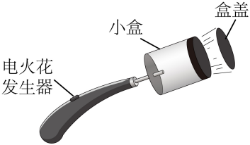

【答案】D

【解析】按动电火花发生器的按钮，点燃盒内酒精，这是因为酒精燃烧产生的燃气对外做功，变成盒盖的机械能；四冲程热机中的做功冲程就是利用内能来做功的冲程。A为压缩冲程，B为吸气冲程，C为排气冲程，D为做功冲程，故ABC不符合题意，D符合题意。
故选D。

## 30. 单选题（难度：简单）

如图，用酒精灯给试管中的水加热，一段时间后橡皮塞被冲开，下列说法正确的是（　　）
       
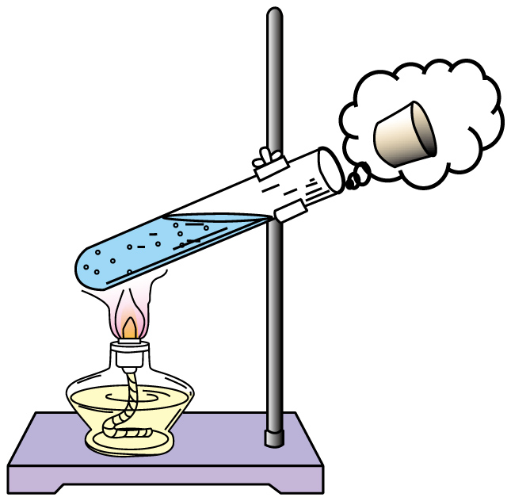

- A. 酒精灯中酒精的质量越大，酒精的热值越大
- B. 酒精燃烧放出的热量能全部被试管中的水吸收
- C. 试管中水的内能是通过热传递的方式增加的
- D. 橡皮塞被冲开的过程与内燃机的压缩冲程都是内能转化为机械能的过程

【答案】C

【解析】A．燃料的热值仅与燃料的种类有关，燃料的质量无关，故A错误；
B．酒精燃烧放出的热量要散失到空气中一部分，被试管吸收一部分，所以，酒精燃烧放出的热量不能全部被试管中的水吸收，故B错误；
C．加热过程中，通过热传递的方式增加水的内能，故C正确；
D．塞子冲出时，是试管内气体的内能转化为塞子增加的机械能，与内燃机的做功冲程能量转化相同，故D错误。
故选C。

## 31. 单选题（难度：适中）

以下四冲程汽油机的工作示意图，按吸气、压缩、做功、排气顺序排列正确的是（　　）

【答案】A

## 32. 单选题（难度：简单）

有一个转速为3600r/min的四冲程汽油机，如图所示，为该汽油机某冲程的示意图，则下列说法不正确的是（　　）
      
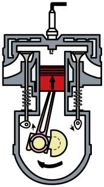

- A. 汽油机的效率越高，做功越快
- B. 这是汽油机的压缩冲程，机械能转化为内能
- C. 汽油机的该冲程是靠飞轮惯性完成的
- D. 汽油机正常工作时，1s对外做功30次

【答案】A

【解析】A．由热机效率\( \eta =\frac{{W}_{\mathrm{有}}}{{Q}_{\mathrm{放}}}\)可知，影响效率的因素分别为有用功和燃料完全燃烧放出的热量，而和做功的快慢无关，故A错误，A符合题意；
B．图中的进排气门全关，活塞上行，为压缩冲程，因此将机械能转化为内能，故B正确，B不符合题意；
C．热机四冲程中，除做功冲程外，其他冲程均靠飞轮的惯性运动，故C正确，C不符合题意；
D．飞轮转速是3600r/min，要经过7200个冲程，1s对外做功30次，故D正确，D不符合题意。
故选A。

## 33. 单选题（难度：简单）

如图甲、乙、丙所示，下列就其过程及能量转化分析正确的是（　　）
      
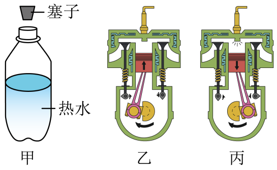

- A. 图甲塞子被弹起时，机械能→内能
- B. 图乙为压缩冲程，内能→机械能
- C. 图丙为压缩冲程，内能→机械能
- D. 图丙为做功冲程，内能→机械能

【答案】D

【解析】A．塞子被弹起时，热水瓶内水蒸气对塞子做功，将水蒸气的内能转化为塞子的机械能，所以瓶内水蒸气的内能会减小，故A错误；
B．乙图中，此时两个气门都关闭，活塞由下向上运动，压缩汽缸内气体，则该冲程是压缩冲程，即是把机械能转化为内能的过程，故B错误；
CD．丙图中，进气门和排气门都是关闭的，活塞下行，可以判断是做功程，此冲程中燃料的化学能转化成燃气的内能，再转化成机械能，故C错误，D正确。
故选D。

## 34. 单选题（难度：简单）

如图所示的是汽油机工作循环中的（　　）
     
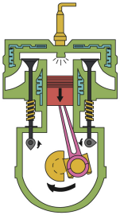

- A. 吸气冲程
- B. 排气冲程
- C. 压缩冲程
- D. 做功冲程

【答案】D

【解析】汽油机的四个冲程：吸气、压缩、做功、排气，可通过气门状态和活塞运动方向区分。
A．吸气冲程：进气门打开，排气门关闭，活塞向下运动。与题图不符，故A不符合题意；
B．排气冲程：排气门打开，进气门关闭，活塞向上运动。与题图不符，故B不符合题意；
C．压缩冲程：两个气门都关闭，活塞向上运动。与题图不符，故C不符合题意；
D．做功冲程：两个气门都关闭，火花塞点火，活塞向下运动。与题图相符，故D符合题意。
故选D。

## 35. 单选题（难度：适中）

“酒困路长惟欲睡，日高人渴漫思茶，敲门试问野人家。”茶文化在中国已经有几千年的历史，中国的历史有多长，中国的茶就有多香。在品茶过程中涉及到的物理知识，下列说法不正确的是（　　）
     

- A. 用沸水才能很快泡出茶香、茶色，这是因为温度越高，扩散现象越明显
- B. 喝茶时身体感觉变暖了，是通过热传递的方式改变了内能
- C. 烧水时水蒸气将壶盖顶起的能量转化与汽油机做功冲程相同
- D. 茶有沉浮，茶叶沉底后，茶所受重力大于浮力，茶叶漂浮时，所受浮力大于重力

【答案】D

【解析】A．闻到茶香，这是一种扩散现象，并且温度越高，扩散现象越明显，所以用沸水能很快泡出茶香、茶色，故A正确，不符合题意；
B．喝茶时身体感觉变暖了，人体吸收热量，是通过热传递的方式改变内能的，故B正确，不符合题意；
C．烧水时水蒸气将壶盖顶起的过程是内能转化为机械能，汽油机做功冲程也是内能转化为机械能，故二者能量转化相同，故C正确，不符合题意；
D．根据物体的浮沉条件可知，茶叶沉底后，茶所受重力大于浮力，茶叶漂浮时，所受浮力等于重力，故D错误，符合题意。
故选D。

## 36. 单选题（难度：适中）

如图是某同学在实践活动中制作的简易汽轮机模型，下列有关说法正确的是（　　）
      
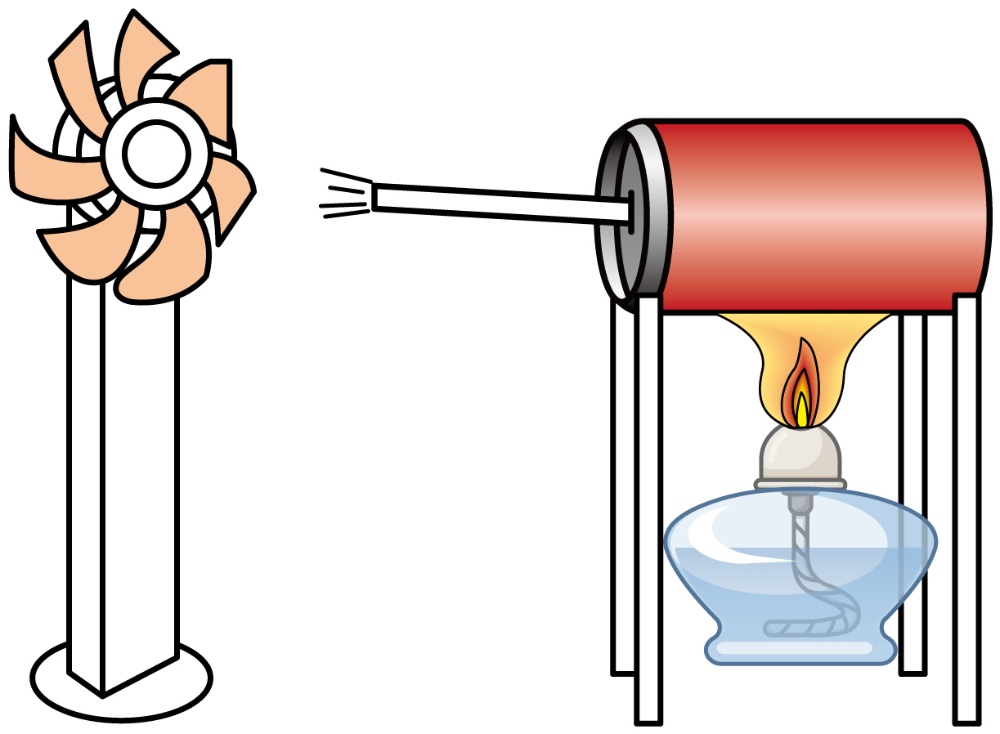

- A. 酒精灯燃烧时，将内能转化为化学能
- B. 易拉罐里所装水增加的内能是通过热传递的方式获得的
- C. 蒸汽从罐中喷出，使扇叶转动，这是能量的转移
- D. 在制作简易汽轮机过程中，选择中性笔后端作为蒸汽喷嘴的实验效果会更好

【答案】B

【解析】A．酒精灯燃烧时，将酒精的化学能转化为水和水蒸气的内能，故A错误；
B．易拉罐里的水吸收热量，内能增加，这是通过热传递的方式改变内能的，故B正确；
C．蒸汽从罐中喷出，使扇叶转动，将蒸汽的内能转化为扇叶的机械能，这是能量的转化，故C错误；
D．中性笔后端的口径较大，作为喷嘴喷出的蒸汽分散，冲击力小，实验效果比较差，而选用口径较小的笔尖作为喷嘴，蒸汽喷出更集中，冲击力更强，实验效果更好，故D错误。
故选B。

## 37. 单选题（难度：适中）

小明利用图示装置进行实验，用酒精灯加热试管使水沸腾，在水蒸气驱动下叶轮转动起来，下列对这个实验分析正确的是（　　）
       
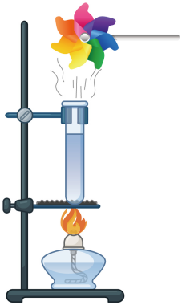

- A. 酒精的化学能直接转化为风车的机械能
- B. 酒精燃烧过程中热值逐渐变小
- C. 水蒸气的内能全部转化成风车的机械能
- D. 这个实验体现了热机的工作原理

【答案】D

【解析】A．酒精燃烧，化学能转化为内能，之后气体推动叶轮转动，将内能转化为机械能。化学能没有直接转化为机械能。故A错误；
B．燃料种类没有变化，其热值大小不变。故B错误；
C．推动叶轮后的水蒸气，依然具有内能，故水蒸气内能没有全部转化为机械能。故C错误；
D．燃料燃烧产生内能，得到高温高压气体，高温高压气体对物体做功，将内能转化为机械能。这个实验诠释了热机的工作原理。故D正确。
故选D。

## 38. 单选题（难度：适中）

下列关于内燃机的四个冲程说法中正确的是（　　）

- A. 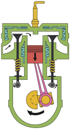
如图是汽油机的压缩冲程
- B. 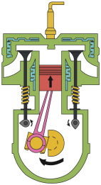
如图是汽油机的排气冲程
- C. 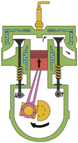
如图是汽油机的吸气冲程
- D. 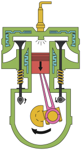
如图是汽油机的做功冲程

【答案】D

【解析】A．进气门打开，活塞下行，说明是吸气冲程，故A错误；
B．两个气门关闭，活塞上行，汽缸容积变小，说明是压缩冲程，故B错误；
C．排气门打开，活塞上行，排除废气，是排气冲程，故C错误；
D．两个气门关闭，活塞下行，汽缸容积变大，火花塞点火，说明是做功冲程，故D正确。
故选D。

## 39. 单选题（难度：适中）

如图所示是四冲程汽油机的剖面图，关于其四个冲程的描述正确的是（　　）
     

- A. 吸气冲程：汽油和空气的混合物进入汽缸
- B. 压缩冲程：燃气推动活塞向下运动
- C. 做功冲程：燃料释放的能量全部转化为机械能
- D. 排气冲程：废气没有带走燃料释放的能量

【答案】A

【解析】A．汽油机在吸气冲程中，进气门打开、排气门关闭，活塞向下运动，汽油和空气的混合物进入汽缸，故A正确；
B．在压缩冲程中，进气门和排气门都关闭，活塞向上运动，燃料混合物被压缩，气体的内能变大，此过程是机械能转化为内能的过程，故B错误；
C．在做功冲程中，燃料燃烧释放的内能大部分需要克服摩擦、发生热传递而散失，只有一少部分转化为机械能，故C错误；
D．在排气冲程中，废气带走了燃料释放的能量的大部分，故D错误。
故选A。

## 40. （难度：适中）

你认为热机使用会带来哪些污染？作为小市民，请你对合理使用机动车辆提两条建议。

## 41. 填空题（难度：适中）

四冲程汽油机在工作过程中，将内能转化为机械能的是___冲程，如果汽油机的转速表显示3000revs/min，那么该汽油机每秒内做___次功．给汽车加油时能闻到汽油的味道说明___．

## 42. 填空题（难度：适中）

在四冲程汽油机中，将机械能转化为内能的冲程是___冲程；汽车发动机工作时，当汽油在发动机内燃烧不充分时会冒“黑烟”，这时发动机的效率___（选填“升高”、“不变”或“降低”）；发动机散热器常用水做冷却剂，因为水的___较大。

## 43. 多选题（难度：适中）

2023年3月22日17时09分，命名为“快舟<latex class="math-tex">\( \cdot \)</latex>飞利浦蜂巢号”的快舟一号甲固体运载火箭在酒泉卫星发射中心点火升空，以“一箭四星”方式，将天目一号气象星座03星、04星、05星、06星送入预定轨道，发射任务取得圆满成功。下列说法中正确的是（　　）

【答案】A

## 44. 单选题（难度：适中）

我国科技人员，只争朝夕，突破“卡脖子”问题，把科技的命脉牢牢的掌握在自己的手中，历时13年自主研制，“大国重器”F级50兆瓦重型燃气轮机于2022年11月26日在四川正式完工。燃气轮机的本质是一种通过燃料（主要为天然气）与空气燃烧产生高温高压气体推动叶片转动来发电。联合循环一小时获得2.52×1011J的电能，消耗6.3×103m3天然气（天然气的热值取8×107J/m3）。下列有关说法错误的是（

【答案】A

## 45. 填空题（难度：适中）

随着生活水平的提高，汽车已经进入普通百姓家庭，它给我们的生活提供了便利，汽油机是汽车的“心脏”，其中冲程将机械能转化为内能；某台汽油机飞轮的转速为2400r/min，在1s内对外做功次。

【答案】压缩，20

【解析】[1]汽油机的工作循环包括吸气、压缩、做功、排气四个冲程，在压缩冲程中，活塞向上运动，压缩气缸内的燃料混合物，对气体做功，活塞的机械能转化为燃料混合物的内能。
[2]汽油机飞轮的转速为2400r/min=40r/s，即飞轮每秒转40圈，由于汽油机的1个工作循环完成4个冲程，飞轮和曲轴转2圈，对外做功1次，所以，在1s内该汽油机完成80个冲程，对外做功20次。

## 46. 填空题（难度：适中）

搭载神舟十九号飞船的长征运载火箭发射升空，燃料燃烧产生的能量推动火箭升空，该过程与汽油机的冲程能量转化相同；飞船与空间站成功对接后，以空间站为参照物，飞船是（填“运动”或“静止”）的。

【答案】做功，静止

【解析】[1]搭载神舟十九号飞船的长征运载火箭发射升空，燃料燃烧产生的内能转化为火箭的机械能，该过程与汽油机的做功冲程能量转化相同。
[2]飞船与空间站成功对接后，以空间站为参照物，飞船相对于空间站的位置没有发生改变，飞船是静止的。

## 47. （难度：适中）

哪个冲程排出了汽车的废气？

## 48. 填空题（难度：适中）

汽车的发动机是一种热机，工作时使汽车获得动力的是冲程，此冲程是把能转化为机械能的过程。

【答案】做功，内

【解析】[1][2]汽车的发动机是一种内燃机，工作过程主要包括吸气、压缩、做功、排气四个冲程，其中吸气、压缩、排气三个冲程靠惯性或外力完成，在做功冲程中，燃料燃烧产生高温高压的气体推动活塞向下运动，对外做功，将内能转化为机械能，故工作时使汽车获得动力的是做功冲程，此冲程是把内能转化为机械能的过程。

## 49. 多选题（难度：适中）

关于内能，有以下四个观点，你认为正确的是（　　）

【答案】A

## 50. 多选题（难度：适中）

下列关于柴油机和汽油机的说法正确的是（　　）

【答案】A

## 51. 多选题（难度：适中）

以下关于热机的知识错误的是（　　）

【答案】A

## 52. 填空题（难度：适中）

火箭用液态氢作为燃料，因为液态氢具有较高的热值，火箭升空过程中，燃料燃烧将___能转化为内能。

## 53. 单选题（难度：适中）

蒸汽弹射器是一种飞机弹射器。有人提出将航母蒸汽轮机的蒸汽连动到弹射器上，进而发明了航母用的蒸汽弹射器，如图为其简化示意图，该蒸汽弹射器能带动舰载机在两秒钟内达到起飞速度。下列说法正确的是（　　）

【答案】A

## 54. （难度：适中）

2025年10月23日22时30分，我国利用现役最大的长征五号运载火箭成功发射通信技术试验卫星二十号。火箭点火后，向下快速喷出气体，推动火箭加速上升，请说出火箭点火升空过程中包含哪些力学知识，存在哪些能量转化（各说出一条即可）

【答案】

火箭向下快速喷出气体，推动火箭加速上升，可得物体间力的作用是相互的；火箭加速上升可得力可以改变物体的运动状态；有力产生时至少出现两个物体，可得力是物体对物体的作用。（答出一条即可）

燃料燃烧过程中，化学能转化为内能；火箭加速上升过程中，内能转化为机械能；与空气摩擦过程中，机械能转化为内能。（答出一条即可）

## 55. 填空题（难度：适中）

世界上很多发明都是受到生活现象的启发而蒙生的创意，比如：蒸汽机和汽油机，它们工作时，能的转化过程是 
      
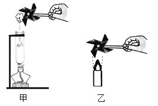

【答案】燃烧燃料，将燃料的化学能转化为内能，然后将内能转化为机械能

【解析】蒸汽机和汽油机都属于热机，它们工作时，首先燃烧燃料，将燃料的化学能转化为内能，然后将内能转化为机械能．

## 56. （难度：适中）

自制汽轮机模型如图，中空笔壳一端插入装少量水的易拉罐，接口处用胶密封，中空笔壳尖口对准小风扇的扇叶，点燃酒精灯，蒸汽喷出推动扇叶转动。

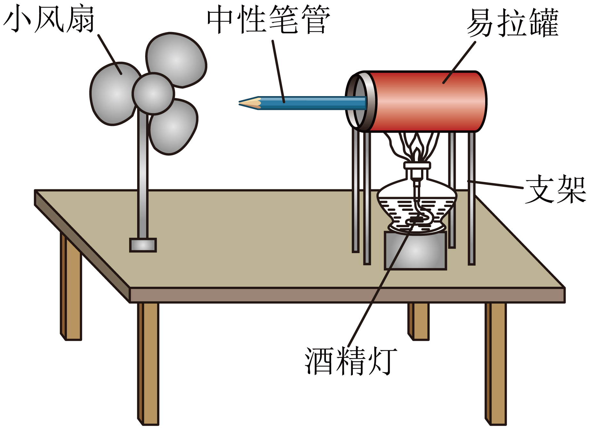

(1)从能量转化的角度分析该模型工作原理。
(2)在测试过程中，发现扇叶转动很慢，请写出出现这种现象的一种可能原因。

【答案】

[1]酒精灯加热水，将燃料的化学能转化为水的内能；蒸汽喷出推动扇叶，将水蒸气的内能转化为扇叶的机械能。 

[2]①可能笔尖喷出的蒸汽太少；②可能是扇叶转动时受到摩擦较大；③风扇自身质量太大，转动时阻力大。（任写一条）

## 57. 多选题（难度：适中）

如图甲所示是四冲程汽油机某冲程示意图，图乙为空气压缩引火仪，图丙对试管中水加热一段时间后瓶塞“飞出”。关于这三幅图，下列说法正确的是（　　）

【答案】A

## 58. 单选题（难度：适中）

如图所示是我国传统的走马灯，点燃底部的蜡烛，上升的热空气驱动扇叶转动，带动纸片小人转动。关于走马灯，下列说法正确的是（　　）
       
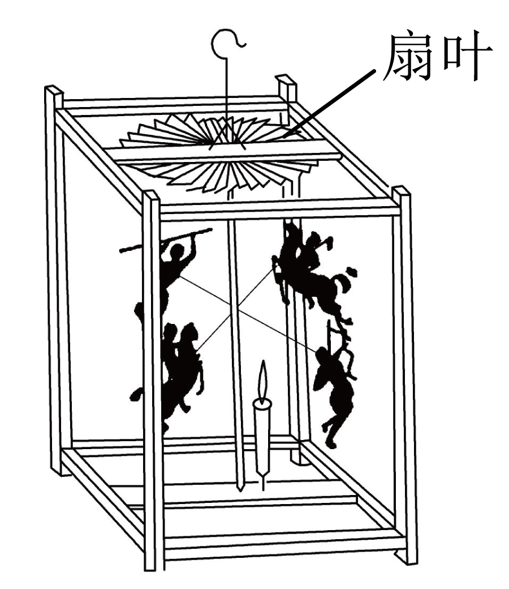

- A. 蜡烛燃烧越充分，其热值就越大
- B. 经过改进，走马灯的效率能达到100%
- C. 上升的热空气驱动扇叶转动，机械能转化为内能
- D. 上升的热空气驱动扇叶转动，能量转化与做功冲程相同

【答案】D

【解析】A．热值是燃料的固有属性，与燃料的种类有关，与燃料燃烧程度无关，故A错误；
B．任何机械在工作时，都会存在能量损失，机械效率小于100%。经过改进，走马灯的效率不能达到100%，故B错误；
CD．上升的热空气驱动扇叶转动是热空气的内能转化为扇叶的机械能。做功冲程中，燃料燃烧产生的高温高压燃气膨胀，推动活塞做功，同样是内能转化为机械能，故D正确，C错误。
故选 D。

## 59. 单选题（难度：适中）

小明用饮料瓶制作水火箭，先在瓶里装适量水，然后将带有阀门的金属管插入瓶塞，旋紧瓶塞后用打气筒往瓶里打足气（如图），打开阀门后，水从尾部的金属管向下喷出，水火箭向上飞向空中，下列分析正确的是（　　）
       
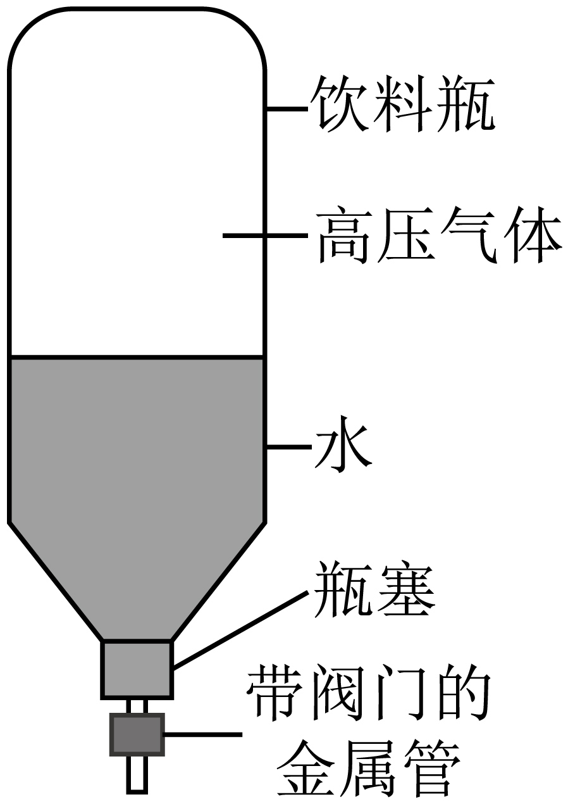

- A. 往水火箭里打气相当于内燃机的做功冲程
- B. 上升过程中，水火箭瓶内气体的内能减少
- C. 水从水火箭中喷出相当于内燃机的排气冲程
- D. 在整个过程中，所有能量的总和在减小

【答案】B

【解析】A．往水火箭里打气，对气体做功，机械能转化为内能，相当于内燃机的压缩冲程，故A错误；
B．发射时，火箭的动能是由瓶内高压气体的内能转化来的，所以水火箭瓶内气体的内能减少，故B正确；
C．水从水火箭中喷出，是里面的气体对外做功，相当于内燃机的做功冲程，故C错误；
D．根据能量守恒定律可知，在整个过程中，能量总量是保持不变的，故D错误。
故选 B。

## 60. 多选题（难度：适中）

如图所示为一款比亚迪新能源汽车—“汉”，它采用的是电动机驱动。相比于传统的内燃机汽车，以下说法正确的是（　　）

【答案】A

## 61. 多选题（难度：适中）

小明用可乐瓶制作水火箭，先在瓶里装适量水，然后将带有阀门的金属管插入瓶塞，旋紧瓶塞后用打气筒往瓶里打足气（如图）；打开阀门后，水从尾部的金属管向下喷出，水火箭竖直向上飞向空中，下列分析正确的是（　　）
      
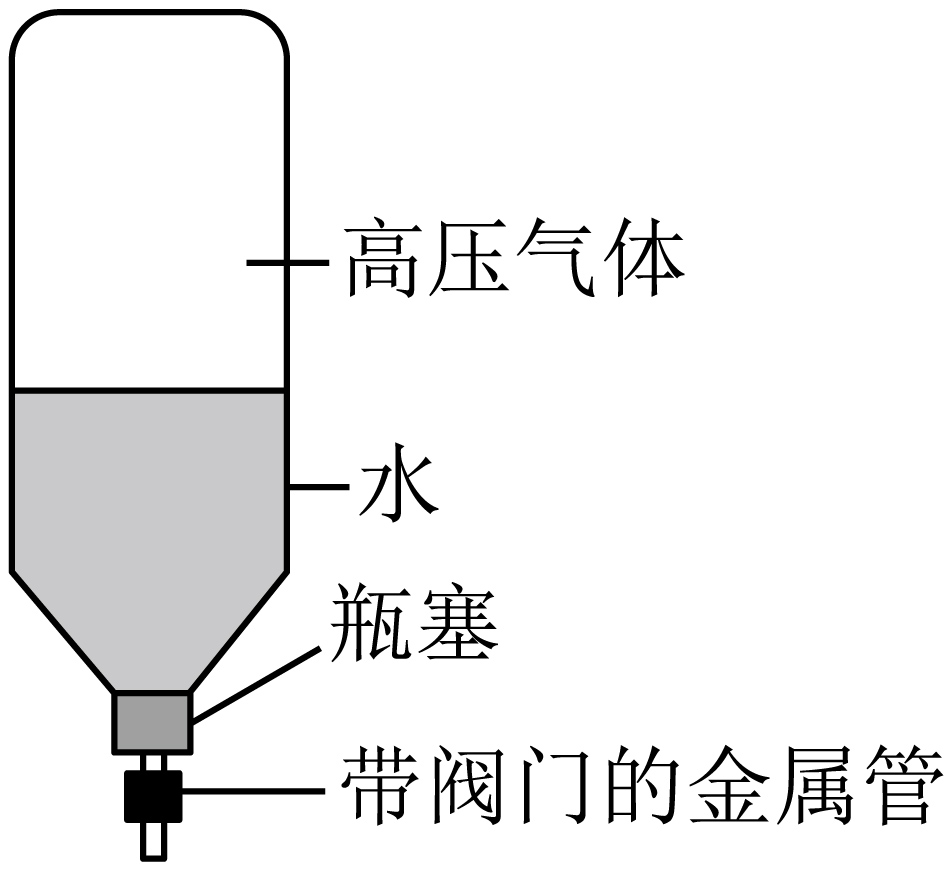

- A. 上升过程中，水火箭瓶内气体的内能减少
- B. 往水火箭里打气相当于内燃机的做功冲程
- C. 水从水火箭中喷出相当于内燃机的排气冲程
- D. 在整个过程中，能量总量是保持不变的

【答案】A/D

【解析】A．上升过程中，水火箭瓶内气体对外做功，故水火箭瓶内气体的内能减少，故A正确；
B．往水火箭里打气，相当于内燃机压缩冲程，压缩气体做功，故B错误；
C．水从水火箭中喷出相当于内燃机的做功冲程，水火箭瓶内气体对水做功，故C错误；
D．根据能量守恒定律，在整个过程中，能量总量是保持不变的，能量是不会凭空产生，也不会凭空消失，故D正确。
故选AD。

## 62. 填空题（难度：适中）

暑假期间小明随父母自驾出游，拓宽了视野，增长了见识。小明看到了我国传统的“走马灯”，如图所示。点燃底部蜡烛，热空气上升驱动扇叶转动，小明惊奇地看到纸片小人的影子动了起来。热空气上升驱动扇叶转动的能量转化情况与汽油机的冲程相同。
       
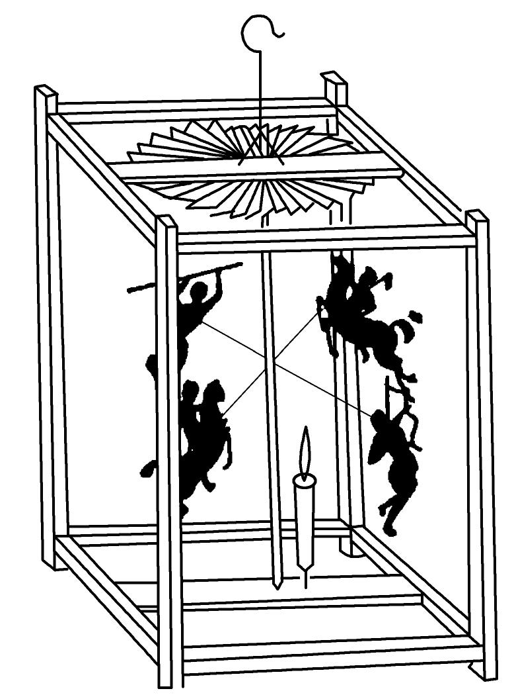

【答案】做功

【解析】【小题1】点燃蜡烛时，气体温度升高，热空气就会向上运动，运动的热空气对外做功，能量的转化方式是内能转化为机械能，四冲程汽油机的做功冲程能量的转化方式是内能转化为机械能，所以与做功冲程的能量转化相同。

## 63. 填空题（难度：适中）

如图中，这是汽油机的某个冲程，发生的能量转化是．
      
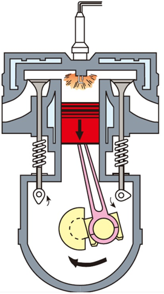

【答案】内能转化为机械能

【解析】如图，两气门都关闭，火花塞点火，高温高压的燃气推动活塞向下运动，即内能对外做功，是做功冲程；
做功冲程中内能转化为机械能．

## 64. 多选题（难度：适中）

如图所示是我国自主研发的巡天空间望远镜，其投入运行后最主要的使命是“巡天观测”，能够清晰、精细地观察到成千上万的星系，带来全景式宇宙高清图。下列有关说法正确的是（　　）
      
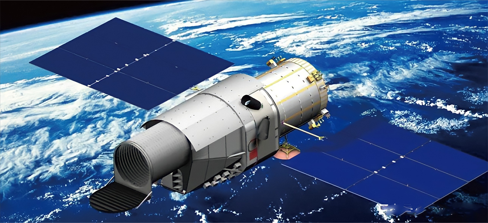

- A. 投入运行后科学家通过电磁波控制巡天空间望远镜
- B. 巡天空间望远镜在固定轨道绕地球运行做的是非机械运动
- C. 望远镜的运载火箭点火升空时的能量转化与内燃机的做功冲程是相同的
- D. 望远镜上的太阳能电池板将太阳能转化为内能

【答案】A/C

【解析】A．由于电磁波可以在真空中传播，电磁波传播范围广，传播速度快，所以科学家通过电磁波控制巡天空间望远镜，故A正确；
B．物理学中把物体的位置随时间的变化叫做机械运动，则巡天空间望远镜在固定轨道绕地球运行做的是机械运动，故B错误；
C．运载火箭点火升空时，发动机工作时，燃料燃烧获取内能并转化为机械能，为火箭提供动力，与内燃机的做功冲程中能量转化相同，故C正确；
D．太阳能电池板工作时，吸收太阳能，为电路提供电能，所以能量转化是将太阳能转化为电能，故D错误。
故选AC。

## 65. （难度：适中）

如图所示，在试管内装些水，用橡胶塞塞住管口，将水加热一段时间后， 塞子受到水蒸气的压力而冲出去，且管口出现了白雾。请你用所学的物理知识解释上述两现象。

## 66. 多选题（难度：简单）

关于汽油机和柴油机的区别，下列说法正确的是（　　）

- A. 汽油机和柴油机的气缸顶部都有火花塞
- B. 汽油机吸入气缸的是汽油和空气的混合物，柴油机吸入的是纯空气
- C. 汽油机是内燃机，柴油机不属于内燃机
- D. 汽油机的做功冲程是靠火花塞点火，柴油机靠压缩冲程末尾喷油嘴喷油自燃

【答案】B/D

【解析】A．柴油机的气缸顶部有喷油嘴，汽油机的顶部有火花塞，故A错误；
B．工作过程中，柴油机吸入气缸的是空气，汽油机吸入气缸的是汽油和空气的混合物，故B正确；
C．柴油机和汽油机都是利用内能做功的机器，都是热机，因为燃料都是在气缸内燃烧，又都叫做内燃机，所以汽油机和柴油机都属于内燃机，故C错误；
D．汽油机的做功冲程是靠火花塞点火，点燃被压缩的汽油和空气的混合气体，柴油机靠压缩冲程末尾喷油嘴喷油自燃，故D正确。
故选BD。

## 67. 单选题（难度：适中）

关于汽油机和柴油机的区别，下列说法中你认为不妥的是（　　）

- A. 柴油机比汽油机费用低廉，但比较笨重
- B. 柴油机吸入汽缸的是空气，汽油机吸入汽缸的是汽油和空气的混合物
- C. 汽油机的汽缸顶部有喷油嘴，柴油机的顶部有火花塞
- D. 在做功冲程中，柴油机的点火方式是压燃式，汽油机的点火方式是点燃式

【答案】C

【解析】A．柴油机是压燃式，压缩比较充分，故比较笨重，柴油比汽油费用低廉，故柴油机比汽油机费用低廉，故A正确，不符合题意；
B．在吸气冲程，柴油机吸入汽缸的只是空气，喷油嘴喷出汽油，汽油机吸入汽缸的是汽油和空气的混合物，故B正确，不符合题意；
C．柴油机和汽油机的结构不同：柴油机的汽缸顶部是喷油嘴，汽油机的顶部有火花塞，故C错误，符合题意；
D．汽油机的点火方式是点燃式，柴油机的点火方式是压燃式，柴油机压缩更加充分，热机效率更高，故D正确，不符合题意。
故选C。

## 68. 单选题（难度：简单）

下列关于汽油机和柴油机的主要区别，说法正确的是（　　）

【答案】A

## 69. 单选题（难度：适中）

关于汽油机和柴油机的区别，下列说法正确的是（　　）

【答案】A

## 70. 单选题（难度：适中）

根据汽油机和柴油机的区别，下列说法错误的是（　　）

【答案】A

## 71. 多选题（难度：简单）

关于汽油机和柴油机的主要区别，其中正确的是（　　）

【答案】A

## 72. 单选题（难度：适中）

关于汽油机和柴油机的主要区别，说法错误的是（　　）

- A. 柴油机的汽缸顶部有喷油嘴，汽油机的汽缸顶部有火花塞
- B. 压缩冲程中，汽油机的压缩程度要比柴油机的压缩程度大
- C. 在做功冲程中，汽油机的点火方式是点燃式，柴油机的点火方式是压燃式
- D. 柴油机吸入汽缸的是空气，汽油机吸入汽缸的是汽油和空气的混合物

【答案】B

【解析】A．在构造上汽油机汽缸顶部有喷油嘴，而柴油机的汽缸顶部有火花塞，故A正确，不符合题意；
B．压缩冲程中，柴油机的压缩程度要比汽油机的压缩程度大，故B错误，符合题意；
C．汽油机采用的是点燃式点火，而柴油机采用的是压燃式点火，故C正确，不符合题意；
D．汽油机和柴油机吸入的物质不同，汽油机在吸气冲程中吸入了汽油和空气的混合气体，柴油机在吸气冲程中吸入空气，故D正确，不符合题意。
故选B。

## 73. 单选题（难度：适中）

根据汽油机和柴油机的区别，下列说法正确的是（　　）

【答案】A

## 74. 单选题（难度：适中）

下列关于汽油机和柴油机的主要区别，错误的是（　　）

【答案】A

## 75. 单选题（难度：适中）

关于汽油机和柴油机的主要区别，其中正确的是（　　）

- A. 柴油机的气缸上是喷油嘴，汽油机的顶部有火花塞
- B. 在做功冲程中，柴油机的点火方式叫点燃式，汽油机的点火方式叫压燃式
- C. 柴油机比汽油机笨重，功率较小
- D. 柴油机吸入气缸的是汽油和空气的混合物，汽油机吸入气缸的只是空气

【答案】A

【解析】A．柴油机和汽油机的结构不同，柴油机的气缸上是喷油嘴，汽油机的顶部有火花塞，故A正确；
B．在做功冲程，汽油机的点火方式叫点燃式，柴油机的点火方式叫压燃式，故B错误；
C．柴油机比汽油机笨重，效率高，功率大，故C错误；
D．在吸气冲程，柴油机吸入气缸的只是空气，汽油机吸入气缸的是汽油和空气的混合物，故D错误。
故选A。

## 76. 单选题（难度：适中）

柴油机与汽油机的区别，下列叙述错误的是（　　）

【答案】A

## 77. 单选题（难度：适中）

下列关于汽油机和柴油机的区别中错误的是（　　）

- A. 柴油机的汽缸顶部是喷油嘴
- B. 使用柴油机比汽油机经济，但是比较笨重
- C. 柴油机的热机效率比汽油机的高
- D. 柴油机点火方式用的是点燃式

【答案】D

【解析】A．汽油机在汽缸顶部有火花塞，柴油机在汽缸顶部有喷油嘴，故A正确，不符合题意；
B．柴油机比汽油机费用低廉，但比较笨重，故B正确，不符合题意；
C．一般柴油机的压缩比要比汽油机大得多，且汽缸内柴油燃烧要比汽油燃烧更充分，所以柴油机的效率更高一些，故C正确，不符合题意；
D．汽油机点火方式是点燃式，柴油机点火方式是压燃式，故D错误，符合题意．

## 78. 单选题（难度：适中）

关于汽油机和柴油机的区别，下列说法错误的是（　　）

【答案】A

## 79. 单选题（难度：适中）

下列关于汽油机和柴油机的主要区别，说法正确的是（　　）

【答案】A

## 80. 多选题（难度：简单）

下列关于汽油机和柴油机的主要区别，下列说法正确的是（　　）

- A. 柴油机的上部是喷油嘴，汽油机的顶部有火花塞
- B. 在做功冲程中，柴油机的点火方式叫点燃式，汽油机的点火方式叫压燃式
- C. 柴油机和汽油机一个工作循环都是由4个冲程组成，压缩冲程把内能转化为机械能
- D. 柴油机吸入汽缸的只是空气，汽油机吸入汽缸的是汽油和空气的混合物

【答案】A/D

【解析】A．汽油机的气缸顶部装有火花塞，用于点燃油气混合物，柴油机的气缸顶部装有喷油嘴，用于压缩冲程末喷油，故A正确；
B．汽油机有火花塞，其点火方式是点燃式，柴油机通过压缩冲程对空气做功，气缸内空气温度较高，其点火方式是压燃式。故B错误；
C．汽油机和柴油机的一个工作循环均由吸气、压缩、做功、排气 4 个冲程组成，但压缩冲程是活塞对气体做功，将机械能转化为内能；做功冲程才是内能转化为机械能。故C错误；
D．汽油机工作时，吸入汽缸的是汽油和空气的混合物，柴油机工作时，先吸入纯净的空气，压缩至高温后再通过喷油嘴喷入柴油，柴油遇高温空气自燃。故D正确。
故选AD。

## 81. 单选题（难度：适中）

关于汽油机和柴油机的区别，下列说法中错误的是（　　）

- A. 柴油机比汽油机费用低，但比较笨重
- B. 柴油机的效率一般比汽油机的效率高
- C. 一个工作循环中柴油机做功两次，比汽油机多一个做功冲程
- D. 在构造上，柴油机汽缸顶部有喷油嘴而没有火花塞

【答案】C

【解析】A．柴油机比汽油机费用低，但比较笨重，A正确，不合题意；
B．一般柴油机汽缸内柴油燃烧比汽油燃烧更充分，所以柴油机的效率一般比汽油机的效率高，B正确，不合题意；
C．在一个工作循环中，柴油机和汽油机都是做功一次，C错误，符合题意；
D．在构造上，汽油机顶部有火花塞，属于点燃式；而柴油机在汽缸顶部有喷油嘴而没有火花塞，属于压燃式，D正确，不合题意。
故选C。

## 82. 单选题（难度：适中）

关于汽油机和柴油机的区别，下列说法中你认为不妥的是（　　）

- A. 柴油机比汽油机费用低廉，但比较笨重
- B. 柴油机的效率一般比汽油机的效率高
- C. 一个工作循环中汽油机做功一次，柴油机做两次功
- D. 在构造上，柴油机汽缸顶部有喷油嘴而没有火花塞

【答案】C

【解析】AB．由于柴油机和汽油机的压缩程度和点燃方式不同，使得柴油机的效率比汽油机的效率高，使用柴油机比汽油机经济，费用低廉，但不如汽油机轻便，故AB不符合题意；
C．无论是汽油机和柴油机，一个工作循环中汽油机和柴油机都做一次功，故C符合题意；
D．汽油机与柴油机的结构上不同：汽油机顶部是个火花塞，柴油机的顶部是喷油嘴，故D不符合题意。
故选C。

## 83. 多选题（难度：简单）

以下关于热机的知识错误的是（　　）

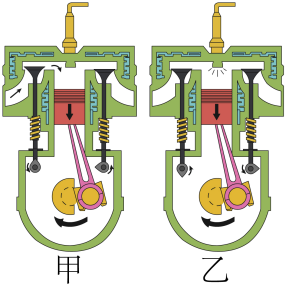

- A. 图甲对应的是压缩冲程
- B. 图乙涉及的能量转化是机械能转化为内能
- C. 若这台热机的转速是3600r/min，则1s内该汽油机对外做功30次
- D. 一般来说，汽油机的效率比柴油机高

【答案】A/B/D

【解析】AB．由图可以看出，甲图中进气门打开，排气门关闭，活塞由下向上运动，为吸气冲程；乙图中，两个气门关闭，活塞向下运动，为做功冲程，内能转化为机械能，故AB错误，符合题意；
C．单缸四冲程汽油机的飞轮转速是\( \text{3600r/min}\)，即每秒钟转\( 60\)圈，完成\( 120\)个冲程，做功\( 30\)次，故C正确，不符合题意；
D．柴油机压缩程度更大，压缩冲程末温度更高，所以柴油机属于压燃式，它的效率更高，故D错误，符合题意。
故选ABD。

## 84. 多选题（难度：简单）

如图所示是单缸四冲程汽油机工作循环示意图，下列有关说法正确的是（　　）
 
      
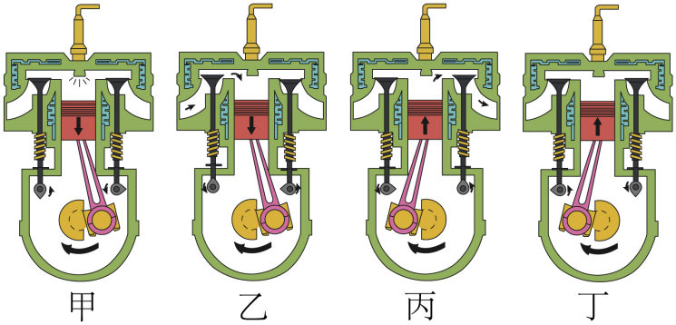

- A. 汽油机和柴油机的气缸顶部都有火花塞
- B. 柴油机的吸气冲程，吸入的只有空气
- C. 汽油机一个完整的工作循环顺序是乙、甲、丁、丙
- D. 图丁是压缩冲程，该过程主要的能量转换是机械能转化为内能

【答案】B/D

【解析】A．汽油机的气缸顶部有火花塞，柴油机的气缸顶部有喷油嘴，故A错误；
B．在吸气冲程中，汽油机吸入的是汽油和空气的混合物，柴油机吸入的只是空气，故B正确；
C．甲图中两个气门都关闭，火花塞点火，此时活塞向下运动，是做功冲程；乙图是进气门打开，排气门关闭，此时活塞向下运动，是吸气冲程；丙图中进气门关闭，排气门打开，此时活塞向上运动，是排气冲程；丁图中两个气门都关闭，活塞向上运动，是压缩冲程；所以，该内燃机一个工作循环有四个冲程正确的顺序是乙、丁、甲、丙，故C错误；
D．丁图中两个气门都关闭，活塞向上运动，是压缩冲程，机械能转化为内能，故D正确。
故选BD。

## 85. 单选题（难度：适中）

关于柴油机与汽油机的区别，下面叙述错误的是（　　）

- A. 构造上，柴油机汽缸顶部有一个喷油嘴而没有火花塞
- B. 工作过程中，柴油机与汽油机只有一个冲程不同
- C. 柴油机的效率比汽油机高
- D. 柴油机比汽油机经济，但是比较笨重

【答案】B

【解析】汽油机与柴油机的主要不同点列表如下：

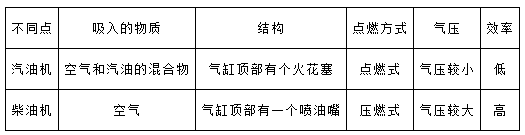

汽油机顶部是个火花塞，柴油机的顶部是个喷油嘴，故A项正确；柴油机吸入汽缸的是空气，汽油机吸入汽缸的是空气和汽油的混合物，故B错误；由于柴油机和汽油机的结构和点燃方式不同，使得柴油机的效率比汽油机的效率高，故C正确；柴油机比汽油机的效率高，但不如汽油机轻便，故D正确，故符合题意的是B．

## 86. 单选题（难度：适中）

粮食安全是国家安全的重要基础。如图甲是收割机正在收割小麦的场景。收割机发动机多为柴油机，其能量流向图如图乙所示，下列说法正确的是（　　）
      
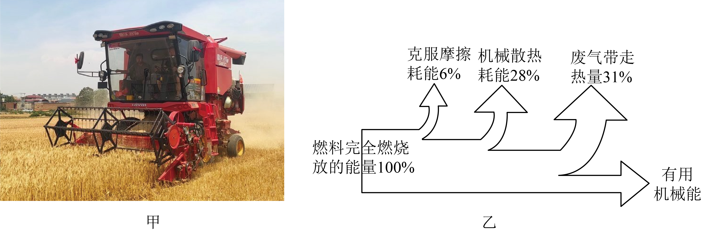

- A. 该柴油机的效率为35%
- B. 柴油机做功冲程中燃气的内能增大
- C. 增加柴油机部件的摩擦可以提高热机效率
- D. 柴油机比汽油机的效率高，所做的有用功更多

【答案】A

【解析】A．柴油机的效率是 “有用机械能” 与 “燃料完全燃烧放出的能量” 的比值。由图乙可知，有用机械能占比为 100%−6%−28%−31%=35%
因此效率为 35%，故A 正确；
B．柴油机做功冲程中，燃气膨胀推动活塞做功，内能转化为机械能，燃气的内能是减小的，故B 错误；
C．增加机件摩擦会导致 “机械摩擦损耗” 的能量增多，有用机械能占比减小，热机效率会降低，故C 错误；
D．柴油机效率比汽油机高，指的是 “能量的利用率更高”，但有用功的多少还与燃料完全燃烧放出的总能量有关，效率高不等于有用功多，故D 错误。
故选 A。

## 87. 单选题（难度：适中）

根据汽油机和柴油机的区别，对图中各冲程描述正确的是（　　）
      
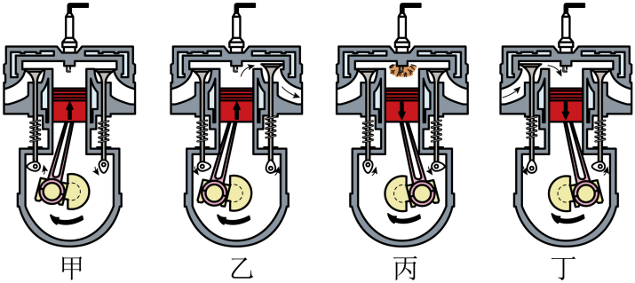

- A. 如图甲冲程都是使得空气和燃油的混合气体内能增大
- B. 如图乙冲程汽油机吸入的是空气，柴油机吸入的是空气和柴油的混和气体
- C. 如图丙冲程都是机械能转化为内能
- D. 如图丁冲程都是利用飞轮惯性带动活塞运动

【答案】D

【解析】A．图甲中，进气门、排气门关闭，活塞向上运动，将活塞的机械能转化为汽缸内气体的内能，汽油机吸入空气和汽油的混合物，使得空气和燃油的混合气体内能增大，柴油机只吸入空气，使得空气的内能增大，故A错误；
B．图乙中，进气门关闭，排气门打开，活塞向上运动，为排气冲程；在吸气冲程中，汽油机吸入空气和汽油的混合物，柴油机吸入的是空气，故B错误；
C．图丙中，进气门、排气门关闭，活塞向下运动，为做功冲程，是由燃气推动活塞做功，将内能转化为机械能，故C错误；
D．图丁中，进气门打开，排气门关闭，活塞向下运动，为吸气冲程，四个冲程中只有做功冲程是对外做功，其它三个冲程都是飞轮的惯性带动曲轴运动，所以图丁冲程都是利用飞轮惯性带动活塞运动，故D正确。
故选D。

## 88. 单选题（难度：简单）

如图是一种常用“柴油平板夯机”，广泛应用于路面施工、场地填土等多个方面。使用时柴油发动机提供动力，激荡器带动夯板上下运动。下列关于汽油机和柴油机的主要区别，说法错误的是（　　）

【答案】A

## 89. 单选题（难度：适中）

如图是一种常用“柴油平板夯机”，广泛应用于路面施工、场地填土等多个方面。使用时柴油发动机提供动力，激荡器带动夯板上下运动。下列关于汽油机和柴油机的主要区别，说法错误的是（　　）

【答案】A

## 90. 单选题（难度：适中）

为了缓解能源紧缺问题，提高热机的效率尤为重要。下列有关热机效率说法正确的是（　　）

【答案】A

## 91. 填空题（难度：适中）

柴油机和汽油机的主要区别在于，汽油机在吸气冲程中吸入汽油和空气的混合物，而柴油机吸入的只有，构造上柴油机顶端有喷油嘴，而汽油机顶部有。

【答案】空气，火花塞

【解析】[1][2]工作过程中，汽油机吸入的是空气和汽油的混合物，柴油机吸入的是空气。汽油机汽缸顶部有一个火花塞，柴油机汽缸顶部是一个喷油嘴。

## 92. 填空题（难度：适中）

汽油机和柴油机都属于内燃机，它们在构造上有区别：汽油机顶部有___，柴油机顶部有___。（均选填“火花塞”或“喷油嘴”）。

## 93. 填空题（难度：适中）

请将下列汽油机和柴油机的区别与联系填写完成．
种类
项目
汽油机
柴油机

构造不同
汽缸顶部有
汽缸顶部有

燃料不同

吸气冲程
吸入的是空气和的混合物
吸入的是

点火方式
点燃式
压燃式

【答案】火花塞，喷油嘴，汽油，柴油，汽油，空气

【解析】[1][2] 汽油机汽缸顶部有一个火花塞，柴油机汽缸顶部是一个喷油嘴；
[3][4] 汽油机的燃料为汽油，柴油机的燃料为柴油；
[5]6] 工作过程中，汽油机吸入的是空气和汽油的混合物，柴油机吸入的是空气.

## 94. 填空题（难度：适中）

汽油机和柴油机在构造上的主要区别：汽油机汽缸顶部有，而柴油机汽缸顶部有；在吸气冲程中的不同：汽油机吸入汽缸里的是汽油和空气的混合物，而柴油机吸入汽缸里的是。

【答案】火花塞，喷油嘴，空气

【解析】[1]汽油机汽缸顶部有火花塞。在压缩冲程结束时，火花塞产生电火花，使燃料猛烈燃烧，从而推动活塞做功。
[2]柴油机汽缸顶部有喷油嘴。在压缩冲程结束时，喷油嘴向汽缸内喷入雾状柴油，柴油遇到高温高压的空气后自燃，推动活塞做功。
[3]在吸气冲程中，汽油机吸入汽缸里的是汽油和空气的混合物，而柴油机吸入汽缸里的是空气。柴油机在压缩冲程末，通过喷油嘴将柴油喷入汽缸，与高温空气混合后燃烧。

## 95. 单选题（难度：适中）

在做功冲程中，汽油机燃气的压强可达<latex class="math-tex">\( 5.0\times {10}^{5}\text{Pa}\)</latex>，柴油机燃气的压强可达<latex class="math-tex">\( 1.0\times {10}^{6}\text{Pa}\)</latex>，如果汽油机和柴油机的活塞面积、活塞运动的距离都相同，则在一个做功冲程中柴油机与汽油机做

【答案】A

## 96. 单选题（难度：适中）

2022年11月，潍柴集团发布全球首款热效率52.28%的商用柴油机，突破世界纪录，树立了世界内燃机热效率新标杆。下列关于柴油机的说法正确的是（　　）

【答案】A

## 97. 单选题（难度：适中）

关于内燃机，下列说法正确的是（　　）

【答案】A

## 98. 单选题（难度：适中）

有关汽油机和柴油机的异同，下列说法错误的是（　　）

- A. 汽油机与柴油机使用的燃料不同
- B. 柴油机一般用于大型、重型机械，汽油机一般用于轻型、小型机械
- C. 吸气冲程，汽油机吸入的只有空气，柴油机吸入的是柴油和空气的混合物
- D. 柴油机压缩冲程末的温度比汽油机高

【答案】C

【解析】A．柴油机和汽油机都属于内燃机，汽油机与柴油机使用的燃料不同，柴油机使用柴油，汽油机使用汽油，故A正确，不符合题意；
BD．柴油机属于压燃式，压缩冲程末的温度比汽油机高，燃料燃烧更完全，效率比汽油机高，所以柴油机一般用于大型、重型机械，汽油机一般用于轻型、小型机械，故BD正确，不符合题意；
C．工作过程中，汽油机吸入的是空气和汽油的混合物，柴油机吸入的是空气，故C错误，符合题意。
故选C。

## 99. 单选题（难度：适中）

关于热机，下列说法正确的是（    ）

【答案】A

## 100. 单选题（难度：适中）

关于汽油机和柴油机描述正确的是（　　）

【答案】A

## 101. 单选题（难度：适中）

下列关于柴油机和汽油机的说法中，正确的是（　　）

- A. 吸气冲程中，汽油机吸入气缸的是空气
- B. 汽油机气缸的顶端有喷油嘴
- C. 进气门、排气门都关闭，活塞向上运动——压缩冲程
- D. 内能转化为机械能——压缩冲程

【答案】C

【解析】A．柴油机在吸气冲程中，将空气吸入气缸；汽油机在吸气冲程中，将汽油和空气的混合物吸入气缸；故A错误；
B．汽油机气缸顶部有火花塞，柴油机顶部有喷油嘴，故B错误；
CD．汽油机和柴油机的压缩冲程中，进气门、排气门都关闭，活塞向上运动，机械能转化为内能，故C正确，D错误。
故选C。

## 102. 填空题（难度：适中）

试从热机结构和点火方式回答汽油机和柴油机的区别。当前社会建设非常重视生态环境的保护，许多国家都制定了燃油汽车逐步退出市场的规划，新能源汽车发展前景良好，以电动汽车发展更为突出。试谈一谈电动汽车的优势（请谈两点）。解：汽油机和柴油机的区别：结构：___。点火方式：___。电动汽车的优势：___。

## 103. 单选题（难度：适中）

期末复习时，王丽同学对“热机”知识点的总结中，有错的是（　　）

- A. 生活中常见的热机有汽油机、柴油机、喷气发动机、蒸气轮机等
- B. 内燃机在压缩冲程中，将机械能转化为内能
- C. 汽油机的效率比柴油机低，是因为汽油的热值比柴油小
- D. 让燃料尽可能充分燃烧，是提高热机效率的途径之一

【答案】C

【解析】A．生活中常见的热机有很多种，例如汽油机、柴油机、喷气发动机、蒸气轮机等，故A不符合题意；
B．汽油机四个冲程中，只有做功冲程燃气对外做功，将内能转化为机械能；在压缩冲程中将机械能转化为内能，故B不符合题意；
C．汽油机的效率比柴油机低，它与燃料的热值大小无关，而是与燃料的燃烧情况、散热情况、压缩程度等有关，故Ｃ符合题意；
D．热机效率是指热机有效利用的能量与燃料完全燃烧放出的能量之比；所以使燃料充分燃烧、减少废气带走的热量、减少热机部件间的摩擦都可以减少热量的损失，提高效率，故D不符合题意。
故选C。

## 104. 单选题（难度：适中）

2024年4月20号，世界内燃机大会上，潍柴动力一款新型柴油机问世，此款柴油机效率达到了53.09%，成为了世界首款热效率突破53%的柴油机。下列是关于四冲程汽油机和柴油机工作过程的几种说法，不正确的是（　　）

【答案】A

## 105. 填空题（难度：适中）

某内燃机在吸气冲程吸入汽缸的只有空气，那么它是___（选填“汽油机”或“柴油机”）；若一单缸四冲程汽油机飞轮转速为3600r/min，则该内燃机1秒钟对外做功___次。

## 106. 填空题（难度：适中）

柴油机和汽油机的区别 汽油机柴油机构造顶部___顶部___燃料______吸气冲程______点火方式___式___式效率20%—30%30%—45%应用小型轻便机械大型设备

## 107. 填空题（难度：适中）

常见的汽油机和柴油机的一个工作循环都要经历个冲程，如图所示是汽油机工作过程的一个冲程，该冲程是冲程。
     
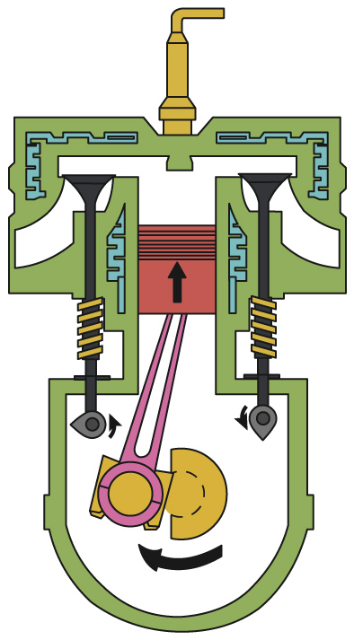

【答案】4<i>/</i>四，压缩

【解析】[1]常见的汽油机和柴油机都是四冲程的，包括吸气冲程、压缩冲晨光、做功冲程和排气冲程。
[2]由图可知，该汽油机两个气门都关闭，活塞向上运动，因此是压缩冲程。

## 108. 填空题（难度：适中）

汽油机和柴油机的结构不同，带有喷油嘴的是（选填“汽油机”或“柴油机”）已知某单缸汽油机的飞轮转速为2400r/min，则它每秒对外做功次。

【答案】柴油机，20

【解析】[1]汽油机和柴油机的结构不同，带有喷油嘴的是柴油机，用火花塞点火的是汽油机。
[2]某单缸汽油机的飞轮转速为2400r/min=40r/s，一个工作循环飞轮转2r，对外做功一次，则它每秒对外做功20次。

## 109. 填空题（难度：适中）

如图为一台单缸四冲程（选填“汽油机”或“柴油机”），它吸气冲程吸入汽缸内的物质是（选填“空气”“柴油”“汽油和空气的混合物”），若飞轮转速是2400r/min，则每秒对外做功次。
     
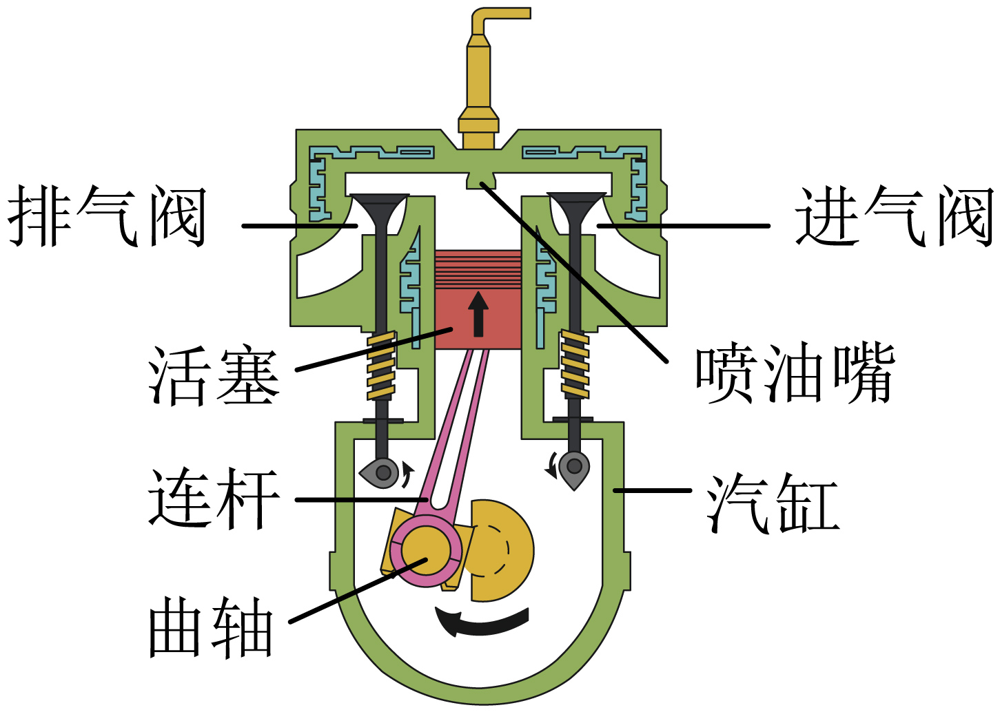

【答案】柴油机，空气，20

【解析】[1]由图可知，图中有喷油嘴，没有火花塞，所以如图为一台单缸四冲程柴油机。
[2]四冲程柴油机在吸气冲程中吸入汽缸的是空气，汽油机在吸气冲程中吸入汽缸的是汽油和空气的混合物。
[3]飞轮转速是2400r/min，即40r/s，由于四冲程柴油机一个工作循环完成4个冲程，飞轮和曲轴转2圈，对外做功1次，所以该柴油机每秒对外做功20次。

## 110. 单选题（难度：适中）

2023年慕尼黑车展，一半是欧洲车，一半是中国车、中国车大放异彩，下列与小汽车有关的说法错误的是（　　）

【答案】A

## 111. 单选题（难度：适中）

如图所示，甲是汽油机某个冲程的工作示意图，乙是柴油机某个冲程的工作示意图。下列说法正确的是（　　）
       
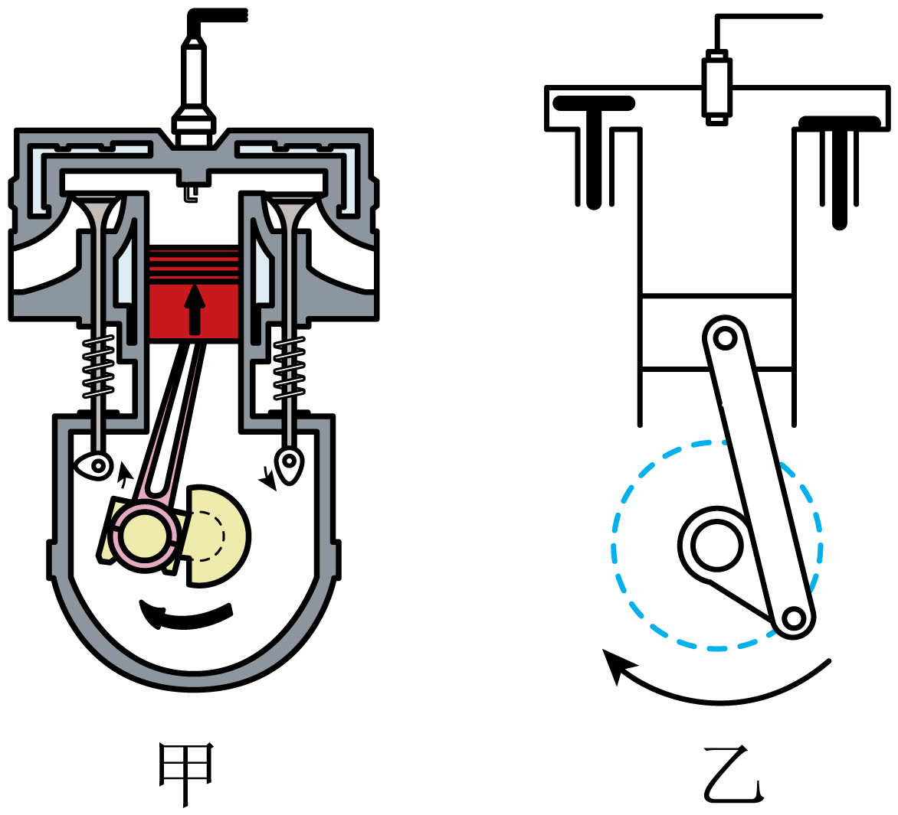

- A. 甲是汽油机的压缩冲程，将机械能转化为内能
- B. 甲是汽油机的做功冲程，汽缸内空气内能增加，温度升高
- C. 乙是柴油机的吸气冲程，吸进汽缸的是空气和柴油的混合物
- D. 乙是柴油机的排气冲程，此时汽缸顶部的喷油嘴正在喷油

【答案】A

【解析】AB．由图甲可知，两个气门关闭，活塞向上运动，为压缩冲程，将机械能转化为内能，汽缸内空气内能增加，温度升高，故A正确，B错误；
CD．由图乙可知，进气门打开、排气门关闭，活塞向下运动，为吸气冲程；气缸的顶部有个喷油嘴，是柴油机的吸气冲程，吸入的只是空气，故CD错误。
故选A。

## 112. 单选题（难度：适中）

如图A是四冲程汽油机的工作示意图，如图B是我国古代曾发明的一种点火器，以牛角为套筒，把艾绒黏附在木质推杆前端。取火时一只手握住套筒，另一只手向内猛推推杆，推杆前端的艾绒就会被点燃。下列说法错误的是（　　）

【答案】A

## 113. 单选题（难度：适中）

如图所示，甲是汽油机某个冲程的工作示意图，乙是柴油机某个冲程的工作示意图。下列说法正确的是（　　）

【答案】A

## 114. 单选题（难度：适中）

2023年慕尼黑车展，一半是欧洲车，一半是中国车，中国车大放异彩，下列与小汽车有关的说法正确的是（　　）

【答案】A

## 115. 填空题（难度：适中）

汽油机与柴油机的异同相同点：基本构造和主要部件作用相似：（1）每个___ 都一样，有吸气、压缩、做功、排气四个冲程组成；（2）四个冲程中，只有___对外做功，其余三个冲程靠飞轮惯性完成；（3）一个工作循环中，活塞往复___，曲轴转动___，飞轮转两圈，做功___；不同点：（1）构造不同：汽油机汽缸顶部有___，而柴油机汽缸顶部有___ ；（2）燃料不同：汽油机燃烧___，而柴油机燃烧___；（3）

## 116. （难度：适中）

热机

定义：能将燃料燃烧时释放的转化为的发动机叫做热机

内燃机分类：汽油机：气缸顶部有，柴油机：气缸顶部有

工作过程：冲程→冲程→冲程→冲程

【答案】内能/机械能，火花塞/喷油嘴，吸气/压缩/做功/排气

## 117. 单选题（难度：适中）

阅读短文，回答问题：从火车到火箭生产的发展需要强大的动力。17世纪，人类发明的热机。最早的热机是蒸汽机。在锅炉里把水烧成水蒸气，水蒸气在汽缸里推动活塞做功。原始的蒸汽机不便于使用，后来许多人对它不断改进，其中贡献最大的是英国人瓦特，他在1782年发明了往复式蒸汽机使蒸汽机成为可以广泛使用的动力机。这种蒸汽机在之后的100多年里对工业的发展起了极其重要的作用。但是由于蒸汽机过于笨重，效率很低现在世界

【答案】A
