# 知识点·二力平衡条件的应用（同步练习）

> 教材：物理·八年级全一册·沪科技版2024新教材 ｜ 来源：国家中小学智慧教育平台·在线练习 ｜ 共 12 题

## 1. 单选题（难度：简单）

如图所示，总重为5N的花瓶放置在水平桌面上，桌面对花瓶的支持力为（   ）

- A. \( \text{5N}\)，方向竖直向下
- B. \( \text{5N}\)，方向竖直向上
- C. \( \text{10N}\)，方向竖直向下
- D. \( \text{10N}\)，方向竖直向上

【答案】B

【解析】​

## 2. 单选题（难度：适中）

如图所示，一个木箱放在水平地面上，小明同学用\( \text{75N}\)的水平推力向右推木箱，但未推动。下列说法正确的是（    ）

- A. 推木箱时，小明不受到木箱的作用力
- B. 若此时木箱所受的外力同时消失，它将做匀速直线运动
- C. 木箱对地面向下的压力和地面对木箱向上的支持力是一对平衡力
- D. 地面对木箱向左的阻力和人对木箱向右的推力是一对平衡力

【答案】D

【解析】​

## 3. 单选题（难度：简单）

在平直的路面上，一个人沿水平方向用\( \text{20N}\)的力推一辆重为\( \text{150N}\)的小车匀速向东运动，则小车所受阻力的大小和方向分别为（   ）

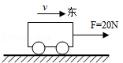

- A. \( \text{20N}\)，向西
- B. \( \text{20N}\)，向东
- C. \( \text{150N}\)，向西
- D. \( \text{150N}\)，向东

【答案】A

【解析】​

## 4. 单选题（难度：适中）

2021年4月19日，“机智号”电动直升机在火星地表首飞成功，如图所示。在匀速上升、空中悬停、匀速下降阶段，“机智号”旋翼受到的升力分别为\( {F}_{1}\)、\( {F}_{2}\)、\( {F}_{3}\)，不计机身受到的火星气体阻力，则（  ）

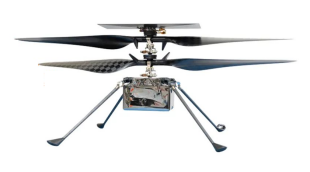

- A. \( {F}_{1}>{F}_{2}>{F}_{3}\)
- B. \( {F}_{1}<{F}_{2}<{F}_{3}\)
- C. \( {F}_{1}={F}_{3}>{F}_{2}\)
- D. \( {F}_{1}={F}_{2}={F}_{3}\)

【答案】D

【解析】​

## 5. 单选题

如图所示，是一辆静止在水平面上的小车，在其支架的杆上固定一个质量为\( m\)的小球，关于杆对小球作用力的描述，下列说法中正确的是（   ）

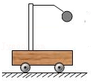

- A. 力的方向竖直向上，大小为\( mg\)
- B. 力的方向沿杆斜向上，大小为\( 2mg\)
- C. 力的方向垂直于杆向上，大小为\( mg\)
- D. 力的方向沿杆和竖直方向之间的某一方向，大小为\( 2mg\)

【答案】A

【解析】​

## 6. 单选题

氢气球下吊一重物在空气中做匀速直线运动。若不计空气阻力和风力影响，而小重物恰能沿\( MN\)方向上升，图中气球和重物在运动中所处的位置正确的是（   ）

- A. 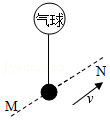
- B. 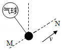
- C. 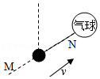
- D. 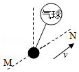

【答案】A

【解析】​

## 7. 填空题（难度：简单）

质量为\( \text{40kg}\)的小船静止在水面上，它除了受到重力之外，还受到另一个力的作用，这个力的大小是\( \text{N}\)，方向是。（\( g\)取\( \text{10N/kg}\)）

【答案】400，竖直向上

【解析】​

## 8. 填空题（难度：适中）

起重机吊起\( \text{10000N}\)的货物，如图所示，以\( \text{0.8m/s}\)的速度匀速上升时，钢丝对货物的拉力为 \( \text{N}\)，若以\( \text{0.5m/s}\)的速度匀速下降，钢丝对货物的拉力\( \text{10000N}\)（选填“大于”、“小于”或“等于”）。

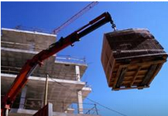

【答案】10000，等于

【解析】​

## 9. 填空题（难度：适中）

有一架直升飞机重\( \text{1.6×}{10}^{5}\text{N}\)，悬停在空中时，螺旋桨产生向上的举力，这个力是\( \text{N}\)；当它匀速下降时，举力将（选填“变大”、“变小”或“不变”）。

【答案】$ \text{1.6×}{10}^{5}$， 不变

【解析】​

## 10. 填空题（难度：适中）

如图所示，用弹簧测力计测一物体所受重力，则被测物体的重力为重力的方向是的；若改在匀速上升的电梯中进行测量，则弹簧测力计的示数（选填“变大”“变小”或“不变”）。

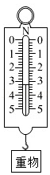

【答案】3.2，竖直向下，不变

【解析】​

## 11. （难度：适中）

如图甲所示，在水平公路上沿匀速直线行驶的太阳能汽车受到两对平衡力的作用，请在图乙上画出汽车受力的示意图。

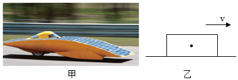

【答案】

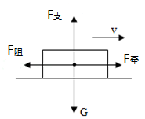  

【解析】​

## 12. （难度：简单）

如图所示，刻度尺静止在手指上，请画出刻度尺所受力的示意图。

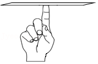

【答案】

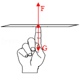   

【解析】​
